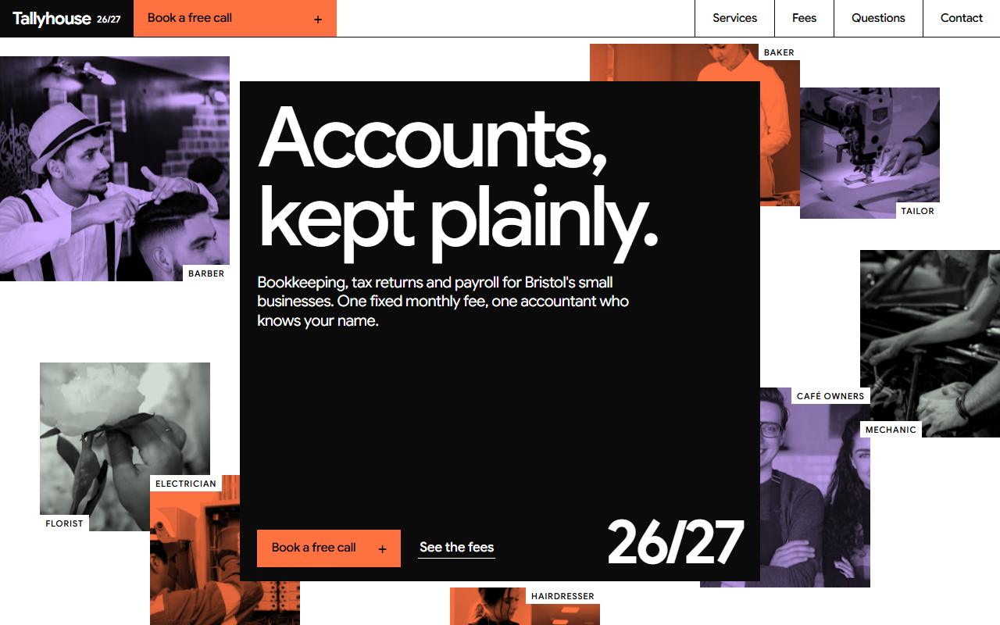
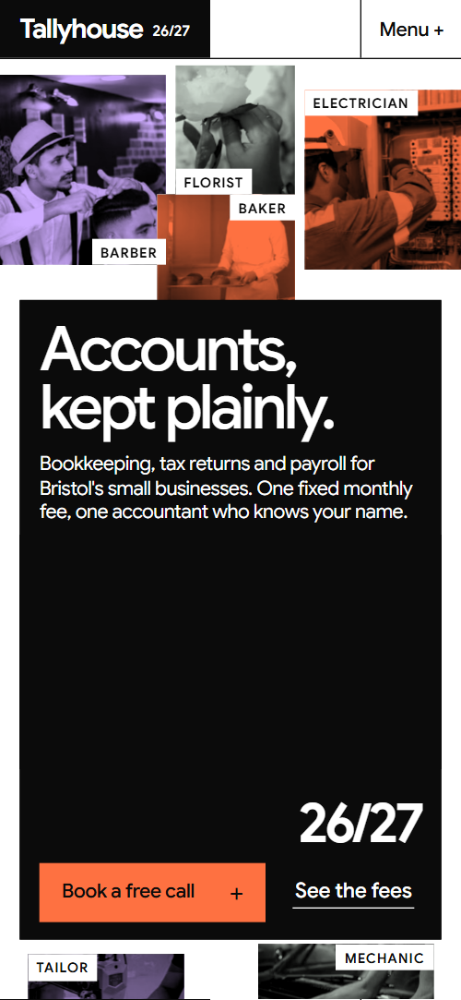
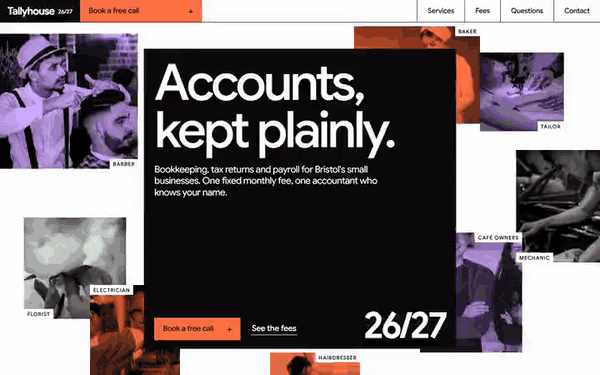

# Free HTML accountant website template with scroll animations and no libraries

Accountant website template: a one-page site for a practice that does bookkeeping, tax returns and payroll for small businesses, built from flat blocks of orange, lavender, sage and black with giant tight type. It has a sample monthly report, a twelve-month tax calendar, three fixed monthly plans and a booking form. Its scroll motion runs on CSS with no JavaScript libraries, in one file with an AGENTS.md for your AI agent.

[](LICENSE)  

**[Live demo](https://8bsite.github.io/accountant-website-template/)** · **[Use this template](https://github.com/new?template_name=accountant-website-template&template_owner=8bsite)** · **[Download ZIP](https://github.com/8bsite/accountant-website-template/archive/refs/heads/main.zip)** · **[Template page on 8b.com](https://8b.com/templates/tallyhouse/)**

<a href="https://8bsite.github.io/accountant-website-template/"></a> <a href="https://8bsite.github.io/accountant-website-template/"></a>

<p align="center"><a href="https://8bsite.github.io/accountant-website-template/"></a><br><sub>Scroll animation</sub></p>

## Use it with Claude Code, Cursor or Codex

Download the four files into your project folder (`curl.exe` in Windows PowerShell):

```bash
curl -LO https://raw.githubusercontent.com/8bsite/accountant-website-template/main/index.html
curl -LO https://raw.githubusercontent.com/8bsite/accountant-website-template/main/AGENTS.md
curl -LO https://raw.githubusercontent.com/8bsite/accountant-website-template/main/LICENSE
curl -LO https://raw.githubusercontent.com/8bsite/accountant-website-template/main/CREDITS.md
```

Then fill in the angle brackets and give your agent this prompt:

```text
Read AGENTS.md, then edit index.html. Turn it into the site for <my practice: name, town and office address, which of bookkeeping, tax returns and payroll I sell, my monthly plans with prices and what each includes, the day my report goes out, my country's tax year deadlines, my team and their qualifications, opening hours>. Replace prices, report figures and deadline chips first, with the data value inside every price and bar. Motion is CSS scroll-driven animation plus the inline kit: keep the gate script, section ids, data-8b attributes and the classes AGENTS.md lists; add no animation library. Never invent prices, dates, titles, licences, quotes, addresses or contacts; ask me.
```

Accountants web design turns on facts only the owner holds, so an agent in a vibe coding session with Claude Code, Cursor or Codex works in a fixed order. First the money: the three plan prices, whose block heights come from a data value in each price, and the twelve cash bars, which read theirs too. Then the 24 tax-year chips, which follow UK dates. Set the footer wordmark's --len to the new name's character count. The motion is CSS scroll-driven animation scoped to a data-8b-live flag plus a short inline kit, so new effects go in as CSS, never as a library. The agent asks for fees, deadlines, qualifications and client permission rather than inventing them.

No agent? Click **[Use this template](https://github.com/new?template_name=accountant-website-template&template_owner=8bsite)**, edit `index.html` on GitHub and turn on **Settings > Pages**.

## Sections and motion

- **Navigation**: top bar: wordmark with the year, section links, Book a free call button; phone menu overlay.
- **Accounts, kept plainly.**: first screen: a black cover square with headline and two buttons over a collage of eight tinted photos with captions (demo: the trades of the clients), then a black statement screen. Smooth wheel scrolling on desktop; rules draw in and highlights sweep over key words. On the held first screen the black cover spreads as eight photo tiles fly outward.
- **Your month, on one page.**: sample one-page report beside four numbered notes (demo: a bakery's September). Reading the four notes fills each note's number box black and moves a sage band to the matching part of the sample report.
- **Three jobs, done every month whether you remember or not.**: three full-width colour slabs, one per service, each with a big name, included list, button and a tinted photo. On large screens the colour slabs stack as you scroll, each pushing the last back while its photo resolves from coarse dots.
- **Switching takes one phone call.**: how to switch: a large photo, a heading with a highlight and three numbered steps. In view, the photo opens upward from a slight zoom and the heading's last words get an orange highlight.
- **The tax year, handled before it's due.**: pinned horizontal track of twelve months with colour-coded deadline chips (demo: UK tax year April to March). Pinned, the twelve months slide past a fixed orange line, and each deadline chip fills with colour as it crosses.
- **Three kinds of year, kept.**: three client quotes as split blocks: dark panel with portrait and name, colour panel with the quote. Each portrait opens upward from a slight zoom, and a white highlight sweeps over a phrase in every quote.
- **Four accountants. You will know one of them well.**: team of four: portraits, names and what each looks after. Tied to scroll, the four portraits start gathered and tilted towards the middle, then spread out into the grid.
- **Questions people ask before they switch.**: questions and answers on a sage ground (native &lt;details&gt;).
- **Fixed monthly fees. The height of each block is its price.**: three fixed monthly plans as colour blocks whose heights follow their prices. Tied to scroll, the three colour blocks rise from the baseline in turn, lifting their prices to their heights.
- **Book a free twenty minutes.**: office, phone, email and hours, plus a booking form in a black panel (placeholders).
- **Footer**: black footer: address and contacts, links, a giant year and a width-filling wordmark, copyright and the Design: 8B credit. As the footer scrolls in, the full-width wordmark settles into place and the giant 26/27 slides to the right.

## Design

 page background  
 text, cover, tax year, footer  
 orange slab, highlights, buttons  
 lavender report section, slab  
 sage questions section, slab  
 secondary text  
 muted text on black

**Google Sans**: all text: huge, tightly tracked medium headings; bold wordmark and year (Google Fonts). A twelve-column grid of hairline rules and flat colour that reads like an annual report. Headings are huge and tightly set, with highlighter marks on key words. Photos are greyscale, multiplied into orange, lavender or sage tints. Services are full-width colour slabs, and fees are blocks whose heights follow their prices.

## Questions

**Can I use it for a CPA firm in the US?**  
Yes, with a lot of editing. The structure carries over to CPA firm websites, but the calendar of UK deadlines, the pound-priced fee blocks and the lines on VAT and Making Tax Digital have to be replaced. Treat it as a CPA website template only after every date and rule has been checked against your own tax authority.

**Can I use it for a firm of chartered accountants?**  
Yes, once the wording is checked. Chartered is a regulated title, and the demo uses it twice: the team paragraph says all four accountants are chartered, and the footer line says chartered accountants for small businesses. Keep both only if they are true for your firm, and rewrite them otherwise.

**How do I change the tax-year calendar?**  
Edit the chips. Each of the twelve months holds two, with a date and a line of text, coloured by a key of three kinds: returns and accounts, VAT and quarterly updates, payroll and pensions. Replace the dates for your country and recheck them yearly. The held track takes about three screens of scroll on a desktop and four on a phone, so cutting months shortens it.

## Is it the right base?

Among website templates for accountants, pick this one when your accountant website has to show how a month with you works: a report, deadlines, switching steps and fixed fees. This is the light build, with the same look and the same scroll behaviour and no script from a CDN: about 30 KB of code gzipped in one file, where the GSAP version needs about 75 KB and three more requests. For a stricter look, the [black-on-white](https://8b.com/templates/evenkeel/) accountants template is closer. The weak spot is the demo's content: pounds, VAT, HMRC letters and Making Tax Digital run through it, so a firm abroad has real rewriting to do.

## Before you publish

- Replace what is marked `data-8b-placeholder` (social preview image, favicon, phone, email, form) and the invented demo facts; [AGENTS.md](AGENTS.md) lists them.
- The form sends nothing yet: connect it to Formspree or Netlify Forms, or remove it.

## Tech

No JavaScript libraries: CSS scroll-driven animations and a small inline motion script with its own smooth wheel scrolling, 122 KB, no build step. Chrome and Edge 111+, Safari 16.2+, Firefox 113+ (it uses color-mix(), cascade layers, small/dynamic viewport units). Without scroll-driven animations (Firefox today) the scroll motion and the smooth wheel are off and each section shows its finished layout, while any load-in or looping animation still plays; with "reduce motion" on, the page is complete and nothing moves on its own (hover effects stay).

A GSAP build of the same page is [`index.gsap.html`](index.gsap.html): GSAP 3.13.0, ScrollTrigger, Lenis 1.3.27 from jsDelivr, 113 KB; its scroll motion also plays in Firefox. Use one of the two files.

## License

MIT, see [LICENSE](LICENSE). Photos, fonts and libraries keep their own licences: [CREDITS.md](CREDITS.md). More free templates: [8b.com/templates](https://8b.com/templates/) · [github.com/8bsite](https://github.com/8bsite).
