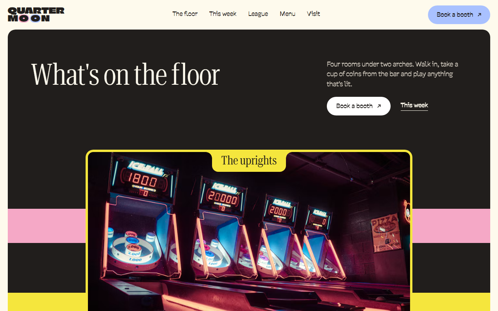
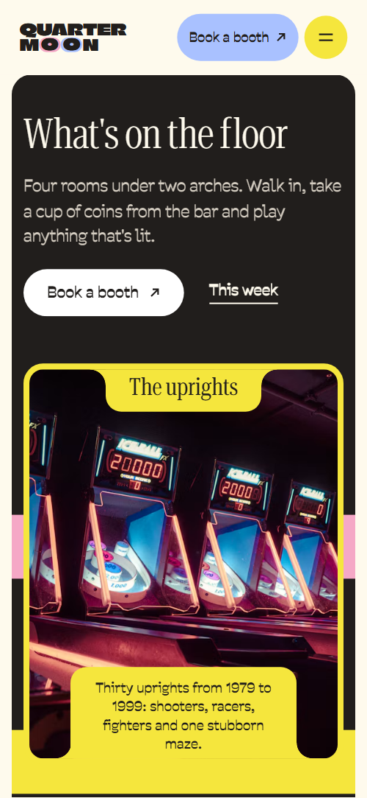

# Free HTML arcade bar website template with GSAP scroll animations

Arcade bar website template: one free HTML file for a bar or game venue that runs league nights and private hire. It has a room tour, a week of events, a high-score board, prices, a drinks menu and a booking form, in cream and charcoal with pink, blue and yellow photo frames. AGENTS.md is included for Claude Code or Cursor.

[](LICENSE)  

**[Live demo](https://8bsite.github.io/arcade-bar-website-template/)** · **[Use this template](https://github.com/new?template_name=arcade-bar-website-template&template_owner=8bsite)** · **[Download ZIP](https://github.com/8bsite/arcade-bar-website-template/archive/refs/heads/main.zip)** · **[Template page on 8b.com](https://8b.com/templates/quarter-moon/)**

<a href="https://8bsite.github.io/arcade-bar-website-template/"></a> <a href="https://8bsite.github.io/arcade-bar-website-template/"></a>

<p align="center"><a href="https://8bsite.github.io/arcade-bar-website-template/"></a><br><sub>Scroll animation</sub></p>

## Use it with Claude Code, Cursor or Codex

Download the four files into your project folder (`curl.exe` in Windows PowerShell):

```bash
curl -LO https://raw.githubusercontent.com/8bsite/arcade-bar-website-template/main/index.html
curl -LO https://raw.githubusercontent.com/8bsite/arcade-bar-website-template/main/AGENTS.md
curl -LO https://raw.githubusercontent.com/8bsite/arcade-bar-website-template/main/LICENSE
curl -LO https://raw.githubusercontent.com/8bsite/arcade-bar-website-template/main/CREDITS.md
```

Then fill in the angle brackets and give your agent this prompt:

```text
Read AGENTS.md, then edit index.html. Make this the site for <my venue: name, address, machines, weekly events and league rules, prices, private hire options, menu, hours, owners' names, how people book>. Replace first the venue name everywhere, the owners' story, the league board, prices, menu, hours and photos. Keep the section ids, the classes AGENTS.md lists and the board rows in rank order, and set the footer wordmark's --len to the new name's length. Ask me for any missing fact; never invent prices, hours, scores, reviews, addresses or contacts.
```

Give Claude Code, Cursor or Codex the facts only the venue has: hours, machine counts, league rules, coin and hire prices, menu, address and the owners' names. The demo invents all of them, along with the board's scores and the three reviews. The agent should replace the venue name everywhere, set the footer wordmark's --len to the new name's length and point the Book buttons at your booking page. A one-file page suits [vibe coding in Claude Code](https://8b.com/templates/for-claude-code/).

No agent? Click **[Use this template](https://github.com/new?template_name=arcade-bar-website-template&template_owner=8bsite)**, edit `index.html` on GitHub and turn on **Settings > Pages**.

## Sections and motion

- **Navigation**: chunky two-colour wordmark, five links, a Book a booth button and a menu button that opens a full-screen overlay. The bar hides when you scroll down past 120px and returns on scroll up, with or without reduced motion; the menu button opens a full-screen overlay.
- **What's on the floor**: dark rounded panel with the h1, a short intro, two actions and four framed room cards that stack as you scroll. The heading, intro and buttons rise in on load; the four photo cards then stick one under another, each shrinking to 90% and dimming as the next covers it, while three coloured bands drift sideways behind.
- **This week under the arches**: a featured event card with a Tonight tab and three dated event rows with thumbnails. The Tonight tab drops out of the card edge and the three event rows slide in from alternating sides as they arrive.
- **We're Ailsa and Dev. We fixed our first cabinet on a kitchen table in Partick.**: tall portrait in a yellow frame, the owners' story in a blue panel, social links and three loose prints. The portrait eases from a 1.24 times zoom to its frame while three small prints, piled in the middle, fan out to their tilted places.
- **Your initials on the board by Sunday**: copy and a join button beside a six-row high-score board that sorts itself into rank order. As the board crosses the screen the champion row climbs past each row from the bottom until all six stand in rank order and the first row turns yellow.
- **Quote**: black-and-white photo of friends in a dark frame with the house rule laid over it. The tab drops in and the quote and its signature slide in from opposite sides.
- **Three ways to play**: pink wall of repeated Insert coin rows around a dark card with three ways to play. The four Insert coin rows drift in opposite directions as the section crosses the screen and rest briefly in the middle; the card title tab drops in.
- **Have the arches to yourselves**: three hire options with prices beside a framed party photo. The three hire rows slide in from alternating sides and the photo tab drops in.
- **Behind the long bar**: six drinks and plates as framed cards in one row that travels sideways while the section holds. The section holds the screen while the six cards slide left by the full length of their overflow; without the script or with reduced motion it is a native sideways scroller.
- **What the regulars say**: three regulars' reviews whose words light up as they rise. Each quote fades in word by word as it rises, and the signatures slide in.
- **Find the green-lit arches**: address, opening hours, phone and email beside a photo, and a booth booking form. The tab on the photo drops in on arrival.
- **Footer**: big wordmark, email sign-up with a photo, a dark card with a blurb, three link columns and the base line. The two O discs of the wordmark roll in from beyond the right edge and settle into place as the wordmark scrolls into view.

## Design

 page and bar ground, text on charcoal blocks, button text on charcoal buttons, form field ground  
 text, the first-screen panel, league board, ways-to-play card, footer card, main buttons, charcoal photo frames, focus outline  
 pink photo frames, the Insert coin wall, the league badge, the first O disc, button hover fills, event row hover  
 blue photo frames, the menu overlay, the owners' panel, the visit info panel, the newsletter block, the Book a booth button in the bar, the second O disc  
 yellow photo frames, the menu button, the champion row, prices on the dark card, focus outline on dark blocks  
 secondary text: intros, small labels, game names, the booking form's status line  
 secondary text on charcoal: the first-screen intro, option text, the board note, footer headings and base line  
 white photo frames, event rows, board rows, the booking form, the newsletter input, small prints, secondary buttons

**Climate Crisis**: the wordmark in the bar and the footer: one heavy weight, all capitals, tight line height. **Roboto Serif**: headings, tab titles, board initials and scores, quotes: weight 300 for large headings and quotes, 400 for tab titles and smaller headings, in a condensed width. **Savate**: body text, labels, form fields, buttons and links: 400 for text, 500 for small labels, 600 for buttons (Google Fonts). A cream page of large rounded blocks: a charcoal panel opens it, then pink, blue, white or charcoal blocks with 20px corners hold the board, prices and owners. Most photos sit in 6px frames in pink, yellow, blue, white or charcoal, with title tabs notched into the frame edge. Sections alternate two-column splits with full-width rows. A sticky bar carries the wordmark, links and a Book a booth button; below 900px a menu button opens a blue overlay.

## Questions

**Does it work as an arcade game website template for a venue without a bar?**  
Yes, after a text pass. Bowling, escape rooms, mini golf and pinball halls reuse the events, league board, ways to play, hire and booking sections of its [single-scroll layout](https://8b.com/templates/one-page/). With no bar, delete the drinks menu section, its menu-track script block and the three Menu links, in the header, the phone overlay and the footer.

**Does the booking form send bookings?**  
No. As shipped, the booth form and the newsletter form check their fields, show a thank-you or error line and send nothing. Connect them to Formspree or Netlify Forms, or point the Book a booth buttons at your own booking page or ticketing link.

**Can I get a site like this without editing code?**  
Yes. [8B's AI website builder](https://8b.com/) designs a new site from a one-sentence description; it is its own design, not this template. Designing and restyling are free; publishing with hosting and SSL, full HTML export and AI edits in chat are on Pro at $9 a month billed yearly. It also runs inside Claude and ChatGPT.

## Is it the right base?

It fits a venue that sells a night out: events, a league, hire and a short menu. A cafe built around a library of board games is better served by [a layout made for game shelves](https://8b.com/templates/quarter-turn/), and a venue that sells tickets by the time slot needs a real booking tool. The weak spot is length: the room tour and the sideways menu both take a long scroll on a short phone. Without a coding agent, 8B's builder is the no-code route.

## Before you publish

- Replace what is marked `data-8b-placeholder` (social preview image, favicon, social, phone, email, form) and the invented demo facts; [AGENTS.md](AGENTS.md) lists them.
- The form sends nothing yet: connect it to Formspree or Netlify Forms, or remove it.

## Tech

GSAP 3.13.0, ScrollTrigger, SplitText, Lenis 1.3.27 from jsDelivr, 93 KB, no build step. Chrome and Edge 111+, Safari 16.2+, Firefox 113+ (it uses color-mix(), cascade layers, small/dynamic viewport units). With "reduce motion" on, the page is complete and still.

## License

MIT, see [LICENSE](LICENSE). Photos, fonts and libraries keep their own licences: [CREDITS.md](CREDITS.md). More free templates: [8b.com/templates](https://8b.com/templates/) · [github.com/8bsite](https://github.com/8bsite).
