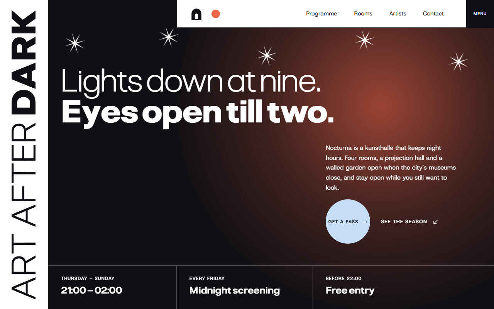
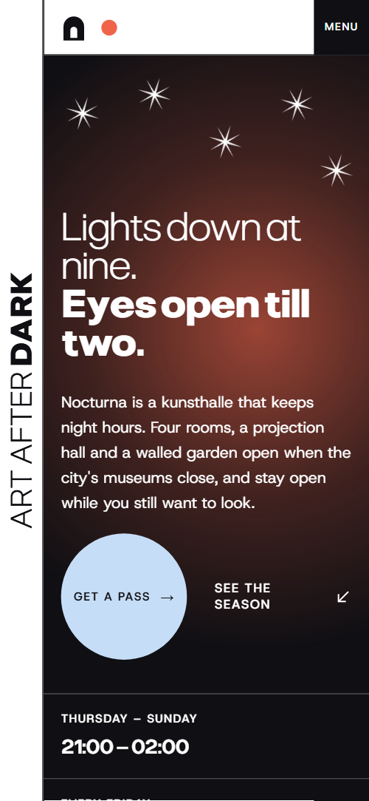
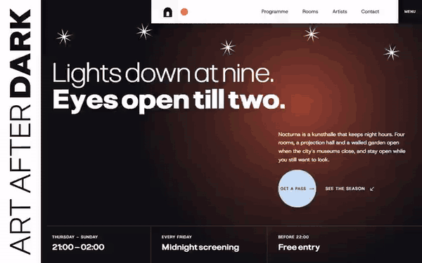

# Free HTML art gallery website template with scroll animations and no libraries

This art gallery website template is a free HTML file for a gallery, kunsthalle or museum that opens late: a six-night programme, four rooms, five artists, a screening, passes and a visit form. White ruled cells meet dark night screens and a coral glow. Its scroll motion runs on CSS with no libraries, in about 27 KB of code gzipped.

[](LICENSE)  

**[Live demo](https://8bsite.github.io/art-gallery-website-template/)** · **[Use this template](https://github.com/new?template_name=art-gallery-website-template&template_owner=8bsite)** · **[Download ZIP](https://github.com/8bsite/art-gallery-website-template/archive/refs/heads/main.zip)** · **[Template page on 8b.com](https://8b.com/templates/nocturna/)**

<a href="https://8bsite.github.io/art-gallery-website-template/"></a> <a href="https://8bsite.github.io/art-gallery-website-template/"></a>

<p align="center"><a href="https://8bsite.github.io/art-gallery-website-template/"></a><br><sub>Scroll animation</sub></p>

## Use it with Claude Code, Cursor or Codex

Download the four files into your project folder (`curl.exe` in Windows PowerShell):

```bash
curl -LO https://raw.githubusercontent.com/8bsite/art-gallery-website-template/main/index.html
curl -LO https://raw.githubusercontent.com/8bsite/art-gallery-website-template/main/AGENTS.md
curl -LO https://raw.githubusercontent.com/8bsite/art-gallery-website-template/main/LICENSE
curl -LO https://raw.githubusercontent.com/8bsite/art-gallery-website-template/main/CREDITS.md
```

Then fill in the angle brackets and give your agent this prompt:

```text
Read AGENTS.md, then edit index.html. Make this the site for <my venue: name, address, hours, rooms, dated events, artists, screening, pass prices>. Replace the name, hours, six programme rows, five artists, prices and the Rotterdam address first. Keep the gate script in the head, the ids, the data-8b-section and data-8b-motion attributes and the classes AGENTS.md lists, and add no animation library. Reset each --len; keep four rooms, six programme photos, eight relay cities and three pass cards. Never invent dates, prices, artists or contacts; ask me.
```

As an art gallery website template for Claude Code, Cursor or Codex, it adapts by vibe coding in a few passes. Start with the name, hours, address and the six programme rows, then the four rooms, five artists and the screening. Ask the owner for every date, price, artist name, film title and house rule; the demo invents all of them. Leave the gate script, the ids and the classes and data-8b attributes AGENTS.md lists alone, and reset each --len when its text changes.

No agent? Click **[Use this template](https://github.com/new?template_name=art-gallery-website-template&template_owner=8bsite)**, edit `index.html` on GitHub and turn on **Settings > Pages**.

## Sections and motion

- **Navigation**: white top bar over the right two thirds: arch logo, coral dot, four links, Menu button; Menu opens a dark overlay with seven links; the bar hides on scroll down. The bar hides when you scroll down past half a screen and returns on scroll up; Menu opens a dark overlay of seven links.
- **Lights down at nine. Eyes open till two.**: dark screen with the heading "Lights down at nine. Eyes open till two.", intro, Get a pass button, See the season link, three fact cells and five stars. Smooth wheel scrolling throughout; on load the heading lines, text and three fact cells rise in one after another, while the glow breathes and the five stars turn slowly, pausing off screen.
- **Six nights to stay up for**: ledger of six nights with dates, titles, formats and rooms, beside a sticky arch window that shows a photo per night. As each row reaches the reading line its photo rises into the arch over the previous one, and on desktop a coral dot slides down the rule to that row.
- **Four rooms, one long night**: dark stage with the heading "Four rooms, one long night", a Plan a visit button and a plan of four rooms that a coral lamp walks through. Pinned: each room starts under a dark veil, a coral lamp travels from room to room, and each veil lifts as the lamp arrives.
- **Five artists who work at night**: five resident artists as huge two-weight names with a role line and an arch portrait each. As each row crosses the screen the light first name thickens while the heavy surname thins, they trade back, and the portrait slides along the row.
- **Head lights**: 3x3 ruled credits grid with a film still in the middle that opens to the full screen. Pinned: the still opens from the middle cell to the full screen, the other cells slide off the edges and the title travels down onto the picture.
- **One film, eight midnights**: one row of eight city cells in midnight order that a coral line sweeps across, each turning dark. A coral line sweeps across the row of cities, and each cell fills with night as the line passes.
- **Close your eyes**: light-blue section: one featured note in a big arch, two short notes with round photos, a row of five stars. The heading rises, the arch photo opens upward, the two notes draw their hairlines and the five stars turn with scroll.
- **One evening, or every one**: three passes with price, three included items and a button each: One Night, Night Pass, Patron. The three cards start stacked and slightly turned, then fan out into a row as you scroll.
- **Questions for the night**: vertical rail "Before you come", an intro with three stars and five questions that open and close. A hairline draws in below each question and the three stars turn with scroll.
- **Come late. Stay later.**: four info cells, the heading "Come late. Stay later." and a form with name, email and question, over a light-blue dawn disc. A large light-blue disc rises from below and grows behind the heading and form as you scroll.
- **Footer**: dark footer with the wordmark filling the width and four ruled columns.

## Design

 page ground of the light sections, text on the dark screens and footer, the Buy a ticket card  
 text and hairlines on light sections, the dark night screens, the footer and filled buttons  
 the light-blue journal section, the dawn disc behind the contact form, the round Get a pass button and the Patron card  
 coral accent: the glow, the dot, the room lamp, the relay line, button hover fills and the Night Pass card  
 secondary body text and captions on light sections  
 small secondary text on the dark screens, the menu overlay and the footer: room captions, the screening synopsis, the footer columns

**Pliant**: headings and the vertical rails, a variable font from weight 200 to 900 that pairs a light line with a heavy one; card and cell titles at weight 600. **Host Grotesk**: body text, labels, form fields and buttons, in weights 400 to 600; labels and buttons are small uppercase with wide spacing (Google Fonts). A hairline grid divides each section. On a desktop a left column about a third wide holds the label, with the content to its right; the opening and FAQ add a narrow rail of rotated type. Sections mostly alternate white and near black, with one light-blue journal. The programme, artists and passes read as ruled rows or cards, the screening is a three by three credits grid around the still, and the relay is a row of eight cells.

## Questions

**Can a museum or a daytime gallery use it?**  
Yes, after a text pass. A museum website design can keep the rooms, programme and passes, but the demo copy is built around night hours: nine to two, free entry before 22:00 and a Friday midnight screening. Replace those, or remove the screening and relay sections with their motion styles and script, and repoint the links to #screening.

**Where does the visit form send its messages?**  
Nowhere yet. The form needs a name, an email and a question, then shows a thank-you line and clears itself without sending anything. Connect Formspree or Netlify Forms with the steps in AGENTS.md, or replace the form with a link, and rewrite the thank-you line.

**Does the motion work in every browser and with reduced motion?**  
The gate script in the head turns the scroll motion on only where scroll-driven animations exist and reduced motion is off. Elsewhere, Firefox today, the page shows its finished layout with plain scrolling: no pinned sections, all rooms lit, the still in its middle cell. In Firefox the opening glow and stars still move; with reduced motion they stay still.

## Is it the right base?

This is the right base when a venue keeps late hours, runs dated events and sells passes. It is the light build: the same look and scroll behaviour, with no animation library and no script from a CDN. Measured here, it downloads about 27 KB of code gzipped in one file; the GSAP version needs about 72 KB and three extra requests. A venue built around one dated event fits [a template made for events](https://8b.com/templates/ondo/) better.

## Before you publish

- Replace what is marked `data-8b-placeholder` (social preview image, favicon, email, phone, form, social) and the invented demo facts; [AGENTS.md](AGENTS.md) lists them.
- The form sends nothing yet: connect it to Formspree or Netlify Forms, or remove it.

## Tech

No JavaScript libraries: CSS scroll-driven animations and a small inline motion script with its own smooth wheel scrolling, 116 KB, no build step. Chrome and Edge 111+, Safari 16.2+, Firefox 121+ (it uses color-mix(), :has(), cascade layers, small/dynamic viewport units). Without scroll-driven animations (Firefox today) the scroll motion and the smooth wheel are off and each section shows its finished layout (a load-in or a loop may still play); with "reduce motion" on, the page is complete and nothing moves on its own (hover effects stay).

A GSAP build of the same page is [`index.gsap.html`](index.gsap.html): GSAP 3.13.0, ScrollTrigger, Lenis 1.3.27 from jsDelivr, 105 KB; its scroll motion also plays in Firefox. Use one of the two files.

## License

MIT, see [LICENSE](LICENSE). Photos, fonts and libraries keep their own licences: [CREDITS.md](CREDITS.md). More free templates: [8b.com/templates](https://8b.com/templates/) · [github.com/8bsite](https://github.com/8bsite).
