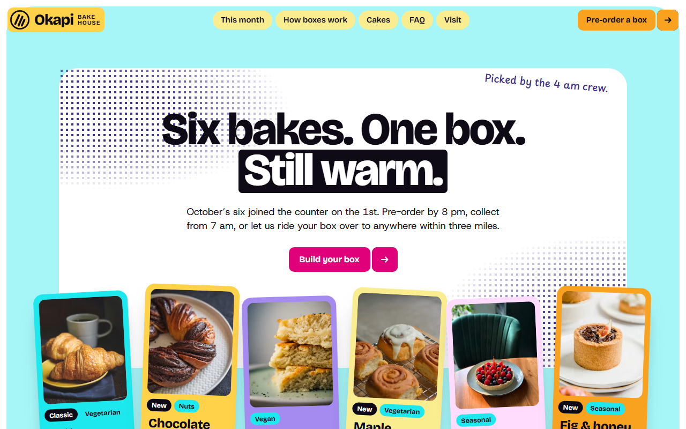
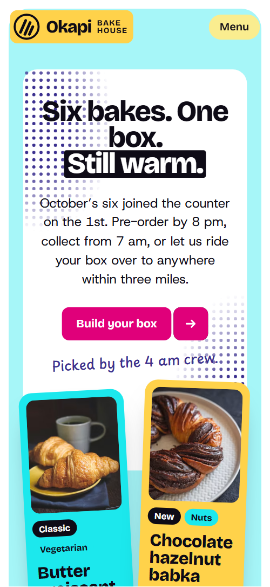
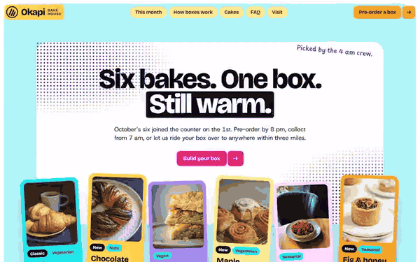

# Free HTML bakery website template with scroll animations and no libraries

Bakery website template: one free HTML file for a neighbourhood bakery or coffee counter that sells a monthly box of six bakes by pre-order, with cakes, office platters and gift cards. Bright yellow, pink and violet cards with handwritten notes sit on a white page, and the scroll motion runs on CSS with no JavaScript library.

[](LICENSE)  

**[Live demo](https://8bsite.github.io/bakery-website-template/)** · **[Use this template](https://github.com/new?template_name=bakery-website-template&template_owner=8bsite)** · **[Download ZIP](https://github.com/8bsite/bakery-website-template/archive/refs/heads/main.zip)** · **[Template page on 8b.com](https://8b.com/templates/okapi/)**

<a href="https://8bsite.github.io/bakery-website-template/"></a> <a href="https://8bsite.github.io/bakery-website-template/"></a>

<p align="center"><a href="https://8bsite.github.io/bakery-website-template/"></a><br><sub>Scroll animation</sub></p>

## Use it with Claude Code, Cursor or Codex

Download the four files into your project folder (`curl.exe` in Windows PowerShell):

```bash
curl -LO https://raw.githubusercontent.com/8bsite/bakery-website-template/main/index.html
curl -LO https://raw.githubusercontent.com/8bsite/bakery-website-template/main/AGENTS.md
curl -LO https://raw.githubusercontent.com/8bsite/bakery-website-template/main/LICENSE
curl -LO https://raw.githubusercontent.com/8bsite/bakery-website-template/main/CREDITS.md
```

Then fill in the angle brackets and give your agent this prompt:

```text
Read AGENTS.md, then edit index.html. Make this the site for <my bakery: name, address, this month's six bakes with prices and diet tags, pre-order cutoff, collection time, delivery radius, cake and platter prices and notice, hours, phone, email, how people order>. Motion is CSS scroll-driven animation plus the inline motion kit: keep the gate script in the head, the data-8b-section, data-8b-motion and data-8b-items attributes, four step cards and two review ribbons; add no animation library. Ask me for missing facts; never invent prices, allergy claims, reviews or contacts.
```

Start with the six cards in the first block and the ten lines of the morning list, then the prices, the pre-order cutoff, the delivery radius and the allergy answer. All of it is demo text, so the agent must ask the owner for it, and for hours, address, phone, the crew story and the quotes. Keep the section ids, the classes AGENTS.md lists for [its scroll-driven lettering](https://8b.com/templates/animated/), and set the footer wordmark's --len to the new name's length.

No agent? Click **[Use this template](https://github.com/new?template_name=bakery-website-template&template_owner=8bsite)**, edit `index.html` on GitHub and turn on **Settings > Pages**.

## Sections and motion

- **Navigation**: fixed top bar: logo and wordmark on a yellow tab, five pill links, a Pre-order a box button; hides on scroll down; phone menu overlay.
- **Six bakes. One box. Still warm.**: first screen: pale cyan panel with the headline "Six bakes. One box. Still warm.", an intro, a Build your box button and a tray of six bake cards with prices. On load the heading, text, button and note rise in one after another, and the six bake cards jump up from below in turn, then rest tilted; the mouse wheel scrolls smoothly throughout.
- **Out of the oven by 7**: magenta panel with the heading "Out of the oven by 7", a handwritten note and a list of ten bakes in huge type. The line nearest the middle of the screen is full width, heavy and dark while the others narrow, thin and fade to pale pink as you scroll.
- **Pre-order tonight, collect it warm**: pale pink panel: heading "Pre-order tonight, collect it warm", a Start a box button and four step cards in a tilted fan. The four step cards start stacked and are dealt out to their tilted places as the section scrolls; on phones they slide in from alternating sides.
- **Bake of the year**: four winners of the yearly vote as photo cards with year stickers: 2025, 2024, 2023, 2022. Each photo card drops in with an overshoot and each year sticker stamps on, turned and large.
- **Who’s up at 4 am?**: section whose ground goes from night to sunflower yellow as you scroll, with a rising sun and four timed entries from 4:00 am to 7:00 am. The section ground runs from midnight blue through violet and orange to sunflower yellow while the sun disc climbs and grows with your scroll.
- **Why Okapi?**: six reasons as stickers around a round turning mark with the curved text "Why Okapi? · Why Okapi? · ...". The six stickers scatter from behind the round mark to their places as the section arrives, and the ring of text turns with the scroll.
- **What the regulars say**: two tilted ribbons of customer quotes, three on each, running as continuous rows. Two tilted ribbons of quotes open like scissors as you scroll, and each row runs as a loop that pauses off screen and on hover.
- **Cakes that make the room go quiet**: pink frame around a celebration cake card with two quotes and an office platter photo. The pink field widens from the cake card to the whole frame while the quotes and the platter photo slide out from behind it.
- **Fair questions**: four questions as native details elements under a heading and a handwritten note. The heading pops in and the note writes itself in.
- **Give someone a better morning**: gift card section: heading, text, a Buy a gift card button and a gift card sliding out of a sleeve. The gift card slides up out of its sleeve and turns to its resting tilt while the photo drifts up behind it.
- **Come by, or just ask**: visit block with address, opening hours, phone, email and a counter photo beside an order form. The heading pops in and the counter photo tumbles into place.
- **Footer**: footer: large wordmark, a short line, an email list form, six links, three round icons and a copyright line with the Design: 8B credit. The large wordmark pops in.

## Design

 page background, photo frames, form fields, white chips and cards, and the text in the violet footer  
 body text, button lids, dark badges and field borders  
 the bake of the year panel, the logo tab in the nav and yellow cards  
 pale yellow card ground, photo frames in the bake of the year and the ground of the stickers section  
 orange starbursts, the small button label and some stickers  
 the main button label, the favicon and the times in the morning shift cards  
 the oven list panel, the phone menu overlay and the striped box band  
 the cyan panel of the opening screen  
 link underlines and fills, badges, one tray card, the gift section ground and the second review ribbon  
 the pre-order steps panel, the pink fill of the cake frame and the pale pink the oven list fades toward  
 the footer ground, most handwritten notes, the dot print and striped bands  
 dark wine text and ring on the sticker section and the second review ribbon  
 lavender cards in the tray, the steps fan and the stickers  
 the midnight ground at the start of the morning shift section

**Bricolage Grotesque**: headings and the wordmark in heavy 800 weight, buttons and badges in 700. **Host Grotesk**: body text at 17 px regular, form fields and card lines. **Playpen Sans**: the handwritten notes beside headings (mostly violet), the step labels, reviewer names and the two cake quotes, at 500 weight (Google Fonts). A white page of rounded colour panels stacked in a column, each on its own ground: cyan, magenta, pale pink, yellow, midnight blue. Cards sit in trays and fans, tilted a few degrees, with framed photos. Starburst stickers carry years and notices, and handwritten violet notes sit beside headings. Buttons are a coloured label beside a lid tab whose cover flips open on hover to show a dark face. The headings are very large and heavy.

## Questions

**Can a cafe use it as a coffee shop website template?**  
Yes, with edits. The morning list ends with strong coffee and one sticker mentions coffee, but the file has no drinks menu section. Replace the six bake cards with your pastries or drinks, and ask the agent to remove the cake and gift sections with their scripts if you do not sell them.

**Where do the order form and the email list send their data?**  
Nowhere yet. Both forms check the required fields, show a thank-you line and clear themselves, so a customer would think the order went through. Connect Formspree or Netlify Forms with the steps in AGENTS.md, or point the buttons at your own ordering page.

**Can I get a bakery site like this without editing code?**  
Yes, with [8B's AI website builder](https://8b.com/). You describe the bakery in a sentence and its engine designs a new site, its own design, not this template. Designing and restyling are free; publishing with hosting, full HTML export and AI edits in chat are on Pro at $9 a month billed yearly. It also runs inside Claude and ChatGPT.

## Is it the right base?

It is a good bakery website template for Claude Code when a bakery sells by pre-order and wants a loud, friendly look. This build looks and moves the same with no animation library and no script from a CDN: about 32 KB of code gzipped, against 79 KB and four more requests for the GSAP version. A place that needs table booking and a seated menu fits the [restaurant](https://8b.com/templates/ombrelle/) template better. Ordering is the weak spot: there is no basket or payment step.

## Before you publish

- Replace what is marked `data-8b-placeholder` (social preview image, favicon, phone, email, form, social) and the invented demo facts; [AGENTS.md](AGENTS.md) lists them.
- The form sends nothing yet: connect it to Formspree or Netlify Forms, or remove it.

## Tech

No JavaScript libraries: CSS scroll-driven animations and a small inline motion script with its own smooth wheel scrolling, 121 KB, no build step. Chrome and Edge 111+, Safari 16.2+, Firefox 113+ (it uses color-mix(), cascade layers, small/dynamic viewport units). Without scroll-driven animations (Firefox today) the scroll motion and the smooth wheel are off and each section shows its finished layout (a load-in or a loop may still play); with "reduce motion" on, the page is complete and nothing moves on its own (hover effects stay).

A GSAP build of the same page is [`index.gsap.html`](index.gsap.html): GSAP 3.13.0, ScrollTrigger, SplitText, Lenis 1.3.27 from jsDelivr, 110 KB; its scroll motion also plays in Firefox. Use one of the two files.

## License

MIT, see [LICENSE](LICENSE). Photos, fonts and libraries keep their own licences: [CREDITS.md](CREDITS.md). More free templates: [8b.com/templates](https://8b.com/templates/) · [github.com/8bsite](https://github.com/8bsite).
