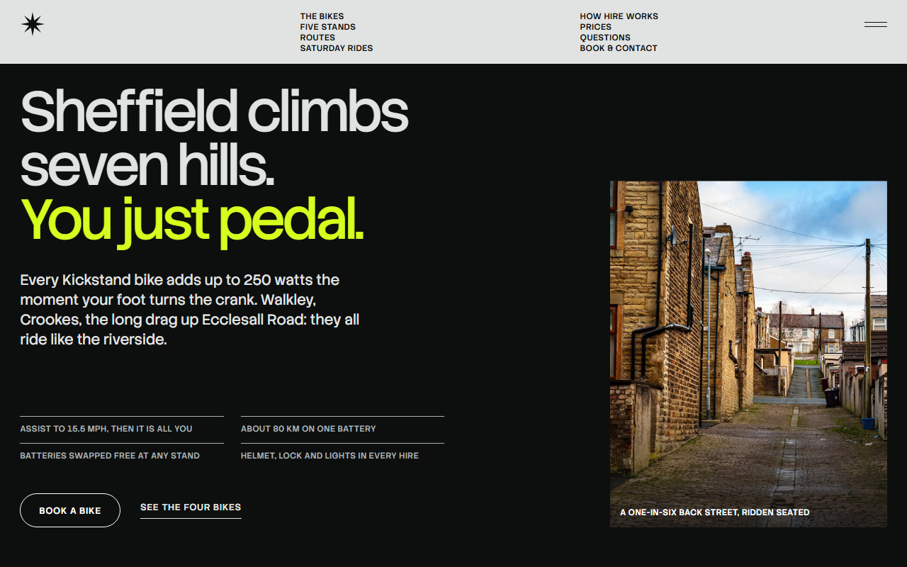
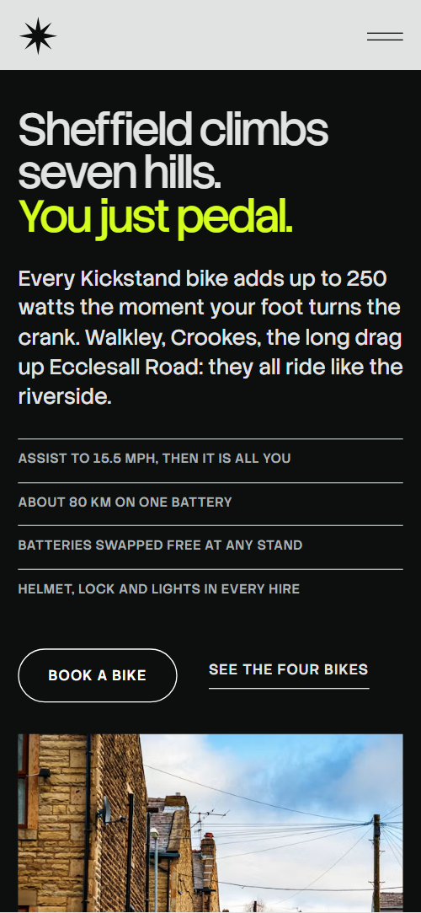
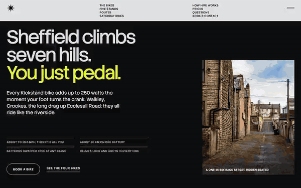

# Free HTML bike rental website template with GSAP scroll animations

Bike rental website template: one free HTML file for an e-bike or bike hire business with several pick-up stands, guided rides and prices by the hour, day and week. Near black and pale grey with one acid-lime accent, tight sans type and double rules that draw across the page. AGENTS.md is included for Claude Code, Cursor or Codex.

[](LICENSE)  

**[Live demo](https://8bsite.github.io/bike-rental-website-template/)** · **[Use this template](https://github.com/new?template_name=bike-rental-website-template&template_owner=8bsite)** · **[Download ZIP](https://github.com/8bsite/bike-rental-website-template/archive/refs/heads/main.zip)** · **[Template page on 8b.com](https://8b.com/templates/kickstand/)**

<a href="https://8bsite.github.io/bike-rental-website-template/"></a> <a href="https://8bsite.github.io/bike-rental-website-template/"></a>

<p align="center"><a href="https://8bsite.github.io/bike-rental-website-template/"></a><br><sub>Scroll animation</sub></p>

## Use it with Claude Code, Cursor or Codex

Download the four files into your project folder (`curl.exe` in Windows PowerShell):

```bash
curl -LO https://raw.githubusercontent.com/8bsite/bike-rental-website-template/main/index.html
curl -LO https://raw.githubusercontent.com/8bsite/bike-rental-website-template/main/AGENTS.md
curl -LO https://raw.githubusercontent.com/8bsite/bike-rental-website-template/main/LICENSE
curl -LO https://raw.githubusercontent.com/8bsite/bike-rental-website-template/main/CREDITS.md
```

Then fill in the angle brackets and give your agent this prompt:

```text
Read AGENTS.md, then edit index.html. Make this the site for <my hire business: name, town, bikes and prices, stands with addresses and hours, routes, hire terms, deposit, excess, phone, email, legal name>. Replace first the bike specs, the five stands, the four routes, the prices and the Saturday dates. If the number of stands changes, edit the letters A to E by hand too. Keep the section ids and the classes AGENTS.md lists. Ask me for missing facts and never invent prices, hours, addresses, reviews or contacts.
```

Vibe coding with Claude Code, Cursor or Codex goes fastest when you give the agent the facts only the business has: bike specs and prices, stand addresses and hours, route distances, deposit, excess and hire terms. The demo invents all of them, along with the Sheffield places, the riders' quotes and the Saturday dates. Change the bike articles with the bike options and price rows, the five stand rows with the collect-from options, and edit the letters A to E by hand when the stand count changes.

No agent? Click **[Use this template](https://github.com/new?template_name=bike-rental-website-template&template_owner=8bsite)**, edit `index.html` on GitHub and turn on **Settings > Pages**.

## Sections and motion

- **Navigation**: round starburst logo, eight links in two columns and a menu button that opens a full-screen overlay. Smooth scrolling runs page-wide; the bar slides out of view as you scroll down and returns as you scroll up.
- **Sheffield climbs seven hills. You just pedal.**: dark first screen: a three-line h1 stepping in like stairs, a lead, four facts, a booking button and a street photo. On load the three heading lines step in like stairs, the street photo levels from a slanted upper edge, and the lead, facts and buttons rise in.
- **Four bikes, one push**: held stage that steps through four bikes: the next photo wipes in from the right while the name tabs and text change. Pinned for about two and a third screens of scrolling: each next bike's photo wipes in from the right, the text swaps, and a marker slides along a strip of bike names that the script builds.
- **Five stands, one line**: dark band with a night photo and a line of letters A to E over it, then five stand rows. Each stand row rises into place as it enters; the line of letters over the night photo stays still.
- **Four rides from the stands**: four ride panels that slide sideways past a held stage while a lime line fills and a disc rolls along it. Pinned for as many pixels as the row overflows: the four ride panels slide sideways while a lime line fills and a round marker rolls along it.
- **Three steps to a ride**: dark band with three numbered booking steps joined by a filling lime line. A lime line fills across the three steps (down them on a phone) as they scroll into view, and each step comes up from dim with its number sliding in from the left.
- **In every basket**: photo and a list of six things included with every hire. The photo and the six kit items rise in as they enter.
- **Saturday rides**: dark band: a group-ride photo opens from a slit while the two words of the heading part, then a date list and a join button. The group photo opens from a central slit to full width while the two words of the heading part toward the edges.
- **Prices**: price table of four bikes by hour, half day, day and week, and a monthly pass card. The price table and the monthly pass card rise in once.
- **Riders**: three rider quotes that ride in from alternate sides into one ruled column. The three quotes slide in from alternating sides as the list scrolls into view.
- **Questions**: five questions and answers (native details). Each question rises in; opening one turns its plus sign 45 degrees into a cross.
- **Book a bike**: address, phone, e-mail and hours beside a booking form, over a night photo with a scattered stand line. The night photo settles from slightly enlarged and shifted, and eight marks (a dash, a bar, a dot and the letters A to E) fly into line with a spin.
- **Footer**: dark footer with brand, three link columns and two legal lines.

## Design

 page ground and navigation bar; text and square marks on the dark bands and in the menu overlay  
 text, filled buttons and rules; ground of the first screen, stands, rides, footer and menu overlay  
 the only accent: last heading line of the first screen, button hover fill, round discs, progress lines, stand codes, the reviews band and the monthly pass card  
 button labels, text on the hire and rides bands, photo captions  
 small labels, bike kinds, spec terms, route facts, kit text, table heads, form labels and FAQ answers  
 ground of the hire band, the multiply tint over night and band photos, and the placeholder behind photos  
 grey text and rules on dark: the four first-screen facts, stand descriptions, ride dates, hire track, footer heads and legal line

**Stack Sans Headline**: the first-screen heading, section headings, bike, stand, route and step names, quotes and FAQ questions; one weight (400) with tight negative tracking. **Stack Sans Text**: body text, small uppercase labels, buttons and price figures; weights 400 and 500 (Google Fonts). The first screen is a 12-column grid: the three-line heading, lead, four facts, a button and a link on the left, a tall street photo on the right. Nine sections then open with a double rule, a small square mark with a lime plus and a short note. Bikes, stands, kit and prices sit in ruled rows and two-column splits, and the routes become one wide row of panels. On phones the splits stack to one column.

## Questions

**Can I get a site like this without editing code?**  
Not from this file, which needs an AI coding agent or a developer. For no code, [8B's AI website builder](https://8b.com/templates/8b/) designs a new site from a sentence, in its own design rather than this one. Designing is free; publishing with hosting, HTML export and AI edits are on Pro at $9 a month billed yearly.

**Does the booking form send anything?**  
No. The form requires a name, an email and a date, then shows a thank-you line and disables the button without sending anything. Connect Formspree or Netlify Forms with the steps in AGENTS.md, or point the Book buttons at your own booking page, and edit the promise to confirm within the hour.

**What happens on a phone, with reduced motion or without JavaScript?**  
On a phone the header links give way to the menu button and the held bike stage hides the spec lists. With reduced motion, entrance and scroll animations and smooth scrolling are off and bikes and routes sit in plain grids. Without JavaScript the menu cannot open; on phones the nine footer links remain, and the questions still open.

## Is it the right base?

Among bike rental website templates this one suits a business that sells time, not products, and wants a hard, technical look with one bright accent. A shop that rents tents and boots by the night is closer to the [tent and boot hire](https://8b.com/templates/kitfell/) template. Anyone after a bike shop website template that sells bikes will miss a cart: there is no checkout, and booking is a form that sends nothing yet. Without an agent, 8B can design a site from a sentence.

## Before you publish

- Replace what is marked `data-8b-placeholder` (social preview image, favicon, phone, email, form, social) and the invented demo facts; [AGENTS.md](AGENTS.md) lists them.
- The form sends nothing yet: connect it to Formspree or Netlify Forms, or remove it.

## Tech

GSAP 3.13.0, ScrollTrigger, Lenis 1.3.4 from jsDelivr, 91 KB, no build step. Chrome and Edge 111+, Safari 16.2+, Firefox 113+ (it uses color-mix(), cascade layers, small/dynamic viewport units). With "reduce motion" on, the page is complete and still.

## License

MIT, see [LICENSE](LICENSE). Photos, fonts and libraries keep their own licences: [CREDITS.md](CREDITS.md). More free templates: [8b.com/templates](https://8b.com/templates/) · [github.com/8bsite](https://github.com/8bsite).
