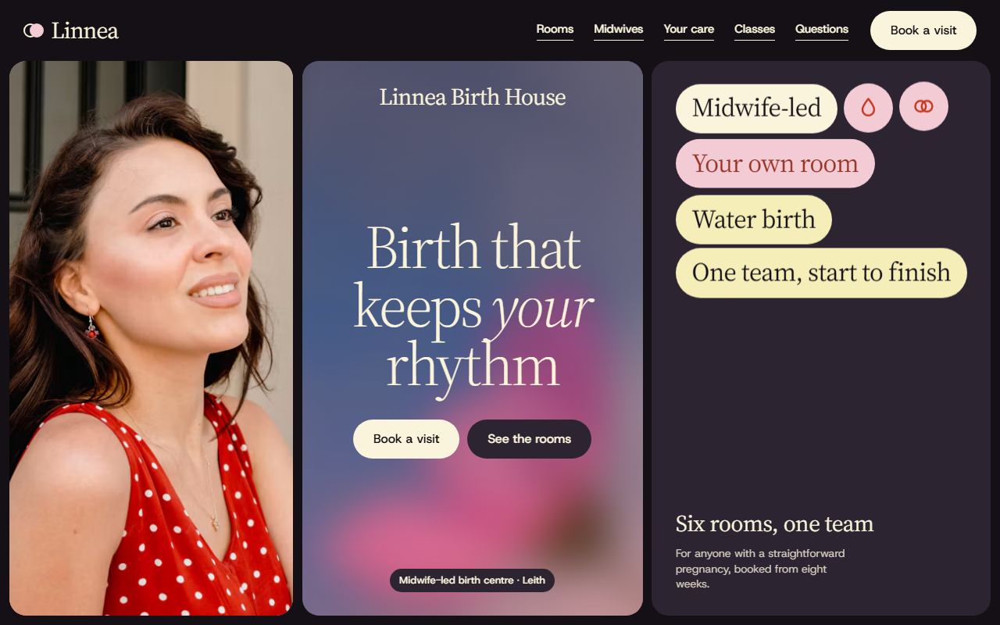
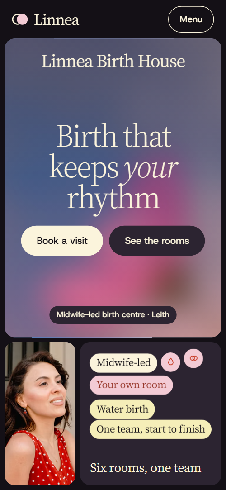
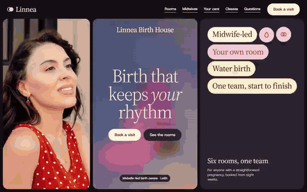

# Free HTML birth center website template with scroll animations and no libraries

Birth center website template: a free one-page site for a midwife-led birth center, with six named birth rooms, twelve midwives in three teams, a pregnancy timeline, five phases of labour and a tour form. Soft serif type sits on tinted tiles. It is one HTML file of about 29 KB gzipped with no libraries, which an AI agent can adapt.

[](LICENSE)  

**[Live demo](https://8bsite.github.io/birth-center-website-template/)** · **[Use this template](https://github.com/new?template_name=birth-center-website-template&template_owner=8bsite)** · **[Download ZIP](https://github.com/8bsite/birth-center-website-template/archive/refs/heads/main.zip)** · **[Template page on 8b.com](https://8b.com/templates/linnea-house/)**

<a href="https://8bsite.github.io/birth-center-website-template/"></a> <a href="https://8bsite.github.io/birth-center-website-template/"></a>

<p align="center"><a href="https://8bsite.github.io/birth-center-website-template/"></a><br><sub>Scroll animation</sub></p>

## Use it with Claude Code, Cursor or Codex

Download the four files into your project folder (`curl.exe` in Windows PowerShell):

```bash
curl -LO https://raw.githubusercontent.com/8bsite/birth-center-website-template/main/index.html
curl -LO https://raw.githubusercontent.com/8bsite/birth-center-website-template/main/AGENTS.md
curl -LO https://raw.githubusercontent.com/8bsite/birth-center-website-template/main/LICENSE
curl -LO https://raw.githubusercontent.com/8bsite/birth-center-website-template/main/CREDITS.md
```

Then fill in the angle brackets and give your agent this prompt:

```text
Read AGENTS.md, then edit index.html. Make it the site for <my birth center or midwife practice: town, funding and fees, who can book and from when, rooms, teams, visit schedule, classes with times, hospital transfer arrangements, phone numbers>. Replace the name, rooms, teams, medical claims and contacts first, and set --len on the closing wordmark to its length. Keep the gate script in the head, the data-8b-section and data-8b-motion attributes and the six room ids; add no animation library. Never invent clinical facts, prices or contacts; ask me.
```

With this birth center website template for Claude Code, Cursor or Codex, a vibe coding session starts with facts the agent must ask you for: funding and fees, pain relief offered, transfer arrangements, visit schedule, class times, room features and phone numbers. The demo's medical figures, such as the transfer rate and the time to discharge, are invented: replace them with your own protocols. Add or remove rooms, teams or classes in the same markup pattern, and the scenes count them.

No agent? Click **[Use this template](https://github.com/new?template_name=birth-center-website-template&template_owner=8bsite)**, edit `index.html` on GitHub and turn on **Settings > Pages**.

## Sections and motion

- **Navigation**: brand mark and name, five section links, a Book a visit button and a Menu button with a full-screen menu.
- **Birth that keeps your rhythm**: three tiles with a portrait, the h1 over a drifting flower photo and a values tile, then a second screen with six room swatches, a statement, a visits dial and two photos. On load the tiles and headline slide in, a flower photo drifts and the pills bob; on scroll a flower field the width of the headline tile widens to full bleed while the side tiles tilt away, and the swatches, photos, statement and visits dial settle in.
- **Six rooms, each named for the light it keeps**: six coloured bands, one per birth room, that unfold from their title strips as you scroll, then an "In every room" tile. The bands below the first wait as a stack of title strips, and each unfolds to full height as the band above it reaches the top, its photo easing from larger to normal.
- **Twelve midwives. You get four of them.**: a tile with twelve midwives in three teams of four, scattered pills that settle into rows, and a portrait with a quote. Fifteen pills, three team names and twelve midwives, start scattered and turned and fly into three rows as the field scrolls in, while each team pill turns from cream to its own colour.
- **Your pregnancy with us**: a list of five stages from the first call to 37 weeks, each row rising in with a week pill. The heading and the five rows rise out of a clip and the week pills pop in as each reaches 90% of the screen.
- **On the day, one rhythm**: a pinned card with a dial that names the phase on screen, beside five phases of labour. A card sticks while the five phases pass, its dial arc fills and the card names the phase near the middle of the screen.
- **The first six weeks, at home**: a pinned photo beside a letter of three panels about the first six weeks at home. The father-and-baby photo sticks and eases from larger to normal while three letter panels swing down flat as they rise.
- **A house, not a ward**: title tile, three captioned photos that open from a veil, and a row of five facts. The three photos settle from a larger, paler image, and the heading, paragraph and five fact pills rise or pop in.
- **Classes and groups**: a held horizontal track of five class photos that come into focus as they reach the middle. The five class tiles are held on a horizontal track that slides sideways as you scroll, and each photo comes into focus as it reaches the middle.
- **Families who began here**: three family stories on tiles that stack like pages, each shrinking under the next. The three story cards stick under the header, and each shrinks to 92% and darkens as the next slides over it.
- **Questions we hear at every tour**: seven questions and answers in native details elements.
- **Come and see the rooms**: a tour form, phone and address tile, and a closing wordmark over a turning flower photo. The closing word grows from a hairline weight to full weight while the photo behind it turns level and shrinks.
- **Footer**: brand line, three link columns with the address and phone, and the copyright with the labour line.

## Design

 near-black: the page ground that frames the tiles, and the text on light tiles  
 aubergine: dark tiles, the second button, the full-screen menu and the nav bar once you scroll, and the Plum room band  
 cream: text on dark tiles, light tiles, the main button and the Milk room band  
 pale pink: pink tiles, pills, chips and the Blush room band  
 coral: the Coral room band and the warm middle of the tick dials  
 red: the Ember room band, the end of the tick dials, warm pill text and the second button's hover fill  
 periwinkle: the Cornflower room band, the blurred fields behind the dial and the closing word, and the start of the tick dials  
 butter: two pills in the opening values tile, the Team Alder pill, the third story tile and one class veil

**Source Serif 4**: headings, pills, quotes, room names, FAQ questions and the wordmark; weights 300 to 600, with one italic word in the headline. **Host Grotesk**: body copy, labels, buttons and form text, at weights 400 and 500 (Google Fonts). A board of rounded tiles on a near-black frame, with one corner radius and one gutter shared everywhere. Intros and copy sit on solid tiles, the six rooms are full-width colour bands, the team is a dark field of name pills, and the pregnancy timeline is a ruled list. Photo tiles carry cream cards. Pills are serif capsules in cream, pink, butter, periwinkle or aubergine. The twelve-column grids fold to one column on phones.

## Questions

**Can this serve as a midwife website or a doula website template, and is it free?**  
Yes to both. The code is MIT licensed, free for your own practice or a client's. A doula can rename the six rooms as ways of working and the teams as doulas. The 24 demo photos keep the Unsplash License and the fonts the Open Font License, credited in CREDITS.md.

**Does the tour form send anything?**  
No. It checks the name and email, shows the thank-you line and disables the button, but it sends nothing until you connect Formspree or Netlify Forms; AGENTS.md has both recipes. Without a service, remove the form and its script and keep the phone links. Also reword the line promising a call within a day.

**Does this version need GSAP, Lenis or any other library?**  
No. Most scroll scenes are CSS scroll-driven animations; a small inline script measures the page, unfolds the room bands and smooths the mouse wheel. In Firefox today, or with reduced motion on, the scenes stay off: rooms become a plain stack, classes a three-and-two grid, and the dials stay full. The opening still plays its load-in in Firefox.

## Is it the right base?

Choose this base when the offer is a house, a small team and a named room per family. For [a clinic with a price list and home visits](https://8b.com/templates/footnote/) another template fits better. This light build has the same look with no animation library and no script from a CDN: 29 KB gzipped in one file, where the GSAP build needs 74 KB and three more requests. The weak spot is the single page: no online booking, and a form that sends nothing.

## Before you publish

- Replace what is marked `data-8b-placeholder` (social preview image, favicon, phone, form, email) and the invented demo facts; [AGENTS.md](AGENTS.md) lists them.
- The form sends nothing yet: connect it to Formspree or Netlify Forms, or remove it.

## Tech

No JavaScript libraries: CSS scroll-driven animations and a small inline motion script with its own smooth wheel scrolling, 124 KB, no build step. Chrome and Edge 111+, Safari 16.2+, Firefox 113+ (it uses color-mix(), cascade layers, small/dynamic viewport units). Without scroll-driven animations (Firefox today) the scroll motion and the smooth wheel are off and each section shows its finished layout (a load-in or a loop may still play); with "reduce motion" on, the page is complete and nothing moves on its own (hover effects stay).

A GSAP build of the same page is [`index.gsap.html`](index.gsap.html): GSAP 3.13.0, ScrollTrigger, Lenis 1.3.4 from jsDelivr, 117 KB; its scroll motion also plays in Firefox. Use one of the two files.

## License

MIT, see [LICENSE](LICENSE). Photos, fonts and libraries keep their own licences: [CREDITS.md](CREDITS.md). More free templates: [8b.com/templates](https://8b.com/templates/) · [github.com/8bsite](https://github.com/8bsite).
