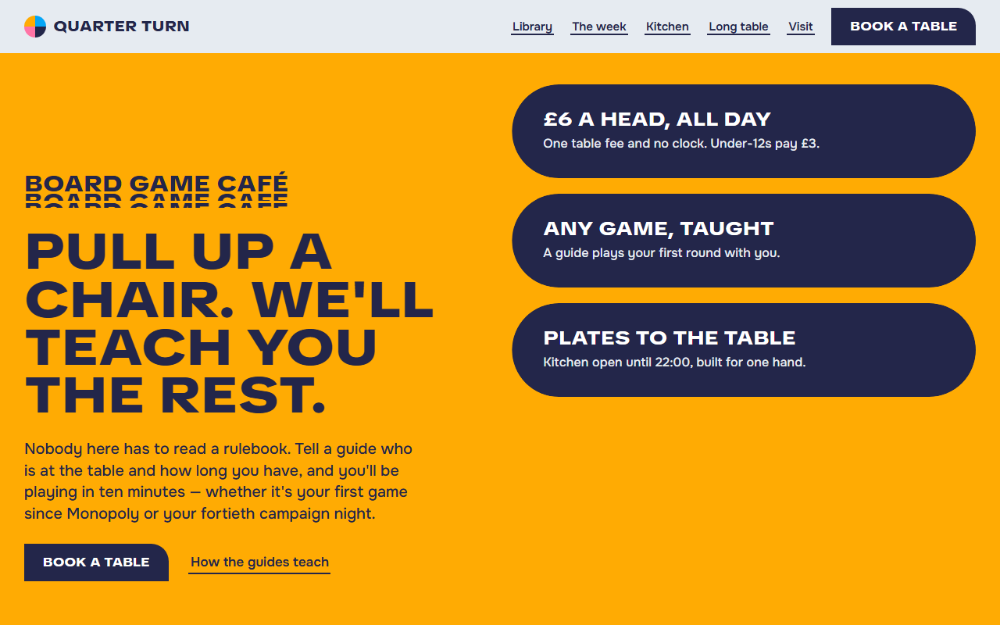
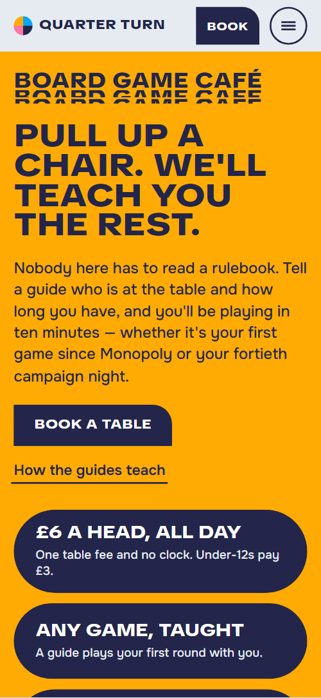

# Free HTML board game cafe website template with scroll animations and no libraries

Board game cafe website template: one free HTML page for a game cafe or tabletop library, with a table fee on the first screen, four game shelves, table guides, a seven-day week, a menu, private hire and a booking form. Navy, sky blue, amber and pink quarter-circle tiles carry the look. The motion is CSS with no JavaScript libraries.

[](LICENSE)  

**[Live demo](https://8bsite.github.io/board-game-cafe-website-template/)** · **[Use this template](https://github.com/new?template_name=board-game-cafe-website-template&template_owner=8bsite)** · **[Download ZIP](https://github.com/8bsite/board-game-cafe-website-template/archive/refs/heads/main.zip)** · **[Template page on 8b.com](https://8b.com/templates/quarter-turn/)**

<a href="https://8bsite.github.io/board-game-cafe-website-template/"></a> <a href="https://8bsite.github.io/board-game-cafe-website-template/"></a>

<p align="center"><a href="https://8bsite.github.io/board-game-cafe-website-template/"></a><br><sub>Scroll animation</sub></p>

## Use it with Claude Code, Cursor or Codex

Download the four files into your project folder (`curl.exe` in Windows PowerShell):

```bash
curl -LO https://raw.githubusercontent.com/8bsite/board-game-cafe-website-template/main/index.html
curl -LO https://raw.githubusercontent.com/8bsite/board-game-cafe-website-template/main/AGENTS.md
curl -LO https://raw.githubusercontent.com/8bsite/board-game-cafe-website-template/main/LICENSE
curl -LO https://raw.githubusercontent.com/8bsite/board-game-cafe-website-template/main/CREDITS.md
```

Then fill in the angle brackets and give your agent this prompt:

```text
Read AGENTS.md, then edit index.html. Make this the site for <my game venue: name, address, table fee, games on each shelf with player counts, weekly nights, menu with prices, hire terms, loyalty card, hours, phone, email>. Replace first the name, 20 game titles, fees, hours, menu and contacts. Motion is CSS plus the inline kit: keep the gate script, data-8b attributes, four shelf cards, seven days plus the booking cell, ten card cells and every --len; add no library. Never invent prices or contacts.
```

Vibe coding with Claude Code or Cursor goes fastest with the venue's real facts: table fee, shelf games, hours, weekly nights, menu prices, hire terms and address. The demo invents them all, and its 20 game titles are real published games, so the agent swaps in your own library. Renamed, the long table heading and footer name need new --len numbers. Keep exactly four shelf cards, seven days with the booking cell and ten card cells: the CSS animates exactly those counts.

No agent? Click **[Use this template](https://github.com/new?template_name=board-game-cafe-website-template&template_owner=8bsite)**, edit `index.html` on GitHub and turn on **Settings > Pages**.

## Sections and motion

- **Navigation**: top bar: four-tile mark and name, five links, a Book a table button; below 861 px a menu button opens a full-screen overlay. The fixed bar slides out of view when you scroll down and returns on scroll up, and this keeps working with reduced motion.
- **Pull up a chair. We'll teach you the rest.**: first screen: sliced label, headline, paragraph, a button and a link beside three navy pill bars with the main offers. On load the copy rises into place and the three navy bars open from a small pill in the middle, then their text fades in.
- **Seven hundred games, shelved by how your table feels**: four shelf cards on a board, each with a photo, a name, a note and five games with players and length. Held on tall desktop windows: the four shelf cards swing a quarter turn into place about their outer corners, one after another; on phones each swings in as its shelf arrives.
- **We read the rulebook so you don't have to**: table guides: label, heading, paragraph and a photo with a quarter tile, beside four numbered steps. The label slices in, the photo's tile swings a quarter turn and each of the four steps slides in from the right.
- **Something on every night but Monday**: the week as a sliding-tile board: seven nights and a booking cell. Held on screen: the seven day tiles start shuffled around an empty cell and slide one at a time into order until the empty cell becomes the booking cell.
- **Food you can eat with one hand**: menu in four groups with prices and two photos. The label slices in, and the four menu groups slide in from alternating sides while each corner tile swings into place.
- **The long table**: private hire: a huge heading that stretches out to full width, a long photo and four facts. The heading stretches out from about 60 percent of its width to its full width as it crosses the screen, and the photo grows from a disc into a long pill.
- **Bring the game you haven't finished**: prototype night: a photo, label, heading and a slip with Bring, We supply and Sign up. The label slices in and the three slip columns slide in one by one.
- **Every tenth visit is on us**: loyalty card: label, heading, price, four perks and a button beside a card of ten cells. The ten card cells fill one after another as you scroll, quarter shapes from their square corner, discs from the centre, and the last cell's On us label slides up.
- **Before you come**: seven questions as native details elements with a phone link in the heading. The label slices in and each question slides in from the right; opening one turns its mark a quarter turn and changes its colour.
- **Come and play**: address, hours, contact links and a table request form over a field of arc tiles. The 16 arc tiles above the address start turned every which way and make quarter turns back into a checkerboard as you scroll through them.
- **Footer**: footer: four coloured strips, the name large, a short line with the address, three link columns and a base line.

## Design

 text on light grounds, primary button, the library, long table and visit grounds, first screen price bars, form borders, two-pixel rules and the Monday and Friday tiles  
 the week ground, the first library card, the tile beside the guides photo, the corner tiles of two menu groups, the open mark in the questions and the rule above each hours row  
 the first screen ground, the loyalty section ground, the third library card, the secondary button and the Tuesday and Saturday tiles  
 the kitchen ground, button hover fill, the second library card, guide step pillars, the Wednesday and Sunday tiles and the pink arcs in the visit field  
 text on navy, and the fill of the form inputs  
 the page ground, the guides, prototype night and questions sections, the fourth library card, the Thursday tile, the form panel and the footer

**TikTok Sans**: display face, weights 700 to 900 with width up to 150 percent: uppercase headings, labels, buttons, the name in the bar and the footer, set wide at 125 percent. **Onest**: body face, weights 400 to 700: paragraphs at regular, small notes and times at semibold, lead paragraphs at medium (Google Fonts). Each section is a slab of one colour, edge to edge: navy library, sky blue week, pink kitchen, amber loyalty card. Content splits into asymmetric columns, about 3:8 for the library and 5:7 for the guides, and cards are told apart by colour alone. Buttons, form fields and the form panel share one signature: a single rounded top-right corner and three square ones. Photos are cut to quarter circles, discs and long pills. Two-pixel rules divide lists.

## Questions

**Where does the table request form send its messages?**  
Nowhere yet. It checks the required fields, shows a thank-you line and clears itself, with no handler behind it. Connect Formspree or Netlify Forms with the steps in AGENTS.md, or delete the form and keep the phone and email. Also change the promise in the thank-you line to match your real reply time.

**What do Firefox, reduced motion, a phone and no JavaScript show?**  
In Firefox today and with reduced motion, [motion tied to scrolling](https://8b.com/templates/animated/), the opening load-in and smooth wheel scrolling are off, so the shelves, week and card read in place; hover fills and the bar's hide on scroll keep running. On phones the held week needs a tall screen. Without JavaScript the menu button cannot open.

**Can I get a site like this without editing code?**  
Not this exact file, but [8B's AI website builder](https://8b.com/) makes a site from a sentence, in a new design of its own. Designing and restyling are free. Publishing with hosting and SSL, full HTML export and AI edits in chat are on Pro at $9 a month billed yearly. It also runs inside Claude and ChatGPT through the 8B connector.

## Is it the right base?

Choose this when the venue sells teaching, nights and food together and wants a loud, colourful look. It is the light build: the same look and scroll behaviour without an animation library, 26 KB gzipped against 72 KB for the GSAP version. A [bakery](https://8b.com/templates/okapi/) template fits a counter selling baked goods by pre-order better, and many pages or a live booking calendar need more than one file. The form checks the fields but sends nothing. 8B's builder makes a different design without code.

## Before you publish

- Replace what is marked `data-8b-placeholder` (social preview image, favicon, email, phone, map, form, social) and the invented demo facts; [AGENTS.md](AGENTS.md) lists them.
- The form sends nothing yet: connect it to Formspree or Netlify Forms, or remove it.

## Tech

No JavaScript libraries: CSS scroll-driven animations and a small inline motion script with its own smooth wheel scrolling, 110 KB, no build step. Chrome and Edge 111+, Safari 16.2+, Firefox 113+ (it uses color-mix(), container query units, cascade layers, small/dynamic viewport units). Without scroll-driven animations (Firefox today) the scroll motion and the smooth wheel are off and each section shows its finished layout (a load-in or a loop may still play); with "reduce motion" on, the page is complete and nothing moves on its own (hover effects stay).

A GSAP build of the same page is [`index.gsap.html`](index.gsap.html): GSAP 3.13.0, ScrollTrigger, Lenis 1.3.27 from jsDelivr, 95 KB; its scroll motion also plays in Firefox. Use one of the two files.

## License

MIT, see [LICENSE](LICENSE). Photos, fonts and libraries keep their own licences: [CREDITS.md](CREDITS.md). More free templates: [8b.com/templates](https://8b.com/templates/) · [github.com/8bsite](https://github.com/8bsite).
