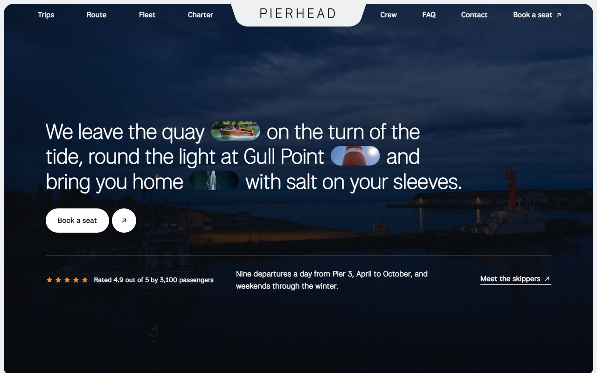
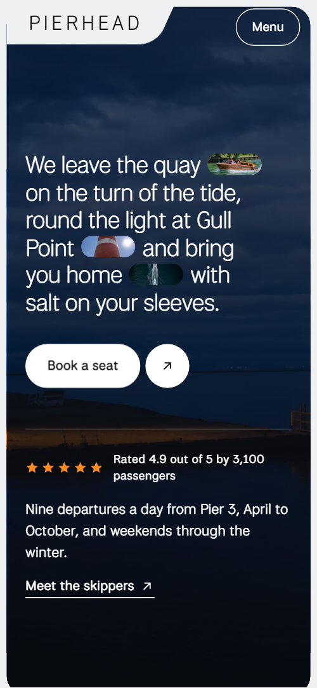
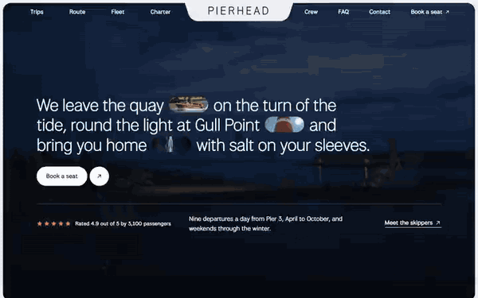

# Free HTML boat tour website template with scroll animations and no libraries

Boat tour website template: one free HTML page for a harbour operator who sells seats from a pier kiosk, with three timetabled trips, a five-place route, three boats, skippers and private charter. Near-black panels on pale grey, one orange accent, and scroll motion in plain CSS with no JavaScript libraries. AGENTS.md is included for Claude Code, Cursor or Codex.

[](LICENSE)  

**[Live demo](https://8bsite.github.io/boat-tour-website-template/)** · **[Use this template](https://github.com/new?template_name=boat-tour-website-template&template_owner=8bsite)** · **[Download ZIP](https://github.com/8bsite/boat-tour-website-template/archive/refs/heads/main.zip)** · **[Template page on 8b.com](https://8b.com/templates/pierhead/)**

<a href="https://8bsite.github.io/boat-tour-website-template/"></a> <a href="https://8bsite.github.io/boat-tour-website-template/"></a>

<p align="center"><a href="https://8bsite.github.io/boat-tour-website-template/"></a><br><sub>Scroll animation</sub></p>

## Use it with Claude Code, Cursor or Codex

Download the four files into your project folder (`curl.exe` in Windows PowerShell):

```bash
curl -LO https://raw.githubusercontent.com/8bsite/boat-tour-website-template/main/index.html
curl -LO https://raw.githubusercontent.com/8bsite/boat-tour-website-template/main/AGENTS.md
curl -LO https://raw.githubusercontent.com/8bsite/boat-tour-website-template/main/LICENSE
curl -LO https://raw.githubusercontent.com/8bsite/boat-tour-website-template/main/CREDITS.md
```

Then fill in the angle brackets and give your agent this prompt:

```text
Read AGENTS.md, then edit index.html. Make it the site for <my boat firm: name, home pier, season, each trip with boat, times and fares, route places, boats with seats, skippers, charter prices, weather and dog rules, kiosk hours>. Replace trips and fares first. Keep the ids, the gate script, the data-8b-* attributes and selectors AGENTS.md lists, three trips and four charter occasions, and the footer wordmark's len; add no animation library. Never invent fares, times, safety rules, licences, ratings or contacts; ask me.
```

Vibe coding goes fastest when the agent gets the operator's own facts first, and this boat tour website template for Claude Code, Cursor or Codex rewards that. Replace the three trips, then the route places, boats with seats, three skippers, charter prices and the kiosk address. Keep every section id and the data-8b-section, data-8b-motion and data-8b-part attributes, and ask for ratings, licences, weather and dog rules instead of inventing them, since [made-up filler](https://8b.com/templates/not-ai-generated/) reads as generated. The demo's fares are in pounds and its Kelmouth details are invented.

No agent? Click **[Use this template](https://github.com/new?template_name=boat-tour-website-template&template_owner=8bsite)**, edit `index.html` on GitHub and turn on **Settings > Pages**.

## Sections and motion

- **Navigation**: wordmark in a tab between two link lists on desktop; on phones a Menu button opens a full-screen overlay with seven section links and a Book a seat link. The bar turns solid after a short scroll, slides away when you scroll down and returns on scroll up, and on phones the Menu button opens a full-screen overlay.
- **We leave the quay on the turn of the tide, round the light at Gull Point and bring you home with salt on your sleeves.**: a full-bleed harbour photo behind one large statement with three small photo chips, a Book a seat button, a rating line and a link to the skippers. On load the statement and the facts row rise in and the three photo chips open from the centre one after another; the harbour photo stays in the frame as you scroll and drifts sideways in a loop that pauses off screen.
- **Three ways out of the harbour**: three trip rows: a card with name, boat, times and fare, and two photos beside it. Each row arrives shifted sideways with its cells spread apart, alternating sides, and closes into the grid as it scrolls up while the photos pan the other way.
- **The water we cover**: five place cards in a row that travels sideways while the section is held, with a wave running through the cards. The section holds while the row of five place cards slides sideways in a wave that lifts and tilts the cards away from the middle and lets each settle flat as it passes the centre.
- **Three boats, all older than their skippers**: three boats, each with a wide photo, a short description and four facts. Each boat photo opens upward from its bottom edge and then drifts inside its frame as you scroll.
- **Everything you need is already on board**: a heading split around a photo chip that grows into a picture filling the panel, then four notes about comfort. Held for about one screen: a small photo chip between the two heading lines grows from a pill into the full picture while the lines move apart.
- **Three skippers, one rule: home before the tide turns**: three skippers with a portrait, name, boat, a quote and their favourite stretch. The three portraits open upward on arrival and then drift inside their frames.
- **Take the whole boat**: private hire: a held photo frame that changes picture beside four occasions with prices. The photo frame stays in view while each occasion comes to full strength at mid-screen and the next picture wipes up over the frame.
- **Heard on the way back in**: four comment cards stacked like a deck; each scroll step flings the top card away. Held while four comment cards sit as a deck, and each scroll step flings the front card sideways with a turn.
- **Before you come aboard**: a held photo with a phone card beside six questions (native details). The photo and phone card stay in view beside the questions and the photo drifts as you scroll.
- **Your seat is waiting at Pier 3**: a big closing heading with an email sign-up, two tilted photo cards and the kiosk details. The two photo cards swing in from opposite tilts and settle as the panel comes into view.
- **Footer**: short company note, three link columns, the wordmark across the width and the copyright with the Design: 8B credit. The wordmark rises out of a mask once as it enters.

## Design

 page background, the solid nav bar and the wordmark tab, the charter photo frame backing on phones  
 text and headings on the light ground, dark button pills, the wordmark in the nav tab  
 background of the opening frame and of the trips, onboard, reviews, contact and footer panels, and of the phone menu overlay  
 text on dark panels, the white button pills, the FAQ question cards and the phone card over the FAQ photo  
 the only accent: hover fill on buttons and round icon buttons, focus outlines, the five stars in the opening  
 secondary text on the light ground: route, fleet and charter intros, place and crew captions, FAQ answers  
 secondary text on dark panels: trip lines and facts, onboard notes, review captions, footer text  
 the dark cards inside panels (trip cards, review cards) and the colour behind photos while they load

**National Park**: the only typeface, weights 300 to 500: light, tightly tracked headings, regular body text, medium-weight buttons and labels, and the wordmark in light spaced capitals (Google Fonts). A pale grey ground carries near-black rounded panels. Trips are three rows, each a dark fare card beside two photos, flipped on the second row. The route is a strip of five portrait cards, the fleet three ruled rows of a wide photo and four facts, and the crew a ruled list of three with a portrait each. Charter holds one photo frame beside four occasions. On desktop the wordmark hangs as a tab between the two link lists.

## Questions

**Can passengers book and pay on this site?**  
No. The Book links and the Book a seat button jump to the trips or contact sections, and the email sign-up form posts to # and sends nothing. Point the links at your ticket shop, and connect the form to Mailchimp, Formspree or Netlify Forms or delete it.

**Does this version need GSAP, and what do Firefox and reduced motion show?**  
No: CSS scroll-driven animations and a short inline script do the motion. In Firefox today and with reduced motion the scroll motion and smooth wheel are off: route and reviews become grids, onboard shows its full picture and charter its last photo. Firefox still plays the opening load-in; hover fills and the nav hiding run in both.

**Can I get a site like this without editing code?**  
Yes, in another way. [8B's AI website builder](https://8b.com/) designs a new site from a sentence, in its own design rather than this template. Designing and restyling are free; publishing with hosting and SSL, full HTML export and AI edits in chat are on Pro at $9 a month billed yearly. It also runs inside Claude and ChatGPT.

## Is it the right base?

Pick it for a local operator with a few named trips, fixed fares and boats worth showing. A firm selling dated group journeys fits the [group tour operator](https://8b.com/templates/binario-tre/) template better. A boat rental website template usually means self-drive hire with a calendar, and this page has none. This is the light build: the same look and motion, no script from a CDN, about 27 KB of code gzipped in one file against 75 KB and four more requests for the GSAP version.

## Before you publish

- Replace what is marked `data-8b-placeholder` (social preview image, favicon, phone, form, email, social) and the invented demo facts; [AGENTS.md](AGENTS.md) lists them.
- The form sends nothing yet: connect it to Formspree or Netlify Forms, or remove it.

## Tech

No JavaScript libraries: CSS scroll-driven animations and a small inline motion script with its own smooth wheel scrolling, 103 KB, no build step. Chrome and Edge 111+, Safari 16.2+, Firefox 113+ (it uses color-mix(), cascade layers, small/dynamic viewport units). Without scroll-driven animations (Firefox today) the scroll motion and the smooth wheel are off and each section shows its finished layout (a load-in or a loop may still play); with "reduce motion" on, the page is complete and nothing moves on its own (hover effects stay).

A GSAP build of the same page is [`index.gsap.html`](index.gsap.html): GSAP 3.13.0, ScrollTrigger, SplitText, Lenis 1.3.27 from jsDelivr, 92 KB; its scroll motion also plays in Firefox. Use one of the two files.

## License

MIT, see [LICENSE](LICENSE). Photos, fonts and libraries keep their own licences: [CREDITS.md](CREDITS.md). More free templates: [8b.com/templates](https://8b.com/templates/) · [github.com/8bsite](https://github.com/8bsite).
