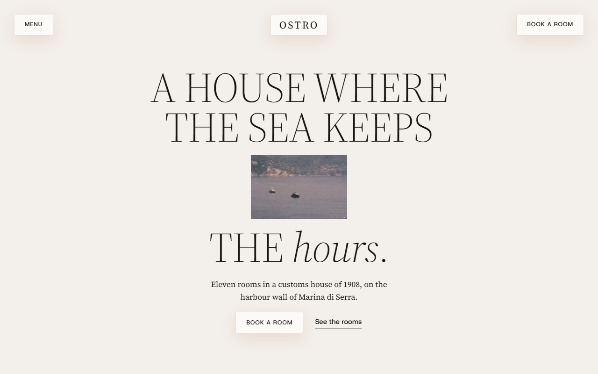
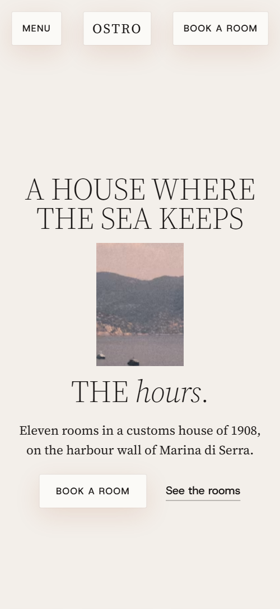
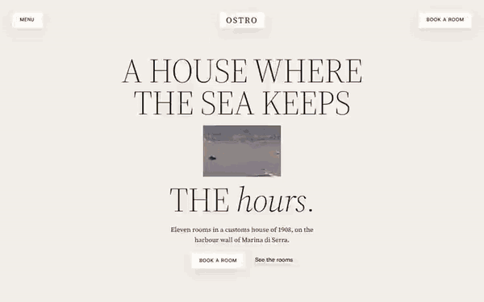

# Free HTML boutique hotel website template with scroll animations and no libraries

Boutique hotel website template: one free HTML page for a small hotel or guesthouse, with a house history, three kinds of room, an hour-by-hour day, meals, outings, a town photo grid and a stay form. Off-white and ink with terracotta accents. The scroll motion runs on CSS with no JavaScript libraries, and AGENTS.md guides Claude Code, Cursor or Codex.

[](LICENSE)  

**[Live demo](https://8bsite.github.io/boutique-hotel-website-template/)** · **[Use this template](https://github.com/new?template_name=boutique-hotel-website-template&template_owner=8bsite)** · **[Download ZIP](https://github.com/8bsite/boutique-hotel-website-template/archive/refs/heads/main.zip)** · **[Template page on 8b.com](https://8b.com/templates/ostro/)**

<a href="https://8bsite.github.io/boutique-hotel-website-template/"></a> <a href="https://8bsite.github.io/boutique-hotel-website-template/"></a>

<p align="center"><a href="https://8bsite.github.io/boutique-hotel-website-template/"></a><br><sub>Scroll animation</sub></p>

## Use it with Claude Code, Cursor or Codex

Download the four files into your project folder (`curl.exe` in Windows PowerShell):

```bash
curl -LO https://raw.githubusercontent.com/8bsite/boutique-hotel-website-template/main/index.html
curl -LO https://raw.githubusercontent.com/8bsite/boutique-hotel-website-template/main/AGENTS.md
curl -LO https://raw.githubusercontent.com/8bsite/boutique-hotel-website-template/main/LICENSE
curl -LO https://raw.githubusercontent.com/8bsite/boutique-hotel-website-template/main/CREDITS.md
```

Then fill in the angle brackets and give your agent this prompt:

```text
Read AGENTS.md, then edit index.html. Make this the site for <my house: name, town, building story, room kinds with sizes, sleeps and nightly prices, season, check-in time, meal times, outings, policies, address, contacts>. Replace the name, place names, rooms, prices, staff and boat names first. Motion is CSS scroll-driven animation plus the inline motion kit: keep the gate script, section ids, data-8b-* attributes, the classes AGENTS.md lists, three room panels with their names, and the wordmark's --len; add no animation library. Never invent prices, policies or contacts; ask me.
```

Vibe coding with Claude Code, Cursor or Codex starts with facts only the house has: room kinds, sizes and nightly prices, season, check-in time, meal times, outings, policies, address, phone and email. The demo invents all of them, along with the cook, the desk, the fisherman and the boat. With this boutique hotel website template for Claude Code, replace the name everywhere, then set the footer wordmark's --len to its letter count. Keep three room panels with one name each: the CSS moves exactly three.

No agent? Click **[Use this template](https://github.com/new?template_name=boutique-hotel-website-template&template_owner=8bsite)**, edit `index.html` on GitHub and turn on **Settings > Pages**.

## Sections and motion

- **Navigation**: fixed bar with a Menu button, the wordmark and a Book a room button; full-screen menu with eight links, address, phone and email. The bar slides away after about 24px of downward scrolling and returns on scroll up; the Menu button opens a full-screen overlay and pauses the smooth wheel scrolling while it is open.
- **A house where the sea keeps the hours.**: a headline cut as a window over a photo of the bay; scrolling opens the window to the full frame, then a statement and three facts arrive on the view. On load the headline rises line by line and the small photo window scales in while the photo drifts sideways in a loop; scrolling then opens the window to the full frame, drops the lede and buttons away and brings a statement and three facts over a dark shade.
- **A customs house of 1908**: a history of the building as three dated photos with captions, then two paragraphs. The heading slides in by line, the three photos open from small windows, and the first also drifts inside its frame as you scroll.
- **The sea rooms, the harbour rooms, the tower.**: a held full-screen stage of three room kinds: the next panel wipes in over the previous one while the heading line of room names slides and lights the current one. Held for about two screens of scroll: each next room photo wipes in from the right over the last while the heading line of room names slides sideways and lights the current name.
- **A day kept by the sea**: six hours of the day as tall rows; the whole section takes each hour's colour as it reaches the middle of the screen. The whole section takes each hour's colours as its row reaches the middle of the screen, and each big phrase drifts sideways as you scroll.
- **Lunch is what the boats bring**: a large held photo beside a text column: four meals, two photos, the cook's quote and a booking button. The heading slides in by line, the held photo drifts a little inside its frame, and the two smaller photos open from windows.
- **Out from the mole**: four outings as plates that stack like cards: each held plate settles back, smaller and darker, while the next rises over it. Each outing plate sticks near the upper edge and shrinks and darkens as the next plate rises over it.
- **Around the harbour**: a grid of fifteen small photos of the town around a held button; the tiles part to leave a clearing as each row passes the middle. Tile rows near the middle of the screen part sideways, and the middle column's tiles shrink, leaving a clearing around the held button.
- **Before you come**: seven questions in native details elements beside a heading and a phone note. The heading slides in by line; each question opens natively and its plus turns into a minus.
- **From the guest book**: one huge guest-book sentence that closes up from its two halves, with the guests' names. The two halves of the guest-book sentence slide in from opposite sides and close up as you scroll.
- **Write to the house**: a heading, an aperture photo, address lines and three ways to arrive, beside a stay request form. The heading slides in by line and the photo opens from a window.
- **Footer**: a letter sign-up, page links, contact links, a very wide wordmark that opens from a window and a base line. The wordmark opens from a narrow window to full width and settles from slightly enlarged as it comes into view.

## Design

 page ground, full-screen menu, footer and the 07:00 day row  
 text and low-opacity rules, the fill of dark buttons and of light buttons on hover, the opening's dark block, the 21:00 day row and the shade under the room names  
 room-kind labels, outing times, the form message, the hover fill of dark buttons and the 15:00 day row; blended into the 12:00 and 18:30 rows  
 captions, field and fact labels, the menu head and small footer lines  
 light buttons, the logo pill, room fact cards, outing plates, the 09:30 day row and text on dark grounds

**Source Serif 4**: body text at 17px regular, the light uppercase display headings (weight 300, 40 to 96px in section headings, larger for the day phrases, room names and guest-book line), the spaced wordmark in the bar, the huge footer wordmark, and italic for one word of the first headline. **Host Grotesk**: weights 400 to 500: small tracked capital labels, buttons, form fields, room fact values, footer links, the questions and the medium-weight statements and quotes at 22 to 32px (the opening statement up to 54px) (Google Fonts). Light uppercase serif headings, centred in most sections, sit over sections that each change shape: a ledger of three history photos in 6:3:4 columns, a full-screen room stage, six tall hour rows, a split section with a held photo beside a menu column, stacked outing plates, a five-column grid of fifteen tall photos, a two-column questions section and a split contact with the form held in view. Labels are small tracked sans capitals; body text is serif.

## Questions

**Can guests book a room or check availability on it?**  
No. The Book a room buttons and room links jump to the stay request form, which asks for dates, guests, a room kind, name and email. As shipped it shows a thank-you line and sends nothing. Connect Formspree or Netlify Forms, or point the buttons at your booking engine.

**What happens on a phone, in Firefox or with reduced motion?**  
On a phone the harbour grid has three columns instead of five. Without CSS scroll-driven animations (Firefox today) or with reduced motion, the page shows its finished layout: the window stays small, the three rooms follow one another, the plates stack without shrinking, ordinary scrolling. Firefox still plays the opening load-in; the bar hides on scroll in both.

**Can I get a site like this without editing code?**  
Not this file; it needs an AI coding agent or a developer. [8B's AI website builder](https://8b.com/) designs a new site from a one-sentence description, in its own design. Designing and restyling are free; publishing with hosting, HTML export and AI edits in chat are Pro, $9 a month billed yearly. It also runs inside Claude and ChatGPT.

## Is it the right base?

Choose it as a website for boutique hotels when the pitch is a place: the building, the rooms, the day and the table. This is the light build, with the same look and motion and no script from a CDN: about 26 KB of code gzipped in one file, against 75 KB and four extra requests for the GSAP version. Fixed-date trips suit the [group tour](https://8b.com/templates/binario-tre/) template better. It is a hotel booking template only through an enquiry form, with no availability calendar.

## Before you publish

- Replace what is marked `data-8b-placeholder` (social preview image, favicon, phone, email, form, social) and the invented demo facts; [AGENTS.md](AGENTS.md) lists them.
- The form sends nothing yet: connect it to Formspree or Netlify Forms, or remove it.

## Tech

No JavaScript libraries: CSS scroll-driven animations and a small inline motion script with its own smooth wheel scrolling, 104 KB, no build step. Chrome and Edge 111+, Safari 16.2+, Firefox 113+ (it uses color-mix(), cascade layers, small/dynamic viewport units). Without scroll-driven animations (Firefox today) the scroll motion and the smooth wheel are off and each section shows its finished layout (a load-in or a loop may still play); with "reduce motion" on, the page is complete and nothing moves on its own (hover effects stay).

A GSAP build of the same page is [`index.gsap.html`](index.gsap.html): GSAP 3.13.0, ScrollTrigger, SplitText, Lenis 1.3.27 from jsDelivr, 95 KB; its scroll motion also plays in Firefox. Use one of the two files.

## License

MIT, see [LICENSE](LICENSE). Photos, fonts and libraries keep their own licences: [CREDITS.md](CREDITS.md). More free templates: [8b.com/templates](https://8b.com/templates/) · [github.com/8bsite](https://github.com/8bsite).
