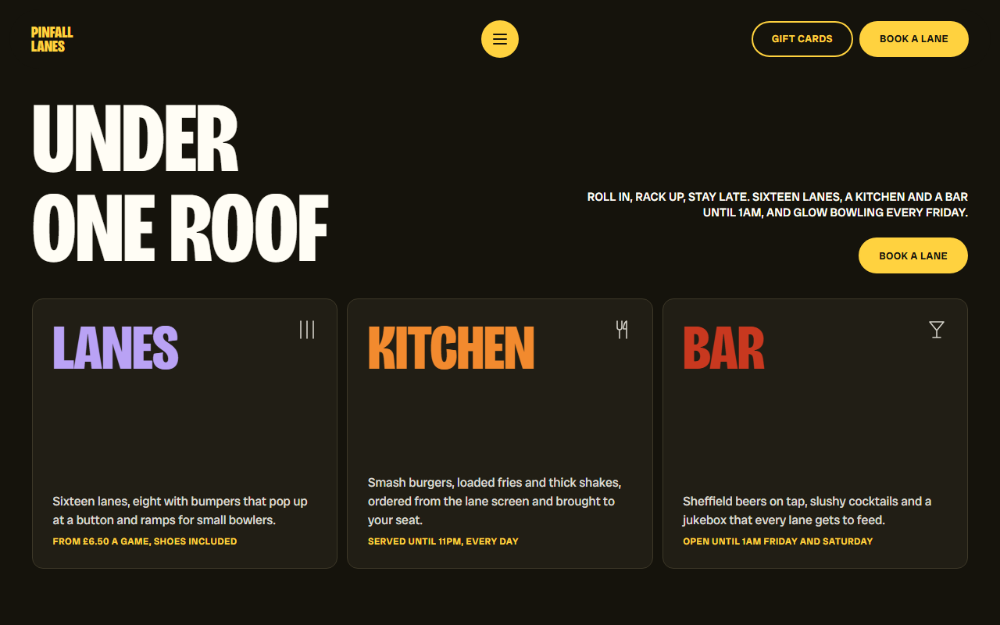
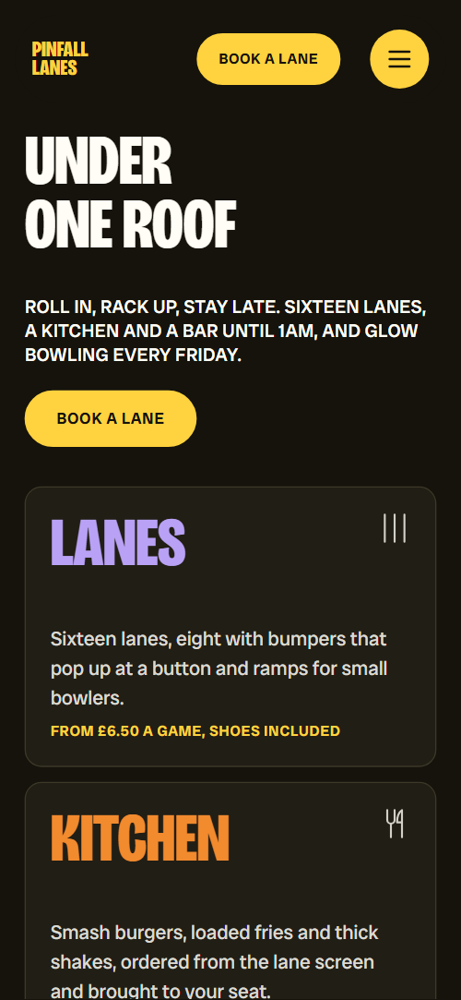
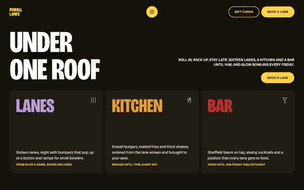

# Free HTML bowling alley website template with GSAP scroll animations

Bowling alley website template: one free HTML file for a venue with a kitchen and bar, three leagues, Friday glow nights, a weekly leaderboard and four party packages. The look is loud, with a near-black ground and yellow, orange, lilac and sky-blue panels. AGENTS.md is included, so Claude Code, Cursor or Codex can adapt it.

[](LICENSE)  

**[Live demo](https://8bsite.github.io/bowling-alley-website-template/)** · **[Use this template](https://github.com/new?template_name=bowling-alley-website-template&template_owner=8bsite)** · **[Download ZIP](https://github.com/8bsite/bowling-alley-website-template/archive/refs/heads/main.zip)** · **[Template page on 8b.com](https://8b.com/templates/pinfall/)**

<a href="https://8bsite.github.io/bowling-alley-website-template/"></a> <a href="https://8bsite.github.io/bowling-alley-website-template/"></a>

<p align="center"><a href="https://8bsite.github.io/bowling-alley-website-template/"></a><br><sub>Scroll animation</sub></p>

## Use it with Claude Code, Cursor or Codex

Download the four files into your project folder (`curl.exe` in Windows PowerShell):

```bash
curl -LO https://raw.githubusercontent.com/8bsite/bowling-alley-website-template/main/index.html
curl -LO https://raw.githubusercontent.com/8bsite/bowling-alley-website-template/main/AGENTS.md
curl -LO https://raw.githubusercontent.com/8bsite/bowling-alley-website-template/main/LICENSE
curl -LO https://raw.githubusercontent.com/8bsite/bowling-alley-website-template/main/CREDITS.md
```

Then fill in the angle brackets and give your agent this prompt:

```text
Read AGENTS.md, then edit index.html. Make this the site for <my venue: name, lane count and game prices, kitchen and bar hours, league nights and captains, menu with prices, party packages, beginners' hour, address and how guests book>. Replace the venue name, leaderboard, menu and every price first. Keep the ids, the data-8b-section, data-8b-motion and data-8b-part attributes, the classes AGENTS.md lists and the footer wordmark's len value set to the new name's character count. Ask me for missing facts and never invent prices, hours, scores, league names or contacts.
```

Vibe coding this bowling alley website template for Claude Code or Cursor goes fastest when the agent gets the facts only the venue has: lane count, game prices, kitchen and bar hours, league nights, menu prices, party packages and the booking route. The demo invents all of them. It also prints two sets of opening hours that disagree, so make them match. Keep the ids and the data-8b-section, data-8b-motion and data-8b-part attributes.

No agent? Click **[Use this template](https://github.com/new?template_name=bowling-alley-website-template&template_owner=8bsite)**, edit `index.html` on GitHub and turn on **Settings > Pages**.

## Sections and motion

- **Navigation**: two-line wordmark, a Gift cards button, a Book a lane button and a menu icon; the menu opens a full-screen overlay with five links. The bar tightens after 40 px of scroll, slides out of view when you scroll down past 120 px and returns on scroll up.
- **Under one roof**: big "Under one roof" headline, a lead line with a button, and three tiles for lanes, kitchen and bar. On load the lead and button lift in, the heading lifts out of a clip with a slight tilt, and each tile word lands oversized and turned before pressing flat.
- **Meet the leagues**: three league captains as duotone portrait cards with colour washes that sweep through them. Colour bands slide sideways behind each greyscale portrait as you scroll, one card a beat behind the last, and settle on purple, green and blue.
- **Lane-side kitchen**: a round photo stage where four dish photos roll in one after another, beside the menu in four groups. The burger photo sits in a sticky round stage, and the fries, shake and cocktail photos roll in over it from the left, turning as they travel, as each later menu group scrolls up.
- **Lights out at nine**: "Lights out at nine": the yellow ground dims to black, the heading turns neon and colour pools fade in. As the section scrolls in, one value runs the ground from yellow to black, the heading turns lilac with a purple glow, two colour pools fade in and the photo regains its colour.
- **Wall of fame**: wall of fame: the six best games of the week, sorted by sliding rows past each other. Rows start in the order the games were bowled, given by data-day, then slide past each other into rank order with a small sideways nudge.
- **Throw a party at the lanes**: four party packages as panels that ride in from the right while the section is held. The section holds the screen while the intro and the four panels move left, then releases; without the scene the panels wrap into a grid.
- **Never bowled? Good.**: a beginners' hour: a photo, three numbered tips and a booking button. Only the heading lifts out of a clip on arrival.
- **Before you roll up**: six questions and answers (native &lt;details&gt;) on a panel with two balls and two brush scribbles. Two yellow balls roll in from opposite edges, turning as they travel, and two brush scribbles draw themselves.
- **Grab a lane**: "Grab a lane" with email and phone tiles, an enquiry form and a photo with the address and opening hours. The heading lifts out of a clip on arrival.
- **Footer**: the wordmark across the width, a Book now stamp, five links and the credit line. The wordmark splits into letters that stand up one after another as the footer arrives, and the Book now stamp lands oversized and turns flat.

## Design

 page ground, header bar, default button fill, text on the yellow and sky-blue panels, and the black the glow section dims to  
 menu and questions panels, contact form, top leaderboard row, yellow buttons, footer wordmark and links, the two balls, focus rings  
 the red sweep that fills buttons on hover, the Book now stamp, the Bar tile word  
 cream text on the dark ground, the league pills and the text of the party price pills, the stamp label  
 Lanes tile word, Office socials panel, Call tile, the glow heading at night  
 beginners' hour panel and the Lane takeover party panel  
 Kitchen tile word, Kids' parties panel, Email tile, the warm edge of the balls  
 purple colour band over the first portrait and one of the two glow pools  
 green colour band over the second portrait  
 blue colour band over the third portrait and the second glow pool  
 surfaces of the three tiles, the leaderboard and the footer panel  
 hairline borders of the tiles and the leaderboard

**Bricolage Grotesque**: headings, names, prices, ranks and scores, footer wordmark and links, stamp label: only weight 800 at 75% width loads, set in capitals with a line height of about 0.9. **Radio Canada Big**: body text at weight 400, uppercase lead lines at 500, buttons and small labels at 600, pills at 700 (Google Fonts). A fixed header bar with a two-line wordmark, two buttons and a menu icon sits over a near-black page. The first screen pairs a large two-line heading with a lead and button on the right, above three tiles for lanes, kitchen and bar. Portrait cards then run edge to edge, followed by large rounded colour panels, a sideways row of party panels, and a contact mosaic of two coloured tiles, a form and a photo.

## Questions

**Does the Book a lane button take bookings?**  
Not by itself. Every Book a lane button jumps to the enquiry form, which requires a name and an email, shows a thank-you line and sends nothing. Point the buttons at your booking page, or connect the form to Formspree or Netlify Forms with the steps in AGENTS.md.

**Where is the bowling alley website design prompt, and how do I use it?**  
Below the short prompt sits a longer bowling alley website design prompt for any AI tool. With the template, put index.html and AGENTS.md in an empty folder using its curl lines, and tell the agent to read AGENTS.md first. Give it the files, not the page address. Codex reads [AGENTS.md from the folder](https://8b.com/templates/for-codex/) on its own.

**Can I get a site like this without editing code?**  
Yes, in a different way. [8B's AI website builder](https://8b.com/) designs a new site from a sentence about your venue, not this template. Designing and restyling are free; publishing with hosting and SSL, full HTML export and AI edits in chat are on Pro at $9 a month billed yearly. It also runs inside Claude and ChatGPT.

## Is it the right base?

This is the right base for a venue that sells an evening: lanes, food, drinks, leagues and parties on one loud page. A venue run on weekly skating sessions suits the [weekly-session](https://8b.com/templates/spinway/) template better, and a quiet restaurant wants less motion. The weak spot is booking: every Book a lane button jumps to the form, and there is no lane calendar or payment. Owners who would rather not edit code can try the 8B builder.

## Before you publish

- Replace what is marked `data-8b-placeholder` (social preview image, favicon, email, phone, form) and the invented demo facts; [AGENTS.md](AGENTS.md) lists them.
- The form sends nothing yet: connect it to Formspree or Netlify Forms, or remove it.

## Tech

GSAP 3.13.0, ScrollTrigger, Lenis 1.3.27 from jsDelivr, 81 KB, no build step. Chrome and Edge 111+, Safari 16.2+, Firefox 113+ (it uses color-mix(), cascade layers, small/dynamic viewport units). With "reduce motion" on, the page is complete and still.

## License

MIT, see [LICENSE](LICENSE). Photos, fonts and libraries keep their own licences: [CREDITS.md](CREDITS.md). More free templates: [8b.com/templates](https://8b.com/templates/) · [github.com/8bsite](https://github.com/8bsite).
