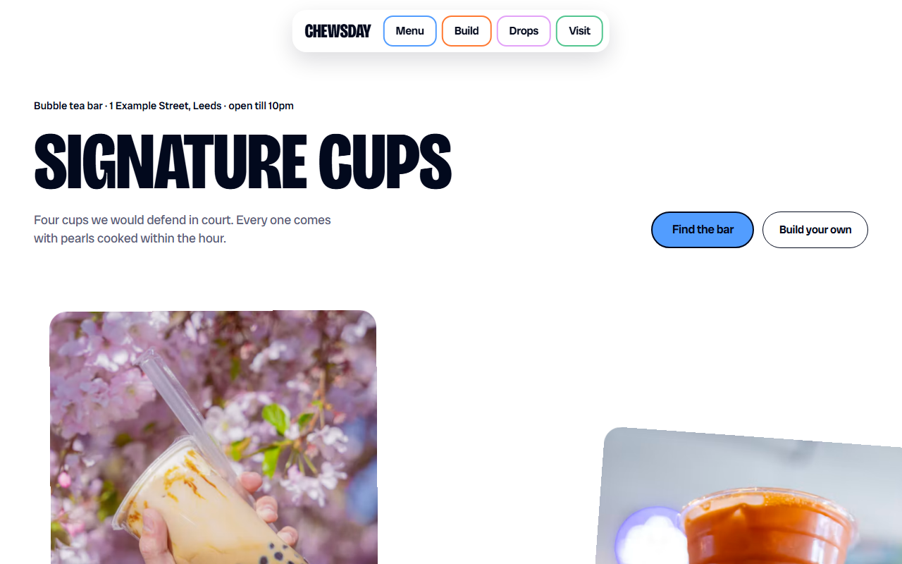
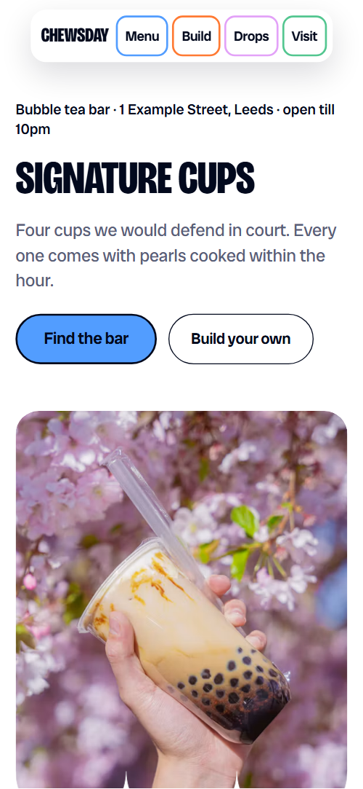
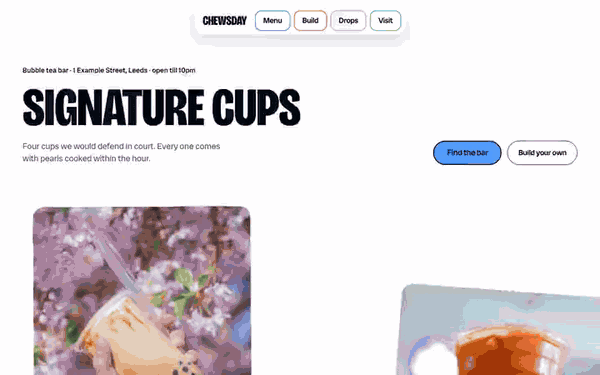

# Free HTML bubble tea shop website template with scroll animations and no libraries

This bubble tea shop website template is one free HTML file for a bar with a signature menu, a build-your-own guide and weekly limited drinks. Candy colours sit on white under navy capitals, with stacked cards and scalloped edges. Scroll motion runs on CSS with no JavaScript libraries; Claude Code can swap in your menu.

[](LICENSE)  

**[Live demo](https://8bsite.github.io/bubble-tea-shop-website-template/)** · **[Use this template](https://github.com/new?template_name=bubble-tea-shop-website-template&template_owner=8bsite)** · **[Download ZIP](https://github.com/8bsite/bubble-tea-shop-website-template/archive/refs/heads/main.zip)** · **[Template page on 8b.com](https://8b.com/templates/chewsday/)**

<a href="https://8bsite.github.io/bubble-tea-shop-website-template/"></a> <a href="https://8bsite.github.io/bubble-tea-shop-website-template/"></a>

<p align="center"><a href="https://8bsite.github.io/bubble-tea-shop-website-template/"></a><br><sub>Scroll animation</sub></p>

## Use it with Claude Code, Cursor or Codex

Download the four files into your project folder (`curl.exe` in Windows PowerShell):

```bash
curl -LO https://raw.githubusercontent.com/8bsite/bubble-tea-shop-website-template/main/index.html
curl -LO https://raw.githubusercontent.com/8bsite/bubble-tea-shop-website-template/main/AGENTS.md
curl -LO https://raw.githubusercontent.com/8bsite/bubble-tea-shop-website-template/main/LICENSE
curl -LO https://raw.githubusercontent.com/8bsite/bubble-tea-shop-website-template/main/CREDITS.md
```

Then fill in the angle brackets and give your agent this prompt:

```text
Read AGENTS.md, then edit index.html. Make this the site for <my drinks shop: name, city, signature cups with prices, build options with extras, weekly drop names and dates, opening hours, address, phone, email, allergen and vegan facts, and how groups order>. Replace the demo menu, drops, messages and name puns first. Motion is CSS scroll-driven animation plus the inline motion kit: keep the gate script, the ids, the data-8b-section, data-8b-motion and data-8b-items attributes and listed classes; add no animation library. Never invent prices, allergens, hours or contacts; ask me.
```

For a bubble tea shop website template for Claude Code, Cursor or Codex, give the agent index.html and AGENTS.md and start with the menu: four signature cups, five build layers with four options each and four dated weekly drops. Keep the ids and the data-8b-section, data-8b-motion and data-8b-items attributes, since the CSS animations and the inline motion kit read them. The agent must ask the owner for real prices, vegan and allergen claims, hours, the address and the drop dates, and rewrite the name puns.

No agent? Click **[Use this template](https://github.com/new?template_name=bubble-tea-shop-website-template&template_owner=8bsite)**, edit `index.html` on GitHub and turn on **Settings > Pages**.

## Sections and motion

- **Navigation**: floating pill bar with the wordmark and four colour-outlined links. The pill bar tucks away when you scroll down past 160 px and returns on scroll up or keyboard focus, also with reduced motion.
- **Signature cups**: the page's opening: where-line, h1, lede and two buttons above four signature cups in staggered columns. Smooth wheel scrolling throughout; on load the heading rises and scales in and the where-line, lede and buttons fade up, then on scroll each cup flies in from alternating edges and settles straight.
- **Build your cup**: five stacked colour cards (Tea, Milk or fruit, Pearls and toppings, Sweetness, Ice and shake), each with its options and a photo. Each colour card sticks below the previous one so the bands stack, and from the second card on it grows from 84% scale while the covered card recedes, tied to the scroll.
- **Cooked every two hours**: a scalloped photo frame with eight texture chips and a paragraph about the pearls. The scalloped photo frame grows from 55% scale while eight chips fly out from behind it and land at their tilted places, tied to the scroll.
- **How to order**: three ordering steps as big words: Pick, Shake, Sip. Each step card hangs from its top edge and swings from a tilt to rest once as it comes into view.
- **House rules**: House rules on a blue band with a scalloped hem and four white cards. The blue band is pulled down like a blind with the scalloped hem riding its edge, and each card swings in as the hem passes.
- **Overheard at the counter**: four regulars' messages as chat bubbles with the bar's replies. Each chat bubble swells from its tail as its row arrives, and the bar's reply slides into place behind it.
- **Tuesday drops**: four weekly limited drinks on a rail that travels sideways while the background changes colour. The stage sticks in place while the rail of four drop cards slides left, and its background turns blue, orange, green and lilac as each card reaches the centre.
- **Good questions**: five questions and answers in native details elements. Each question card swings from a tilt to rest once as it scrolls into view; the answers open without JavaScript.
- **Come chew it over**: full-bleed photo with a big invitation, then address, hours, contact details and a group order form. The photo widens from an inset rounded card to full width, the title grows into place and the colour bumps (five, three on phones) rise unevenly along its lower edge.
- **Footer**: large wordmark, contact and social links, four tile links and the legal line with the Design: 8B credit. The four tile links climb from below their row at different lags while the footer scrolls in.

## Design

 page background, nav bar, FAQ, house rules and drop cards, the order form, secondary button, footer text and one chip fill  
 text outside the footer and the visit photo, borders and outlines, the dark footer panel, button fill on hover  
 primary button, house rules band, first build card, second ritual step, first chat bubble, first drop colour, Menu nav pill, first footer tile, tinted pearls section  
 second build card, third ritual step, second chat bubble and second drop colour, Build nav pill  
 third build card, first ritual step, third chat bubble and third drop colour, Visit nav pill  
 FAQ panel, fourth build card, default chip fill, footer tile hover, visit bump  
 fifth build card, fourth chat bubble and fourth drop colour, Drops nav pill  
 grey-blue lede lines under section headings

**Bricolage Grotesque**: section headings, the wordmark, step numbers and the Pick, Shake, Sip words: weight 800, condensed to 75% width, uppercase. **Radio Canada Big**: body text, buttons, labels, prices, FAQ questions and addresses, in weights 400 to 600. **Playpen Sans**: loaded with the page and set on one badge style that no element uses, so it can be dropped (Google Fonts). Most blocks sit in rounded colour fields on white. The menu is a two-column grid with every second cup pushed down, the build section stacks five colour cards that stick under the nav, and the house rules band has a scalloped top and hem. Blue, orange, green, yellow and lilac repeat across cards, chat bubbles, drops and footer tiles, one colour per item.

## Questions

**Does the group order form send anything?**  
No. A script checks the required name and email and the cup count (10 to 200), shows a thank-you line and clears the fields. Without JavaScript the browser posts it back to the page and nothing is sent. Connect Formspree, Netlify Forms or your ordering tool before you publish, whether [from a GitHub Pages copy](https://8b.com/templates/github/) or another host.

**What happens in Firefox or with reduced motion?**  
Without CSS scroll-driven animations (Firefox today) or with reduced motion, [scroll-linked motion](https://8b.com/templates/animated/) and the smooth wheel are off; cups, chips, bubbles and bumps rest and the drops section is a normal block. The build cards still stick and stack, the nav bar tucks away and button fills run; Firefox also plays the opening load-in.

**Can I get a site like this without editing code?**  
Yes, with [8B's AI website builder](https://8b.com/). You describe the site in a sentence and its engine designs a new site, with its own design, not this template. Designing and restyling are free. Publishing with hosting and SSL, HTML export and AI edits in chat are on Pro at $9 a month billed yearly. It also runs inside Claude and ChatGPT.

## Is it the right base?

Pick this when a drinks business sells from a short signature menu and wants personality: a tea bar, a juice stand or a small cafe with weekly specials. A sit-down place with a long menu fits the [grill restaurant](https://8b.com/templates/hwaro/) template better. This build keeps the look and motion with no animation library: about 25 KB of code gzipped against 71 KB and three requests for the GSAP version. The weak spots are the dense first view and the missing checkout.

## Before you publish

- Replace what is marked `data-8b-placeholder` (social preview image, favicon, phone, email, map, form, social) and the invented demo facts; [AGENTS.md](AGENTS.md) lists them.
- The form sends nothing yet: connect it to Formspree or Netlify Forms, or remove it.

## Tech

No JavaScript libraries: CSS scroll-driven animations and a small inline motion script with its own smooth wheel scrolling, 97 KB, no build step. Chrome and Edge 111+, Safari 16.2+, Firefox 121+ (it uses color-mix(), container query units, :has(), cascade layers, small/dynamic viewport units). Without scroll-driven animations (Firefox today) the scroll motion and the smooth wheel are off and each section shows its finished layout (a load-in or a loop may still play); with "reduce motion" on, the page is complete and nothing moves on its own (hover effects stay).

A GSAP build of the same page is [`index.gsap.html`](index.gsap.html): GSAP 3.13.0, ScrollTrigger, Lenis 1.3.27 from jsDelivr, 88 KB; its scroll motion also plays in Firefox. Use one of the two files.

## License

MIT, see [LICENSE](LICENSE). Photos, fonts and libraries keep their own licences: [CREDITS.md](CREDITS.md). More free templates: [8b.com/templates](https://8b.com/templates/) · [github.com/8bsite](https://github.com/8bsite).
