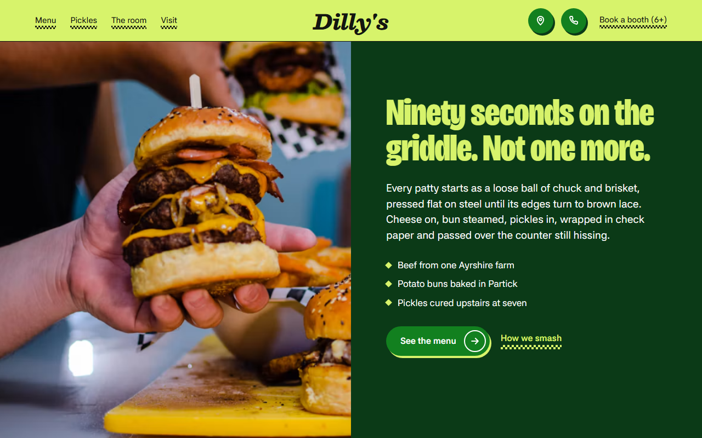
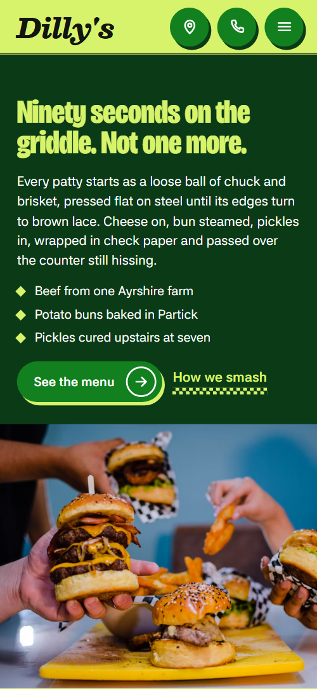
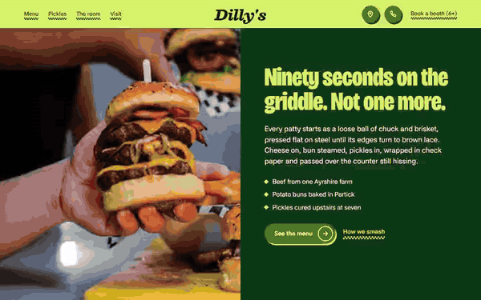

# Free HTML burger restaurant website template with scroll animations and no libraries

Burger restaurant website template: one free HTML file for a burger bar or casual diner, with a six-burger menu board, a five-step method section, house pickles, weekly nights and a booth booking form. Lime, deep green and check paper give it a loud look; the scroll motion is CSS with no libraries, and AGENTS.md lets Claude Code adapt it.

[](LICENSE)  

**[Live demo](https://8bsite.github.io/burger-restaurant-website-template/)** · **[Use this template](https://github.com/new?template_name=burger-restaurant-website-template&template_owner=8bsite)** · **[Download ZIP](https://github.com/8bsite/burger-restaurant-website-template/archive/refs/heads/main.zip)** · **[Template page on 8b.com](https://8b.com/templates/dillys/)**

<a href="https://8bsite.github.io/burger-restaurant-website-template/"></a> <a href="https://8bsite.github.io/burger-restaurant-website-template/"></a>

<p align="center"><a href="https://8bsite.github.io/burger-restaurant-website-template/"></a><br><sub>Scroll animation</sub></p>

## Use it with Claude Code, Cursor or Codex

Download the four files into your project folder (`curl.exe` in Windows PowerShell):

```bash
curl -LO https://raw.githubusercontent.com/8bsite/burger-restaurant-website-template/main/index.html
curl -LO https://raw.githubusercontent.com/8bsite/burger-restaurant-website-template/main/AGENTS.md
curl -LO https://raw.githubusercontent.com/8bsite/burger-restaurant-website-template/main/LICENSE
curl -LO https://raw.githubusercontent.com/8bsite/burger-restaurant-website-template/main/CREDITS.md
```

Then fill in the angle brackets and give your agent this prompt:

```text
Read AGENTS.md, then edit index.html. Make this the site for <my burger bar or diner: name, address, opening hours, the burgers and sides with prices, allergen and gluten-free policy, weekly nights, how groups book, phone, email, social links>. Replace first the wordmark, the six burgers, the method steps, the pickle list, the quotes and the photos. Keep the section ids, the classes AGENTS.md lists, the gate script in the head and three room stories; add no animation library. Never invent prices, hours, sourcing claims, reviews or contacts; ask me.
```

As a burger restaurant website template for Claude Code, Cursor or Codex, it goes fastest when you vibe code it and the agent has the facts only the bar can give: menu and prices, hours, address, allergens, weekly nights and group booking rules. The demo's hours, prices, sourcing claims and quotes are invented. Replace the wordmark, the six menu cells, the five method steps, the pickle list and the quotes first, and leave the section ids and the classes AGENTS.md lists for each script alone.

No agent? Click **[Use this template](https://github.com/new?template_name=burger-restaurant-website-template&template_owner=8bsite)**, edit `index.html` on GitHub and turn on **Settings > Pages**.

## Sections and motion

- **Navigation**: lime top bar with four links, the wordmark, a map pin, a phone button and a booking link; full-screen phone menu. The navigation bar slides away after a short downward scroll and comes back on the way up; on phones its links fold into a full-screen menu sheet.
- **Ninety seconds on the griddle. Not one more.**: one screen split in two: a photo of hands holding burgers on the left, a deep green panel with the h1 and the griddle claim on the right. On load the photo zooms in and the heading, text, facts and buttons rise in turn, then the photo drifts slowly in a CSS loop that pauses when it leaves the screen.
- **Six burgers. That's the menu.**: a checkerboard of six burgers, each a copy cell and a photo cell, plus a list of sides and drinks. Each burger cell slides in from the side as it climbs to mid-screen, alternating by row, while its photo settles from a zoom; the heading drops in with a squash.
- **Five moves, one griddle.**: dark griddle section: a full-bleed photo squeezed into a strip and the five cooking moves. On wide, tall screens the section is held for about one and a half screens while the photo flattens from a tall squeeze into a strip, the heading drops in and the five moves rise in turn.
- **Pickled upstairs before we open.**: photo of pickle jars with a price sticker beside a list of five house pickles. The photo arrives through a check pattern, the sticker stamps in with a small twist, the heading drops in with a squash, and the photo column stays in view beside the list on desktop.
- **A room built for elbows.**: a photo half and three short stories about the counter, the booths and the back bar. On desktop the photo column is held while the three stories pass, each new photo replacing the last through the check pattern as you scroll, and a centre seam draws down.
- **Every night has a thing.**: four weekly nights as rows with big day names, beside a photo and a sticker. The heading drops in, the photo arrives through the check pattern and the sticker stamps in, each once.
- **House rules.**: five house rules in huge type that a black band re-colours as they pass through the middle of the screen. A black band holds the middle of the screen while the five rules scroll behind it, and any rule inside the band reads lime on black.
- **Questions we hear a lot.**: six questions and answers (native &lt;details&gt;). The heading drops in once; each question opens natively and its plus icon turns into a cross.
- **Said at the counter.**: six customer quotes as stickers thrown on a table that settle into two columns. The six quote cards start displaced and tilted, then settle straight into two columns as the board crosses the screen.
- **Come in, or book for six.**: night photo, address, hours, contact lines and a booth booking form. The photo arrives through the check pattern and the heading drops in, each once.
- **Footer**: check strip, wordmark with one line, three link columns and the copyright line. The black and lime check strip slides sideways as the footer scrolls into view.

## Design

 navigation bar, the lime menu cells, the pickles, rules and booking grounds, headings on dark bands, two of the six quote cards, footer check strip  
 text, the thin rules between rows, the griddle and nights bands, the footer, the black band that crosses the house rules  
 filled buttons, round icon buttons and the plus icons on the questions  
 the opening's text panel, every second menu cell, the quotes band and the hard shadows under buttons, cards and stickers  
 menu, room and questions grounds, sticker faces, four of the quote cards and the booking form, text on the dark bands  
 only the small diamond above the text on each sticker

**Bricolage Grotesque**: weight 800 at 75% width: section headings, burger and method names, question text, sticker labels and the huge day names and house rules. **Besley**: prices, step numbers and pickle names in bold upright, the nav and footer wordmark and the customer quotes in italic. **Asta Sans**: body text at 400, buttons and links at 500 to 700, and small tracked uppercase labels at 700 (Google Fonts). Ten bands, each on its own ground: the photo and green panel, white menu, black griddle, lime pickles, white room, black nights, lime rules, white questions, green quotes and a lime booking block. Several open with a big condensed heading on one side and a short paragraph on the other. Two-column checkerboards, 1.5px black rules between rows and scalloped stickers repeat. Below 900 px most grids fold to one column.

## Questions

**Is it a restaurant website template with online ordering?**  
No. It shows the menu, not a basket: six burgers and six sides and drinks with prices, and no cart, payment or order form. The See the menu button can point to an ordering page you already use, and the demo's collection and booking lines are for you to replace.

**Where does the booth booking form send its requests?**  
Nowhere yet. It checks name, mobile, date, time and party size, shows a thank-you line that promises a text within the hour, and clears the fields. Connect Formspree or Netlify Forms using the steps in AGENTS.md, or link to OpenTable, SevenRooms or Resy, and edit that promise.

**Can I get a site like this without editing code?**  
Yes, with a different tool. [8B's AI website builder](https://8b.com/) designs a new site from a one-sentence description, not this template. Designing and restyling are free; publishing with hosting and SSL, full HTML export and AI edits in chat are on Pro at $9 a month billed yearly. It also runs inside Claude and ChatGPT through the 8B connector.

## Is it the right base?

Pick this for a counter-service bar that wants noise and colour; a sit-down table-grill place with set menus fits the [Korean barbecue](https://8b.com/templates/hwaro/) template better. This build loads no JavaScript library and no script from a CDN: the same look and motion in about 38 KB of gzipped code, against about 84 KB and three more requests for the GSAP version. The weak spot is booking: the form sends nothing until a service is connected, and there is no ordering or delivery.

## Before you publish

- Replace what is marked `data-8b-placeholder` (social preview image, favicon, phone, map, email, form, social) and the invented demo facts; [AGENTS.md](AGENTS.md) lists them.
- The form sends nothing yet: connect it to Formspree or Netlify Forms, or remove it.

## Tech

No JavaScript libraries: CSS scroll-driven animations and a small inline motion script with its own smooth wheel scrolling, 153 KB, no build step. Chrome and Edge 111+, Safari 16.2+, Firefox 113+ (it uses color-mix(), cascade layers, small/dynamic viewport units). Without scroll-driven animations (Firefox today) the scroll motion and the smooth wheel are off and each section shows its finished layout (a load-in or a loop may still play); with "reduce motion" on, the page is complete and nothing moves on its own (hover effects stay).

A GSAP build of the same page is [`index.gsap.html`](index.gsap.html): GSAP 3.13.0, ScrollTrigger, Lenis 1.3.27 from jsDelivr, 144 KB; its scroll motion also plays in Firefox. Use one of the two files.

## License

MIT, see [LICENSE](LICENSE). Photos, fonts and libraries keep their own licences: [CREDITS.md](CREDITS.md). More free templates: [8b.com/templates](https://8b.com/templates/) · [github.com/8bsite](https://github.com/8bsite).
