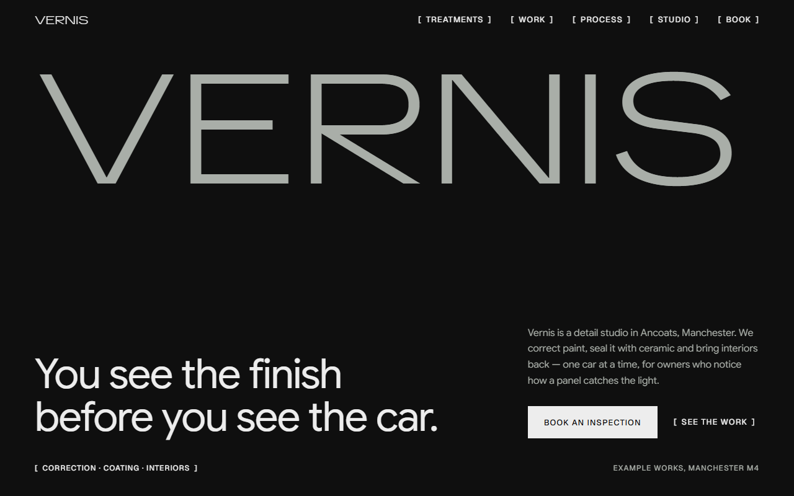
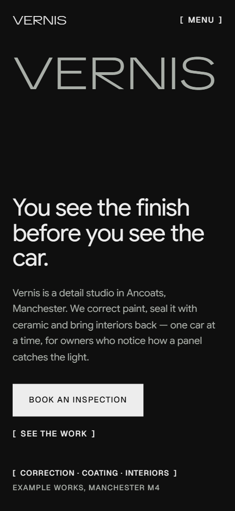
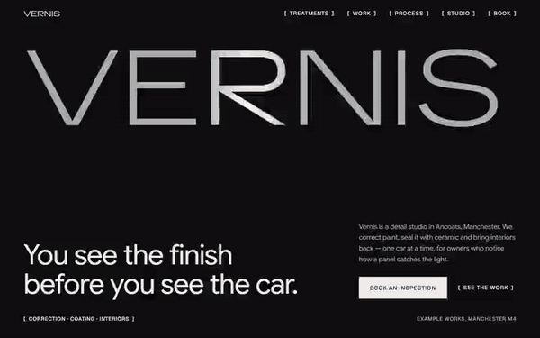

# Free HTML car detailing website template with scroll animations and no libraries

Car detailing website template: one free HTML file for a studio selling paint correction, ceramic coating and interior care, with priced treatments, a paint readings sheet, a five-day working week and an inspection form. The look is near-black with a very wide light wordmark. Its scroll motion runs on CSS with no JavaScript libraries, and Claude Code can adapt it.

[](LICENSE)  

**[Live demo](https://8bsite.github.io/car-detailing-website-template/)** · **[Use this template](https://github.com/new?template_name=car-detailing-website-template&template_owner=8bsite)** · **[Download ZIP](https://github.com/8bsite/car-detailing-website-template/archive/refs/heads/main.zip)** · **[Template page on 8b.com](https://8b.com/templates/vernis/)**

<a href="https://8bsite.github.io/car-detailing-website-template/"></a> <a href="https://8bsite.github.io/car-detailing-website-template/"></a>

<p align="center"><a href="https://8bsite.github.io/car-detailing-website-template/"></a><br><sub>Scroll animation</sub></p>

## Use it with Claude Code, Cursor or Codex

Download the four files into your project folder (`curl.exe` in Windows PowerShell):

```bash
curl -LO https://raw.githubusercontent.com/8bsite/car-detailing-website-template/main/index.html
curl -LO https://raw.githubusercontent.com/8bsite/car-detailing-website-template/main/AGENTS.md
curl -LO https://raw.githubusercontent.com/8bsite/car-detailing-website-template/main/LICENSE
curl -LO https://raw.githubusercontent.com/8bsite/car-detailing-website-template/main/CREDITS.md
```

Then fill in the angle brackets and give your agent this prompt:

```text
Read AGENTS.md, then edit index.html. Make this the site for <my detailing business: name, city, treatments with times and starting prices, recent cars with my own photos, the working week, reviews, warranty, hours, address, contacts, how people book>. Keep the gate script in the head, the motion kit, the section ids, the data-8b-* attributes AGENTS.md lists, twelve readings rows and five cars, and set each --len to its text's length; add no animation library. Ask me for missing facts; never invent prices, readings, reviews or contacts.
```

A coding agent should replace first the studio name, address, hours, the three treatments with times and starting prices, the five cars with their photos and the six reviews. Vibe coding with Claude Code or Cursor goes fastest when you hand over your own paint readings, warranty terms and collection radius, because the demo's figures are invented. Treat this car detailing website template for Claude Code as a layout to fill with facts only the studio has.

No agent? Click **[Use this template](https://github.com/new?template_name=car-detailing-website-template&template_owner=8bsite)**, edit `index.html` on GitHub and turn on **Settings > Pages**.

## Sections and motion

- **Navigation**: fixed bar: wordmark, five section links in the page's own link style, Menu button on phones with a full-screen overlay. The bar hides when you scroll down past 140 px and returns when you scroll up.
- **You see the finish before you see the car.**: two screens: a wide wordmark with headline, intro, two actions and an address caption, then a framed photo of a car in a tunnel of light with a claim and three tags. The wordmark and headline rise on load and a sheen loops across the wordmark; on scroll the wordmark lifts away, 24 photo tiles (12 on phones) fly in and lock into one frame, then a haze sweeps off behind a thin line and the claim and tags fade up.
- **Three treatments, one standard of light.**: three tall rows: treatment name in the wide face, lead, text, time in the studio, price from, and a photo. Per row, on scroll: the name widens from condensed to full width, the photo opens from a narrow slit to the whole frame and the text brightens.
- **We read the paint before we cut it.**: a sheet of twelve panels with paint depth in microns and a bar for each; one flagged as resprayed. A scan line runs down the sheet while the bars grow to their values row by row and the flagged row's ground fades in.
- **Cars that left the studio this season.**: an offset grid of five recent cars, each with two tags on the photo, a name and a description. Each car drifts into place on scroll: the first and fourth settle down from above, the other three rise from below, and the third car's photo also zooms out inside its frame.
- **One car in the studio at a time.**: a photo of a car in a white room beside a short text and three facts with square markers. A haze veil sweeps off the photo once, behind a vertical line, as it scrolls into view.
- **A working week for one car.**: a working week of five day columns, Monday to Friday, with a stack of photos travelling across them. Held in place on wide screens for about one and a half screens of scroll: five stacked photos spread to their day columns while a line above the days grows; phones run it down the rows in normal flow.
- **Owners, in their words.**: six owner quotes on cards that stand as a descending staircase and level into one row on a sideways track. Held in place for about two screens of scroll, the cards slide sideways and climb from a staircase into one row while the ground shifts from deep green toward olive-brown.
- **What owners ask before booking.**: six questions in native details elements beside a heading. The plus sign turns into a minus by a CSS transition when a question opens.
- **A coating is not armour. Wash it gently, dry it softly, and the gloss you collected is the gloss you keep.**: a sage-ground statement with three rules, a maintenance wash offer and a photo of a towel on a bonnet. The statement's words clear from a faint fade one by one as you scroll, with a blur on wide hover screens, and the photo settles and zooms out in its frame.
- **Forty minutes under the lamps.**: booking form beside the studio details: address, hours, phone, email.
- **Footer**: footer with the wordmark across the width, address, hours, contact, page links and legal lines. The wordmark widens from condensed to full width as the footer scrolls into view.

## Design

 page ground of the opening, treatments, work, process, questions, contact and footer; text on the buttons and the pale review cards  
 body and heading text, button fill, the footer wordmark, the sheen on the opening wordmark, reading bars and focus outlines  
 the opening wordmark, paragraphs under headings, spec labels and the muted lines in the footer  
 deep green ground of the paint readings and studio sections and the starting ground of the reviews  
 sage ground of the aftercare section, the button hover wipe, form underlines, question rules and the flagged resprayed row  
 the six review cards  
 tag ground, photo placeholders, bar tracks and hairlines between treatment rows and in the footer  
 the olive-brown the reviews ground reaches at the end of its sideways track

**TikTok Sans**: the uppercase wordmark in the bar, the opening and the footer, and the three treatment names: weight 300 on a width axis that runs from 75% to 150%. **Google Sans**: headings, body text, leads, review quotes, questions and form text, all at weight 400, headings with slightly tight tracking. **Geist**: captions, tags, buttons, links, the table legend and form labels: weight 500, uppercase, 0.08em tracking, 11 to 13 px (Google Fonts). A twelve-column grid with square corners throughout. Display lines use a light face stretched wide: the wordmark and each treatment name are sized from their character count to fill the container. Small bracketed uppercase captions label the sections, and hairlines divide the treatment rows and the questions. Recent cars sit in an offset pattern of five, readings in a table with bars, and reviews on pale cards.

## Questions

**Where does the inspection form send its messages?**  
Nowhere yet. The form needs a name plus a phone number or an email, then shows a thank-you line that promises a call within one working day and clears the fields. Connect Formspree or Netlify Forms with the steps in AGENTS.md, or point the booking links at your own booking page.

**Does it work in Firefox and with reduced motion?**  
Yes. Without CSS scroll-driven animations (Firefox today) this car detailing template keeps its load-in and wordmark sheen but drops the scroll scenes and smooth wheel: the opening photo stands whole, bars sit at their values, reviews form a row you swipe. With reduced motion nothing moves on its own; the navigation bar still hides on scroll.

**Can I get a site like this without editing code?**  
Yes, with [8B's AI website builder](https://8b.com/). Describe the site in a sentence and its engine designs a new one, with its own design, not this template. Designing and restyling are free; hosting with SSL, HTML export and AI edits in chat are on Pro at $9 a month billed yearly. It also runs inside Claude and ChatGPT.

## Is it the right base?

Choose this for a studio that takes one car at a time and sells on finish. This build has the same look and motion with no script from a CDN: 29 KB of code gzipped in one file, against 76 KB and four extra requests for the GSAP version. Most car detailing website templates assume packages and an online calendar; this one has neither. A call-out business such as a plumber suits the [trades layout](https://8b.com/templates/ferrule/) better. Without code, 8B's builder is another route.

## Before you publish

- Replace what is marked `data-8b-placeholder` (social preview image, favicon, phone, form, email) and the invented demo facts; [AGENTS.md](AGENTS.md) lists them.
- The form sends nothing yet: connect it to Formspree or Netlify Forms, or remove it.

## Tech

No JavaScript libraries: CSS scroll-driven animations and a small inline motion script with its own smooth wheel scrolling, 125 KB, no build step. Chrome and Edge 111+, Safari 16.2+, Firefox 113+ (it uses color-mix(), container query units, cascade layers, small/dynamic viewport units). Without scroll-driven animations (Firefox today) the scroll motion and the smooth wheel are off and each section shows its finished layout (a load-in or a loop may still play); with "reduce motion" on, the page is complete and nothing moves on its own (hover effects stay).

A GSAP build of the same page is [`index.gsap.html`](index.gsap.html): GSAP 3.13.0, ScrollTrigger, SplitText, Lenis 1.3.27 from jsDelivr, 107 KB; its scroll motion also plays in Firefox. Use one of the two files.

## License

MIT, see [LICENSE](LICENSE). Photos, fonts and libraries keep their own licences: [CREDITS.md](CREDITS.md). More free templates: [8b.com/templates](https://8b.com/templates/) · [github.com/8bsite](https://github.com/8bsite).
