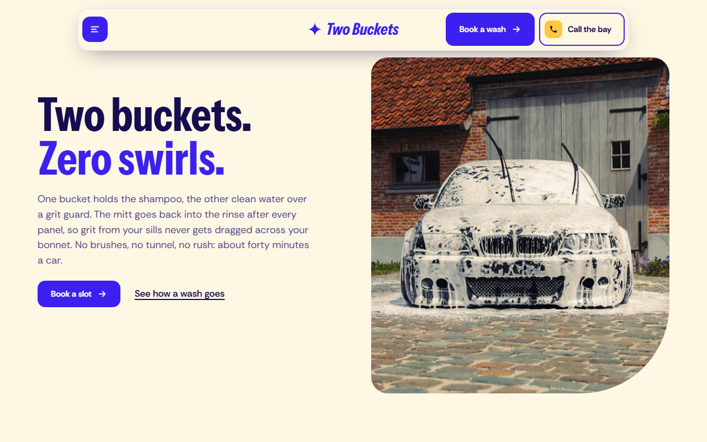
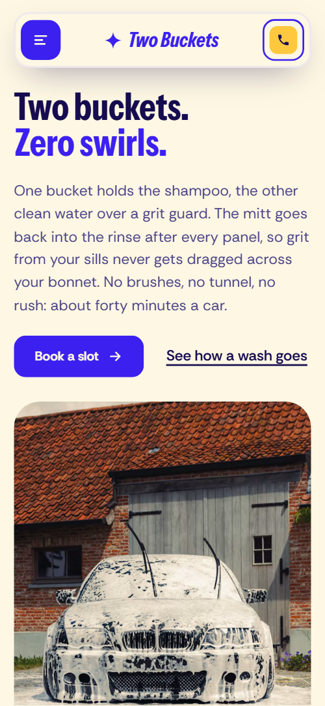
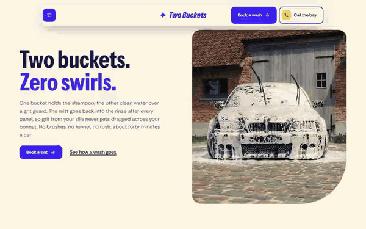

# Free HTML car wash website template with scroll animations and no libraries

Car wash website template: one free HTML page for a hand car wash or valeting bay, with a five-step wash method, a price board that changes with vehicle size, interior work, paint protection coats, a monthly Wash Club and a booking form. Violet, foam cream and yellow, with scalloped edges and CSS scroll motion, no libraries.

[](LICENSE)  

**[Live demo](https://8bsite.github.io/car-wash-website-template/)** · **[Use this template](https://github.com/new?template_name=car-wash-website-template&template_owner=8bsite)** · **[Download ZIP](https://github.com/8bsite/car-wash-website-template/archive/refs/heads/main.zip)** · **[Template page on 8b.com](https://8b.com/templates/two-buckets/)**

<a href="https://8bsite.github.io/car-wash-website-template/"></a> <a href="https://8bsite.github.io/car-wash-website-template/"></a>

<p align="center"><a href="https://8bsite.github.io/car-wash-website-template/"></a><br><sub>Scroll animation</sub></p>

## Use it with Claude Code, Cursor or Codex

Download the four files into your project folder (`curl.exe` in Windows PowerShell):

```bash
curl -LO https://raw.githubusercontent.com/8bsite/car-wash-website-template/main/index.html
curl -LO https://raw.githubusercontent.com/8bsite/car-wash-website-template/main/AGENTS.md
curl -LO https://raw.githubusercontent.com/8bsite/car-wash-website-template/main/LICENSE
curl -LO https://raw.githubusercontent.com/8bsite/car-wash-website-template/main/CREDITS.md
```

Then fill in the angle brackets and give your agent this prompt:

```text
Read AGENTS.md, then edit index.html. Make this the site for <my car wash or valeting business: name, address, opening hours, prices for small, family and large vehicles, the five wash steps, coats with prices, club price and perks, crew, booking method>. Replace first the brand, address, phone, Sheffield references, reviews and crew. Keep the section ids, the gate script in the head, the three price data attributes, five steps with five photos and four coats; add no animation library. Never invent prices, hours, guarantees or reviews; ask me.
```

As a car wash website template for Claude Code, Cursor or Codex, it goes quickest when you vibe code it and give the agent the facts only the owner has: prices for each vehicle size, hours, the club price and perks, protection claims, the redo promise, the tallest vehicle the bay takes, crew and company details. The demo invents all of them, plus the 4.9 rating and the eight reviews. The agent swaps the name in any letter case and rewrites the five wash steps and their minutes.

No agent? Click **[Use this template](https://github.com/new?template_name=car-wash-website-template&template_owner=8bsite)**, edit `index.html` on GitHub and turn on **Settings > Pages**.

## Sections and motion

- **Navigation**: floating pill bar with a menu button, the wordmark, a booking button and a call button; full-screen menu with nine links. The bar slides in from above on load and tucks away after about 24 pixels of downward scroll, returning on upward scroll.
- **Two buckets. Zero swirls.**: one screen: the h1 with a short paragraph and two actions on the left, a tall rounded photo of a snow-foamed car on the right. On load the two h1 lines rise in turn, then the paragraph and buttons, and the foam photo settles up into place.
- **How a wash goes**: five wash steps with timings, next to a held window where each step's photo rises over the last. The photo window stays in view while the five steps pass; each next photo rises over the last behind a cream scalloped edge while the other steps dim.
- **The wash menu**: violet price board of six services whose prices change with a vehicle size switch. The heading and six price rows spring up once as they scroll in; picking a vehicle size swaps all six prices at once.
- **Inside, too**: a heading with a booking button held on the left while five interior photos slide across from the right. The heading stays on the left while the five interior cards slide right to left as you scroll.
- **Gloss that lasts the winter**: four coats of paint protection with prices from, beside two overlapping photos. The four coats start pressed into one tilted slab and spread into the list, while the two photos drift past each other and catch a light sweep.
- **The people with the mitts**: four team portraits with names, roles and one line each. The heading and then each of the four portraits spring up once, and a light band crosses each photo.
- **What Sheffield says**: a rating line and eight review cards in two rows sliding in opposite directions. The two rows of review cards slide sideways in opposite directions as the section crosses the screen.
- **The Wash Club**: yellow disc that grows into the ground behind the Wash Club offer: price, four perks and two buttons. A scalloped yellow disc grows from a small turned shape until it fills the section while the offer rises out of it.
- **Before you come**: five questions and answers (native &lt;details&gt;). The heading and each question spring up once on arrival; answers open as native details elements.
- **Book a wash**: violet booking ground with drifting bubbles, the address, hours and contacts, and a booking form. Three layers of bubbles drift upward at different speeds while the form card straightens out of a slight tilt.
- **Footer**: wordmark with a line, section links, address and phone, social links and the copyright line. The four footer blocks spring up once as they scroll in.

## Design

 primary buttons, the wordmark, the violet price, protection, review and booking grounds, the menu overlay, the second line of the h1, the club price  
 page ground, review and booking form cards, text on the violet sections, scalloped edges  
 body and heading text, the footer ground, the fourth protection coat, the hover fill of the primary button  
 prices, the selected size, the Step tags, the club disc, the secondary button, the second protection coat, alternate review cards  
 badges, photo frame backgrounds, lead text on violet, the third protection coat, tint of the question rows  
 bubbles in the booking section, the size switch border, icon button hover and the menu close button  
 paragraph text on cream sections and review footers

**Instrument Sans**: bold condensed (weight 700, width 75%) for headings, prices, step titles, review quotes and the italic wordmark and menu title. **Rethink Sans**: body text at weight 400, labels at 600 and buttons at 700, in one variable font file (Google Fonts). Photo frames keep one large cut corner, 120 to 160 pixels on a wide screen, with a 30 pixel radius on the others. Cream and violet sections alternate, and nine sections start with a scalloped foam edge drawn in CSS. Content sits in a column up to 1240 pixels wide. Prices are a dashed row board, protection is four stacked coloured cards, and crew portraits are arched pillars of different heights.

## Questions

**Can it work as a car detailing website for paint correction and ceramic coating?**  
Yes. The protection section lists four coats with from prices: decontamination, machine polish, sealant and ceramic coat, each with a sentence. Rename them to your own packages. The sealant and ceramic durations are demo claims, so replace them with what your products really do.

**How do customers book, and does the form send anything?**  
The booking form asks for name, mobile, vehicle size, service, day and a note, and requires name and mobile. As shipped it sends nothing: it shows a thank-you line and clears the fields. Connect Formspree or Netlify Forms, or link the buttons to your booking system.

**Can I get a site like this without editing code?**  
Yes, with [8B's AI website builder](https://8b.com/). You describe the site in a sentence and its engine designs a new site, its own design and not this template. Designing and restyling are free; hosting with SSL, HTML export and AI edits in chat are on Pro at $9 a month billed yearly. It also runs inside Claude and ChatGPT.

## Is it the right base?

As a car detailing website template it suits a single bay with bookings and a club, and it shows a price for every service. This build has no JavaScript library and no script from a CDN: the same look and scroll behaviour in about 24 KB of gzipped code, a third of the 71 KB the GSAP version needs. A business that quotes each job, such as [an electrician's](https://8b.com/templates/ohmstead/) practice, needs a different page, and the booking form sends nothing until a service is connected.

## Before you publish

- Replace what is marked `data-8b-placeholder` (social preview image, favicon, phone, email, form, social) and the invented demo facts; [AGENTS.md](AGENTS.md) lists them.
- The form sends nothing yet: connect it to Formspree or Netlify Forms, or remove it.

## Tech

No JavaScript libraries: CSS scroll-driven animations and a small inline motion script with its own smooth wheel scrolling, 96 KB, no build step. Chrome and Edge 111+, Safari 16.2+, Firefox 121+ (it uses color-mix(), :has(), cascade layers, small/dynamic viewport units). Without scroll-driven animations (Firefox today) the scroll motion and the smooth wheel are off and each section shows its finished layout (a load-in or a loop may still play); with "reduce motion" on, the page is complete and nothing moves on its own (hover effects stay).

A GSAP build of the same page is [`index.gsap.html`](index.gsap.html): GSAP 3.13.0, ScrollTrigger, Lenis 1.3.11 from jsDelivr, 90 KB; its scroll motion also plays in Firefox. Use one of the two files.

## License

MIT, see [LICENSE](LICENSE). Photos, fonts and libraries keep their own licences: [CREDITS.md](CREDITS.md). More free templates: [8b.com/templates](https://8b.com/templates/) · [github.com/8bsite](https://github.com/8bsite).
