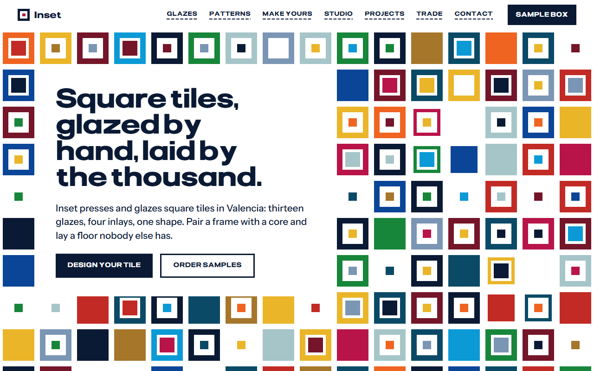
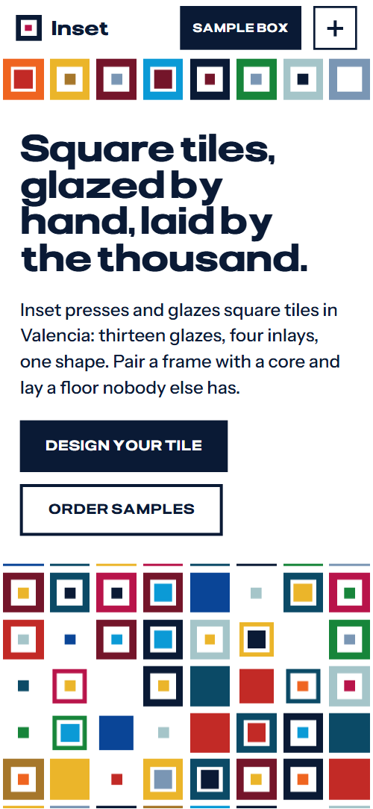
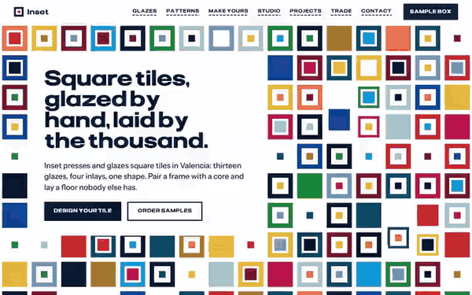

# Free HTML ceramic tile website template with GSAP scroll animations

Ceramic tile website template: one free HTML file for a tile maker or ceramics studio that sells custom glazed tiles to homes, cafes and trade. It has a glaze wall, a live tile designer with a price per square metre, trade specs and a sample box, in saturated colour. AGENTS.md lets Claude Code, Cursor or Codex adapt it.

[](LICENSE)  

**[Live demo](https://8bsite.github.io/ceramic-tile-website-template/)** · **[Use this template](https://github.com/new?template_name=ceramic-tile-website-template&template_owner=8bsite)** · **[Download ZIP](https://github.com/8bsite/ceramic-tile-website-template/archive/refs/heads/main.zip)** · **[Template page on 8b.com](https://8b.com/templates/inset/)**

<a href="https://8bsite.github.io/ceramic-tile-website-template/"></a> <a href="https://8bsite.github.io/ceramic-tile-website-template/"></a>

<p align="center"><a href="https://8bsite.github.io/ceramic-tile-website-template/"></a><br><sub>Scroll animation</sub></p>

## Use it with Claude Code, Cursor or Codex

Download the four files into your project folder (`curl.exe` in Windows PowerShell):

```bash
curl -LO https://raw.githubusercontent.com/8bsite/ceramic-tile-website-template/main/index.html
curl -LO https://raw.githubusercontent.com/8bsite/ceramic-tile-website-template/main/AGENTS.md
curl -LO https://raw.githubusercontent.com/8bsite/ceramic-tile-website-template/main/LICENSE
curl -LO https://raw.githubusercontent.com/8bsite/ceramic-tile-website-template/main/CREDITS.md
```

Then fill in the angle brackets and give your agent this prompt:

```text
Read AGENTS.md, then edit index.html. Make this the site for <my tile or ceramics business: name, city, products, colour or size options with prices per square metre, how a piece is made, projects, sample and trade terms, showroom, how people enquire>. Replace first the brand name, the footer wordmark's len, the glaze names and pairing notes, prices, specs and contacts. Keep the section ids, the data-price, data-extra and data-core attributes and the counts AGENTS.md lists. Ask me for missing facts and never invent prices, specs, firing claims or contacts.
```

For vibe coding in Claude Code, Cursor or Codex, give the agent the facts only the maker has: glaze names, the price per square metre for each size, inlay extras, trade terms, lead times, showroom details and project captions. The agent should rename the glazes in the wall, in both swatch rows, the pairing notes and the project captions together, and update the footer wordmark's len to the new name's length. It must keep the data-price, data-extra and data-core attributes and invent no prices or specs.

No agent? Click **[Use this template](https://github.com/new?template_name=ceramic-tile-website-template&template_owner=8bsite)**, edit `index.html` on GitHub and turn on **Settings > Pages**.

## Sections and motion

- **Navigation**: fixed bar: logo with a tile mark, seven links, Sample box button and a menu button; full-screen menu with a colour square per link under 1080px; hides on scroll down.
- **Square tiles, glazed by hand, laid by the thousand.**: two screens: a field of square tiles under a headline plate with two buttons, then a navy core explaining that every tile is three squares, with a photo. On load the tiles pour in and the headline rises; scrolling the first screen shrinks many tiles away and sends a band of others, turned a quarter and in colour order, to the screen edges as a giant frame, while two groups of three tiles slide round a small square on a loop.
- **Thirteen glazes, fired to stay loud.**: a wall of thirteen glaze tiles with names and pairing notes, plus a note about the clay. The heading is revealed in a hard left-to-right wipe and each glaze tile pours in, ring then core, as it arrives.
- **One tile, four floors.**: a held screen where a 6 by 6 floor of tiles flips between four layouts while a list marks the current one. Pinned for about two screens of scroll: a 6 by 6 floor of two-faced tiles flips in diagonal waves through four layouts while the list marks the current one.
- **Design your own tile.**: a tile designer: pick frame glaze, core glaze, inlay and size, see a 5 by 5 floor and a live price per square metre. Every choice updates the 5 by 5 preview floor, the one-line summary and the price per square metre; only the heading animates on scroll.
- **From wet clay to a loud floor.**: five making steps on a sideways track beside one tile that goes from clay to fired colour (held screen). Pinned for about three screens of scroll: five steps slide sideways while one tile goes from wet clay to dry, to chalky raw glaze, to fired colour.
- **Laid in kitchens, pools and cafés.**: a collage of six installed projects with captions, among small coloured tile chips. The heading wipes in and the eight small tile chips between the photos pour in as they arrive.
- **Six tiles in a box, at your door in three days.**: sample box offer with three facts, two actions and a photo, beside a sliding-puzzle board of eight tiles. Scrubbed with the scroll, the eight tiles of the sample board start scrambled and slide one square at a time into colour order.
- **For architects, builders and anyone ordering by the pallet.**: trade offer text and three size cards with specs, each with a nested square drawing. The three squares start nested inside one another and slide apart over their own spec columns as the cards come into view.
- **Asked every week.**: six questions and answers as native details, beside a heading and a contact link. The heading wipes in; questions open and close without JavaScript, and the plus sign turns into a minus.
- **Come and see them fired.**: showroom details and a project enquiry form inside a frame of four colour bands. Four colour bands slide in from beyond the section's edges and settle into a frame around the navy contact panel.
- **Footer**: a row of thirteen tiles, four link columns, a large wordmark, and a legal line with the Design: 8B credit. The row of thirteen tiles pours in as it arrives.

## Design

 page ground, the headline plate, tile rings, text on the navy panels, form fields  
 body text, buttons and the outlined button's hover fill, the 2px rules, the navy panels, the Night glaze  
 Raspberry glaze, the filled button's hover fill, focus outline, list bullets, the logo mark's core, the top contact band  
 Claret glaze  
 Signal glaze  
 Tangerine glaze  
 Marigold glaze, the designer's default core, the thank-you line, the right contact band, focus outline on navy  
 Ochre glaze  
 Fern glaze, the designer's default frame, the left contact band  
 Harbour glaze and the secondary text: pairing notes, spec labels, step numbers, layout descriptions, footer lines  
 Cobalt glaze, the second colour of the patterns floor, the core of the fired tile, the bottom contact band  
 Lido glaze  
 Mist glaze and the backgrounds behind photos while they load  
 Slate glaze

**Pliant**: headings, labels, buttons, links and the price in weights 700 to 800, stretched to 125% width; labels and buttons are uppercase with tracking. **Instrument Sans**: body text, intro lines and form fields in weights 400 to 600 (Google Fonts). Below a sticky first-screen field of small tiles (16 columns on a desktop, 12 under 1100px, 8 under 760px) sit full-width bands: a 7-column glaze wall (4 under 960px, 3 under 420px), a 12-column collage of six project photos with captions on white tabs, and three size cards with spec rows. Navy panels hold the second screen and the contact form, which four colour bands frame.

## Questions

**Is there a free HTML website template for a tile maker?**  
Yes. This is one HTML file under the MIT licence with inline CSS and scripts, GSAP and Lenis loaded from jsDelivr, and ten Unsplash photos. It covers glazes, floor patterns, a designer, how a tile is made, projects, samples, trade specs, a FAQ and a contact form.

**Does the tile designer take orders?**  
No. It changes the preview floor, the one-line summary and the price shown, which is the size price plus the inlay extra, and it sends nothing. The Put it in a sample box button only jumps to the samples section. Connect your shop or an order form first.

**Does the contact form send anything?**  
No. The form checks the required fields, shows the thank-you line and resets, so nothing leaves the page. Connect Formspree or Netlify Forms, or point it at your email, before publishing; AGENTS.md lists the steps for this form and for the designer.

## Is it the right base?

This is the right base when the product is one custom item with colour and size choices and buyers order samples first. A showroom that sells many ranges and fits them itself suits the [showroom-led tile shop](https://8b.com/templates/tegel/) template better, and a ceramics website template for tableware would need the tile drawings replaced. The weak spot is the designer: it changes the preview and the price shown, and nothing else. People who do not code can use 8B's builder instead.

## Before you publish

- Replace what is marked `data-8b-placeholder` (social preview image, favicon, form, phone, email, social) and the invented demo facts; [AGENTS.md](AGENTS.md) lists them.
- The form sends nothing yet: connect it to Formspree or Netlify Forms, or remove it.

## Tech

GSAP 3.13.0, ScrollTrigger, Lenis 1.3.27 from jsDelivr, 115 KB, no build step. Chrome and Edge 111+, Safari 16.2+, Firefox 121+ (it uses color-mix(), container query units, :has(), cascade layers, small/dynamic viewport units). With "reduce motion" on, the page is complete and still.

## License

MIT, see [LICENSE](LICENSE). Photos, fonts and libraries keep their own licences: [CREDITS.md](CREDITS.md). More free templates: [8b.com/templates](https://8b.com/templates/) · [github.com/8bsite](https://github.com/8bsite).
