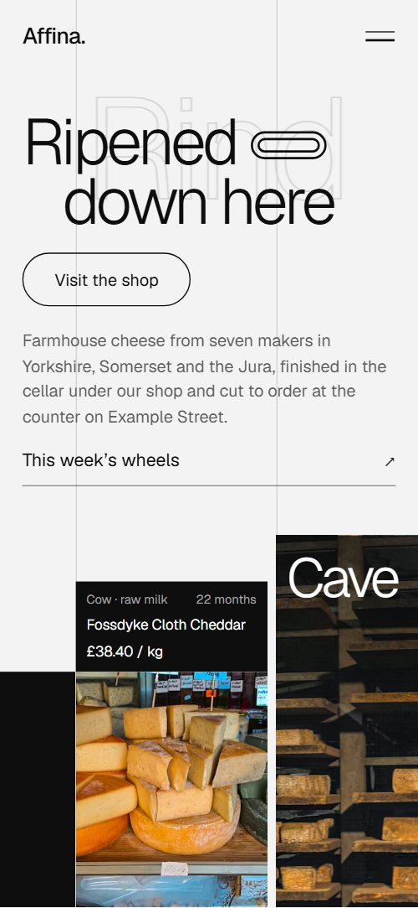
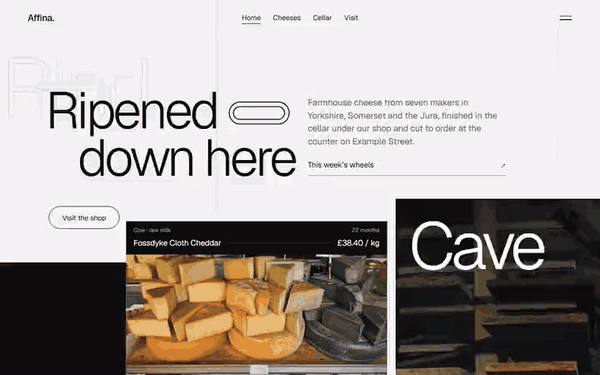

# Free HTML cheese shop website template with GSAP scroll animations

Cheese shop website template: one free HTML page for a cheesemonger that matures its own wheels in a cellar, with a counter list, five cellar steps, tastings, a monthly club and a visit form. The look is light grey and black with hairline grids. AGENTS.md is included, so Claude Code, Cursor or Codex can adapt it.

[](LICENSE)  

**[Live demo](https://8bsite.github.io/cheese-shop-website-template/)** · **[Use this template](https://github.com/new?template_name=cheese-shop-website-template&template_owner=8bsite)** · **[Download ZIP](https://github.com/8bsite/cheese-shop-website-template/archive/refs/heads/main.zip)** · **[Template page on 8b.com](https://8b.com/templates/affina/)**

<a href="https://8bsite.github.io/cheese-shop-website-template/"></a> <a href="https://8bsite.github.io/cheese-shop-website-template/"></a>

<p align="center"><a href="https://8bsite.github.io/cheese-shop-website-template/"></a><br><sub>Scroll animation</sub></p>

## Use it with Claude Code, Cursor or Codex

Download the four files into your project folder (`curl.exe` in Windows PowerShell):

```bash
curl -LO https://raw.githubusercontent.com/8bsite/cheese-shop-website-template/main/index.html
curl -LO https://raw.githubusercontent.com/8bsite/cheese-shop-website-template/main/AGENTS.md
curl -LO https://raw.githubusercontent.com/8bsite/cheese-shop-website-template/main/LICENSE
curl -LO https://raw.githubusercontent.com/8bsite/cheese-shop-website-template/main/CREDITS.md
```

Then fill in the angle brackets and give your agent this prompt:

```text
Read AGENTS.md, then edit index.html. Make this the site for <my shop: name, address, hours, counter cheeses with milk, age and price per kilo, farms we buy from, tasting dates, seats and prices, club plans, posting rules, phone, email>. Replace the shop name, address, cheeses, farms and prices first. Keep the section ids, the classes AGENTS.md lists and the --h, --w and --len values, setting each --len to the new word's character count. Ask me for any missing fact and never invent prices, ages, farms, hours or contacts.
```

In vibe coding with Claude Code, Cursor or Codex, give the agent the facts only the shop has: prices per kilo, milk, raw or pasteurised, ageing times, tasting dates, club plans and delivery rules. It should replace the shop name in the bar, the menu and the footer wordmark, give each new counter panel its own height and width, and swap the farms for your suppliers.

No agent? Click **[Use this template](https://github.com/new?template_name=cheese-shop-website-template&template_owner=8bsite)**, edit `index.html` on GitHub and turn on **Settings > Pages**.

## Sections and motion

- **Navigation**: bar with the wordmark, four links and a menu button; full-screen overlay with seven links, address, phone and email.
- **Ripened down here**: two screens: a two-line headline with a small pill, a product label panel, a framed cellar photo, then the dark cellar with three facts. On load the headline lines rise and the product label and cellar photo open upward; scrolling floods the page black from the bottom left, parts the headline to the sides, widens the cellar photo leftward across its frame and brings the second screen's copy in from the right.
- **On the counter this week**: five cheeses on a stepped skyline of tall panels, each with a label of milk, age, name and price. With the scroll, each panel climbs out of the floor a beat after its left neighbour until the row settles into its stepped heights, and on phones the panels slide in from the left.
- **What the cellar does**: five steps of the maturing process beside a held square frame that turns a quarter turn per step and changes photo. A square frame held by CSS sticky turns a quarter turn per step while its photo stays upright and changes to the next step's photo, and each step's hairline fills as it passes.
- **Three milks, three tempers**: three bands (cow, ewe, goat), each with a photo of the animals, a black field with a giant word and a short text. Each band's black field starts across the whole band and recedes to its 40 percent side as you scroll, with the giant word riding the edge and the photo settling from a closer crop.
- **Cut to order, wrapped in paper**: a photo of a wheel being cut beside a heading and four ruled tips. The photo opens upward from its bottom edge, the heading rises line by line and a hairline draws above each of the four tips, once, as they enter.
- **Seven farms we buy from**: seven farms on a horizontal track that slides sideways while the page scrolls down. The section holds a screen-high stage while the track of seven panels slides sideways by its own overflow and each photo drifts against the movement.
- **Thursdays in the cellar**: a heading, a photo of a laid table and four dated tasting rows with seats, price and a Book a seat link. The heading rises line by line, the photo opens upward and a hairline draws above each of the four dated rows.
- **The cellar club**: three monthly parcels (Pair, Board, Cellar) with photos, prices and join buttons, dealt out of one stack. On wide screens the three parcels start piled on the middle one, each tilted, and spread into their row with the scroll; on narrower screens each is dealt in from alternating sides.
- **Questions at the counter**: six questions in native details elements with hairlines, beside a heading. The heading rises and a hairline draws above each of the six questions; opening one turns its plus into a minus.
- **Come downstairs**: a text column with address, hours, phone, email and a message form, beside a shop photo cut into three sliding columns. Three columns showing thirds of one shop photo start offset by different amounts, some up and some down, and slide to meet as a single picture as the section nears mid-screen.
- **Footer**: footer with a one-line description, two link lists, a very wide wordmark and a base line.

## Design

 page ground of the first screen, counter, milk, cut, tastings, questions and footer sections, and the bar once scrolled  
 text and button borders on light grounds, and the ground of the second screen, cellar, farms, club, visit and the labels  
 intro paragraphs, tasting descriptions, seats, cut tip terms, answers and the footer base line on light grounds  
 hairlines on light grounds, the outlined ghost word and the grid rules of the first screen  
 text and outline buttons on black grounds, the label text, and the visit form's inputs  
 small text on black: label meta, step numbers, paragraphs on black, form labels and the milk cheese lists  
 rules on black, the ground of club parcels and the cellar frame, and the placeholder behind photos

**Geist**: the only typeface: weight 300 for the headline, section titles and giant words at tight negative tracking, 400 for body text, labels, links and buttons, and 500 only for the wordmark in the bar (Google Fonts). Light grey bands alternate with black ones. The first screen is crossed by two vertical hairlines, and a black block grows from its bottom left corner. Counter panels stand at five different heights like a skyline, each with a black label of milk, age, name and price above a portrait photo. Section heads sit in a wide column beside a narrower intro. Milk bands alternate sides, while tastings, cut tips and questions are ruled rows.

## Questions

**Can a deli, butcher or farm shop use it instead of a cheese shop?**  
Yes, if the shop sells by weight from a counter and buys from named makers. Swap cheeses for hams, pies or loaves, turn the cellar steps into curing or baking, and the farm panels into suppliers. A shop with a long catalogue needs more pages than this one.

**Does the visit form send messages?**  
No. It checks that a name and a valid email are filled, shows a thank-you line and clears the fields, and nothing is sent. Connect Formspree or Netlify Forms with the steps in AGENTS.md, or delete the form and keep the email link. The tasting and club buttons open a mail program, not a checkout.

**Can I get a site like this without editing code?**  
Yes, with [8B's AI website builder](https://8b.com/templates/8b/). You describe the site in a sentence and its engine designs a new one, in its own style rather than this template. Designing and restyling are free; hosting with SSL, full HTML export and AI edits in chat are on Pro at $9 a month billed yearly. It also runs inside Claude and ChatGPT.

## Is it the right base?

It suits a shop that buys from named makers and sells by weight, tastings or box. Drinks and desserts fit the [bubble tea bar](https://8b.com/templates/chewsday/) template better. The weak spot is ordering: Order for collection jumps to the visit form, which sends nothing yet, and the club and tasting buttons open an email. A shop selling online needs a cart, which this page does not have.

## Before you publish

- Replace what is marked `data-8b-placeholder` (social preview image, favicon, phone, email, form) and the invented demo facts; [AGENTS.md](AGENTS.md) lists them.
- The form sends nothing yet: connect it to Formspree or Netlify Forms, or remove it.

## Tech

GSAP 3.13.0, ScrollTrigger, SplitText, Lenis 1.3.27 from jsDelivr, 96 KB, no build step. Chrome and Edge 111+, Safari 16.2+, Firefox 113+ (it uses color-mix(), cascade layers, small/dynamic viewport units). With "reduce motion" on, the page is complete and still.

## License

MIT, see [LICENSE](LICENSE). Photos, fonts and libraries keep their own licences: [CREDITS.md](CREDITS.md). More free templates: [8b.com/templates](https://8b.com/templates/) · [github.com/8bsite](https://github.com/8bsite).
