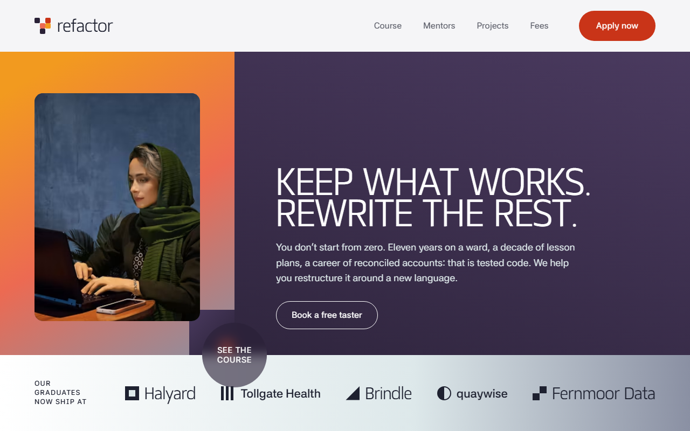
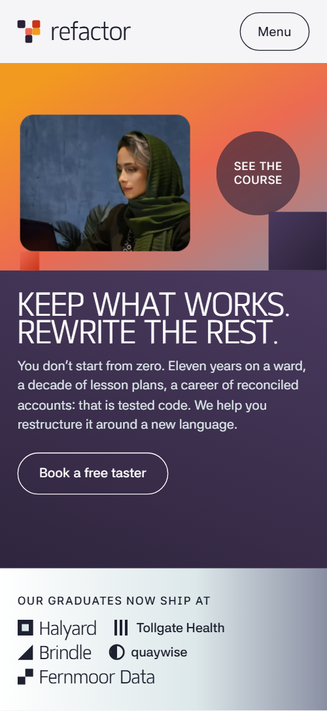
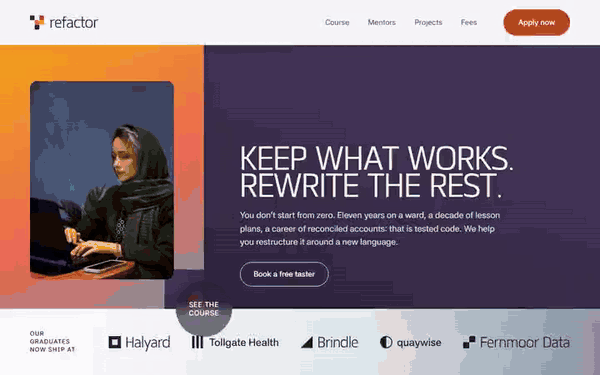

# Free HTML coding school website template with GSAP scroll animations

Coding school website template: one free HTML file for a part-time school that retrains adults, with before-and-after careers, a five-module course, a weekly timetable, mentors, taster evenings and three fee plans. The look is flat colour planes in orange, plum and ice. AGENTS.md is included, so Claude Code, Cursor or Codex can adapt it.

[](LICENSE)  

**[Live demo](https://8bsite.github.io/coding-school-website-template/)** · **[Use this template](https://github.com/new?template_name=coding-school-website-template&template_owner=8bsite)** · **[Download ZIP](https://github.com/8bsite/coding-school-website-template/archive/refs/heads/main.zip)** · **[Template page on 8b.com](https://8b.com/templates/refactor/)**

<a href="https://8bsite.github.io/coding-school-website-template/"></a> <a href="https://8bsite.github.io/coding-school-website-template/"></a>

<p align="center"><a href="https://8bsite.github.io/coding-school-website-template/"></a><br><sub>Scroll animation</sub></p>

## Use it with Claude Code, Cursor or Codex

Download the four files into your project folder (`curl.exe` in Windows PowerShell):

```bash
curl -LO https://raw.githubusercontent.com/8bsite/coding-school-website-template/main/index.html
curl -LO https://raw.githubusercontent.com/8bsite/coding-school-website-template/main/AGENTS.md
curl -LO https://raw.githubusercontent.com/8bsite/coding-school-website-template/main/LICENSE
curl -LO https://raw.githubusercontent.com/8bsite/coding-school-website-template/main/CREDITS.md
```

Then fill in the angle brackets and give your agent this prompt:

```text
Read AGENTS.md, then edit index.html. Make this the site for <my school: name, city, subjects, course length and modules, weekly timetable, fees and funding, next start date, mentors, graduate stories, employer names, opening hours, how people book a taster>. Replace first the school name, six career rows, four mentors with portraits, three capstones and the fees. Keep the section ids, the classes AGENTS.md lists and the five i elements in each pixel glyph. Ask me for missing facts and never invent outcomes, employers, quotes, prices, dates or contacts.
```

Vibe coding with Claude Code, Cursor or Codex starts with facts only the school has: course length, modules, timetable, fees, funding rules and start date. Ask the agent to replace the school name in the menu, footer and legal line, then the career rows, mentors, capstone clients and employer names. Graduate quotes, ages, outcomes and the employers in the opening band are invented; the owner supplies real ones or deletes them.

No agent? Click **[Use this template](https://github.com/new?template_name=coding-school-website-template&template_owner=8bsite)**, edit `index.html` on GitHub and turn on **Settings > Pages**.

## Sections and motion

- **Navigation**: logo glyph and word, four links, an Apply now button and a Menu button; full-screen menu. The bar turns solid after 24 px of scroll and slides away on the way down, returning when you scroll up.
- **Keep what works. Rewrite the rest.**: one screen: a panel of colour planes with a photo, the h1, a paragraph, a taster button and a row of employers. On load the panel and then the heading, paragraph and button lift into place; the colour planes themselves stay still.
- **Your first career isn't dead code.**: six rows of old job to new job, each with what carried over. Each of the six rows is scrubbed on scroll: the old job is struck through and greyed, the new job wipes in from the left, then the Kept line fades up.
- **Twenty-four weeks. Five modules. One real product.**: a pinned horizontal track of five course modules with a strip of 24 week squares that fill in. Pinned: the five module panels slide sideways while 24 week squares fill in order and each module's planes turn level as it arrives.
- **Built around the job you still have.**: three fixed weekly sessions with a photo each. The heading and lead rise out of a clip, and each of the three photos settles from a tilt, once, as they near the screen.
- **Mentors who made the same jump.**: a sticky portrait window that changes as four mentor stories scroll past. The portrait window is sticky; as each mentor card nears the middle, the next portrait wipes in on a slant and settles from a slight zoom.
- **Capstones that are still running.**: three project cards that stack as you scroll. The three project cards stick near the top and stack; the card underneath tilts, shrinks to 88% and darkens as the next slides over.
- **What changed, in their words.**: one large quote and four shorter ones with name and former job. The heading, the lead quote and four shorter quotes rise into view, and the heading's pixel glyph assembles from scattered squares.
- **Not sure yet? Sit in on a real class first.**: a red disc that grows into a panel listing four taster evenings. The red panel starts as a small disc with an arrow and grows on scroll until it fills its box, then the four dates rise inside.
- **One fee. Three ways to carry it.**: three fee plans dealt out from one stack. The three fee cards start stacked and slightly turned on one card, then are dealt into their columns as the section scrolls up.
- **Questions adults actually ask.**: six questions and answers (native details) beside a sticky heading. The heading rises and its glyph assembles; the six answers open and close natively, without JavaScript.
- **Book a taster, or just ask.**: colour planes falling into bands behind a contact form and details. Three colour planes behind the form fall from a tilted heap into bands, and the four detail rows fade up.
- **Footer**: wordmark, short description, six links and the address.

## Design

 page ground, the solid bar after scrolling, the form field backgrounds  
 body text and headings, the dark employer marks, text on the light planes  
 lead paragraphs, nav links, struck-through old jobs, notes under fees  
 the red accent: buttons, focus outline, the strike line, the taster panel, the last module and weeks 20 to 24, the labels of the contact details  
 orange plane in the first screen, first module and weeks 1 to 5, first project and fee gradients, pixel glyph  
 coral: the tint behind old jobs, second module and weeks 6 to 10, gradient ends, minus signs  
 plum: the graduates and footer sections, the full-screen menu, the second project and fee cards, mentor labels, FAQ icons  
 deep plum: the course section background, button hover wipe, gradient ends, the favicon square  
 slate: fourth module and weeks 16 to 19, gradient ends, field hover border  
 ice: the mentors and questions sections, new-job rows, third module and weeks 11 to 15, lead text on dark sections  
 fee cards and the form surface, text on dark planes, button labels  
 hairline rules, form field borders and the bar's shadow line

**Matangi**: headings, module and mentor names, fee prices, the menu links and the wordmark: weight 500, uppercase, slightly tracked. **Asta Sans**: body text, buttons, form fields and small tracked uppercase labels: weights 400 to 600 (Google Fonts). A 1440 px column with side gutters of 20 to 64 px. Most section heads split in two: an uppercase heading on the left, a lead paragraph on the right, aligned at the bottom. Hairline rules separate the career rows, timetable slots and contact details. A five-square pixel glyph repeats in the top bar, the careers, graduates and questions headings and the footer. Below 900 px the columns stack and a Menu button replaces the links.

## Questions

**Can I use it for a full-time coding bootcamp rather than a part-time school?**  
Yes, after a text pass. The demo is a part-time school in Sheffield: 24 weeks, two evenings and a Saturday, fees in pounds and regional skills funding. Replace the timetable rows, module weeks, fees and funding with your own, and change the numbers in the course heading.

**Does the contact form send applications?**  
No. As shipped it checks the fields, shows a thank-you line and disables the button, and sends nothing. Connect Formspree, Netlify Forms or your own endpoint and remove the script that stops the submit. The Apply buttons and the Book buttons beside the taster dates only jump to the form.

**Can I get a school site like this without editing code?**  
Yes, with a different tool. [8B's AI website builder](https://8b.com/templates/8b/) designs a new site from a sentence, and its own design is not this template. Designing and restyling are free; publishing with hosting and SSL, full HTML export and AI edits are on Pro at $9 a month billed yearly. It also runs inside Claude and ChatGPT.

## Is it the right base?

Choose this for a cohort course with fixed sessions, a fee page and a taster evening. If you teach single instruments or private lessons instead, the [lesson studio](https://8b.com/templates/overtone/) template with programs and a booking form fits better. The weak spot is booking: the Apply buttons and the Book buttons beside the dates only jump to the form, taster dates are fixed text, and there is no calendar. Without code, 8B's builder is the other route.

## Before you publish

- Replace what is marked `data-8b-placeholder` (social preview image, favicon, phone, email, form) and the invented demo facts; [AGENTS.md](AGENTS.md) lists them.
- The form sends nothing yet: connect it to Formspree or Netlify Forms, or remove it.

## Tech

GSAP 3.13.0, ScrollTrigger, Lenis 1.3.27 from jsDelivr, 160 KB, no build step. Chrome and Edge 111+, Safari 16.2+, Firefox 113+ (it uses color-mix(), container query units, cascade layers, small/dynamic viewport units). With "reduce motion" on, the page is complete and still.

## License

MIT, see [LICENSE](LICENSE). Photos, fonts and libraries keep their own licences: [CREDITS.md](CREDITS.md). More free templates: [8b.com/templates](https://8b.com/templates/) · [github.com/8bsite](https://github.com/8bsite).
