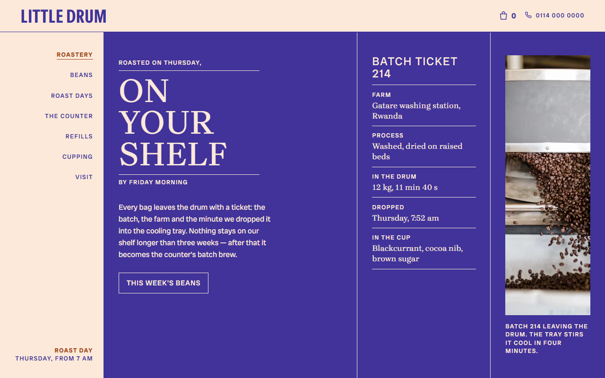
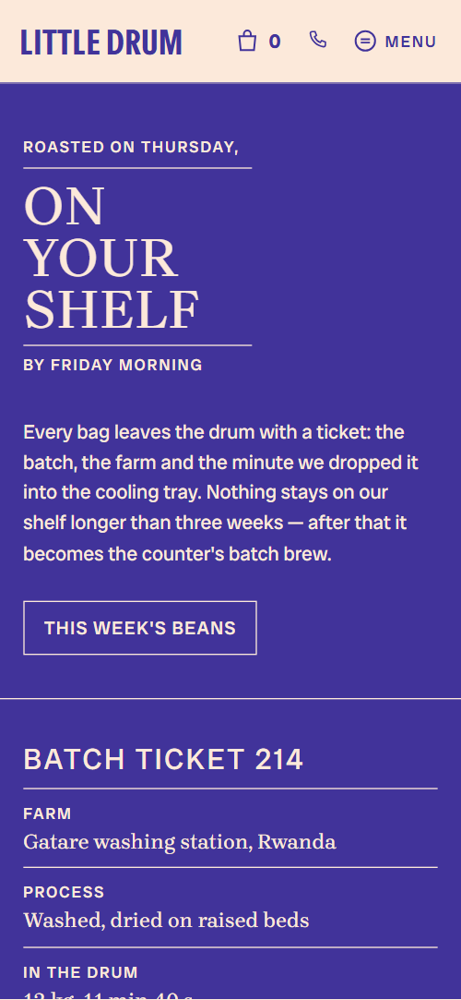
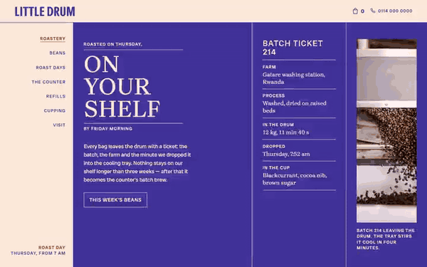

# Free HTML coffee roaster website template with GSAP scroll animations

Coffee roaster website template: one free HTML file for a micro-roastery with a counter, built like a printed roast-day ticket. Cream paper, indigo ink, rust accents and round stamps frame five bean listings, a drinks board, tin refills, monthly tastings and visit details. AGENTS.md is included, so Claude Code, Cursor or Codex can adapt it.

[](LICENSE)  

**[Live demo](https://8bsite.github.io/coffee-roaster-website-template/)** · **[Use this template](https://github.com/new?template_name=coffee-roaster-website-template&template_owner=8bsite)** · **[Download ZIP](https://github.com/8bsite/coffee-roaster-website-template/archive/refs/heads/main.zip)** · **[Template page on 8b.com](https://8b.com/templates/little-drum/)**

<a href="https://8bsite.github.io/coffee-roaster-website-template/"></a> <a href="https://8bsite.github.io/coffee-roaster-website-template/"></a>

<p align="center"><a href="https://8bsite.github.io/coffee-roaster-website-template/"></a><br><sub>Scroll animation</sub></p>

## Use it with Claude Code, Cursor or Codex

Download the four files into your project folder (`curl.exe` in Windows PowerShell):

```bash
curl -LO https://raw.githubusercontent.com/8bsite/coffee-roaster-website-template/main/index.html
curl -LO https://raw.githubusercontent.com/8bsite/coffee-roaster-website-template/main/AGENTS.md
curl -LO https://raw.githubusercontent.com/8bsite/coffee-roaster-website-template/main/LICENSE
curl -LO https://raw.githubusercontent.com/8bsite/coffee-roaster-website-template/main/CREDITS.md
```

Then fill in the angle brackets and give your agent this prompt:

```text
Read AGENTS.md, then edit index.html. Make this the site for <my roastery or coffee shop: name, town, address, hours, roast day, coffees with origin, process, notes and prices, drinks and prices, refill or tin offer, tasting dates, owners, postage terms>. Replace first the name, the five coffees, the farms, the drinks board and the Sheffield address, then the photos. Keep the ids, the selectors AGENTS.md lists, one photo per coffee and four ticket cells for four steps. Ask me for missing facts; never invent prices, hours, reviews or contacts.
```

Vibe coding with Claude Code goes fastest when the agent gets the owner's facts first: coffees with origin, process and price, roast day and times, drink prices, refill terms, tasting dates, hours and address. The demo's farms, owners, batch numbers and figures such as 4,120 bags saved are invented, so the agent must ask rather than guess. It then replaces the name wherever it appears and keeps the selectors AGENTS.md lists.

No agent? Click **[Use this template](https://github.com/new?template_name=coffee-roaster-website-template&template_owner=8bsite)**, edit `index.html` on GitHub and turn on **Settings > Pages**.

## Sections and motion

- **Navigation**: wordmark, a bag icon with a count, a phone link and a Menu button that opens a rail of seven links.
- **Roasted on Thursday, on your shelf by Friday morning**: three panels side by side: the headline with a button, a batch ticket and a photo of a batch leaving the drum. Smooth scrolling runs page-wide; on load the three indigo panels fill from the bottom one after another (from the left on phones) and the headline and ticket lines rise into place.
- **On the shelf This week 250 g bags, roasted Thursday**: five coffees on the shelf with prices, notes and a turning round photo frame. A round frame stays beside the list while you scroll and turns one full circle, and the next coffee's photo opens inside it from a circle as its row nears the middle of the screen.
- **Thursday is Roast day Four steps, one ticket per batch**: four steps of roast day beside a sticky batch ticket that gets stamped. As each of the four steps passes the reading line, a ring stamp presses onto the matching ticket cell from over twice its size and turned, and the cell dips slightly.
- **Bought direct Three farms The same growers, year after year**: a photo and three partner farms with place, year and a line each. Each of the three farm rows wipes in from the left as it arrives.
- **At the Counter Espresso, filter and cake**: a drinks board of seven rows that fans open, and a photo of the counter. The seven drink rows start stacked on the first row and fan down to their places while each row's text opens from the top.
- **Bring the Tin back Refills on every opening day**: the tin refill offer with three terms and a lid that rolls off the tin. The Refill lid starts over the tin and rolls along the baseline to the right edge, turning by the distance it travels.
- **First Saturday Cupping Ten till half eleven**: a round photo with a Free stamp and four monthly tasting dates. The Free stamp drops in from a larger size, turned, once, when it reaches the lower part of the screen.
- **Two people One drum Kelham Island since 2019**: a photo of the two owners that assembles from slats, with a short bio each. The owners' photo is cut into slats, four on screens 700 px wide or more and three below, offset up and down, and they slide together as the photo rises.
- **Asked at The counter Five things people ask**: five questions and answers (native details). Each question wipes in from the left on arrival; opening one turns its plus into a minus.
- **Come to The counter Kelham Island, Sheffield**: address, hours, phone, email, directions and a square photo behind the counter. The shop-window photo starts as a small round shape turned on its side and turns upright as it rises, opening into a full square while the image zooms out.
- **Footer**: copyright, email, two social links and back to the top.

## Design

 cream paper ground of the page, plus the text and rules on the indigo and rust sections and the fill of the light buttons on hover  
 indigo ink: text and hairlines on cream, the ground of the three first-screen panels, the drinks board and the visit section, and the fill of the bag and Menu icons on hover  
 rust: small kicker labels, outlined buttons, refill figures, the ground of the roast-days and cupping sections, the current coffee name and the current rail link

**Brygada 1918**: serif at weight 500: uppercase display headings and coffee, farm and owner names, plus drink names, ticket values, FAQ questions, tasting dates and the text running round the stamps. **Radio Canada Big**: body text at 400, uppercase tracked labels and buttons at 500, and prices and step titles at 700. **Instrument Sans**: condensed bold (stretch 75%) used only for the wordmark, the ticket heading and the words inside the stamps (Google Fonts). Indigo hairlines split nearly every section into ruled cells, and on desktop a fixed left rail holds seven links. Each heading is a three-line lockup: a small kicker, a large serif line and a small caption, with rules between the lines. Grounds alternate cream, indigo and rust. Round forms recur: the turning bean frame, the tin and its lid, the tasting photo and seven ring stamps with a word in the middle.

## Questions

**Can it work as a cafe website template or a coffee shop website template?**  
Yes, if the cafe also sells beans or has a roasting story. Most cafe websites stop at a menu and hours; this one adds priced bags, a refill scheme and tastings. A cafe that does not roast should rewrite or remove the roast days and farms sections and the Roast days rail link.

**Can I sell beans online with it?**  
Not as shipped. The Add to bag buttons link to the visit section, and the 0 beside the bag icon is plain text, not a cart. Point each button at a Shopify, Stripe or Square checkout link. The Book a seat links on the tasting dates are email links with a subject per date.

**Can I get a site like this without editing code?**  
Yes, with a different tool than this file. [8B's AI website builder](https://8b.com/templates/8b/) designs a new site from a sentence, in its own design; designing and restyling are free. Publishing with hosting and SSL, full HTML export and AI edits in chat are on Pro at $9 a month billed yearly. It also runs inside Claude and ChatGPT.

## Is it the right base?

This is the right base for a small roastery or a cafe that sells its own beans and wants a warm, printed look. Among coffee shop websites it is one page with no real shop: Add to bag buttons jump to the visit section until a checkout is linked. A place that pours beer and hosts events fits the [taproom-and-events](https://8b.com/templates/loud-kettle/) template better. Owners who do not code can try 8B, an AI website builder, instead.

## Before you publish

- Replace what is marked `data-8b-placeholder` (social preview image, favicon, phone, email, map, social) and the invented demo facts; [AGENTS.md](AGENTS.md) lists them.

## Tech

GSAP 3.13.0, ScrollTrigger, Lenis 1.3.4 from jsDelivr, 88 KB, no build step. Chrome and Edge 108+, Safari 15.4+, Firefox 101+ (it uses cascade layers, small/dynamic viewport units). With "reduce motion" on, the page is complete and still.

## License

MIT, see [LICENSE](LICENSE). Photos, fonts and libraries keep their own licences: [CREDITS.md](CREDITS.md). More free templates: [8b.com/templates](https://8b.com/templates/) · [github.com/8bsite](https://github.com/8bsite).
