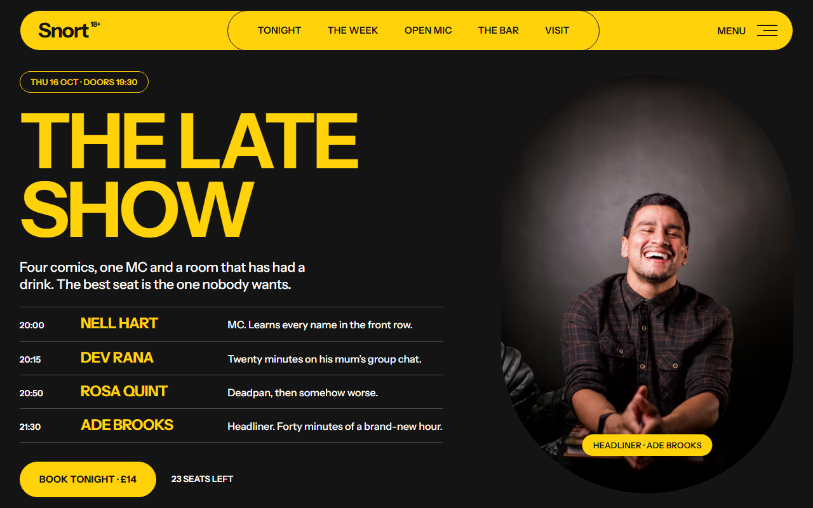
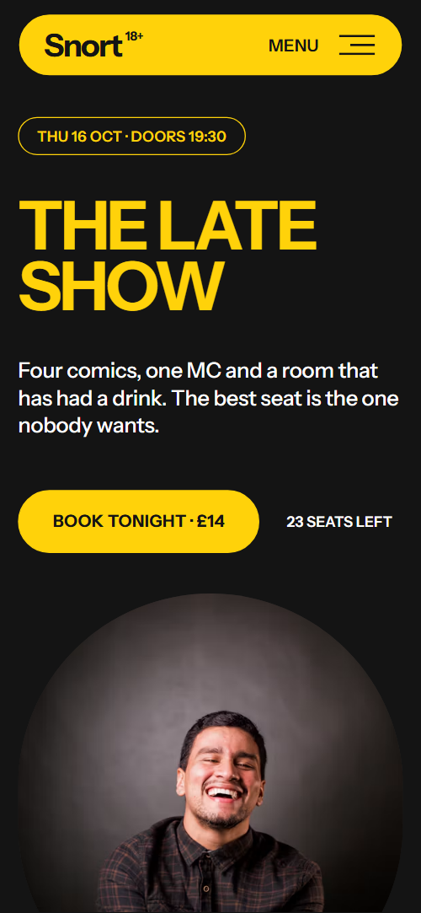
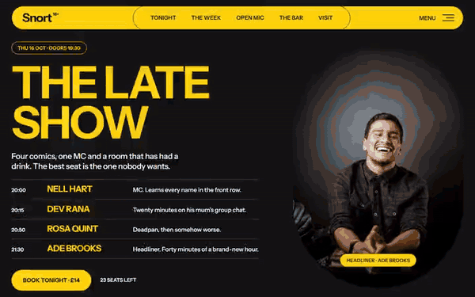

# Free HTML comedy club website template with GSAP scroll animations

Comedy club website template: one free HTML file for a venue that runs a show every night, serves drinks and hires out the room. It opens on tonight's running order, then runs through a seven-night week, house rules, an open-mic sign-up and the bar. Black, yellow and white with heavy type. AGENTS.md lets Claude Code or Cursor adapt it.

[](LICENSE)  

**[Live demo](https://8bsite.github.io/comedy-club-website-template/)** · **[Use this template](https://github.com/new?template_name=comedy-club-website-template&template_owner=8bsite)** · **[Download ZIP](https://github.com/8bsite/comedy-club-website-template/archive/refs/heads/main.zip)** · **[Template page on 8b.com](https://8b.com/templates/snort/)**

<a href="https://8bsite.github.io/comedy-club-website-template/"></a> <a href="https://8bsite.github.io/comedy-club-website-template/"></a>

<p align="center"><a href="https://8bsite.github.io/comedy-club-website-template/"></a><br><sub>Scroll animation</sub></p>

## Use it with Claude Code, Cursor or Codex

Download the four files into your project folder (`curl.exe` in Windows PowerShell):

```bash
curl -LO https://raw.githubusercontent.com/8bsite/comedy-club-website-template/main/index.html
curl -LO https://raw.githubusercontent.com/8bsite/comedy-club-website-template/main/AGENTS.md
curl -LO https://raw.githubusercontent.com/8bsite/comedy-club-website-template/main/LICENSE
curl -LO https://raw.githubusercontent.com/8bsite/comedy-club-website-template/main/CREDITS.md
```

Then fill in the angle brackets and give your agent this prompt:

```text
Read AGENTS.md, then edit index.html. Make this the site for <my venue: name, city, seats, tonight's date and running order, the seven weekly shows with times and prices, house rules, open-mic rules, bar menu with prices, private hire rates, accessibility details, address, box office hours, ticket link, social links>. Replace the tonight panel and week rows first, then bar and hire. Keep the section ids, data-8b-section and data-8b-motion, the class names AGENTS.md lists and --len. Ask for any missing fact. Never invent prices, times, reviews, addresses or contacts.
```

Replace the tonight panel first: date, doors time, price, the four acts and the seats note. Then the seven week rows, the house rules, the six bar items and the hire packages. Keep the section ids, the data-8b-section and data-8b-motion attributes and the class names AGENTS.md lists. Ask the owner for capacity, address, box office hours, ticket links and accessibility details. A vibe coding session in Cursor or Claude Code should never invent them.

No agent? Click **[Use this template](https://github.com/new?template_name=comedy-club-website-template&template_owner=8bsite)**, edit `index.html` on GitHub and turn on **Settings > Pages**.

## Sections and motion

- **Navigation**: fixed top bar: wordmark with an 18+ mark, five section links, Menu button; hides on scroll down; full-screen menu overlay. The top bar slides out of view on a scroll down past 120px and returns on a scroll up; the Menu button opens a full-screen overlay.
- **The Late Show, Snort comedy club, Leeds**: tonight's show: date and doors line, the heading "The Late Show", a short intro, a four-act running order, a Book tonight button and a headliner photo. On load the text blocks rise in one after another, the title settles from a larger size, the photo zooms in and the caption fades in.
- **Seven nights, seven crowds**: seven nights as seven capsule rows: day, show name, one line, time and price, a small photo and a Book link. As each of the seven rows crosses the middle of the screen, a black fill grows out of the day disc across the row and the colours swap, then it shrinks back.
- **One arch, 164 seats, nowhere to hide**: the venue in three facts: a heading, two photos and three short blocks (distance to the mic, the train, the brick vault). The heading lines slide into place, the line with the arrow dropping from above, and the yellow underline draws itself, once.
- **House rules (the real ones)**: five house rules, each a crossed-out polite rule and the real rule under it. Scrubbed by scroll: a brush stroke draws through each old rule, it tilts with a bounce, and the real rule drops in with a squash.
- **Fresh Meat five minutes, one mic**: open-mic sign-up: heading, three steps with numbers, a photo and a short form. The heading lines slide into place, and the three step numbers squash and bounce into place.
- **They bombed here first**: five comics who started at the open mic, portraits in a spotlight line-up. On wide screens the section holds for nearly two screens of scroll while a spotlight travels along the five portraits, lighting each in colour and lifting it slightly; on phones the same spotlight follows the scroll without pinning.
- **The bar stays open till two**: the bar: heading and six items (four drinks, two snacks) with photos and prices, on a pinned sideways track. The section pins and the six bar cards slide sideways as you scroll, leaning with the scroll speed, while each photo drifts inside its frame.
- **Hire the arch**: private hire: photo, heading, three priced packages and an enquiry button. The heading lines slide into place, the underline draws itself and the three price pills squash into place.
- **Overheard at the bar**: six short quotes with a face and a first name, in a grid. Scrubbed by scroll: each face grows and wobbles in turn while a brush underline is drawn beneath the name.
- **Asked before**: six questions and answers in native &lt;details&gt; elements beside a sticky heading. The heading slides in; answers open and close natively and the plus icon rotates.
- **Come round the arches**: address, box office, email and directions under a call button, ending in a huge wordmark. A black blob that covers the section on arrival shrinks to nothing at the closing wordmark, which then springs up from a squashed shape.
- **Footer**: footer: wordmark and note, club links, social and newsletter links, copyright with the Design: 8B credit.

## Design

 page ground behind the week, open mic, hire and visit sections, the nav bar, the yellow buttons and the hover fill of the dark ones, and headings and names on dark sections  
 text and borders on light grounds, the first-screen panel, house rules, alumni, reviews, footer and menu overlay grounds, and the dark buttons  
 grounds of the room, bar and FAQ sections, text on dark grounds, the menu link hover colour and the hover fill of the yellow buttons

**Instrument Sans**: headings in bold uppercase, body text in medium weight, labels, pills and buttons in semibold or bold uppercase. **Playpen Sans**: weight 800 only: the menu links, the real house rules, open-mic step numbers, alumni names, bar item names, the closing wordmark and the footer mark (Google Fonts). Rounded pills carry most of the interface: the nav bar, buttons, form fields and the seven week rows, with 40px corners on the form and FAQ items. Section heads sit in two columns, heading left and a lead paragraph right. Headings are uppercase, with small inline arrows and brush underlines. The first screen is a dark panel: title and running order left, a tall headliner photo right. On phones it stacks.

## Questions

**Is this a free comedy club website template?**  
Yes. It is one index.html under the MIT license, with no build step and no CMS. GSAP, ScrollTrigger and Lenis load from jsDelivr, fonts from Google Fonts, and the photos are Unsplash images listed in CREDITS.md, so you can use it for your own club or for client sites.

**Can it work for a theatre or a live music venue?**  
Yes, if the venue has a weekly bill, a bar and rooms to hire. For theater website design, rename the shows, swap the open mic for your own community night and change the house rules. A venue that needs seat maps or a booking calendar will need a ticketing service linked in.

**Does the open-mic form send anything?**  
No. The script checks the name and email, shows a thank-you line and resets the form; nothing leaves the page. Connect Formspree or Netlify Forms in the form tag and the script, or delete the form. The Book buttons are plain links until you point them at your ticketing page.

## Is it the right base?

Pick it when one venue needs one long page with a nightly programme. It has no ticket engine and no calendar: every Book button is a link you point at your ticketing page, and dates are typed by hand. For a business that sells planned events rather than nightly tickets, a [garden wedding studio](https://8b.com/templates/aubade/) page fits better. The weak spot is the alumni line-up, which is built for five portraits.

## Before you publish

- Replace what is marked `data-8b-placeholder` (social preview image, favicon, phone, email, form, map, social) and the invented demo facts; [AGENTS.md](AGENTS.md) lists them.
- The form sends nothing yet: connect it to Formspree or Netlify Forms, or remove it.

## Tech

GSAP 3.13.0, ScrollTrigger, Lenis 1.3.27 from jsDelivr, 113 KB, no build step. Chrome and Edge 111+, Safari 16.2+, Firefox 113+ (it uses color-mix(), cascade layers, small/dynamic viewport units). With "reduce motion" on, the page is complete and still.

## License

MIT, see [LICENSE](LICENSE). Photos, fonts and libraries keep their own licences: [CREDITS.md](CREDITS.md). More free templates: [8b.com/templates](https://8b.com/templates/) · [github.com/8bsite](https://github.com/8bsite).
