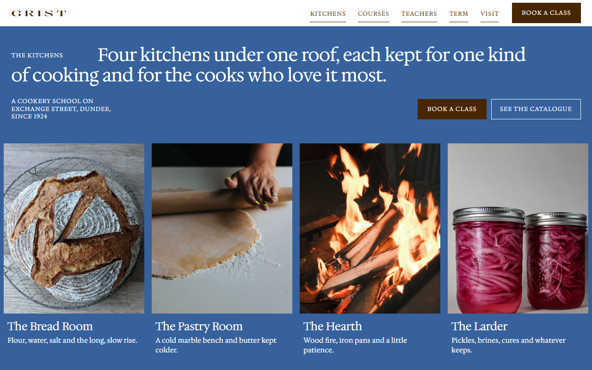
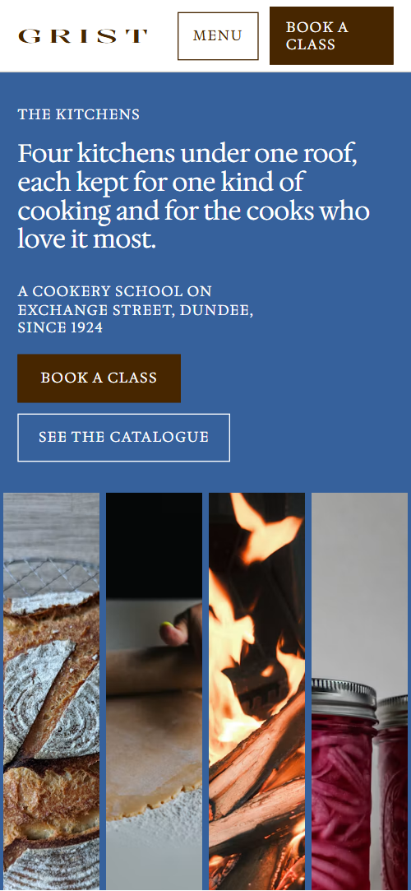
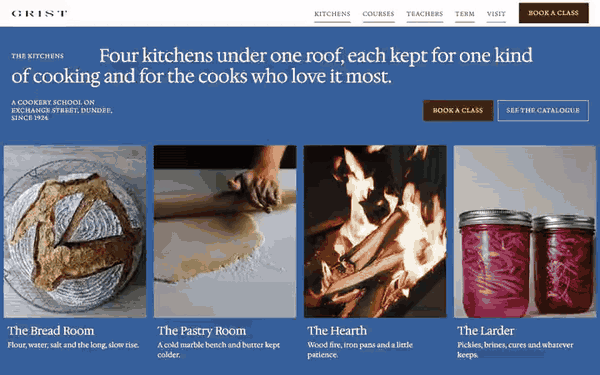

# Free HTML cooking school website template with scroll animations and no libraries

Cooking school website template: a free HTML page for a cookery school that sells places on dated classes and hires out its kitchens. It has a seven-course catalogue, an eight-date timetable with places left and four teachers, set in chocolate brown, white and one cobalt blue. Its scroll motion is CSS with no libraries, and AGENTS.md guides an AI agent.

[](LICENSE)  

**[Live demo](https://8bsite.github.io/cooking-school-website-template/)** · **[Use this template](https://github.com/new?template_name=cooking-school-website-template&template_owner=8bsite)** · **[Download ZIP](https://github.com/8bsite/cooking-school-website-template/archive/refs/heads/main.zip)** · **[Template page on 8b.com](https://8b.com/templates/grist/)**

<a href="https://8bsite.github.io/cooking-school-website-template/"></a> <a href="https://8bsite.github.io/cooking-school-website-template/"></a>

<p align="center"><a href="https://8bsite.github.io/cooking-school-website-template/"></a><br><sub>Scroll animation</sub></p>

## Use it with Claude Code, Cursor or Codex

Download the four files into your project folder (`curl.exe` in Windows PowerShell):

```bash
curl -LO https://raw.githubusercontent.com/8bsite/cooking-school-website-template/main/index.html
curl -LO https://raw.githubusercontent.com/8bsite/cooking-school-website-template/main/AGENTS.md
curl -LO https://raw.githubusercontent.com/8bsite/cooking-school-website-template/main/LICENSE
curl -LO https://raw.githubusercontent.com/8bsite/cooking-school-website-template/main/CREDITS.md
```

Then fill in the angle brackets and give your agent this prompt:

```text
Read AGENTS.md, then edit index.html. Make this the site for <my school: name, address, year founded, kitchens, courses with codes, lengths and prices, this term's dates, teachers, opening hours, how people book, private hire terms>. Motion is CSS scroll-driven animation plus the inline motion kit: keep the gate script, the section ids, the data-8b-* attributes, the classes AGENTS.md lists and one photo per catalogue row; add no animation library. Set each display heading's --len to its character count. Never invent prices, dates, diet claims or contacts; ask me.
```

If you vibe code the site in Claude Code, Cursor or Codex, give the agent what only the school knows: course names, codes, lengths and prices, term dates, teachers, places left, class size, hours, diet and allergy rules, cancellation rules and voucher terms. The demo invents all of it, along with the 1924 history and the Dundee address. Replace the school name in the header, title, footer wordmark and copyright line. Keep the section ids, and update each display heading's --len when its text changes.

No agent? Click **[Use this template](https://github.com/new?template_name=cooking-school-website-template&template_owner=8bsite)**, edit `index.html` on GitHub and turn on **Settings > Pages**.

## Sections and motion

- **Navigation**: wordmark, five links, a Menu button and a Book a class button. Mouse-wheel scrolling is smoothed; the bar slides out of sight on a scroll down past the first 120 px and returns on a short scroll up; on screens up to 860 px wide the Menu button opens a full-screen brown overlay.
- **Four kitchens under one roof, each kept for one kind of cooking and for the cooks who love it most.**: a blue screen: label, the h1, a line, two buttons and four kitchen photos with captions. On load the heading and the button row rise into place and the four photo frames open upward one after another; nothing in this section moves on scroll.
- **Since 1924**: the school's history in a large paragraph, with a photo and a note about the archive. The history paragraph and the archive photo rise into view once, as they reach the lower tenth of the screen.
- **The Catalogue**: seven catalogue rows with codes, prices and a sticky photo that changes row by row. The heading's words gather into place and the row lines draw in; as each row crosses the reading line its photo wipes up over the last one in the sticky frame and its code turns cobalt.
- **Doors**: two photo doors: public classes and private kitchen hire. The two photo cards start pushed toward the middle, one low and one high, with zoomed photos, then part into their columns as they scroll up.
- **Who Teaches**: one sentence introducing four teachers, each with a small portrait that opens into a window. Each portrait opens from a thin pill to a full window as its line passes the middle of the screen, the photo zooms out and the name darkens from taupe to brown.
- **Autumn Term**: autumn timetable table with eight dated classes and places left. The heading's words gather into place and the timetable's row lines draw in one after another.
- **The Notebook**: a pinned sideways track of four dated notes from the teachers. Held on a sticky stage: the section stays while the four notes slide left, and each photo drifts sideways inside its frame.
- **Before you come**: five questions and answers (native details). Row lines draw in once; opening a question turns its plus into a cross.
- **The house**: the building, seen from close to far, and a note about the shop. The facade photo starts zoomed in on one window and pulls back to the whole front while the cobalt block slides from behind the frame to its offset.
- **Find Us**: three contact rows: the school, the shop, private hire. The heading's words gather into place and the three contact rows draw their lines.
- **Footer**: timetable email form, link columns, legal column and a large wordmark with the year.

## Design

 page ground, header bar, text and outlined buttons on the cobalt and brown grounds  
 text, solid buttons, footer ground, the phone menu overlay and the hover fill of outlined buttons  
 header bar's bottom line, empty photo frames, footer text and its top rule  
 hairlines between catalogue rows, timetable rows, questions and contact rows; teacher names before they are read  
 first screen ground, button hover fill, the lit course code, the block behind the house photo and the favicon

**Kalnia**: wide uppercase capitals, regular weight, for the five big headings, the header wordmark and the footer wordmark. **Hedvig Letters Serif**: everything else in one regular weight: the first-screen sentence, body text, small tracked uppercase labels, buttons, table and questions (Google Fonts). Small uppercase labels hang in a narrow left column and the large text starts indented beside them; on phones the label sits above. The four main headings are justified edge to edge. The catalogue splits into ruled rows on the left and a sticky photo frame on the right, a short strip held at the foot of the screen on phones. The timetable is a table with hairline rules, and the footer ends in a huge wordmark over the year.

## Questions

**Is this a free cooking class website I can use for a baking or pottery school?**  
Yes. It is one index.html that [holds the whole school](https://8b.com/templates/one-page/), under the MIT license, free for client work. Swap the four kitchens and seven courses for your own rooms and classes; a baking, pastry, wine or pottery school keeps the same structure. Photos are Unsplash images listed in CREDITS.md, and the fonts are open-licensed Google Fonts.

**Does it take bookings or payments?**  
No. The Book links, the Ask for a place button and the Waiting list link jump to the timetable or the contact section; point them at your booking system or at Eventbrite or Stripe links. Places left are plain text in an eight-row table. The timetable email form sends nothing either: connect Mailchimp, Buttondown or Formspree.

**What shows in Firefox, with reduced motion or with JavaScript off?**  
The whole page, at rest. Without CSS scroll-driven animations (Firefox today) or with reduced motion, nothing moves: headings sit justified, the catalogue frame shows its last photo, teacher windows are open and the notebook becomes a strip you scroll sideways. With JavaScript off, the phone Menu button cannot open and the email form just reloads the page.

## Is it the right base?

This template fits a school that sells places by the term and also lets a room out. This build looks and moves like the GSAP version with no animation library and no script from a CDN: about 24 KB of code gzipped against about 69 KB and three extra requests. If you serve meals rather than teach, a [barbecue restaurant](https://8b.com/templates/hwaro/) template is closer. Booking is the weak spot: every Book link jumps to the timetable or contact section until you connect a booking system.

## Before you publish

- Replace what is marked `data-8b-placeholder` (social preview image, favicon, phone, email, form, social) and the invented demo facts; [AGENTS.md](AGENTS.md) lists them.
- The form sends nothing yet: connect it to Formspree or Netlify Forms, or remove it.

## Tech

No JavaScript libraries: CSS scroll-driven animations and a small inline motion script with its own smooth wheel scrolling, 91 KB, no build step. Chrome and Edge 111+, Safari 16.2+, Firefox 113+ (it uses color-mix(), cascade layers, small/dynamic viewport units). Without scroll-driven animations (Firefox today) the scroll motion and the smooth wheel are off and each section shows its finished layout (a load-in or a loop may still play); with "reduce motion" on, the page is complete and nothing moves on its own (hover effects stay).

A GSAP build of the same page is [`index.gsap.html`](index.gsap.html): GSAP 3.13.0, ScrollTrigger, Lenis 1.3.4 from jsDelivr, 81 KB; its scroll motion also plays in Firefox. Use one of the two files.

## License

MIT, see [LICENSE](LICENSE). Photos, fonts and libraries keep their own licences: [CREDITS.md](CREDITS.md). More free templates: [8b.com/templates](https://8b.com/templates/) · [github.com/8bsite](https://github.com/8bsite).
