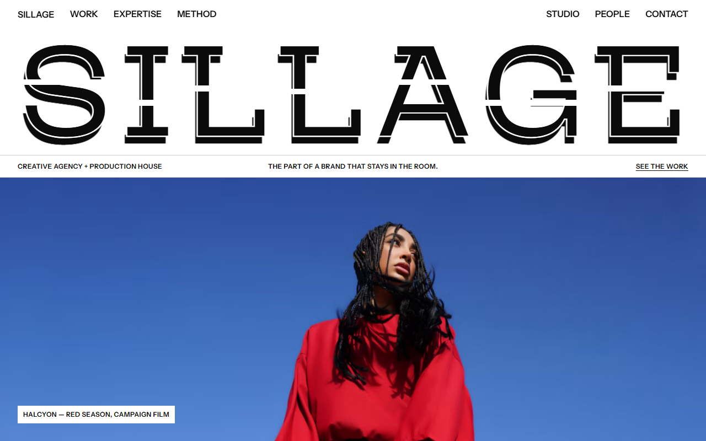
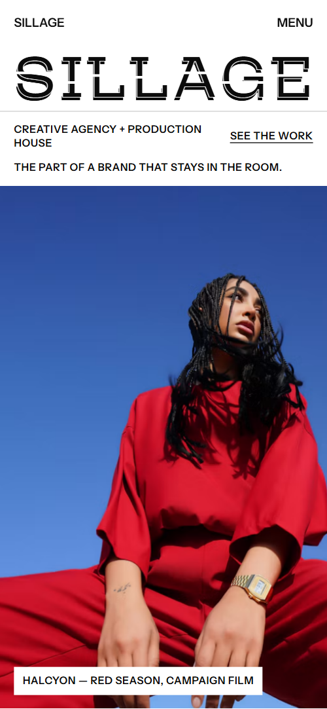
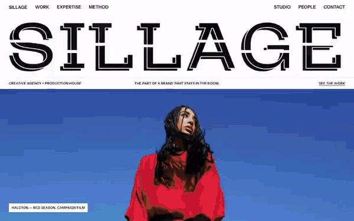

# Free HTML creative agency website template with scroll animations and no libraries

Creative agency website template: one free HTML file for an agency or production house, with a manifesto, a filterable portfolio of eight projects, a featured case, services, a four step process, a team and a studio for hire. Black and white, capitals, hairline rules and colour only from the photos. The scroll motion runs on CSS with no JavaScript libraries, in 26 KB gzipped, and AGENTS.md tells a coding agent what to keep.

[](LICENSE)  

**[Live demo](https://8bsite.github.io/creative-agency-website-template/)** · **[Use this template](https://github.com/new?template_name=creative-agency-website-template&template_owner=8bsite)** · **[Download ZIP](https://github.com/8bsite/creative-agency-website-template/archive/refs/heads/main.zip)** · **[Template page on 8b.com](https://8b.com/templates/sillage/)**

<a href="https://8bsite.github.io/creative-agency-website-template/"></a> <a href="https://8bsite.github.io/creative-agency-website-template/"></a>

<p align="center"><a href="https://8bsite.github.io/creative-agency-website-template/"></a><br><sub>Scroll animation</sub></p>

## Use it with Claude Code, Cursor or Codex

Download the four files into your project folder (`curl.exe` in Windows PowerShell):

```bash
curl -LO https://raw.githubusercontent.com/8bsite/creative-agency-website-template/main/index.html
curl -LO https://raw.githubusercontent.com/8bsite/creative-agency-website-template/main/AGENTS.md
curl -LO https://raw.githubusercontent.com/8bsite/creative-agency-website-template/main/LICENSE
curl -LO https://raw.githubusercontent.com/8bsite/creative-agency-website-template/main/CREDITS.md
```

Then fill in the angle brackets and give your agent this prompt:

```text
Read AGENTS.md, then edit index.html. Turn this template into the site for <my agency or production house: name, what we make, for whom, eight projects with client, title and discipline, one featured case, services, process, studio space if any, team and roles, offices, contacts, showreel link>. Replace the wordmark in hero and footer first. Motion is CSS scroll-driven animation plus the inline motion kit: keep the gate script, section ids, data-8b-* attributes and AGENTS.md's classes; add no library. Set each width filling line's length number to its character count and match project tags to the filters. Never invent clients, prices, addresses, headcount or contacts; ask me.
```

Vibe coding this creative agency website template for Claude Code, Cursor or Codex starts with the wordmark. Its letters appear twice, in the hero and footer, one span per letter with a data-glyph copy, and the --len number must match the letter count. Next replace the eight projects, ten client names and six team members, keeping project tags in step with the filter buttons. Rename no section ids, data-8b-motion attributes or classes AGENTS.md lists, and keep hero before manifesto and works before feature: each pair shares one scroll hand-off. [A well-briefed agent](https://8b.com/templates/vibe-coding/) should ask for clients you may name, headcount, studio specs, addresses and contacts instead of inventing them.

No agent? Click **[Use this template](https://github.com/new?template_name=creative-agency-website-template&template_owner=8bsite)**, edit `index.html` on GitHub and turn on **Settings > Pages**.

## Sections and motion

- **Navigation**: top bar: wordmark, two groups of section links; phone menu overlay with email and phone.
- **First screen**: first screen: width-filling cut wordmark, a ruled info line, a full-bleed campaign photo (demo: SILLAGE). Mouse and trackpad scrolling is smoothed; on load the wordmark letters rise one by one and the photo settles. Scrolling away, the wordmark splits, its letters sliding off both sides with long black streaks, while the photo pushes in. Seven section headings further down slide in from the left, trailing an echo.
- **Not what a brand says. What stays in the room.**: four width-filling statement lines, a lead, two paragraphs and a ruled line of six verbs. Tied to scroll, the four width-filling statement lines close in from alternate sides, then the paragraphs rise from a slit.
- **Selected work**: portfolio: a ruled filter bar over an asymmetric grid of eight projects, plus a reel button. A black and a grey plate fan out behind each photo and fold flat under it as it reaches mid-screen; filter buttons fade non-matching projects to grey.
- **The Amber Hour**: one featured project on a full-screen stage: tags, giant title, client line, credits, button (demo: The Amber Hour). The stage grows from a centre column to full screen; held while you scroll, the giant title slides in from the right as the photo eases back.
- **Houses we keep company with**: a looping row of client names set in the wordmark face. Client names run sideways in a continuous loop that pauses on hover or keyboard focus.
- **Five rooms. One roof.**: dark section: a portrait and five ruled service rows, each with a title and tags. Service rows come up to full white as they cross the middle of the screen and fall back as they leave, while the portrait pushes in.
- **From first line to last frame**: four numbered process steps as a horizontal storyboard (demo: Write, Build, Shoot, Finish &amp; scale). The section holds while the four steps travel sideways as a storyboard, each photo sliding against the travel and settling from a close zoom.
- **Studio Sillage, Montreuil**: a space for hire: large photo, text, five ruled spec rows and a booking button. The photo opens from a thin horizontal slit to full height, and the spec rows wipe in from the left.
- **The people in the room**: team: six portraits with names and roles, and a hiring line. Tied to scroll, six portraits start as a tilted pile in the middle of the top row and deal out to their places.
- **Tell us what should stay**: contact: the main email as a width-filling line, four ruled desks with names, emails, phones, addresses.
- **Footer**: the SILLAGE wordmark again, copyright, social links and the Design: 8B credit. Tied to scroll, the wordmark letters close in from both sides, their black streaks shrinking until the mark is whole at the end of the page.

## Design

 page background, cuts through the wordmark  
 text, rules, buttons, dark services section  
 secondary text  
 spare light grey for small text, defined in the variables but unused by the demo  
 light rules, grey plates behind photos  
 rules on the dark section

**Mozilla Headline**: light, extra wide capitals filling the width. **Instrument Sans**: bold capital headings, small labels, body (Google Fonts). A twelve-column grid ruled with hairlines: info line, filter bar in cells (sticky on wide screens), service and spec rows, contact desks. Each wordmark letter is cut by a thin white line, with a black copy offset behind. Photos are square-cornered in an asymmetric grid; portraits are black and white.

## Questions

**Does it have a contact form?**  
No. The contact section is a width-filling email address and four desks with names, emails, phones and addresses, and the reel, case and studio buttons open pre-addressed emails. The page sends nothing itself. To collect enquiries in a form, ask your agent to add one wired to Formspree or Netlify Forms.

**Does this version need GSAP, Lenis or any other library?**  
No. The scroll scenes are CSS scroll-driven animations, and a short inline script measures the page and smooths the mouse wheel. Nothing changes for the visitor, and the page loads 26 KB of code gzipped against 71 KB for the GSAP build. Keep the gate script, the section ids, the data-8b-motion attributes, project tags matching the filters and each --len equal to its line's length.

**Can I use it as a marketing agency website template?**  
Yes, for a creative-led marketing agency. The service rows already carry creative strategy, campaign concepts, social strategy, editorial calendars and launch planning, and the filter buttons cover campaign, social and activation work. It has no pricing and no lead form, so add those yourself if you sell on performance.

## Is it the right base?

This base is right when the pitch is taste plus the means to shoot it: a creative agency that also produces film and stills, or a production house with a stage to rent. It is the light build, with the same look and scroll behaviour and no script from a CDN: 26 KB of code gzipped, where the GSAP version needs 71 KB and three extra requests. A brand or digital studio that wants enquiries through a form is better served by the [design agency](https://8b.com/templates/onda/) template, which has one. One limit to know: the eight project cards are plain list items, not links.

## Before you publish

- Replace what is marked `data-8b-placeholder` (social preview image, favicon, email, phone, social) and the invented demo facts; [AGENTS.md](AGENTS.md) lists them.

## Tech

No JavaScript libraries: CSS scroll-driven animations and a small inline motion script with its own smooth wheel scrolling, 113 KB, no build step. Chrome and Edge 111+, Safari 16.2+, Firefox 121+ (it uses color-mix(), container query units, :has(), cascade layers, small/dynamic viewport units). Without scroll-driven animations (Firefox today) the scroll motion and the smooth wheel are off and each section shows its finished layout, while any load-in or looping animation still plays; with "reduce motion" on, the page is complete and nothing moves on its own (hover effects stay).

A GSAP build of the same page is [`index.gsap.html`](index.gsap.html): GSAP 3.13.0, ScrollTrigger, Lenis 1.3.27 from jsDelivr, 107 KB; its scroll motion also plays in Firefox. Use one of the two files.

## License

MIT, see [LICENSE](LICENSE). Photos, fonts and libraries keep their own licences: [CREDITS.md](CREDITS.md). More free templates: [8b.com/templates](https://8b.com/templates/) · [github.com/8bsite](https://github.com/8bsite).
