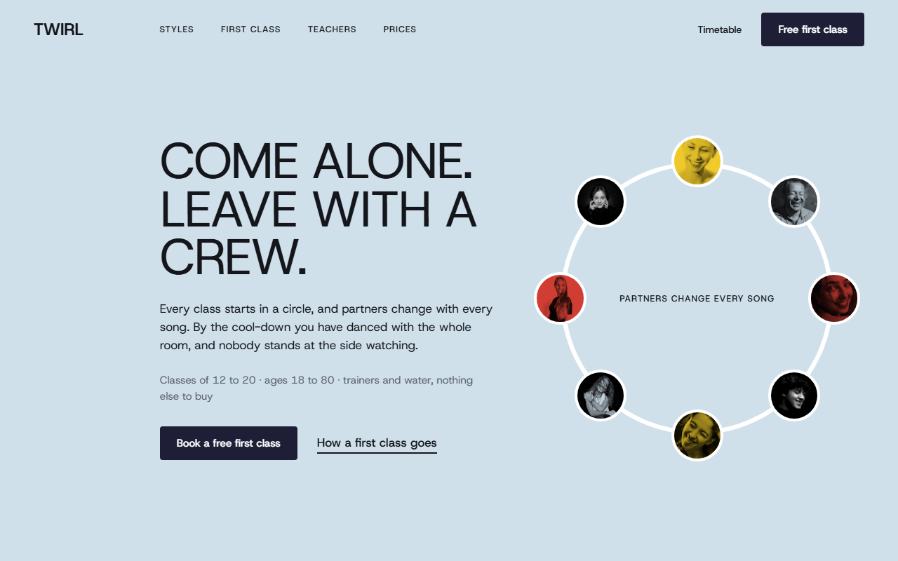
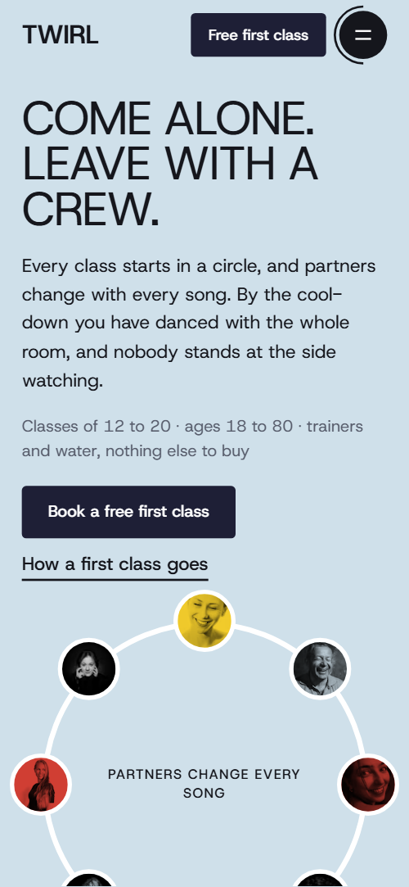
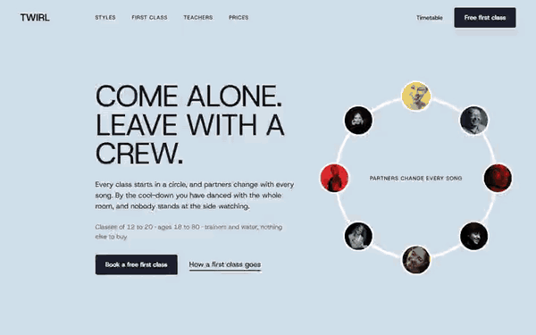

# Free HTML dance studio website template with GSAP scroll animations

This dance studio website template is one free HTML file for a school that runs weekly classes. It has six styles, a drawn path through a first class, a seven-day timetable, five teachers, four passes and a booking form, in bold grotesque type with hand-drawn red loops. An AI agent can adapt it.

[](LICENSE)  

**[Live demo](https://8bsite.github.io/dance-studio-website-template/)** · **[Use this template](https://github.com/new?template_name=dance-studio-website-template&template_owner=8bsite)** · **[Download ZIP](https://github.com/8bsite/dance-studio-website-template/archive/refs/heads/main.zip)** · **[Template page on 8b.com](https://8b.com/templates/twirl/)**

<a href="https://8bsite.github.io/dance-studio-website-template/"></a> <a href="https://8bsite.github.io/dance-studio-website-template/"></a>

<p align="center"><a href="https://8bsite.github.io/dance-studio-website-template/"></a><br><sub>Scroll animation</sub></p>

## Use it with Claude Code, Cursor or Codex

Download the four files into your project folder (`curl.exe` in Windows PowerShell):

```bash
curl -LO https://raw.githubusercontent.com/8bsite/dance-studio-website-template/main/index.html
curl -LO https://raw.githubusercontent.com/8bsite/dance-studio-website-template/main/AGENTS.md
curl -LO https://raw.githubusercontent.com/8bsite/dance-studio-website-template/main/LICENSE
curl -LO https://raw.githubusercontent.com/8bsite/dance-studio-website-template/main/CREDITS.md
```

Then fill in the angle brackets and give your agent this prompt:

```text
Read AGENTS.md, then edit index.html. Make this the site for <my studio: name, city, styles with beginner and improver times, the weekly timetable with teachers, teacher bios, passes and prices, trial offer, show date if any, address, hours, phone, email, how to book>. Replace the six styles, the timetable cards, the five teachers, the four passes and the contact details first. Keep the ids, the data-8b-section, data-8b-motion and data-8b-part attributes and the class names AGENTS.md lists. Ask me for any missing fact; never invent prices, times, bios or contacts.
```

In a vibe coding session, hand Claude Code, Cursor or Codex index.html and AGENTS.md. Replace the thirteen timetable cards, the five teachers and the four passes first. The opening ring is built for eight portraits and the styles line-up for six photos, so swap images without changing the count. Ask the owner for real times, prices, bios and the show date, and never invent them.

No agent? Click **[Use this template](https://github.com/new?template_name=dance-studio-website-template&template_owner=8bsite)**, edit `index.html` on GitHub and turn on **Settings > Pages**.

## Sections and motion

- **Navigation**: fixed top bar: wordmark, four section links, Timetable link, Free first class button, menu button; full-screen menu overlay. The bar turns solid after a few pixels, slides away when you scroll down and returns when you scroll up, and the menu opens as a full-screen overlay.
- **Come alone. Leave with a crew.**: first screen: the heading "Come alone. Leave with a crew.", two paragraphs, two buttons and a ring of eight student portraits with a note. On load the text slides up in turn, a ring line draws itself and the eight portraits spread from a tight fan onto the circle.
- **Six styles, one floor**: six dance styles as a list beside a line-up of six photos; each photo steps forward as its name crosses the middle of the screen. Scrubbed: as each style name crosses the middle of the screen, its photo steps into the centre of the line-up and back while a red loop draws around the name and is erased.
- **Your first class, step by step**: a first class in four steps along a hand-drawn path with a red dot walking it, and a class photo. Scrubbed: a hand-drawn path draws itself while a red dot walks it and each step number fills in when the dot arrives; on phones a straight line runs beside the steps.
- **This week on the floor**: the week as seven day columns, each with one or two classes (time, style, level, teacher), and a closing line. The seven day columns step in once, one beat at a time, and a yellow plus shape turns with the scroll.
- **The people who count you in**: five teachers as photo cards on coloured blocks, each with a name, a style and a short story. Scrubbed: as each card rises, the coloured block behind its photo makes a full turn and the photo lifts into place.
- **On stage in June**: the twice-a-year show: a sideways row of six stage photos and a card with date, place and tickets. Pinned: the section holds while the photo row slides sideways, the photos bob in alternate beats and the bars on the ticket card pulse.
- **Heard after class**: three student quotes with a name and how long they have danced. A red loop draws once around a phrase in each quote, and a large pale blue disc and a yellow plus turn with the scroll.
- **Pick a pass**: four passes as cards: First class (free), Drop-in, Ten classes, Unlimited. Scrubbed: the four passes start fanned on the first card and spread into their row; a loop draws once around the word Free.
- **Asked before the first class**: six questions and answers in native &lt;details&gt; elements beside a heading with a hand-drawn loop. The six questions step in one after another, a loop circles the heading words, and a yellow plus turns with the scroll on wide screens.
- **See you on the floor**: booking: heading, studio address, hours, phone and email beside a form for the free first class. Scrubbed: a pale disc rolls in from the right edge while a yellow plus spins down beside the heading.
- **Footer**: footer: four columns (Studio, Open, Explore, Say hello), a huge wordmark and the copyright line with the Design: 8B credit. The four footer columns step in once, one beat at a time.

## Design

 page background, the solid header bar once scrolled, and the step numbers in the first-class path that the red dot has not reached  
 text, rules, form border, icon buttons, and the black showcase and footer backgrounds  
 pale blue: the first-screen band, the full-screen menu, the styles circle, some timetable cards, the discs behind the quotes and the booking heading, and the fill on button hover  
 red: hand-drawn loops, the walking dot and step numbers, four timetable cards, two teacher blocks and the Ten classes pass  
 yellow: plus shapes, the showcase bars, the thank-you line, two timetable cards, the First class pass and the fill on white button hover  
 deep blue: three timetable cards including the Friday open class, the showcase info card, one teacher block and the Unlimited pass  
 ink navy: the background of the main buttons  
 the timetable and pricing sections, white cards and form, photo borders in the ring, and text on dark  
 grey for lead paragraphs, small notes and the footer rule

**Host Grotesk**: the only typeface, one variable file from weight 400 to 700: huge uppercase headings at weight 400 with tight tracking, bold names and step titles, prices at weight 400 like the headings, small uppercase labels at weight 500 with wide tracking, and the giant footer wordmark at weight 700 (Google Fonts). Content sits on a 1440 px wrap, and most section headings are indented about 18 percent of the screen width from the left. Section headings are huge uppercase lines. Photos are cut into circles, half circles and squares on coloured blocks. Hand-drawn loops circle key words, and plus shapes and discs repeat from section to section.

## Questions

**How many sections and classes does it have?**  
It has twelve sections: header, opening, styles, first class, timetable, teachers, showcase, quotes, passes, questions, booking and footer. The timetable holds thirteen cards, twelve classes and a Friday open class, plus five teachers and four passes.

**Does the booking form send anything?**  
No. With JavaScript the form checks the name and the email, then shows a thank-you line, and sends nothing. Without JavaScript it posts to the page itself, which a static host rejects. Connect it to Formspree or Netlify Forms, or point the buttons at your own booking or checkout page, as AGENTS.md describes.

**Can I get a site like this without editing code?**  
Not this exact file, but [8B's AI website builder](https://8b.com/templates/8b/) makes a new site from a sentence. You describe the studio and its engine designs the site, and designing and restyling are free. Hosting, SSL, full HTML export and AI edits in chat are on Pro at $9 a month billed yearly. It also runs inside Claude and ChatGPT.

## Is it the right base?

Choose this base for a class business with a free trial, a weekly grid and a ticketed show. Take a [gym or training club](https://8b.com/templates/arcline/) template when coaches and memberships matter more than a free trial and a show. The honest weak spot is the pinned showcase, which holds the screen while its photo row slides sideways and can feel long on a short laptop.

## Before you publish

- Replace what is marked `data-8b-placeholder` (social preview image, favicon, phone, email, form) and the invented demo facts; [AGENTS.md](AGENTS.md) lists them.
- The form sends nothing yet: connect it to Formspree or Netlify Forms, or remove it.

## Tech

GSAP 3.13.0, ScrollTrigger, MotionPathPlugin, Lenis 1.3.27 from jsDelivr, 105 KB, no build step. Chrome and Edge 108+, Safari 15.4+, Firefox 101+ (it uses cascade layers, small/dynamic viewport units). With "reduce motion" on, the page is complete and still.

## License

MIT, see [LICENSE](LICENSE). Photos, fonts and libraries keep their own licences: [CREDITS.md](CREDITS.md). More free templates: [8b.com/templates](https://8b.com/templates/) · [github.com/8bsite](https://github.com/8bsite).
