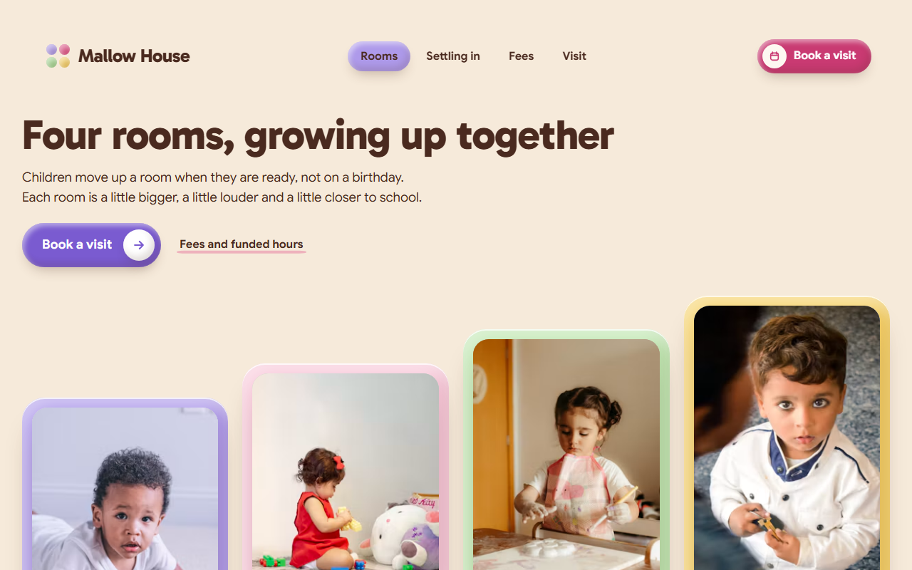
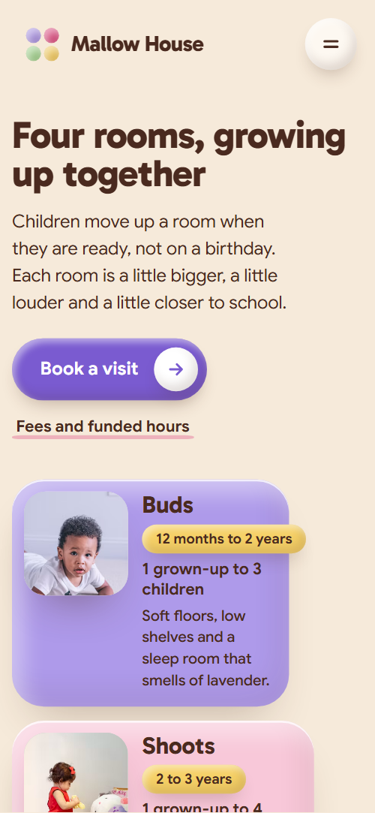
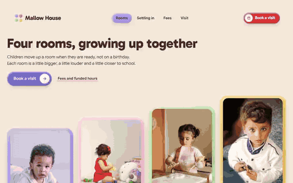

# Free HTML daycare website template with scroll animations and no libraries

Daycare website template: one free HTML file for a day nursery, preschool or childminder, with four rooms by age, a settling-in plan, a weekly lunch menu, fees with funded hours and an open-morning booking form. Photos and cards squash on pink, yellow and lilac slabs. Motion is CSS with no libraries, about 25 KB gzipped, for Claude Code or Cursor.

[](LICENSE)  

**[Live demo](https://8bsite.github.io/daycare-website-template/)** · **[Use this template](https://github.com/new?template_name=daycare-website-template&template_owner=8bsite)** · **[Download ZIP](https://github.com/8bsite/daycare-website-template/archive/refs/heads/main.zip)** · **[Template page on 8b.com](https://8b.com/templates/mallow-house/)**

<a href="https://8bsite.github.io/daycare-website-template/"></a> <a href="https://8bsite.github.io/daycare-website-template/"></a>

<p align="center"><a href="https://8bsite.github.io/daycare-website-template/"></a><br><sub>Scroll animation</sub></p>

## Use it with Claude Code, Cursor or Codex

Download the four files into your project folder (`curl.exe` in Windows PowerShell):

```bash
curl -LO https://raw.githubusercontent.com/8bsite/daycare-website-template/main/index.html
curl -LO https://raw.githubusercontent.com/8bsite/daycare-website-template/main/AGENTS.md
curl -LO https://raw.githubusercontent.com/8bsite/daycare-website-template/main/LICENSE
curl -LO https://raw.githubusercontent.com/8bsite/daycare-website-template/main/CREDITS.md
```

Then fill in the angle brackets and give your agent this prompt:

```text
Read AGENTS.md, then edit index.html. Make this the site for <my nursery: name, address, ages taken, rooms with ratios, fees and funded hours, opening hours, garden, settling plan, menu, open-morning dates, legal name>. Replace first the name, rooms, fees, menu, staff and the footer registration line. Motion is CSS plus the inline kit: keep the gate script, ids, data-8b attributes and listed classes, add no library, and set the wordmark --len. Ask me for missing facts; never invent ratios, prices, funding rules, hours, staff, inspections or contacts.
```

If you [vibe code the site with an agent](https://8b.com/templates/vibe-coding/), a daycare website template for Claude Code, Cursor or Codex goes fastest when you hand the agent the facts only the setting has: ages taken, rooms and ratios, fees, funded hours, opening times, the menu week, open-morning dates and the registered name. The demo invents all of them, including the staff names, the Ofsted registration line in the footer and the funding rules. Ratios and funding differ by country, so the agent should ask rather than guess.

No agent? Click **[Use this template](https://github.com/new?template_name=daycare-website-template&template_owner=8bsite)**, edit `index.html` on GitHub and turn on **Settings > Pages**.

## Sections and motion

- **Navigation**: top bar with the brand, four links, a Book a visit button and a menu button; full-screen menu. The bar hides when you scroll down and returns when you scroll up, floats after 40 px, and the round icon buttons squash on hover.
- **Four rooms, growing up together**: the h1, a booking button and four rooms by age as columns of rising height. On load the heading block rises and the four coloured grounds grow from small, with each room's contents following 0.16 s apart; as the rooms scroll away, their photos drift inside their frames.
- **The making table**: a slab with the making table text and six craft photos that roll out like dough. Six photos start piled in the middle of the table, turned and shrunk, and roll out to their grid places as you scroll.
- **Out in all weathers**: two garden photos and a slab listing what is in the garden. The slab swells out from its lower left corner, and the small wellies photo and the badges squash down as they arrive.
- **Settling in, one step at a time**: four settling-in steps beside a portrait stage where the parent moves away and the key person comes close. As the four steps scroll past, the parent's portrait steps away and shrinks while the key person's comes beside the child, the dashed lines follow them and a lilac fill sweeps across the active step.
- **Cooked here, this morning**: the week's lunch menu: five bowls that roll onto a butter-yellow slab. Each day's round bowl photo rolls in from the left edge of the slab, turning as it travels and squashing as it stops on its day.
- **Questions parents ask**: six parents' questions in native &lt;details&gt;. Each question squashes in as it arrives, and its plus turns to a cross when it opens.
- **Fees and funded hours**: three day patterns as price cards on a lilac tray, with a funded-hours note. The three cards start stacked as one small lump on a shrunken tray; the tray stretches and the cards slide apart and press down.
- **Come to an open morning**: open-morning text, a playroom photo, address and contacts beside a booking form. The photo and the form squash in as they arrive.
- **Footer**: wordmark, four columns and the copyright with the Design: 8B credit. The wordmark squashes in as it arrives.

## Design

 page ground  
 cards: settling steps, question items, lunch days and fee plans, form fields and date pills, the floating nav bar, the round icon buttons and the menu links  
 text, focus outlines and the favicon ground  
 second dot of the logo mark and the low wash under the text links that fills on hover  
 lilac: the Buds room ground, the fee tray, the full-screen menu, the footer ground, the first logo dot, the plus discs in the questions, the settling step fill and the nav link pill on hover and for the section in view  
 violet: the main buttons and the chosen Saturday pill  
 mint: the Blooms room ground, the garden slab, the booking form, the six craft photo labels and the nut-free badge  
 butter yellow: the Meadow room ground, the lunch slab, the small badges and the fourth logo dot  
 pale pink: the Shoots room ground, the making-table slab and the settling stage  
 text on violet and pink buttons, the arrow discs, the rings round the bowls and portraits, and the highlight in the inner shadows  
 deep pink: the Book a visit button in the nav bar and in the menu  
 softer brown for the dish lines, the price units and the contact facts  
 light green, used only for the third dot of the logo mark

**Gabarito**: headings at weight 800, room and card titles and the nav wordmark at 700-800. **Google Sans**: body text, buttons, labels, badges and form fields, at 400 to 700 (Google Fonts). A single column of coloured slabs on a cream ground. The first screen holds the heading and four room columns of rising height (76, 84, 92 and 100 percent), each its own colour, with photo, age badge and ratio inside. Below come a six-photo craft grid, a garden slab with two photos, a four-step settling list beside a portrait stage, five lunch cards, the parents' questions, three fee cards on a lilac tray, and a booking form beside the contacts.

## Questions

**Does the open-morning booking form send anything?**  
No. As shipped, it checks the fields, shows a thank-you line and clears itself, but sends nothing. Point it at Formspree or Netlify Forms, or at your booking system, before you publish. The three Saturday choices are fixed radio buttons, so edit their dates too.

**Can I get a daycare site like this without editing code?**  
Yes, with a different tool: [8B's AI website builder](https://8b.com/) designs a new site from a sentence, not this template. Designing and restyling are free. Publishing with hosting and SSL, full HTML export and AI edits in chat are on Pro at $9 a month billed yearly. It also runs inside Claude and ChatGPT through the 8B connector.

**What happens in Firefox, with reduced motion or without JavaScript?**  
In Firefox, which lacks scroll-driven animations today, and with reduced motion, the scroll and arrival animations and the smooth wheel are off and every section shows its finished layout; the first screen's load-in still plays in Firefox, and the nav bar still hides on scroll. Without JavaScript the menu cannot open and the form sends nothing.

## Is it the right base?

Choose it when one friendly page should show rooms, fees and a way to book a visit. For daycare web design where families book sessions and parties, the [indoor play venue](https://8b.com/templates/hopla/) template fits better. This is the light build: the same look and motion with no animation library or CDN script, about 25 KB of code gzipped against 70 KB and three extra requests for the GSAP version. One weak spot: many rounded photos move at once, which can feel heavy on weak phones.

## Before you publish

- Replace what is marked `data-8b-placeholder` (social preview image, favicon, phone, email, form) and the invented demo facts; [AGENTS.md](AGENTS.md) lists them.
- The form sends nothing yet: connect it to Formspree or Netlify Forms, or remove it.

## Tech

No JavaScript libraries: CSS scroll-driven animations and a small inline motion script with its own smooth wheel scrolling, 97 KB, no build step. Chrome and Edge 111+, Safari 16.2+, Firefox 121+ (it uses color-mix(), :has(), cascade layers). Without scroll-driven animations (Firefox today) the scroll motion and the smooth wheel are off and each section shows its finished layout (a load-in or a loop may still play); with "reduce motion" on, the page is complete and nothing moves on its own (hover effects stay).

A GSAP build of the same page is [`index.gsap.html`](index.gsap.html): GSAP 3.13.0, ScrollTrigger, Lenis 1.3.27 from jsDelivr, 89 KB; its scroll motion also plays in Firefox. Use one of the two files.

## License

MIT, see [LICENSE](LICENSE). Photos, fonts and libraries keep their own licences: [CREDITS.md](CREDITS.md). More free templates: [8b.com/templates](https://8b.com/templates/) · [github.com/8bsite](https://github.com/8bsite).
