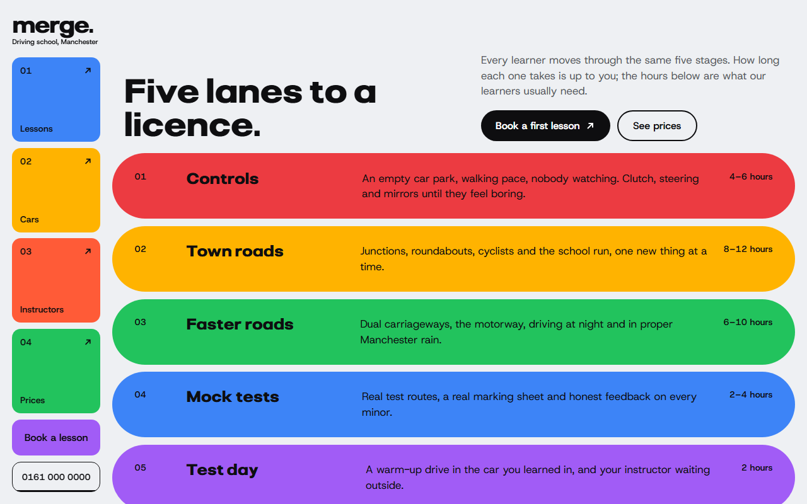
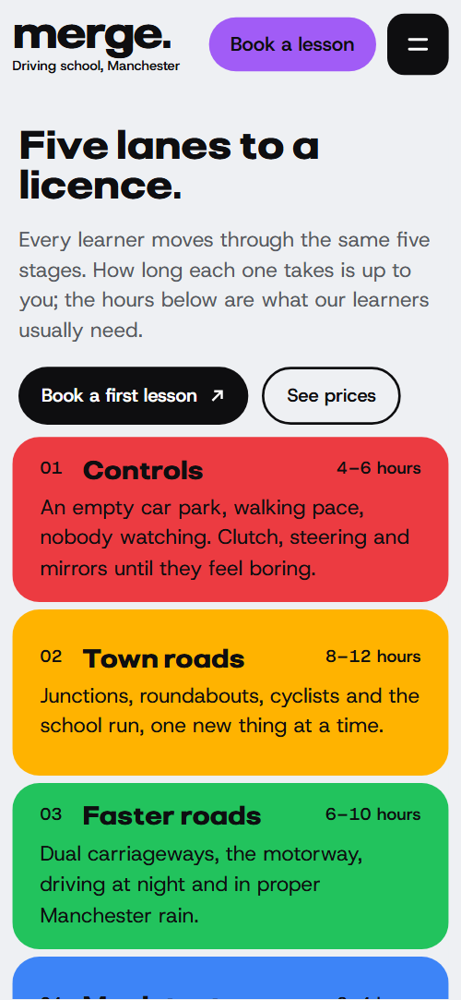

# Free HTML driving school website template with GSAP scroll animations

Driving school website template: one free HTML file for a school or an independent instructor who sells lessons by the hour. It has five lesson stages, an all-inclusive price card, four instructor cards, a pick-up zone board, three packages and a booking form, in bright colour tiles. AGENTS.md is included, so Claude Code, Cursor or Codex can adapt it.

[](LICENSE)  

**[Live demo](https://8bsite.github.io/driving-school-website-template/)** · **[Use this template](https://github.com/new?template_name=driving-school-website-template&template_owner=8bsite)** · **[Download ZIP](https://github.com/8bsite/driving-school-website-template/archive/refs/heads/main.zip)** · **[Template page on 8b.com](https://8b.com/templates/merge/)**

<a href="https://8bsite.github.io/driving-school-website-template/"></a> <a href="https://8bsite.github.io/driving-school-website-template/"></a>

<p align="center"><a href="https://8bsite.github.io/driving-school-website-template/"></a><br><sub>Scroll animation</sub></p>

## Use it with Claude Code, Cursor or Codex

Download the four files into your project folder (`curl.exe` in Windows PowerShell):

```bash
curl -LO https://raw.githubusercontent.com/8bsite/driving-school-website-template/main/index.html
curl -LO https://raw.githubusercontent.com/8bsite/driving-school-website-template/main/AGENTS.md
curl -LO https://raw.githubusercontent.com/8bsite/driving-school-website-template/main/LICENSE
curl -LO https://raw.githubusercontent.com/8bsite/driving-school-website-template/main/CREDITS.md
```

Then fill in the angle brackets and give your agent this prompt:

```text
Read AGENTS.md, then edit index.html. Make this the site for <my driving school: name, city, lesson stages and typical hours, what the price covers, cars and gearboxes, instructors and languages, pick-up districts and test centres, packages and prices, office hours, how people book>. Replace first the prices, instructors, districts, pass figures and quotes. Keep the section ids, data-8b-section, data-8b-motion and data-8b-part, the classes AGENTS.md lists and each --len set to its word's character count. Ask me for missing facts and never invent prices, approvals, pass rates, reviews or contacts.
```

Replace the school facts first: prices and package hours, instructor names, languages and free slots, the 24 district names, the three test centres, pass figures and learner quotes. The demo is British, which makes it one of the driving school website templates UK schools can start from, but DVSA, pounds and the test centres are demo content to replace. For vibe coding in Claude Code or Cursor, tell the agent to keep data-8b-section, data-8b-motion and data-8b-part.

No agent? Click **[Use this template](https://github.com/new?template_name=driving-school-website-template&template_owner=8bsite)**, edit `index.html` on GitHub and turn on **Settings > Pages**.

## Sections and motion

- **Navigation**: top bar with wordmark, Book a lesson button and menu button; from 1024 px a left side rail of four colour tiles, the button and the phone number. The top bar, and on wide screens the side rail, slides up out of view when you scroll down and returns on a move up, a class toggle with a CSS transition that keeps running with reduced motion.
- **Five lanes to a licence.**: headline "Five lanes to a licence.", intro, two buttons, and five coloured lesson stages with hours. On load the headline and its side text fade and rise, and the five stage rows slide in from alternate sides one after another, in CSS that reduced motion switches off.
- **One price. Everything in the car.**: bento of tiles: one orange all-inclusive price card, two list tiles, a photo and an hours tile. Scrubbed as the section arrives: four tiles start small behind the orange card and slide out to their places one after another.
- **Dual controls in every car.**: text card about the cars beside a 3D tunnel of colour cells and photos. Scrubbed while the tunnel crosses the screen: its four perspective walls, grid lines and cells together, glide six grid units toward you and settle at their depth.
- **The calm voice in the passenger seat.**: four instructor cards with a portrait, bio, gearbox and languages, and next free slots. Heading lines arrive from alternate sides and each instructor card opens from its top left corner as it arrives.
- **We come to you.**: pick-up zone as a 24-cell district grid coloured by three test centres, with a legend. Scrubbed: only the three centre cells are coloured at first, then each district takes its centre's colour in order of distance.
- **Nervous?**: three stacked colour panels that answer in turn: Nervous? Good. Let’s go.. A sticky stage holds for about 2.3 screens of scrolling: an amber square grows from the red panel's corner until it fills the stage, then a green one does the same, while the amber and green words rise in.
- **We speak human.**: driving jargon table: five terms and their plain-English translations. Scrubbed row by row: a large jargon term slides back into its own cell, shrinks and is struck through while the plain words rise in.
- **Passed. Recently.**: heading with a looping reel of eight photos and three pass quotes. A reel of eight photos scrolls sideways forever in a 48 second loop, pausing on hover, focus and when off screen.
- **Pay for the driving, nothing else.**: three package cards with a price, hours, a description and a button, plus a row of squares per hour. One square per lesson hour is drawn on each package card, then filled square by square as the card crosses the screen, the biggest package last.
- **Book your first lesson.**: dark booking card with a form, and a white card with phone, email, office and hours. The heading lines arrive from alternate sides and both cards open from their top left corners.
- **Footer**: large wordmark with six small colour cells, legal line, DVSA note and four links. Scrubbed: six colour cells step along the grid from scattered spots to their resting squares around the wordmark.

## Design

 pale grey page ground, the navigation bar and the tunnel board  
 text, solid buttons, the dark booking card, hairlines and the centre cells of the district board  
 form fields, jargon cells, text on the dark booking card, the hover fill of the purple buttons and the focus halo  
 amber: button hover fill, the areas card, the amber nervous panel, one stage, one package card and one nav tile  
 orange: the all-inclusive price card, one nav tile, one pass quote and one footer cell  
 red: the first stage, the red nervous panel, the strike-through on jargon terms and one footer cell  
 green: the hours tile, the south zone of the district board, the green nervous panel and the contact info card  
 blue: the north zone of the district board, one nav tile, one instructor card and one package card  
 purple: the Book a lesson buttons and the Send request button, the last lesson stage, one instructor card, the east zone of the district board and one package card  
 light lilac: the Theory, sorted tile, one pass quote and one jargon translation cell  
 grey for intro paragraphs, jargon terms and the legal line

**Pliant**: heavy wide display face at weight 800: section headings, stage names, the nervous words, the wordmark and the large footer wordmark. **Host Grotesk**: body text, labels, buttons and form fields in regular to semibold weights (Google Fonts). On wide screens a fixed rail on the left holds the wordmark, four numbered colour tiles, the booking button and the phone number; below 1024 px it becomes a bar with a menu sheet. The sections are rounded tiles on a pale grey ground: a bento of price and hours, a text card beside a perspective tunnel of colour and photo cells, portrait cards, a 24-cell district board and a table of terms.

## Questions

**Where does the booking form send requests?**  
Nowhere yet. The form needs a name and a phone number, then shows a thank-you line and sends nothing, because its action is #. Connect Formspree or Netlify Forms with the steps in AGENTS.md, or link to your booking system. Also edit the line that promises a call back within one working day.

**Can I get a site like this without editing code?**  
Yes, in a different way. [8B's AI website builder](https://8b.com/templates/8b/) designs a new site from a sentence, in its own design, not this template. Designing and restyling are free; hosting with SSL, full HTML export and AI edits in chat are on Pro at $9 a month billed yearly. It also runs inside Claude and ChatGPT through the 8B connector.

**What works on a phone, with reduced motion or without JavaScript?**  
On a phone the four section links sit in the menu sheet. With reduced motion the scroll scenes, entrance effects and smooth scrolling are off, while the bar's hide on scroll and the hover fills keep running. Without JavaScript the menu button cannot open, the hour squares are not drawn and the photo reel does not loop.

## Is it the right base?

Choose this when the business sells hours of tuition, has a few named people and a pick-up area. A shop or a restaurant needs another shape, and an online teacher with mentors and plans sits closer to the [music school](https://8b.com/templates/overtone/) template. The weak spot is booking: the form sends nothing and the next free times on the cards are typed by hand, not a live calendar. An owner who does not code can describe a new site to the 8B builder instead.

## Before you publish

- Replace what is marked `data-8b-placeholder` (social preview image, favicon, phone, form, email) and the invented demo facts; [AGENTS.md](AGENTS.md) lists them.
- The form sends nothing yet: connect it to Formspree or Netlify Forms, or remove it.

## Tech

GSAP 3.13.0, ScrollTrigger, SplitText, Lenis 1.3.27 from jsDelivr, 99 KB, no build step. Chrome and Edge 111+, Safari 16.2+, Firefox 113+ (it uses color-mix(), cascade layers, small/dynamic viewport units). With "reduce motion" on, the page is complete and still.

## License

MIT, see [LICENSE](LICENSE). Photos, fonts and libraries keep their own licences: [CREDITS.md](CREDITS.md). More free templates: [8b.com/templates](https://8b.com/templates/) · [github.com/8bsite](https://github.com/8bsite).
