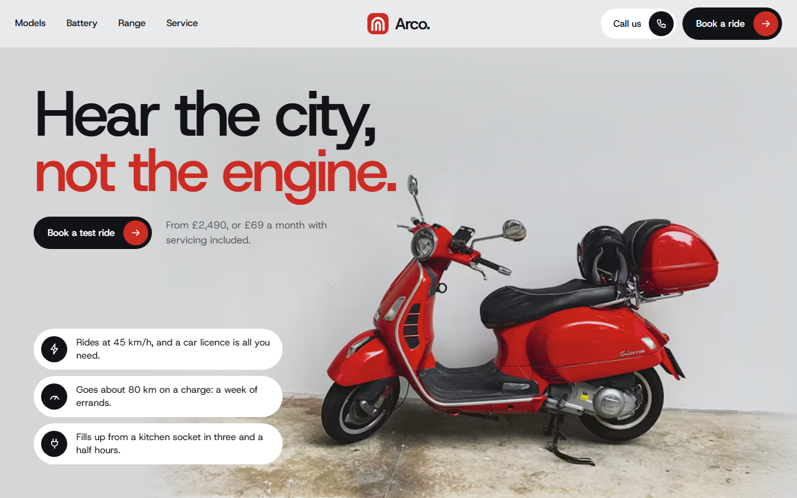
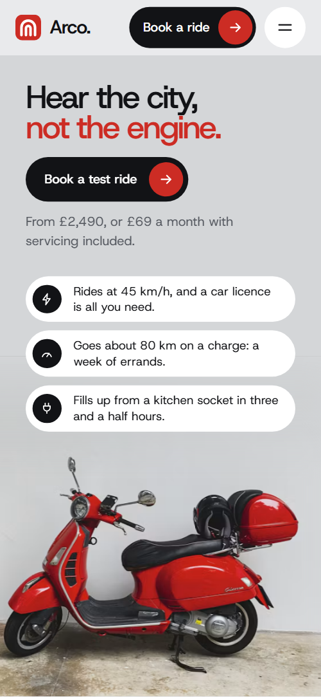
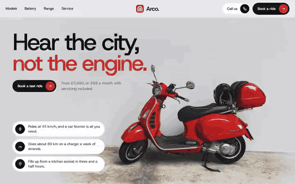

# Free HTML electric moped website template with scroll animations and no libraries

Electric moped website template: one free HTML file for a maker or dealer with three models, a buy or monthly choice, kerbside servicing and a test ride form. Pale grey panels, white pill cards and one red accent carry four pinned scroll sections, run by CSS with no JavaScript library. AGENTS.md is included for Claude Code, Cursor or Codex.

[](LICENSE)  

**[Live demo](https://8bsite.github.io/electric-moped-website-template/)** · **[Use this template](https://github.com/new?template_name=electric-moped-website-template&template_owner=8bsite)** · **[Download ZIP](https://github.com/8bsite/electric-moped-website-template/archive/refs/heads/main.zip)** · **[Template page on 8b.com](https://8b.com/templates/arco/)**

<a href="https://8bsite.github.io/electric-moped-website-template/"></a> <a href="https://8bsite.github.io/electric-moped-website-template/"></a>

<p align="center"><a href="https://8bsite.github.io/electric-moped-website-template/"></a><br><sub>Scroll animation</sub></p>

## Use it with Claude Code, Cursor or Codex

Download the four files into your project folder (`curl.exe` in Windows PowerShell):

```bash
curl -LO https://raw.githubusercontent.com/8bsite/electric-moped-website-template/main/index.html
curl -LO https://raw.githubusercontent.com/8bsite/electric-moped-website-template/main/AGENTS.md
curl -LO https://raw.githubusercontent.com/8bsite/electric-moped-website-template/main/LICENSE
curl -LO https://raw.githubusercontent.com/8bsite/electric-moped-website-template/main/CREDITS.md
```

Then fill in the angle brackets and give your agent this prompt:

```text
Read AGENTS.md, then edit index.html. Make this the site for <my brand: name, models with specs, range and prices, buy and monthly plan terms, warranty, servicing, licence rules, shop address, how people book a test ride>. Replace the models, plans, map rides and reviews first. Keep three models, five stops, the gate script in the head, the data-8b-section, data-8b-motion and data-8b-items attributes and the classes AGENTS.md lists; set each --len to its line's character count. Add no animation library. Never invent prices, specs, reviews or contacts; ask me.
```

Replace the three models first: names, badges, descriptions, four specs each, prices and monthly prices, then the photos. Next come the two plans, the five rides on the map and the service steps. The models section is built for three models and the map pairs five stops with five day dots. Ask the owner for range, weight, warranty and licence rules. Vibe coding with Claude Code or Cursor suits it because every fact is plain text, and [a side-by-side of agents and builders](https://8b.com/templates/vibe-coding/) shows which tools edit it in place.

No agent? Click **[Use this template](https://github.com/new?template_name=electric-moped-website-template&template_owner=8bsite)**, edit `index.html` on GitHub and turn on **Settings > Pages**.

## Sections and motion

- **Navigation**: fixed top bar: four section links, the Arco logo, a Call us button and a Book a ride button; hides on scroll down; phone menu overlay.
- **Hear the city, not the engine.**: first screen: a two-line headline, a test ride button with a price line, three fact pills, and a red moped photo behind them. On load the headline, button, fact pills and photo slide or settle in with CSS keyframes; on phones the photo also drifts sideways in a loop.
- **Three Arcos. One charger.**: three models on a pinned switcher: each photo grows from a stack of thumbnails at the right edge, with name, badge, text, four specs and a price tab (demo: Uno, Nero, Argento). Pinned for about two screens: each next photo grows from the thumbnail stack to full size while the previous one steps back and darkens, and the text swaps.
- **Lift it out. Charge it anywhere.**: dark section: a removable battery lifts out and fills ten segments while three evening times tick off. As the battery passes through the screen it rises, ten segments turn red one by one, three rules draw and the last heading line turns red.
- **Built in Bristol from fewer parts.**: split section: heading, paragraph and two columns beside a workshop photo with a notch caption. The heading rises, the two columns slide in from the left and the photo opens from a round notch at one corner.
- **Three things you touch every day.**: three close-ups on a pinned stage that trade width: the focused strip opens wide, the others close to slivers (demo: lamp, wheel, grips). Pinned: the three close-ups trade width as you scroll (height on phones), so the focused strip opens wide and only its caption shows.
- **A week on one charge.**: pinned map: a street map where a red rider drives a drawn route through five stops while a charge bar empties (demo: a week of errands in Bristol). Pinned: the route draws itself on the map behind a red rider, each stop and day dot lights as it passes and the charge bar shrinks.
- **Buy it, or ride it monthly.**: two plans side by side on a split panel with an "or" disc: own it or ride monthly. The heading rises and each plan's list slides in from the left.
- **Service comes to your kerb.**: four service steps on one horizontal track: two text cards with chips and two photo cards (demo: kerbside servicing). Pinned: the four-step track slides sideways while the photos inside the cards shift a little faster than the cards that hold them.
- **Before you ride.**: heading and a photo with a phone caption beside five questions as native details elements (demo: licence, winter range, flats, rain, theft). The heading rises and the photo opens from a round notch; the five questions are native details elements.
- **Riders rate it 4.8 out of 5.**: six review cards with stars, a quote and a rider, dealt out from a pile in the middle of the grid. The six cards start as one tilted pile mid-grid and are dealt out to their places, each a little after the one before.
- **Ride one this week.**: test ride form over a photo, with three pills for the shop address, phone and email. The photo opens from a round notch and the three contact pills slide in from the left.
- **Footer**: footer: brand line, three link columns, a large Arco wordmark and a base line with the company line and the Design: 8B credit. The letters of the big wordmark spread from the middle to their places as the footer comes up.

## Design

 page ground, the nav bar and the phone menu overlay  
 grey panels and photo placeholders, the Own it plan, model badges, river and street lines on the map  
 pill cards, the Ride monthly plan, question rows, the street map ground, the second-style buttons  
 text, the main buttons, the battery section ground, the route line, map labels  
 secondary text: leads, descriptions, captions, field labels  
 the only accent: button icon discs, charge segments, route rider, review stars, list markers, the wordmark full stop  
 paragraph text and the slot label on the dark battery section  
 battery cell, handle and slot, and the time rules on the dark section  
 hairlines between specs, plan items and footer, and form field borders

**Host Grotesk**: the only typeface: tight medium-weight headings and model names, semibold logo and thumbnail names, regular body text, loaded from Google Fonts as one variable font (Google Fonts). Rounded light grey panels sit on a pale ground, with white pill cards and photo corners cut by a notch. Section heads split into a big heading and a short lead. Models, plan panels and service steps each repeat as a set. The battery, the street map with its river, lanes and route, the charge bar and the logo mark are drawn in CSS and SVG, not images. A huge wordmark closes the footer.

## Questions

**Does the test ride form send bookings?**  
No. The script checks name, phone and a valid email, shows the thank-you line and disables the button, but sends nothing. Connect Formspree or Netlify Forms with the steps in AGENTS.md. Also edit the thank-you, which promises a text within the hour, and note that the Ride an Uno buttons do not preselect the Model field.

**What does the page show in Firefox or with reduced motion?**  
The finished layout with ordinary scrolling. Without CSS scroll-driven animations (Firefox today) or with reduced motion on, nothing pins: the models, close-ups and service steps stack, the battery shows full and the map shows the whole route. In Firefox the opening still plays its load-in; the header still hides on scroll and the hover fills still run.

**The demo is British. Can a dealer in another country use it?**  
Yes, after a text pass. The demo is a Bristol brand: prices in pounds, a CBT certificate, a car licence rule, a UK phone format and a company line registered in England. Licence and insurance rules differ by country, so the owner supplies them; the agent must not guess them.

## Is it the right base?

Pick this for one product family in a few models, with scroll motion that explains the battery, range and service. This build runs it on CSS with no animation library and no script from a CDN: about 30 KB of code gzipped in one file, against 86 KB and five extra requests for the GSAP version. For a single gadget or app, a [one-product launch page](https://8b.com/templates/hushkey/) fits better. The weak spot is length: four pinned sections each hold the screen for about two screens.

## Before you publish

- Replace what is marked `data-8b-placeholder` (social preview image, favicon, phone, form, email) and the invented demo facts; [AGENTS.md](AGENTS.md) lists them.
- The form sends nothing yet: connect it to Formspree or Netlify Forms, or remove it.

## Tech

No JavaScript libraries: CSS scroll-driven animations and a small inline motion script with its own smooth wheel scrolling, 121 KB, no build step. Chrome and Edge 111+, Safari 16.2+, Firefox 113+ (it uses color-mix(), cascade layers, small/dynamic viewport units). Without scroll-driven animations (Firefox today) the scroll motion and the smooth wheel are off and each section shows its finished layout (a load-in or a loop may still play); with "reduce motion" on, the page is complete and nothing moves on its own (hover effects stay).

A GSAP build of the same page is [`index.gsap.html`](index.gsap.html): GSAP 3.13.0, ScrollTrigger, SplitText, MotionPathPlugin, Lenis 1.3.27 from jsDelivr, 104 KB; its scroll motion also plays in Firefox. Use one of the two files.

## License

MIT, see [LICENSE](LICENSE). Photos, fonts and libraries keep their own licences: [CREDITS.md](CREDITS.md). More free templates: [8b.com/templates](https://8b.com/templates/) · [github.com/8bsite](https://github.com/8bsite).
