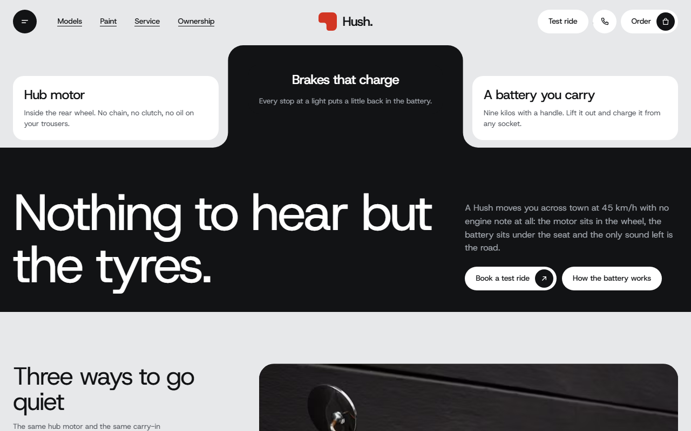
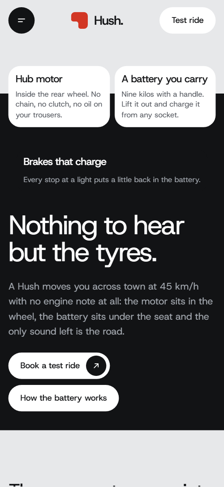
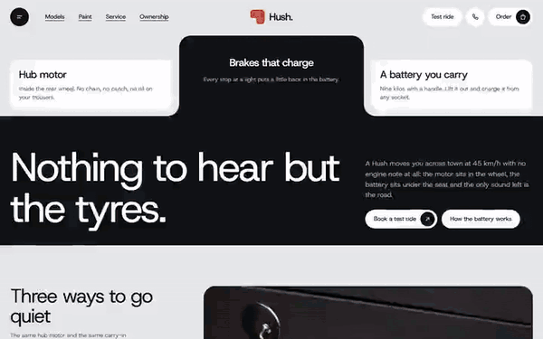

# Free HTML electric scooter website template with scroll animations and no libraries

Electric scooter website template: one free HTML file for a moped or scooter maker, with a model picker, four full-screen paint fields, a charging explainer, buy or monthly plans, home servicing and a test-ride form. Pale grey and near-black panels with notched corners carry a red accent, and the scroll motion runs on CSS with no libraries.

[](LICENSE)  

**[Live demo](https://8bsite.github.io/electric-scooter-website-template/)** · **[Use this template](https://github.com/new?template_name=electric-scooter-website-template&template_owner=8bsite)** · **[Download ZIP](https://github.com/8bsite/electric-scooter-website-template/archive/refs/heads/main.zip)** · **[Template page on 8b.com](https://8b.com/templates/hush/)**

<a href="https://8bsite.github.io/electric-scooter-website-template/"></a> <a href="https://8bsite.github.io/electric-scooter-website-template/"></a>

<p align="center"><a href="https://8bsite.github.io/electric-scooter-website-template/"></a><br><sub>Scroll animation</sub></p>

## Use it with Claude Code, Cursor or Codex

Download the four files into your project folder (`curl.exe` in Windows PowerShell):

```bash
curl -LO https://raw.githubusercontent.com/8bsite/electric-scooter-website-template/main/index.html
curl -LO https://raw.githubusercontent.com/8bsite/electric-scooter-website-template/main/AGENTS.md
curl -LO https://raw.githubusercontent.com/8bsite/electric-scooter-website-template/main/LICENSE
curl -LO https://raw.githubusercontent.com/8bsite/electric-scooter-website-template/main/CREDITS.md
```

Then fill in the angle brackets and give your agent this prompt:

```text
Read AGENTS.md, then edit index.html. Make this the site for <my electric vehicle brand: models with range, seats and prices, paint names, charging facts, plan terms, warranty, service price, showroom address, hours and phone>. Keep the section ids, the classes AGENTS.md lists, three models and four paints, and set each --len to its word's character count. Motion is CSS scroll-driven animation plus an inline kit: keep the head's gate script and the data-8b-motion attributes; add no library. Never invent ranges, prices, terms, reviews or contacts; ask me.
```

If you [vibe code the site](https://8b.com/templates/vibe-coding/), this electric scooter website template for Claude Code goes well when you hand the agent the facts only the maker has: model names, ranges, speed, prices, paint names, plan terms, warranty, service price, showroom address and hours. The demo invents all of them and the six rider reviews. Replace those first, then the 29 photos. Keep the ids and the classes AGENTS.md lists. The licence and age rules in the city section are British demo content, so the owner supplies local ones.

No agent? Click **[Use this template](https://github.com/new?template_name=electric-scooter-website-template&template_owner=8bsite)**, edit `index.html` on GitHub and turn on **Settings > Pages**.

## Sections and motion

- **Navigation**: fixed top bar: menu button, four section links, wordmark, Test ride, phone and Order buttons; hides on scroll down; full-screen menu overlay. The top bar slides up out of view on scroll down and returns on scroll up, and the menu overlay opens over the page.
- **Nothing to hear but the tyres.**: short opening on a black panel with a notch cut from the top: the heading "Nothing to hear but the tyres.", three fact cards, an intro and two buttons. On load, the black field's notched top settles into place while the heading, the intro and then the three fact cards rise in.
- **Three ways to go quiet**: model picker: three cards (name, one line, range, seats or box, price) beside a photo frame that wipes from model to model. Held on screen for two screens of scrolling: the active model card slides out of the photo frame's notch and greys, the notch steps down to the next card and the photo wipes downward.
- **Charge it at your desk, not at a pump.**: charging explainer: photo with a notch and a "3 hours" note, heading, paragraph and three steps (Lift, Plug, Ride). The photo's corner notch widens once on arrival and the heading reveals line by line.
- **Four paints, mixed in Hackney**: four paint colours as full-screen fields, each with a photo, a huge name, a colour description and an Order button, sliding sideways as you scroll. Held on screen for three screens of scrolling, on phones too: the four colour fields slide sideways as a track while each photo and giant name drifts a little faster in the same direction.
- **Made for hands, not only for looks**: mosaic of a text tile and five close-up photos with captions. The heading reveals line by line, and the five close-up photos start pushed out and tilted, then close in around the text tile as you scroll.
- **Parks where a car can't. Leaves before the bus does.**: two rows of street photos sliding in opposite directions under a two-line heading, and a paragraph on licence and parking. Two rows of street photos slide past each other in opposite directions while the two heading lines slide in from opposite sides.
- **Own it outright, or ride it by the month.**: two plans side by side: Own it (£3,190, four points) and Ride it monthly (£79 a month, four points). The heading reveals line by line and each plan card slides in from its own side with a small overshoot.
- **We come to you. Your Hush never sees a garage.**: home servicing: heading, a workshop photo and three steps (Book a slot, We ride over, Done on the kerb). Held for about one and a half screens: the workshop photo opens one third at a time as the second and third steps slide in and their number discs turn dark.
- **What riders hear instead**: six rider quotes with a portrait, a first name, the model and the district. On wide screens six rider cards start as one fanned stack and slide out to their staggered places as the wall scrolls in.
- **Before you ride**: six questions and answers in native &lt;details&gt; elements with a phone link. The heading reveals line by line; the six questions open and close without JavaScript.
- **Ride one for an hour, free.**: test-ride booking: showroom address, hours, phone and email, a showroom photo in a notched panel and a booking form. The photo panel's notch widens around the form and the photo settles from a close view to full frame.
- **Footer**: footer: four columns (Explore, Own one, Visit, Talk), a huge wordmark and the legal lines with the Design: 8B credit. The four link columns slide up into place once as the footer arrives.

## Design

 page background, form field fill and the nav bar once scrolled  
 text, the opening's black field, round and pill buttons, the monthly plan card, the menu overlay and the footer  
 hairlines in steps and plan lists, form field borders, the FAQ rules, and the greyed model cards and service step numbers before they light up  
 cards and surfaces, the Own it plan card, light buttons, text on dark panels and captions on photos  
 the accent: the logo mark, button hover fill, the charging figure, list dots, the footer wordmark's full stop and the Postbox red paint field  
 secondary text, labels, specs and descriptions on light grounds  
 secondary text on dark grounds: the menu footer, the footer columns, the plan card and the middle fact card in the opening  
 the Lido green paint field  
 the Harbour blue paint field  
 the Mustard paint field, whose text switches to the near-black

**Host Grotesk**: the only typeface, loaded at weights 400 to 600: regular, tightly tracked headings and body text, medium-weight buttons, card titles and labels, and a semibold wordmark (Google Fonts). A pale grey ground carries white cards and near-black panels with rounded corners. The opening's black field, the model photo frame, the charging photo and the contact photo each have a notch that a card, note or form sits in. Text blocks follow a 12-column grid. Paint is four full-screen colour fields, reviews a staggered three-column wall, and ownership two large cards, one white and one black. The footer wordmark and each paint name are sized from their character count.

## Questions

**Does the test-ride form send anything?**  
No. It checks that a name and a valid email are present, then shows a thank-you line and clears the fields. Connect Formspree or Netlify Forms using the steps in AGENTS.md, or delete the form and keep a phone link. Also edit the thank-you line, which promises an email within a working day.

**What happens on a phone, with reduced motion or in Firefox?**  
On a phone the section links, phone and Order buttons hide behind the menu button and most layouts become one column. With reduced motion, or without CSS scroll-driven animations (Firefox today), the page shows its finished static layout: nothing holds the screen, the paint fields stack and the model frame shows the first model. The bar still hides on scroll.

**Can I get a site like this without editing code?**  
Not with this file; it needs an AI coding agent or a developer. [8B's AI website builder](https://8b.com/) designs a new site from a sentence you write, in its own design rather than this template. Designing and restyling are free; publishing with hosting is on Pro at $9 a month billed yearly. It also runs inside Claude and ChatGPT.

## Is it the right base?

Pick this base when a maker sells three models and two ways to pay on one scroll. A dealer with many vehicles needs more pages, and a shop that takes payment needs a cart; this file has neither. For a moped seller laid out differently, see the [dealer-style moped](https://8b.com/templates/arco/) template. This build has the same look and scroll scenes with no animation library: about 30 KB of code gzipped, against 78 KB and four more requests for the GSAP version.

## Before you publish

- Replace what is marked `data-8b-placeholder` (social preview image, favicon, phone, email, form) and the invented demo facts; [AGENTS.md](AGENTS.md) lists them.
- The form sends nothing yet: connect it to Formspree or Netlify Forms, or remove it.

## Tech

No JavaScript libraries: CSS scroll-driven animations and a small inline motion script with its own smooth wheel scrolling, 120 KB, no build step. Chrome and Edge 111+, Safari 16.2+, Firefox 121+ (it uses color-mix(), :has(), cascade layers, small/dynamic viewport units). Without scroll-driven animations (Firefox today) the scroll motion and the smooth wheel are off and each section shows its finished layout (a load-in or a loop may still play); with "reduce motion" on, the page is complete and nothing moves on its own (hover effects stay).

A GSAP build of the same page is [`index.gsap.html`](index.gsap.html): GSAP 3.13.0, ScrollTrigger, SplitText, Lenis 1.3.27 from jsDelivr, 108 KB; its scroll motion also plays in Firefox. Use one of the two files.

## License

MIT, see [LICENSE](LICENSE). Photos, fonts and libraries keep their own licences: [CREDITS.md](CREDITS.md). More free templates: [8b.com/templates](https://8b.com/templates/) · [github.com/8bsite](https://github.com/8bsite).
