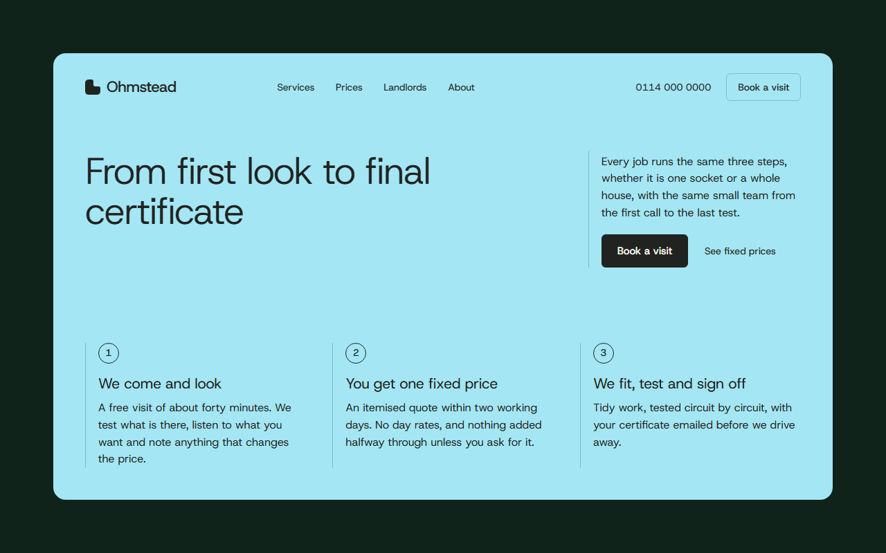
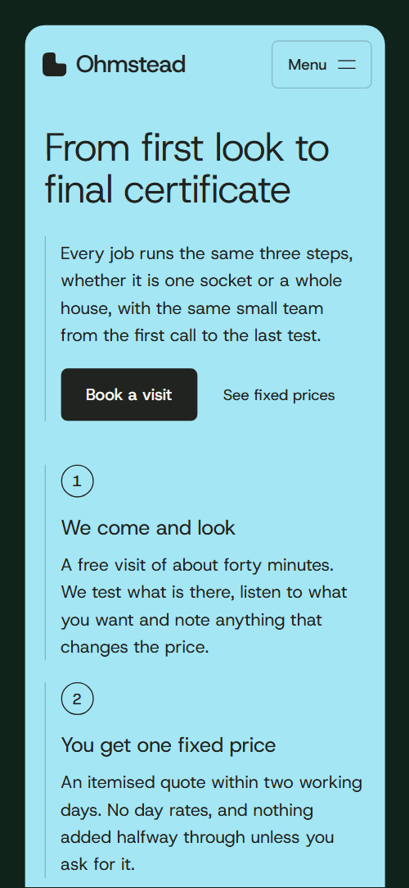
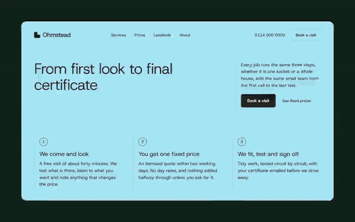

# Free HTML electrician website template with scroll animations and no libraries

Electrician website template: one free HTML file for a home electrician, with a three-step process, room-by-room services, a fixed price list of eight jobs, a landlord checklist, an out-of-hours line and a visit form. Cream sheets sit on dark green with one aqua accent; the scroll motion is CSS, no libraries. AGENTS.md guides an AI agent.

[](LICENSE)  

**[Live demo](https://8bsite.github.io/electrician-website-template/)** · **[Use this template](https://github.com/new?template_name=electrician-website-template&template_owner=8bsite)** · **[Download ZIP](https://github.com/8bsite/electrician-website-template/archive/refs/heads/main.zip)** · **[Template page on 8b.com](https://8b.com/templates/ohmstead/)**

<a href="https://8bsite.github.io/electrician-website-template/"></a> <a href="https://8bsite.github.io/electrician-website-template/"></a>

<p align="center"><a href="https://8bsite.github.io/electrician-website-template/"></a><br><sub>Scroll animation</sub></p>

## Use it with Claude Code, Cursor or Codex

Download the four files into your project folder (`curl.exe` in Windows PowerShell):

```bash
curl -LO https://raw.githubusercontent.com/8bsite/electrician-website-template/main/index.html
curl -LO https://raw.githubusercontent.com/8bsite/electrician-website-template/main/AGENTS.md
curl -LO https://raw.githubusercontent.com/8bsite/electrician-website-template/main/LICENSE
curl -LO https://raw.githubusercontent.com/8bsite/electrician-website-template/main/CREDITS.md
```

Then fill in the angle brackets and give your agent this prompt:

```text
Read AGENTS.md, then edit index.html. Make this the site for <my electrical business: name, area covered, services, fixed prices, team, registrations and insurance, out-of-hours number and fee, hours>. Replace first the company name, the Sheffield places, the eight prices, the team, the reviews and the phone numbers. Keep the ids, the data-8b attributes, the gate script, the selectors AGENTS.md lists and six rooms with one photo each; add no animation library. Ask me for missing facts; never invent prices, registrations, cover, hours, addresses, reviews or contacts.
```

Electrician web design by vibe coding goes quickest with an electrician website template for Claude Code, Cursor or Codex, once the agent has the real facts: prices, areas, registrations, insurance, hours and phone numbers. The demo invents all of them, including the nine employed electricians and the eight reviews. Replace those first, keep the ids, the data-8b attributes and the selectors AGENTS.md lists, keep six rooms with one photo each, and set the footer wordmark's --len to the new name's character count.

No agent? Click **[Use this template](https://github.com/new?template_name=electrician-website-template&template_owner=8bsite)**, edit `index.html` on GitHub and turn on **Settings > Pages**.

## Sections and motion

- **Navigation**: bar with the logo mark and wordmark, four links, phone and a Book a visit button; a Menu button and full-screen overlay on narrow screens. The bar floats after 60 px of scrolling and slides away while you scroll down past 160 px, and the link of the section in view is underlined in aqua.
- **From first look to final certificate**: one aqua sheet with the h1, a short note, two links and a numbered three-step process. On load the heading, the note and the three steps rise in one after another, with about 0.08 s between steps.
- **Room by room**: six rooms listed by name with a sticky frame of photos that open over one another. As each row reaches the reading line its photo opens over the previous one from the top-right corner while the room name darkens, and it dims again once the next room takes over.
- **We leave the place tidier than we found it**: tidy-work promise: a wide photo with a tab, a small photo and three ruled notes on a dark ground. The heading rises line by line, each photo opens from its corner while the image settles from a zoom, and each note draws in once as it arrives.
- **Plug in on the drive, wake up full**: car charger offer: a village seen from above behind a sheet with a list, a button and a price tab. With the scroll the photo zooms out from 1.55 times, the sheet rises into place and the price tab slides in from the right.
- **Landlord certificates without the chasing**: landlord certificate: heading, lead, button and a five-line test sheet that fills in as you read. With the scroll each checklist row draws its line across and darkens its text, and its badge switches from Due to Passed.
- **Fixed prices for the jobs we do most**: fixed price list of eight jobs in ruled rows on a dark ground. Each price row wipes in from the left as it comes into view, after the heading rises line by line.
- **The people who come round**: four electricians with notched portraits, tabs and a speciality line. The four portraits start as one tilted pile in the middle of the grid and are dealt to their places as the grid scrolls in.
- **Questions we get asked at the door**: six questions and answers in native details elements. The heading rises line by line and the note beside it wipes in; the questions are plain details elements that open and close without script.
- **Lights out at 2 a.m.?**: dark stage with the out-of-hours number while a grid of cells lights up around it. The section is 230vh tall and its stage stays fixed while a grid of square cells lights up with the scroll, nearest the phone number first.
- **What the neighbours say**: eight short reviews in two rows that scroll past in opposite directions. The eight cards become two single rows that slide across in opposite directions as the section scrolls past.
- **Book a visit**: a visit form and contact details on a sheet over an aerial photo of terraced houses. The heading rises line by line and the contact details wipe in; sending the form only shows a thank-you line.
- **Footer**: dark footer with the large wordmark, company line, links, phone, email and the copyright with the Design: 8B credit. The wordmark rises line by line and the three columns wipe in.

## Design

 cream: reading sheets, photo tabs, form fields and text on the dark green bands  
 near-black ink: text on cream and aqua, button hover fill, landlord rule lines  
 grey for secondary text on cream, the Due badge and landlord rows before they are checked  
 stone: hairline rules between rows, review card borders and the photo placeholder ground  
 aqua accent: opening sheet, primary buttons, Passed badges, charger price tab and lit night cells  
 dark green: page ground, tidy promise, prices, night stage panel, footer and the tab notch on dark photos  
 sage: secondary text on the dark green bands  
 deep green: charger and contact photo panels, dark photo ground, the rule above the footer credit line

**Host Grotesk**: the only typeface: light headings and the footer wordmark (weight 340) with tight tracking, sub-headings, job names and prices (420), labels, buttons and photo tabs (500), regular body text (400) (Google Fonts). Rounded cream and aqua sheets sit inset on a dark green ground, alternating with full-width dark bands. Section heads pair a heading with a short ruled note. Room photos, team portraits and the wide tidy photo have a notch in the top-right corner holding a small tab. Services are room names beside a sticky photo frame; prices and the landlord checklist are ruled rows, not cards. Corners are 18px on sheets, 10px on photos, 6px on buttons.

## Questions

**Can I use this design with other AI tools?**  
Yes. The electrician website design prompt on this page works without the template in Claude Code, Codex, Cursor, Lovable, v0 or Bolt, and [a Replit button](https://8b.com/templates/for-replit/) fills it in. With the template, download index.html and AGENTS.md into an empty folder, open it in your agent, paste the short prompt; AGENTS.md says what to keep and which facts to ask for.

**Does the visit form send anything?**  
No. The script checks that name and phone are filled in, shows a thank-you line and clears the fields. To receive requests, point the form at Formspree or Netlify Forms, or at your own CRM form, and then drop the thank-you script.

**What does it show in Firefox, with reduced motion or without JavaScript?**  
Without CSS scroll-driven animations (Firefox today) or with reduced motion, nothing moves on load or scroll: the frame keeps the first room's photo, every landlord row reads Passed, the reviews stay a wrapped grid, the night stage shows only the number and scrolling is the browser's own. Without JavaScript the phone Menu button cannot open.

## Is it the right base?

This is a good base for a one-page electrician with published prices, landlord work and an emergency line; a [plumbing firm](https://8b.com/templates/ferrule/) can reuse the structure. It is the light build: no animation library and no script from a CDN, 24 KB of code gzipped against 72 KB and four more requests for the GSAP version. A firm that needs several pages, a blog or online booking will outgrow it: every booking button jumps to the one form.

## Before you publish

- Replace what is marked `data-8b-placeholder` (social preview image, favicon, phone, form, email) and the invented demo facts; [AGENTS.md](AGENTS.md) lists them.
- The form sends nothing yet: connect it to Formspree or Netlify Forms, or remove it.

## Tech

No JavaScript libraries: CSS scroll-driven animations and a small inline motion script with its own smooth wheel scrolling, 92 KB, no build step. Chrome and Edge 111+, Safari 16.2+, Firefox 113+ (it uses color-mix(), cascade layers, small/dynamic viewport units). Without scroll-driven animations (Firefox today) the scroll motion and the smooth wheel are off and each section shows its finished layout (a load-in or a loop may still play); with "reduce motion" on, the page is complete and nothing moves on its own (hover effects stay).

A GSAP build of the same page is [`index.gsap.html`](index.gsap.html): GSAP 3.13.0, ScrollTrigger, SplitText, Lenis 1.3.4 from jsDelivr, 81 KB; its scroll motion also plays in Firefox. Use one of the two files.

## License

MIT, see [LICENSE](LICENSE). Photos, fonts and libraries keep their own licences: [CREDITS.md](CREDITS.md). More free templates: [8b.com/templates](https://8b.com/templates/) · [github.com/8bsite](https://github.com/8bsite).
