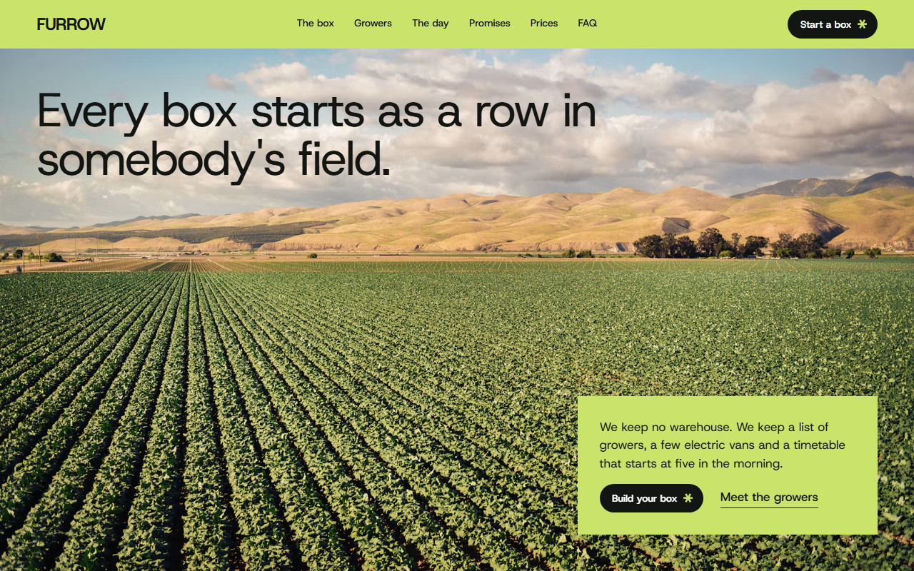
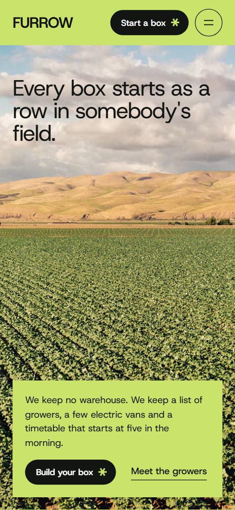
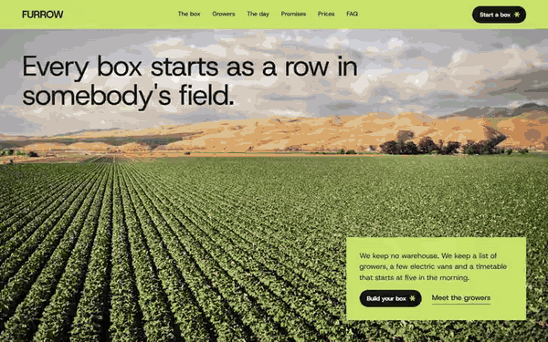

# Free HTML farm delivery website template with GSAP scroll animations

Farm delivery website template: one free HTML file for an organic veg box scheme or farm that delivers by postcode, with this week's box, the growers, a one-day delivery timeline, six promises, a box builder with a live price, recipes and a postcode check. Lime green, near-black and white. AGENTS.md is included for Claude Code, Cursor and Codex.

[](LICENSE)  

**[Live demo](https://8bsite.github.io/farm-delivery-website-template/)** · **[Use this template](https://github.com/new?template_name=farm-delivery-website-template&template_owner=8bsite)** · **[Download ZIP](https://github.com/8bsite/farm-delivery-website-template/archive/refs/heads/main.zip)** · **[Template page on 8b.com](https://8b.com/templates/furrow/)**

<a href="https://8bsite.github.io/farm-delivery-website-template/"></a> <a href="https://8bsite.github.io/farm-delivery-website-template/"></a>

<p align="center"><a href="https://8bsite.github.io/farm-delivery-website-template/"></a><br><sub>Scroll animation</sub></p>

## Use it with Claude Code, Cursor or Codex

Download the four files into your project folder (`curl.exe` in Windows PowerShell):

```bash
curl -LO https://raw.githubusercontent.com/8bsite/farm-delivery-website-template/main/index.html
curl -LO https://raw.githubusercontent.com/8bsite/farm-delivery-website-template/main/AGENTS.md
curl -LO https://raw.githubusercontent.com/8bsite/farm-delivery-website-template/main/LICENSE
curl -LO https://raw.githubusercontent.com/8bsite/farm-delivery-website-template/main/CREDITS.md
```

Then fill in the angle brackets and give your agent this prompt:

```text
Read AGENTS.md, then edit index.html. Make this the site for <my box scheme: what I sell, farms or growers, box sizes and prices, extras, delivery areas with postcode prefixes and days, returns policy, certifier and licence numbers, contacts>. Replace the vegetables, growers, prices and area rows first. Keep the section ids, the classes AGENTS.md lists, the data-price, data-fit, data-label, data-prefix and data-day attributes with your values, and match the footer --len to the new name. Ask me for missing facts; never invent prices, certification, delivery days or contacts.
```

Vibe coding with Claude Code, Cursor or Codex goes fastest when the agent gets the facts only the farm has: growers and farms, box sizes and prices, extras, delivery areas and days, certifier and licence numbers, crate policy, phone hours. Replace the seven vegetables, the four growers and the six area rows first. Keep the section ids and the classes AGENTS.md lists, and set the footer wordmark's --len to the new name's letter count.

No agent? Click **[Use this template](https://github.com/new?template_name=farm-delivery-website-template&template_owner=8bsite)**, edit `index.html` on GitHub and turn on **Settings > Pages**.

## Sections and motion

- **Navigation**: wordmark, six links and a Start a box button; a menu icon opens a full-screen overlay with seven links and the button. The bar hides when you scroll down past 80 px and returns on scroll up, also with reduced motion on.
- **Every box starts as a row in somebody's field.**: one statement as the h1 over a full-screen field photo, with a short paragraph, a button and a link on a card. On load the heading and the lime card rise into place and the photo settles from a slight zoom; nothing here is tied to scroll.
- **In the box this week**: this week's seven vegetables as a table of rows with farm, cut day and a small photo, laid out like a field that swings up to face the reader. The list starts tipped back 60 degrees (48 on phones) and swings flat as it scrolls in, while each photo opens upward from its slot.
- **Twenty-seven growers. Four of them filled this box.**: four grower cards that stack like crates: each holds under the header while the next slides over it. Each card sticks 84 px below the top of the screen while the next slides over it; the covered card shrinks, moves up and darkens.
- **One day, from the row to your door**: one delivery day as five steps that travel sideways while the section is pinned; the ground runs from pale dawn through lime to near-black dusk. Pinned: the five steps travel sideways while the section background runs from a pale lime tint through lime to near-black.
- **The box comes back.**: a crate photo beside a panel about returnable crates, with a grid of dots that fills as it scrolls. The dot grid fills column by column as it crosses the screen, and the heading rises line by line.
- **The asterisk is the promise, not the small print.**: six promises read one at a time while a six-armed asterisk assembles and turns. The asterisk turns 120 degrees over the list and each arm grows as its promise nears the middle, while the promise being read is full strength and the rest are dimmed.
- **Choose a box. Change it any week.**: a box builder: size, frequency and extras with a live price. The heading rises on arrival; the total and the label under it change as you pick a size, a frequency or extras.
- **Cook the box**: four recipe cards that arrive as a fanned stack and are dealt into the grid. The four cards start fanned in one stack, centred over the first row, and are dealt out to their places as it scrolls in.
- **Questions, answered plainly**: six questions and answers (native &lt;details&gt;) with an email link. A rule draws across above each question, and the star turns 60 degrees when one opens.
- **Do our vans come down your lane?**: a barn photo behind a card that asks for a postcode, lists six delivery areas and gives contacts. The lime sheet starts as the whole section and contracts into the card, uncovering the barn photo, which settles from a zoom.
- **Footer**: dot row, call to action, page links, contacts, a furrow rule, the wordmark across the width and small print. The dot row fills from left to right and the rule above the wordmark draws across.

## Design

 nav bar and menu overlay, growers and promises grounds, the lime cards (opening, box builder, contact), the footer button and wordmark, the star on near-black buttons  
 text, rules, the near-black buttons, grower and returns panels, recipes and footer grounds, selected choices, the last colour of the day section  
 box, boxes and questions grounds, the day and recipe cards, the promises asterisk, text on near-black  
 secondary text and rules on dark grounds, footer headings and small print, the returns and footer dot grids  
 secondary text on white: leads, farm lines in the box rows, notes, times, recipe meta, answers, the field placeholder

**Host Grotesk**: the only typeface: regular-weight headings with tight tracking, medium card titles and links, semibold buttons, a bold nav logo and footer wordmark (Google Fonts). Full-width colour blocks follow one another: a photo ground, white, lime, a pale lime tint, near-black, lime, white, near-black, white, then a photo under a lime card. Most headings sit in a two-column head beside a short lead. Lists are square-cornered rows or cards; box rows are split by 1px near-black rules. The only curves are the pills, the round menu buttons and the dot grids; the six-armed asterisk returns as a three-bar star on buttons and questions.

## Questions

**Does the box builder or the postcode check take real orders?**  
No. The builder adds the size and ticked extras into a total, and the Check button reads the leading letters of a postcode against six area rows, then shows a delivery day or a no. Neither sends anything. Connect them to your checkout or Formspree, and edit each row's data-prefix and data-day. Numeric ZIP codes need a rewrite.

**Can I get a site like this without editing code?**  
Yes, with [8B's AI website builder](https://8b.com/templates/8b/). You describe the site in a sentence and its engine designs a new site, its own design and not this template. Designing and restyling are free; hosting with SSL, full HTML export and AI edits in chat are on Pro at $9 a month billed yearly. It also runs inside Claude and ChatGPT.

**What happens on a phone, with reduced motion or with scripts off?**  
On a phone the lists stack and the day section scrolls sideways for about 1,500 px. With reduced motion on, entrance and scroll animations and smooth scrolling are off and the page reads in full; the bar still hides on scroll. Without JavaScript the menu cannot open, the total stays at £23.00 and the postcode check answers nothing.

## Is it the right base?

As a farm shop website template it is right when customers order a recurring box and need to know whether you reach them. A florist or flower grower that sells by the stem fits the [florist](https://8b.com/templates/moth-marigold/) template better. A shop with hundreds of products, a basket and card payment needs more than one scroll: the box builder adds up a price but takes no payment. The day section is also long on a phone.

## Before you publish

- Replace what is marked `data-8b-placeholder` (social preview image, favicon, form, email, phone) and the invented demo facts; [AGENTS.md](AGENTS.md) lists them.
- The form sends nothing yet: connect it to Formspree or Netlify Forms, or remove it.

## Tech

GSAP 3.13.0, ScrollTrigger, SplitText, Lenis 1.3.4 from jsDelivr, 86 KB, no build step. Chrome and Edge 111+, Safari 16.2+, Firefox 121+ (it uses color-mix(), :has(), cascade layers, small/dynamic viewport units). With "reduce motion" on, the page is complete and still.

## License

MIT, see [LICENSE](LICENSE). Photos, fonts and libraries keep their own licences: [CREDITS.md](CREDITS.md). More free templates: [8b.com/templates](https://8b.com/templates/) · [github.com/8bsite](https://github.com/8bsite).
