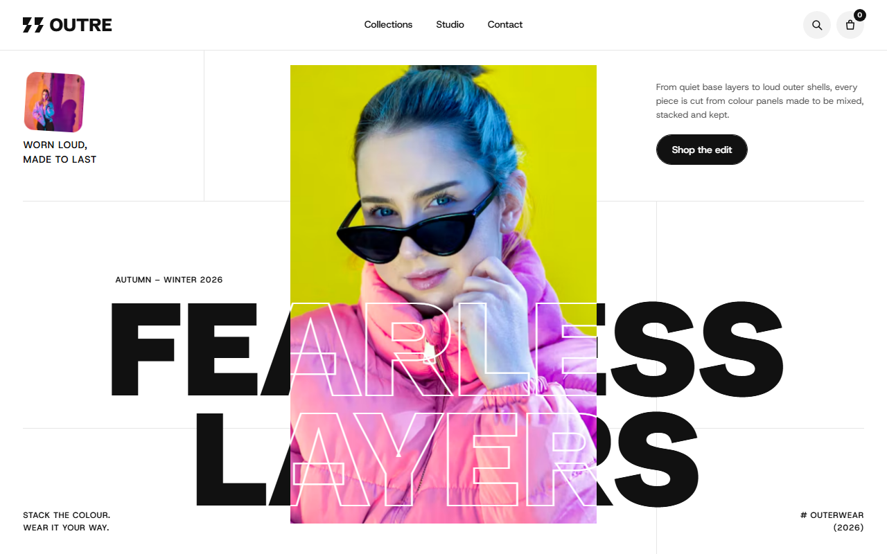
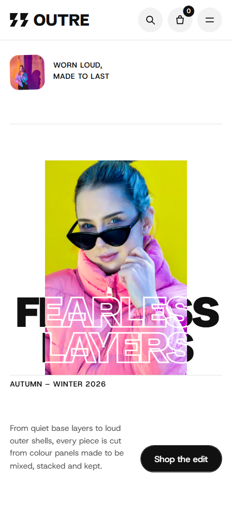

# Free HTML fashion brand website template with GSAP scroll animations

Fashion brand website template: one free HTML file for a clothing label that sells a seasonal collection and runs a few stores, with four priced looks, five colour bands, a street photo notebook and three store cards. The look is white and ink. AGENTS.md is included, so Claude Code, Cursor or Codex can adapt it.

[](LICENSE)  

**[Live demo](https://8bsite.github.io/fashion-brand-website-template/)** · **[Use this template](https://github.com/new?template_name=fashion-brand-website-template&template_owner=8bsite)** · **[Download ZIP](https://github.com/8bsite/fashion-brand-website-template/archive/refs/heads/main.zip)** · **[Template page on 8b.com](https://8b.com/templates/outre/)**

<a href="https://8bsite.github.io/fashion-brand-website-template/"></a> <a href="https://8bsite.github.io/fashion-brand-website-template/"></a>

<p align="center"><a href="https://8bsite.github.io/fashion-brand-website-template/"></a><br><sub>Scroll animation</sub></p>

## Use it with Claude Code, Cursor or Codex

Download the four files into your project folder (`curl.exe` in Windows PowerShell):

```bash
curl -LO https://raw.githubusercontent.com/8bsite/fashion-brand-website-template/main/index.html
curl -LO https://raw.githubusercontent.com/8bsite/fashion-brand-website-template/main/AGENTS.md
curl -LO https://raw.githubusercontent.com/8bsite/fashion-brand-website-template/main/LICENSE
curl -LO https://raw.githubusercontent.com/8bsite/fashion-brand-website-template/main/CREDITS.md
```

Then fill in the angle brackets and give your agent this prompt:

```text
Read AGENTS.md, then edit index.html. Make this the site for <my label: name, city, season, products with prices and fabrics, sizing, delivery and returns terms, store addresses and hours, social profiles>. Replace first the label name, the four looks and prices, the colour descriptions, the stores and the FAQ. Update every --len to the new word's character count and edit outline copies with the visible ones. Keep the section ids and the classes AGENTS.md lists. Ask me for missing facts and never invent prices, policies, reviews, addresses or contacts.
```

If you are working out how to make a clothing brand website with an agent, give Claude Code, Cursor or Codex the real facts first: name, season, products with prices, fabric claims, sizing, delivery, returns, repairs and store hours. The demo invents every one of them. The agent then replaces the name everywhere and updates each --len, the character count that sizes a large word. Vibe coding the rest is safe while the section ids and listed classes stay.

No agent? Click **[Use this template](https://github.com/new?template_name=fashion-brand-website-template&template_owner=8bsite)**, edit `index.html` on GitHub and turn on **Settings > Pages**.

## Sections and motion

- **Navigation**: fixed bar: logo mark and wordmark, three links, search, bag with a counter and a menu button; full-screen sheet with four links; hides on scroll down.
- **Fearless Layers**: two screens: a giant two-line title with a portrait panel and corner captions, then a brand statement over a brand row and two stacked photo cards. Lenis smooths the scroll page-wide; on scroll the portrait panel slides down through the title as a lens that outlines each letter it crosses, then shrinks, tilts and lands on a stack of two photos while the statement fills from grey to ink.
- **Four looks built from one season of colour, made to swap, stack and wear every single day.**: a statement and four looks with name, price and Add to bag, dealt from a pile behind a giant word. The four looks start as a tilted pile and deal out to their columns as you scroll while the giant Colour word rises, and Add to bag raises the nav counter.
- **Index**: a category list of four rows with a tilted photo preview that follows the active row. As you scroll or point at a row it turns from grey to ink and wipes in a new tilted photo that follows it.
- **Voice**: a customer quote beside a photo and a rotating burst. The photo slides up from a tilt into place, the quote fills from grey to ink word by word and the burst icon spins on a slow loop.
- **Just landed**: a wide cobalt photo with a giant title and a shop arrow, with a short offer line below. The wide photo is cut into five vertical strips (three on phones) that slide into line as the title Just landed moves in from the right and fills from outline to solid white.
- **The season in five colours**: five full-width colour bands that stack like layers, each naming a colour, a garment type and what it is used for. The five colour bands stick to the screen edge one after another, and each shrinks and lets its name drift up as the next band covers it.
- **One cutting room in Antwerp, where surplus rolls become panels and panels become coats.**: a photo of the cutting room beside a statement and three facts on hairlines. The photo slides up from a tilt into place, the heading fills from grey to ink and a hairline draws above each of the three facts.
- **Street Notebook**: a heading and six street photos that float up from different depths around it. Six street photos rise from different depths with different scale and tilt while the heading thickens from weight 400 to 900.
- **Before you order**: five questions as native details beside a heading and a contact link. A hairline draws above each question on arrival, and the plus turns into a cross as an answer opens.
- **Come and try a stack on, or write to the cutting room**: three store cards (Antwerp, Lisbon, Seoul) and a message form. A black bar slides down the store list and lights each city in turn, turning that row white on black.
- **Footer**: newsletter sign-up, three link columns, a hairline, a large wordmark, copyright with the Design: 8B credit. A hairline draws across above the giant footer wordmark.

## Design

 page background, text on the black edit and footer, outline strokes on the lens copies  
 text, buttons, nav badge, the black edit and footer sections, the menu sheet and the lit store row  
 grey start of the statements that fill, the giant Colour word, inactive index rows, the brand row and hairlines in the FAQ and footer  
 small body text, FAQ answers and the quote attribution  
 hairlines: nav border, first-screen grid, studio facts and store dividers  
 round icon buttons, FAQ section ground, photo placeholders and the start of the quote gradient  
 small grey text on black: edit caption, footer legal line and the address of a lit store  
 the first colour band, Signal red, with white text  
 the second colour band, Marigold, with ink text  
 the third colour band, Cobalt, with white text, and the ground behind the new arrivals photo  
 the fourth colour band, Peony, with ink text  
 the fifth colour band, Glacier, with ink text

**Schibsted Grotesk**: display and headings: heavy uppercase for the giant title, brand row and footer wordmark, semibold uppercase for statements, bold sentence case for the quote and subheads, semibold FAQ questions, medium uppercase index rows and store cities, and the extra bold logo. **Host Grotesk**: body text at 15px regular, small semibold uppercase labels with tracking, field labels and buttons (Google Fonts). The first screen is a white field cut by four hairlines, with a giant two-line title, a tall portrait panel in front of it and corner captions. The edit and the footer are black bands between white and grey sections. Four looks sit in a row, two by two on phones. Index rows are staggered by indents of 26%, 2%, 14% and 6%. Colour bands run full width, and each store row is headed by its city in huge type.

## Questions

**Do Add to bag and the forms work?**  
Not yet. Add to bag only raises the bag counter in the nav and shows Added to bag; there is no cart. The contact and newsletter forms check their fields, show a thank-you line and send nothing. Connect Shopify, Snipcart or a Stripe button per product, and Formspree, Netlify Forms or your mailing list provider, using AGENTS.md.

**Can I get a site like this without editing code?**  
Yes, with 8B instead of this file. [8B's AI website builder](https://8b.com/templates/8b/) designs a new site from a one-sentence description, in its own design, not this one. Designing and restyling are free; publishing with hosting and SSL, full HTML export and AI edits in chat are on Pro at $9 a month billed yearly. It also runs inside Claude and ChatGPT.

**What happens on a phone, with reduced motion or with scripts off?**  
On a phone the nav links move into a full-screen menu of four links and the looks sit two to a row. With reduced motion on, entrance and scroll animations and smooth scrolling are off, while hover fills and the nav hiding on scroll keep running. Without JavaScript the phone menu cannot open and the forms reload the page.

## Is it the right base?

As an apparel website template it suits a label that sells a small seasonal edit and wants a loud, colour-led look. A label that sells limited drops and credits its artists is closer to the [streetwear](https://8b.com/templates/scrawl/) template. A catalogue of hundreds of products needs a shop platform behind it, because Add to bag here only counts clicks. If you would rather not touch code, 8B can design a site from a sentence.

## Before you publish

- Replace what is marked `data-8b-placeholder` (social preview image, favicon, phone, form, email, social) and the invented demo facts; [AGENTS.md](AGENTS.md) lists them.
- The form sends nothing yet: connect it to Formspree or Netlify Forms, or remove it.

## Tech

GSAP 3.13.0, ScrollTrigger, SplitText, Lenis 1.3.27 from jsDelivr, 86 KB, no build step. Chrome and Edge 111+, Safari 16.2+, Firefox 113+ (it uses color-mix(), container query units, cascade layers, small/dynamic viewport units). With "reduce motion" on, the page is complete and still.

## License

MIT, see [LICENSE](LICENSE). Photos, fonts and libraries keep their own licences: [CREDITS.md](CREDITS.md). More free templates: [8b.com/templates](https://8b.com/templates/) · [github.com/8bsite](https://github.com/8bsite).
