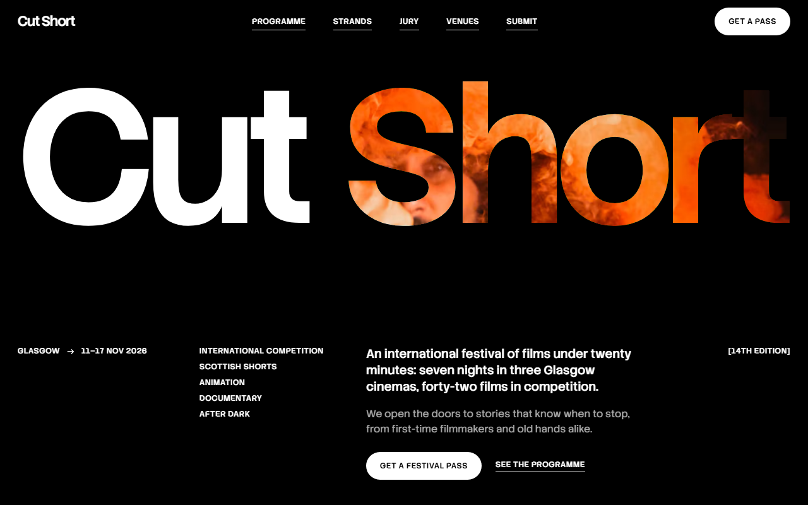
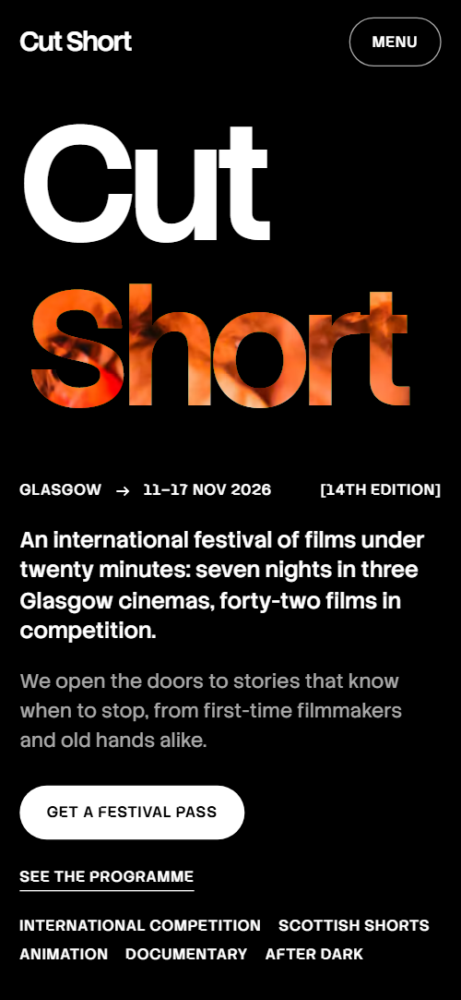
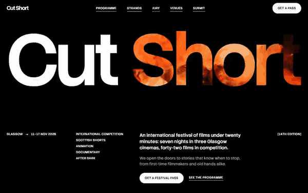

# Free HTML film festival website template with scroll animations and no libraries

Film festival website template: one free HTML file with no JavaScript libraries, for a short film festival, cinema season or screening series. A black page shows a film still through the title's second word and holds eight strands, an opening night, a jury, a call for entries, three venues and two passes. AGENTS.md lets Claude Code or Cursor adapt it.

[](LICENSE)  

**[Live demo](https://8bsite.github.io/film-festival-website-template/)** · **[Use this template](https://github.com/new?template_name=film-festival-website-template&template_owner=8bsite)** · **[Download ZIP](https://github.com/8bsite/film-festival-website-template/archive/refs/heads/main.zip)** · **[Template page on 8b.com](https://8b.com/templates/cut-short/)**

<a href="https://8bsite.github.io/film-festival-website-template/"></a> <a href="https://8bsite.github.io/film-festival-website-template/"></a>

<p align="center"><a href="https://8bsite.github.io/film-festival-website-template/"></a><br><sub>Scroll animation</sub></p>

## Use it with Claude Code, Cursor or Codex

Download the four files into your project folder (`curl.exe` in Windows PowerShell):

```bash
curl -LO https://raw.githubusercontent.com/8bsite/film-festival-website-template/main/index.html
curl -LO https://raw.githubusercontent.com/8bsite/film-festival-website-template/main/AGENTS.md
curl -LO https://raw.githubusercontent.com/8bsite/film-festival-website-template/main/LICENSE
curl -LO https://raw.githubusercontent.com/8bsite/film-festival-website-template/main/CREDITS.md
```

Then fill in the angle brackets and give your agent this prompt:

```text
Read AGENTS.md, then edit index.html. Make it the site for <my festival: name, city, dates and edition, strands with days, films with directors and slots, jury, venues with addresses, passes and prices, submission rules and deadlines, ticket link>. Replace the films, people, prices and photos first; set each big heading's --len to its character count. Keep the head gate script, the motion kit, the data-8b-section, data-8b-motion, data-8b-split and data-8b-items attributes and at most eight strands; add no animation library. Never invent dates, prices, addresses or contacts; ask me.
```

A film festival website template for Claude Code starts well when you hand the agent the facts only the festival has: name, city, dates, edition, films with directors, runtimes and slots, strands and their days, jurors, venue addresses, prices, concessions and submission deadlines. Vibe coding then means swapping text and stills. Keep the strands to eight at most, because the CSS addresses them by position, and keep four jurors, which the grid is built for.

No agent? Click **[Use this template](https://github.com/new?template_name=film-festival-website-template&template_owner=8bsite)**, edit `index.html` on GitHub and turn on **Settings > Pages**.

## Sections and motion

- **Navigation**: fixed top bar: wordmark, five section links, Get a pass button; hides on scroll down; full-screen phone menu. The bar gets a dark fill after 40px of scroll, slides away on a scroll down after 120px and returns on a scroll up.
- **Cut Short**: two screens: the festival name with a film still showing through the second word, an info row and a pass button; then the still full screen with a statement and a submissions card. On load Cut slides in from the left, the Short window opens from a slit and the info row rises in turn; scrolling on, the window grows from the word to the whole screen, the letters swell and dissolve, and the same still becomes the second screen.
- **Manifesto**: a two-sentence statement lit word by word, a portrait and two short paragraphs signed by the festival director. The statement starts in dim grey and an ember edge passes through it word by word, leaving each word white, and back again on a scroll up.
- **In competition**: four featured competition films, each with runtime, director, logline, screening slot and a still (demo: Last Orders at the Lucky Star, Whiteout, Hold Your Breath, The Long Way from Fintry). As each film row passes, its still opens from a letterbox slit to a rounded frame while the picture settles from a zoom, and the orange bar fills across the credits.
- **Strands**: a panel with the eight programme strands as large names with their days in brackets. Each strand name splits into an upper and a lower half that start offset in opposite directions and slide into one line as the row reaches the middle of the screen.
- **Opening Night**: opening night as a pinned screen: a small pill of a still widens to the full frame while the words Opening and Night travel to the edges, then the film's details. The section holds for about one screen of scroll while a pill of a still widens to the full frame and the words Opening and Night travel to its edges, then the film details rise in.
- **The jury**: four jurors as portraits with name, role and city, and a quote each; portraits develop from negative to positive. Each portrait starts as an inverted greyscale negative and turns to colour in turn as the row crosses the screen.
- **Made something under twenty minutes? Send it to us.**: call for entries: statement, rules, a Submit button, a photo and three numbered steps with dates. The heading is cut in, the photo opens from a slit and each step's rule draws itself from the left, once as they arrive.
- **Venues**: three cinemas as panels with photo, name, address and what plays there; a pinned row that slides sideways (demo: The Grand Hall, The Dome, Trongate Night Cinema). The section holds while the row of three venue panels slides sideways, and each photo drifts against the sliding panel.
- **Questions**: five questions in native details elements. The heading is cut in and each question's upper rule draws itself once.
- **Passes**: two ticket cards (Festival pass, Day ticket) with a Standard and Concession price switch. Each price stub starts dropped and turned and joins its ticket as the card rises into view; the switch changes the shown price.
- **Write to us**: a panel with four contact lines: tickets, submissions, press and partners, office (all placeholders). The panel opens from a slit and the heading is cut in, once.
- **Footer**: wordmark across the width, a closing line with the main email, footer links, social links and the copyright line. The wordmark opens from a slit and each footer link's rule draws itself, once.

## Design

 page ground, the dark behind the title's window word, and the label colour on the white pill buttons and the ember hover fill  
 text, the title letters, the pill and icon buttons, and the colour the manifesto words end on  
 raised panels: the strands panel, the two ticket bodies and stubs, the contact panel, and the submissions card on the second opening screen  
 secondary text and bracketed captions, the large strand names, the outline of the Standard and Concession switch, and the small day labels under the strands  
 the unlit manifesto words before they are reached, the slashes between strands and the dashed line above each price  
 one-pixel rules between rows and sections and the track of the progress bars  
 the ember accent: focus outline, the progress bars under each film, step numbers, the dashes in the pass lists, the lit edge of the manifesto words and the hover fill of the white pill buttons

**Stack Sans Headline**: display face at weights 500 and 600: the wordmark, the giant uppercase section names, statements, film and person titles, and the pass prices, all with tight negative tracking. **Stack Sans Text**: body face at weights 400 and 500: 16px paragraphs, loglines, answers and the 18 to 21px lead lines. **Stack Sans Notch**: weight 500 at 12.5px, uppercase with wide tracking: bracketed captions, dates, runtimes, roles, nav links and button labels (Google Fonts). A full-width black page of thirteen blocks, where giant uppercase section names are sized by a character count so each fills the content width. A narrow left column carries bracketed captions and the wide column the statements. Films, venues and passes sit in grids with 8px-cornered stills, near-black panels hold the strands, tickets and contact, and one-pixel grey rules divide rows.

## Questions

**Can a website for short films like this sell tickets or take submissions?**  
Not as shipped. The two buy buttons and the Submit a film button open emails, and there is no form, cart or payment. Point them at your ticket shop and your submissions platform, such as FilmFreeway, or keep the mailto links for a small festival.

**Can I get a festival site like this without editing code?**  
Yes. [8B's AI website builder](https://8b.com/) designs a new site from a sentence about your festival, in its own design rather than this template. Designing and restyling are free; publishing with hosting, HTML export and AI edits in chat are on Pro at $9 a month billed yearly. It also runs inside Claude and ChatGPT.

**Does it work on phones, in every browser and with reduced motion?**  
Yes. Below 900px the links fold into a full-screen menu. Without scroll-driven animation support, Firefox today, you get the finished layout and ordinary scrolling, with only the title's load-in and the still's slow drift; reduced motion drops those too. Without JavaScript the menu button and price switch stop working, standard prices stay and the FAQ still opens.

## Is it the right base?

Choose it when the festival sells a short run of days, passes and entries, and the pitch is a dark room. This build is light: the same look and scroll behaviour, no JavaScript libraries and no script from a CDN, about 24 KB gzipped in one file against about 72 KB and four extra requests for the GSAP build. A cinema with a weekly timetable fits the [independent cinema](https://8b.com/templates/halide/) template better. Tickets are email links, with no checkout.

## Before you publish

- Replace what is marked `data-8b-placeholder` (social preview image, favicon, email, phone, social) and the invented demo facts; [AGENTS.md](AGENTS.md) lists them.

## Tech

No JavaScript libraries: CSS scroll-driven animations and a small inline motion script with its own smooth wheel scrolling, 91 KB, no build step. Chrome and Edge 111+, Safari 16.2+, Firefox 113+ (it uses color-mix(), cascade layers, small/dynamic viewport units). Without scroll-driven animations (Firefox today) the scroll motion and the smooth wheel are off and each section shows its finished layout (a load-in or a loop may still play); with "reduce motion" on, the page is complete and nothing moves on its own (hover effects stay).

A GSAP build of the same page is [`index.gsap.html`](index.gsap.html): GSAP 3.13.0, ScrollTrigger, SplitText, Lenis 1.3.27 from jsDelivr, 80 KB; its scroll motion also plays in Firefox. Use one of the two files.

## License

MIT, see [LICENSE](LICENSE). Photos, fonts and libraries keep their own licences: [CREDITS.md](CREDITS.md). More free templates: [8b.com/templates](https://8b.com/templates/) · [github.com/8bsite](https://github.com/8bsite).
