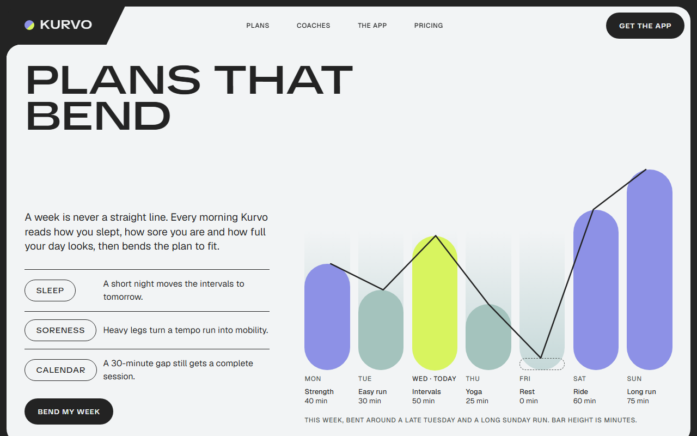
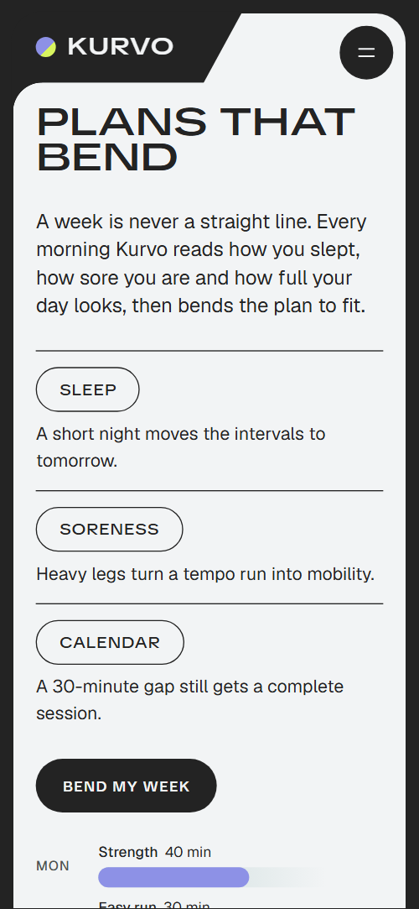
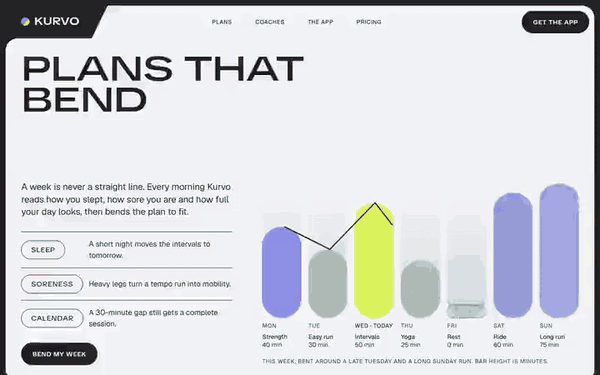

# Free HTML fitness app landing page template with scroll animations and no libraries

Fitness app landing page template: one free HTML file for a training app with adaptive plans and coaching. Rounded panels in a charcoal frame hold a seven-day chart, four coaches, a drawn phone whose screen changes as you scroll, a distance challenge, group runs and three plans. The motion runs on CSS, with no JavaScript libraries.

[](LICENSE)  

**[Live demo](https://8bsite.github.io/fitness-app-landing-page-template/)** · **[Use this template](https://github.com/new?template_name=fitness-app-landing-page-template&template_owner=8bsite)** · **[Download ZIP](https://github.com/8bsite/fitness-app-landing-page-template/archive/refs/heads/main.zip)** · **[Template page on 8b.com](https://8b.com/templates/kurvo/)**

<a href="https://8bsite.github.io/fitness-app-landing-page-template/"></a> <a href="https://8bsite.github.io/fitness-app-landing-page-template/"></a>

<p align="center"><a href="https://8bsite.github.io/fitness-app-landing-page-template/"></a><br><sub>Scroll animation</sub></p>

## Use it with Claude Code, Cursor or Codex

Download the four files into your project folder (`curl.exe` in Windows PowerShell):

```bash
curl -LO https://raw.githubusercontent.com/8bsite/fitness-app-landing-page-template/main/index.html
curl -LO https://raw.githubusercontent.com/8bsite/fitness-app-landing-page-template/main/AGENTS.md
curl -LO https://raw.githubusercontent.com/8bsite/fitness-app-landing-page-template/main/LICENSE
curl -LO https://raw.githubusercontent.com/8bsite/fitness-app-landing-page-template/main/CREDITS.md
```

Then fill in the angle brackets and give your agent this prompt:

```text
Read AGENTS.md, then edit index.html. Make it the landing page for <my fitness app: name, how it adapts training, disciplines, coaches, member results, challenge, clubs, prices, store and sign-up links, contacts>. Replace first the name, chart, coaches, stories, prices and #get-app buttons. Motion is CSS scroll-driven animation plus the inline kit: keep the gate script, data-8b-motion attributes, the classes AGENTS.md lists, three phone screens with three notes and five route checkpoints; match every --len to its line; add no animation library. Never invent prices, results or links; ask me.
```

As a fitness app landing page template for Claude Code or Cursor, it needs your app's facts: the demo invents all, down to 200 coaches and 18,000 members. The week chart lives in two places: each day's --cv-h height and the line's seven points. The script pairs three phone screens with three notes, so keep both. A moved route checkpoint needs new --ch-x and --ch-y values on the path. Replace the third story's avatar, cropped from a crowd photo. Cursor users can [plan the edit before it runs](https://8b.com/templates/for-cursor/).

No agent? Click **[Use this template](https://github.com/new?template_name=fitness-app-landing-page-template&template_owner=8bsite)**, edit `index.html` on GitHub and turn on **Settings > Pages**.

## Sections and motion

- **Navigation**: fixed top bar: logo in a dark corner tab, four section links, Get the app button; hides on scroll down; full-screen menu on phones. The bar slides away while you scroll down and returns when you scroll back up; after 400 px its link pill turns charcoal and its Get the app button turns lime.
- **Plans that bend**: first screen: the h1, a lead, three cues as pills with a line each, a button, and a seven-day bar chart with a line over the bar tops. On load the headline opens from condensed to extended letters and the seven bars, starting nearly level and grey, grow or shrink to their minutes and take their colours one after another; on screens 768 px and wider the line over them draws itself.
- **Coaches who know you**: four coaches as large overlapping round portraits with name, discipline pill and one line; lime Find my coach button. The heading stretches open as the panel arrives, and each discipline pill drops in tilted, then settles level with a bounce.
- **Train anything**: four disciplines as full-width pill rows: big name, weekly class count, one line and a photo. Scrubbed with the scroll, the four rows come in lower, tilted, shifted sideways and clipped short, then level out, line up and open to show the class count, text and photo.
- **One screen, whole week**: a phone drawn in CSS with three app views (today's session, recovery score, coach chat) beside three notes on a timeline. The phone stays in view while you scroll past three notes, the second and third screens wiping up over the one before as a lime dot marks the matching note; on phones it is held for about a screen of scrolling, then the notes follow.
- **Real people, real curves**: three member stories: a small result curve with a lime result tag, a quote, an avatar, a name and how long they have been members. As each card arrives its sparkline draws itself from left to right and its lime result tag drops in and settles.
- **The October hundred**: a monthly 100 km challenge: a route with five checkpoints and rewards, a photo with an arched top and a lime join button. Scrubbed: the route draws itself while a lime dot rides along it, each checkpoint lighting up as the dot passes; on phones the route runs down beside the list.
- **Sunday clubs**: weekly free group runs: a photo and a list of six cities, each with a meeting point and a start time. The heading stretches open, and the six start time pills drop in with a bounce as they reach the screen.
- **Pick your plan**: three plans side by side with the same five rows: a free one, the recommended one in lime, and one for two people. Scrubbed: on wide screens the three plans start stacked and fanned over the middle card and spread into a row; up to 900 px they start pulled up onto the first card and slide apart downward.
- **Questions, answered**: questions and answers (native &lt;details&gt;) beside a short intro with a link to contact. The heading stretches open on arrival; the round plus beside each question turns into a cross when the answer opens and fills lime on hover.
- **Let's move**: lime contact panel: lead, Get the app button, email, phone, address, three social links and a Write to us corner tab (contacts are placeholders). Scrubbed as the panel rises into view, a graphite shade covering most of it shrinks into the upper left corner and leaves the panel lime.
- **Footer**: the wordmark across the full width, copyright with the Design: 8B credit, six links and a tagline. The full-width wordmark opens from condensed to extended letters as it reaches the screen.

## Design

 charcoal frame and footer, corner tabs, dark buttons, the drawn phone, text on light panels, the line over the chart bars  
 mint: the app and run club panels, the HIIT row, member story cards, the free plan card, the rows, ring track and coach's bubbles inside the phone  
 off-white: the first screen, member stories and pricing panels, the Cycling row, the phone's screen, text on graphite and charcoal  
 lilac: the disciplines panel, the regular chart bars, the session card, recovery ring and your own chat bubbles in the phone, sparklines, the challenge route  
 lime: today's bar, the recommended plan, the contact panel, the small filled tags (class counts, member results, Today and Ready in the phone) and the buttons on dark panels, the challenge dot and checkpoints, the active note marker  
 graphite: the coaches, challenge and questions panels, the Strength and Yoga rows, the two-person plan, coach portrait rings, the contact shade  
 sage: the bars of the easy days in the week chart  
 light grey: secondary text on graphite panels, the dashed ghost route, unlit checkpoints, rules between questions, footer text, and the grey the chart bars start from  
 dark grey-green: day labels and caption under the chart, the rest day's dashed outline, membership lengths, meeting points, the price note

**TikTok Sans**: display face at weights 500 and 600 with a width axis: the very wide uppercase headings and footer wordmark, discipline names, subheads, button labels, pills and tags, prices, the recovery number, the contact lines. **Geist**: text face at weights 400 and 500: body copy and leads, small uppercase labels such as the nav links and day names, text links, member quotes (Google Fonts). A charcoal frame shows in 12 px gaps around rounded panels, each in one flat colour. From the second section on, each panel's heading sits in a charcoal corner tab cut into its upper left with a slanted edge; the logo uses the same tab, and the contact panel ends with a mirrored one at the lower right. Pills repeat: chart bars, discipline rows, badges, buttons. Most sections pair two columns, for example the route beside an arched photo.

## Questions

**Where do the Get the app and plan buttons lead?**  
To the plans list. With no store badges, QR code or sign-up form, Get the app, Start free, Try Pro free, Try Duo free, Find my coach and Join the hundred all point to #get-app. As a download app landing page, it needs your store and sign-up links; a waitlist needs a form wired to Formspree or Netlify Forms.

**Does the scroll motion need GSAP or another library?**  
No. The scenes are CSS scroll-driven animations; a short inline kit smooths the wheel and lights the phone notes and checkpoints. Nothing changes for the visitor, and the page loads about a third of the code: 25 KB gzipped against 71 KB. Keep the gate script, every id and data-8b-motion value, three phone screens, three notes and five checkpoints.

**How does it behave on phones, with reduced motion or with JavaScript off?**  
On phones chart days become sideways bars. Without CSS scroll-driven animations (Firefox today) or with reduced motion, the page shows its finished layout: wide headings, full bars, the drawn route, plans in a row, the three phone screens stacked, ordinary scrolling. Hover effects and the hiding nav stay. Without JavaScript the menu cannot open.

## Is it the right base?

Choose this as your fitness landing page when you sell a training app with free and paid plans, coaches, challenges and group runs. It is the light build, with no animation library: about 25 KB of code gzipped in one file against 71 KB for the GSAP version. An app outside fitness sits better on the [captioning app](https://8b.com/templates/linea/) template. Weak spots: no store badges, so every Get the app and plan button stops at the plans list, and five disciplines promised beside four rows.

## Before you publish

- Replace what is marked `data-8b-placeholder` (social preview image, favicon, email, phone, social) and the invented demo facts; [AGENTS.md](AGENTS.md) lists them.

## Tech

No JavaScript libraries: CSS scroll-driven animations and a small inline motion script with its own smooth wheel scrolling, 91 KB, no build step. Chrome and Edge 108+, Safari 15.4+, Firefox 121+ (it uses :has(), cascade layers, small/dynamic viewport units). Without scroll-driven animations (Firefox today) the scroll motion and the smooth wheel are off and each section shows its finished layout (a load-in or a loop may still play); with "reduce motion" on, the page is complete and nothing moves on its own (hover effects stay).

A GSAP build of the same page is [`index.gsap.html`](index.gsap.html): GSAP 3.13.0, ScrollTrigger, Lenis 1.3.27 from jsDelivr, 85 KB; its scroll motion also plays in Firefox. Use one of the two files.

## License

MIT, see [LICENSE](LICENSE). Photos, fonts and libraries keep their own licences: [CREDITS.md](CREDITS.md). More free templates: [8b.com/templates](https://8b.com/templates/) · [github.com/8bsite](https://github.com/8bsite).
