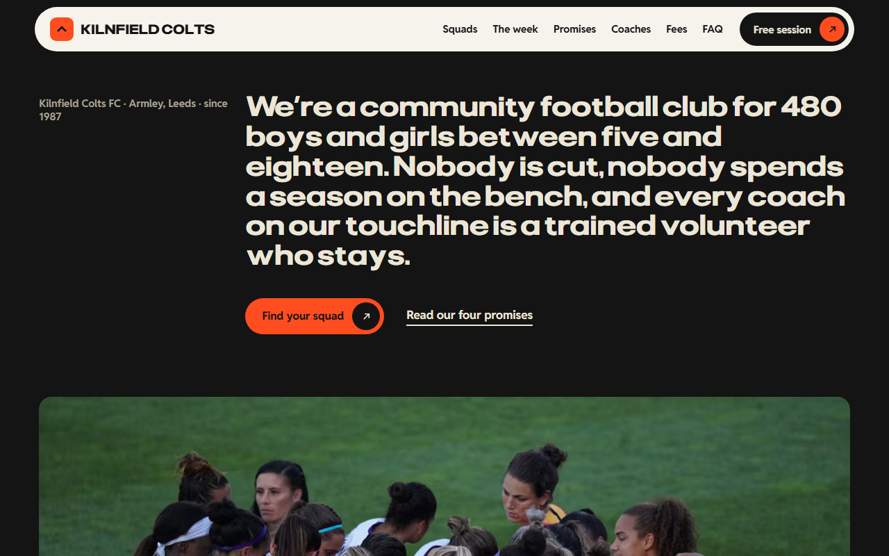
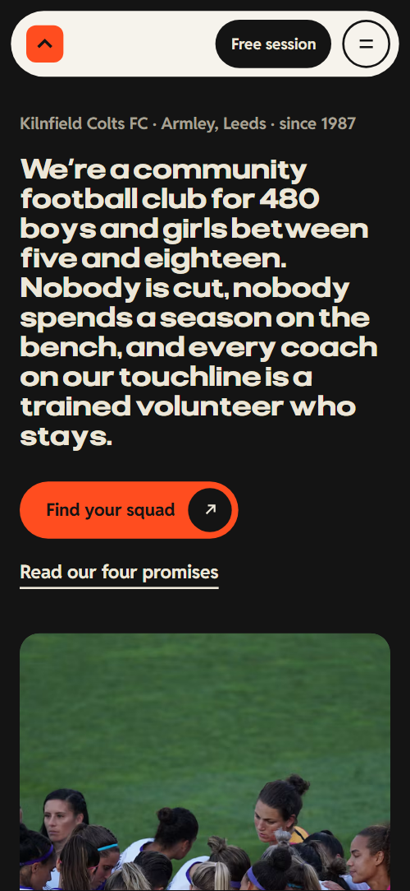
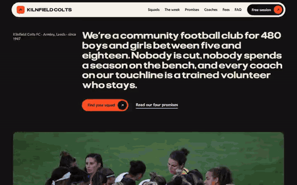

# Free HTML football club website template with GSAP scroll animations

Football club website template: one free HTML file for a volunteer-run youth club, with age-group squads, a weekend fixtures table, coaches, three fee tiers with a bursary and a free-session booking form. Signal orange, black and cream with poster-size capital headings. AGENTS.md is included, so Claude Code, Cursor or Codex can adapt it.

[](LICENSE)  

**[Live demo](https://8bsite.github.io/football-club-website-template/)** · **[Use this template](https://github.com/new?template_name=football-club-website-template&template_owner=8bsite)** · **[Download ZIP](https://github.com/8bsite/football-club-website-template/archive/refs/heads/main.zip)** · **[Template page on 8b.com](https://8b.com/templates/kilnfield/)**

<a href="https://8bsite.github.io/football-club-website-template/"></a> <a href="https://8bsite.github.io/football-club-website-template/"></a>

<p align="center"><a href="https://8bsite.github.io/football-club-website-template/"></a><br><sub>Scroll animation</sub></p>

## Use it with Claude Code, Cursor or Codex

Download the four files into your project folder (`curl.exe` in Windows PowerShell):

```bash
curl -LO https://raw.githubusercontent.com/8bsite/football-club-website-template/main/index.html
curl -LO https://raw.githubusercontent.com/8bsite/football-club-website-template/main/AGENTS.md
curl -LO https://raw.githubusercontent.com/8bsite/football-club-website-template/main/LICENSE
curl -LO https://raw.githubusercontent.com/8bsite/football-club-website-template/main/CREDITS.md
```

Then fill in the angle brackets and give your agent this prompt:

```text
Read AGENTS.md, then edit index.html. Make this the site for <my club: sport, ages and squads with training days, weekly programme, promises, this weekend's fixtures, coaches with badges, how to join, fee tiers and bursary, ground, hours, contacts>. Replace first the club name and year, then the squads, fees, fixtures, coaches, quotes and photos. Keep the ids and classes AGENTS.md lists, and set each --len value to the new line's character count. Ask me for any missing fact and never invent fees, dates, badges, safeguarding claims, names or contacts.
```

Give the agent the facts only the club has: name, town, founding year, squads with ages and training days, fixtures, coaches and their badges, fees, bursary terms, ground and opening hours. The demo invents all of them, along with the quotes and the coaches' names. Replace the club name in any letter case, then the 16 Unsplash photos. Claude Code, Cursor or Codex can do it in one pass, which suits vibe coding a club site on a weekend.

No agent? Click **[Use this template](https://github.com/new?template_name=football-club-website-template&template_owner=8bsite)**, edit `index.html` on GitHub and turn on **Settings > Pages**.

## Sections and motion

- **Navigation**: top bar with club mark and name, six links, a Free session button; phone menu overlay of nine links. The bar slides away when you scroll down past 160 px and back on scrolling up, and the phone menu opens as a full-screen overlay.
- **We’re a community football club for 480 boys and girls between five and eighteen. Nobody is cut, nobody spends a season on the bench, and every coach on our touchline is a trained volunteer who stays.**: club line, a long statement as the h1, two links and a wide photo of a team huddle. On load the club line, the statement and the buttons rise into place one after another and the huddle photo opens upward from its bottom edge.
- **Find your squad**: four age-group cards dealt like a deck, each with a photo, days, a sentence and tags. From 1081 px wide the deck pins while four cards gathered in one turned pile are dealt into a row; below that each card is dealt in from alternating sides.
- **Seven days at Kilnfield**: pinned sideways track of seven club days, each with a huge day name behind a photo card. The section pins and seven day cards travel sideways, while huge outlined day names move more slowly behind their photos.
- **Four promises**: four club promises, each a big line that a black field sweeps across, with a sentence. As each of the four promise lines crosses the middle of the screen, a black field sweeps over it, holds and leaves, scrubbed by the scroll.
- **This weekend**: this weekend's fixtures table: team, opponent, kick-off, ground. The heading halves slide in and the table opens upward from its bottom edge once.
- **The coaches**: four coaches as rows: first name and surname either side of a portrait, role and a quote. For each coach row the first name and surname start together at the centre and part towards the edges while the portrait opens between them; on phones the names slide in from opposite sides.
- **How to join in**: four numbered steps from booking a session to the first match. From 1081 px wide the steps pin while each number appears at poster size and settles into its column, with the title and text rising after it; below that each number lands from a large scale.
- **From the touchline**: a looping row of six parent and volunteer quote cards. Six quote cards loop sideways without end and pause when off screen, on hover and on keyboard focus.
- **What it costs**: three fee tiers as colour columns with a monthly price and a bursary line. The three tiers start under one black field that narrows to the middle column, uncovering the orange and cream fields while the outer tiers’ text slides in from the sides, scrubbed by the scroll.
- **Parents ask**: six questions and answers in native &lt;details&gt; elements. The heading halves slide in and each question rises into view.
- **Come and play. First session free. See you Saturday.**: three huge drifting rows of text, a free-session form and the ground, phone, email and hours. Three huge rows of text drift sideways in opposite directions as the block crosses the screen.
- **Footer**: three link columns, a large club wordmark and a legal line. Each of the three link columns rises into view as it enters the screen.

## Design

 text on the light pages and on orange, the black sections (opening, week, coaches, fees, contact, footer), the dark squad and quote cards, the button marks  
 signal orange: the nav mark, the main button, the promises and join sections, one squad card, two quote cards, the first fee column, the first contact row, week day labels, the form status line  
 cream: text on the black sections, the questions section, the third squad card, the third fee column, button hover text  
 page background, the nav bar, and the fill that sweeps across the dark button on hover  
 intro paragraphs and table heads on light grounds, and the tone behind photos before they load  
 quieter text on the black sections (club line, intros, roles, labels) and the underline of form fields

**Pliant**: display face at heavy weights and wide stretch: the nav name, section headings, promise lines, fee prices, contact rows and the footer wordmark. **Reddit Sans**: body text, labels, table cells, form fields and small captions, from regular to bold (Google Fonts). Poster-size uppercase headings, set wide and heavy in two lines, open the sections after the opening; on all but the week their two halves slide in from opposite sides. Sections alternate full-bleed colour: black for the opening, week, coaches, fees and contact, orange for promises and join, cream for the questions. Buttons are pills with a round arrow mark. Display lines are sized by a --len value so each one fills the width of the screen.

## Questions

**Can I get a site like this without editing code?**  
Yes, with [8B's AI website builder](https://8b.com/templates/8b/). Describe the site in a sentence and its engine designs a new one, with its own design rather than this template. Designing and restyling are free. Hosting with SSL, HTML export and AI edits in chat are on Pro at $9 a month billed yearly.

**Does the booking form send anything?**  
No. The form has action="#", and its script checks the fields and shows a thank-you line without sending anything. Connect Formspree or Netlify Forms before you publish, or delete the form and its script.

**What happens on a phone, with reduced motion or without JavaScript?**  
Below 1081 px the squad deck and join steps stop pinning. With reduced motion, entrance and scroll animations and smooth scrolling are off, but the nav bar still slides and hover fills run. Without JavaScript the phone menu cannot open and the form shows no thank-you; the six questions still open.

## Is it the right base?

Choose this when the club is junior, volunteer-run and wants to talk to parents plainly. A club that sells adult memberships with a weekly timetable and plans may fit the [training club](https://8b.com/templates/arcline/) template better. The weak spot is size: this is one page with a hand-edited table of eight fixtures for a single weekend. Without code, an AI website builder can also design a site from a sentence.

## Before you publish

- Replace what is marked `data-8b-placeholder` (social preview image, favicon, email, form, phone, social) and the invented demo facts; [AGENTS.md](AGENTS.md) lists them.
- The form sends nothing yet: connect it to Formspree or Netlify Forms, or remove it.

## Tech

GSAP 3.13.0, ScrollTrigger, Lenis 1.3.4 from jsDelivr, 100 KB, no build step. Chrome and Edge 111+, Safari 16.2+, Firefox 113+ (it uses color-mix(), container query units, cascade layers, small/dynamic viewport units). With "reduce motion" on, the page is complete and still.

## License

MIT, see [LICENSE](LICENSE). Photos, fonts and libraries keep their own licences: [CREDITS.md](CREDITS.md). More free templates: [8b.com/templates](https://8b.com/templates/) · [github.com/8bsite](https://github.com/8bsite).
