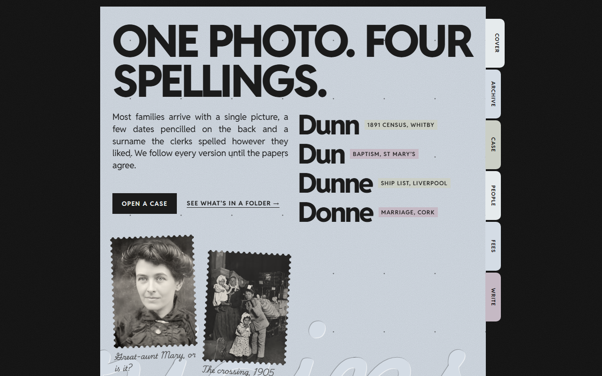
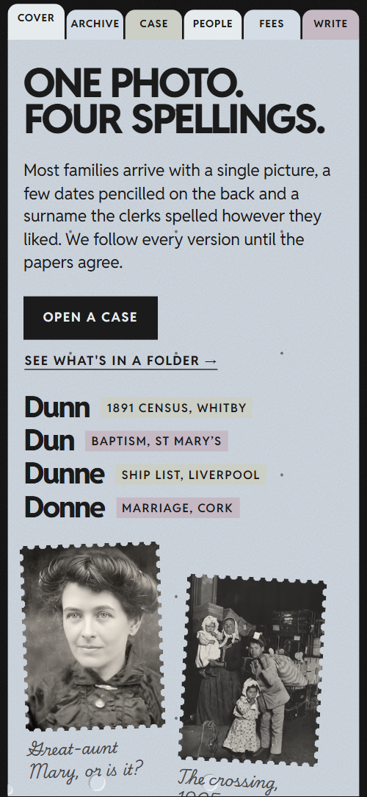
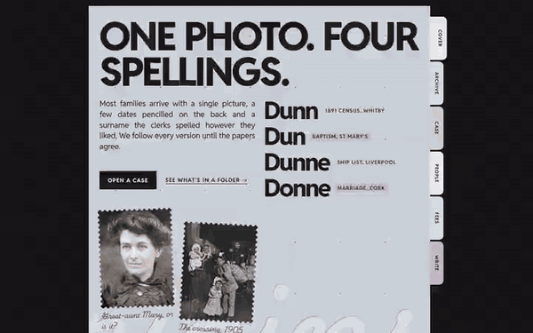

# Free HTML genealogy website template with GSAP scroll animations

Genealogy website template: one free HTML file for a family history research service that hands clients a bound folder. It has a worked family tree, three fixed-price packages, four researchers and an enquiry form, set as pale paper sheets with coloured index tabs on a black desk. AGENTS.md is included, so Claude Code, Cursor or Codex can adapt it.

[](LICENSE)  

**[Live demo](https://8bsite.github.io/genealogy-website-template/)** · **[Use this template](https://github.com/new?template_name=genealogy-website-template&template_owner=8bsite)** · **[Download ZIP](https://github.com/8bsite/genealogy-website-template/archive/refs/heads/main.zip)** · **[Template page on 8b.com](https://8b.com/templates/kinfold/)**

<a href="https://8bsite.github.io/genealogy-website-template/"></a> <a href="https://8bsite.github.io/genealogy-website-template/"></a>

<p align="center"><a href="https://8bsite.github.io/genealogy-website-template/"></a><br><sub>Scroll animation</sub></p>

## Use it with Claude Code, Cursor or Codex

Download the four files into your project folder (`curl.exe` in Windows PowerShell):

```bash
curl -LO https://raw.githubusercontent.com/8bsite/genealogy-website-template/main/index.html
curl -LO https://raw.githubusercontent.com/8bsite/genealogy-website-template/main/AGENTS.md
curl -LO https://raw.githubusercontent.com/8bsite/genealogy-website-template/main/LICENSE
curl -LO https://raw.githubusercontent.com/8bsite/genealogy-website-template/main/CREDITS.md
```

Then fill in the angle brackets and give your agent this prompt:

```text
Read AGENTS.md, then edit index.html. Make this the site for <my research service: firm name and town, how a case runs and how long it takes, what the client receives in the folder, one sample case, researchers and specialties, fixed packages with prices, reading room address and hours, enquiry email and phone>. Replace the demo text, names, prices and photos first. Keep every id, data-8b-section, data-8b-motion and data-8b-part, the classes AGENTS.md lists, fifteen chart entries and four researchers. Never invent fees, memberships or client letters; ask me.
```

Vibe coding with Claude Code or Cursor goes fastest when you hand over the facts only the firm has: town, method and timeline, folder contents, one real or anonymised case, researchers, fees, reading room hours and enquiry address. The agent replaces the demo text first, then the photos, which include stock portraits of real people. The pedigree chart is read by position: entry one is the client, then two parents per entry.

No agent? Click **[Use this template](https://github.com/new?template_name=genealogy-website-template&template_owner=8bsite)**, edit `index.html` on GitHub and turn on **Settings > Pages**.

## Sections and motion

- **Navigation**: six fixed index tabs in four paper colours: Cover, Archive, Case, People, Fees, Write; down the right edge on wide screens, along the top on phones. The current tab sticks out further and a hovered tab slides out of the sheet edge, both by CSS and both still running with reduced motion.
- **One photo. Four spellings.**: the first sheet: heading "One photo. Four spellings.", intro, two links, four spellings of a surname with their sources, two stamped photos and a ghost word. On load the heading rises, the intro, buttons and four spelling rows slide up in turn and the two stamped photos settle.
- **Every hand is readable**: a ledger photo with a moving magnifier beside five kinds of entries that are read off it. Scrubbed to the scroll, a paper-edged window with an enlarged copy of the ledger travels down the dimmed photo while the five list titles are underlined one by one.
- **How a case runs**: how a case runs: four step slips joined by a thread that draws itself. An ink thread draws itself from slip to slip as you scroll, and each tilted slip straightens onto its place when the thread reaches it.
- **Inside every folder**: what is in the client folder: four tabs (Tree, Records, Maps, Story), each with a photo, text and two points. The tabs switch the four panels, with arrow keys, Home and End supported, and each photo drops into place the first time it comes into view.
- **The Marr folder**: a worked example: a family tree of twelve named people and three open question marks, growing back four generations. The chart sticks for about one and a half screens of scrolling, starts zoomed on the client and pulls back while each generation's lines draw, dots appear and names wipe in.
- **Who does the reading**: four researchers as stamp portraits with a name and a specialty. The four portraits start joined in a perforated block and tear apart into their places, four in a row on wide screens and two by two on phones, while the names wipe in.
- **Letters back**: five client letters on slips that roll slowly sideways. The five letter slips drift left in a slow 70 second loop while the row is on screen, pausing on hover and focus.
- **Bring the shoebox**: the reading room: heading, how to bring the family papers, a visit card with address and hours, and a room photo. As you scroll the room photo grows from a small tilted stamp to the full desk width while its image settles from a close crop.
- **Questions**: six questions and answers in native &lt;details&gt; elements. The pressed word Asked deepens with the scroll, and a colour bar sweeps behind a question on hover.
- **Fees**: three fixed-price packages with a price slip that turns over to the one being read. A price slip sticks to the screen and flips over to show the name and price of the package being read.
- **Open a case**: enquiry sheet: reply time, heading, email with copy button, phone, address and a short form. The reply-time slip drops into place when it first appears, and the pressed word Write deepens with the scroll.
- **Footer**: footer: name and note, two link columns, a huge pressed word and the copyright line with the Design: 8B credit. A raking light crosses the pressed word Yours from left to right while its shadow edges swing and deepen.

## Design

 the black desk behind the sheets, with a faint grain, and the stamp mask colour  
 pale paper sheets, pale index tabs, text on the dark desk and button labels  
 blue paper sheets and tabs, and the fill of the button hover panel  
 sage paper sheets and tabs, the ink bars under the archive items and the link hover highlight  
 mauve paper sheets and tabs, and the highlight behind a question on hover  
 text on the paper, buttons, rules, chart dots and lines, the thread and dark step badges  
 small grey text on paper: chart details and open entries, photo captions, the towns under the letters and form placeholders  
 the paper slips (method steps, visit card, reply note, fee slip), the Story folder panel and tab, the reading window outline and the light edge of the pressed words

**Reddit Sans**: all running text, in weights 400 to 800: tight uppercase 800 headings, 700 buttons, links and step titles, 600 labels, and regular body text. **Playwrite US Trad**: the handwriting: photo captions, the open chart entries, letter signatures and the huge pressed words, including Yours in the footer, at one weight (Google Fonts). Paper sheets stand in one column, 820px wide at most, left of centre on the black desk with room on the right for the index tabs; on phones the sheets fill the width and the tabs run along the top. Each sheet pairs a large uppercase heading with a lead and one device: a list of spellings, slips, folder tabs, a pedigree grid, stamped portraits or fees. Four paper tints alternate; the archives and letters sections sit on the desk.

## Questions

**Does the enquiry form send anything?**  
No. As shipped it checks the fields, shows a thank-you line and resets, and sends nothing. Connect Formspree or Netlify Forms, or delete the form and its script. Without JavaScript there is no thank-you line, and the email copy button needs it and an https page.

**Can I get a site like this without editing code?**  
Yes, through a different route. [8B's AI website builder](https://8b.com/templates/8b/) designs a new site from a sentence, not this template. Designing and restyling are free; publishing with hosting and SSL, full HTML export and AI edits in chat are on Pro at $9 a month billed yearly. It also runs inside Claude and ChatGPT.

## Is it the right base?

It is the right base for a small research service that sells fixed packages and welcomes people to a reading room. A practice that bills by the hour and wants a firmer tone suits the [law firm](https://8b.com/templates/fellgate/) template better. The weak spot is navigation: six index tabs are the only fixed navigation, with no wordmark or menu, and their vertical labels are small on wide screens. 8B's builder is the no-code route.

## Before you publish

- Replace what is marked `data-8b-placeholder` (social preview image, favicon, email, phone, form) and the invented demo facts; [AGENTS.md](AGENTS.md) lists them.
- The form sends nothing yet: connect it to Formspree or Netlify Forms, or remove it.

## Tech

GSAP 3.13.0, ScrollTrigger, Lenis 1.3.4 from jsDelivr, 105 KB, no build step. Chrome and Edge 111+, Safari 16.2+, Firefox 113+ (it uses color-mix(), cascade layers, small/dynamic viewport units). With "reduce motion" on, the page is complete and still.

## License

MIT, see [LICENSE](LICENSE). Photos, fonts and libraries keep their own licences: [CREDITS.md](CREDITS.md). More free templates: [8b.com/templates](https://8b.com/templates/) · [github.com/8bsite](https://github.com/8bsite).
