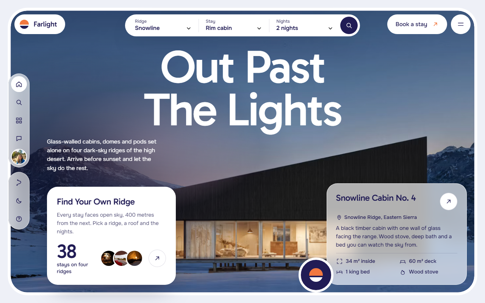
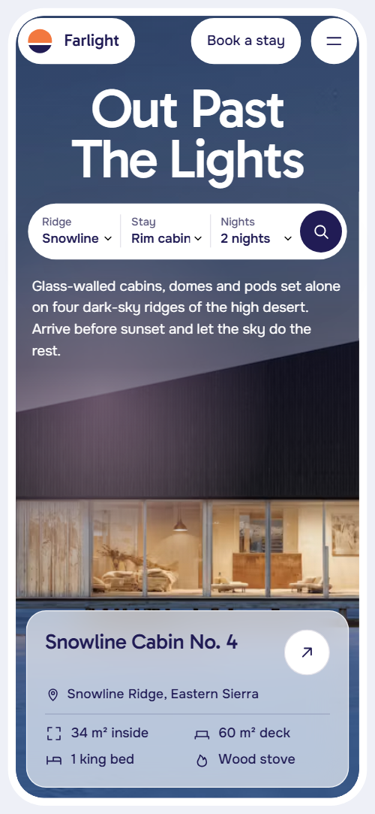
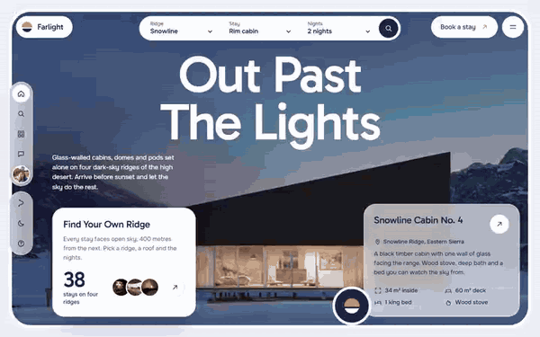

# Free HTML glamping website template with scroll animations and no libraries

Glamping website template: one free HTML file for a glamping or remote cabin business that rents a handful of stays on a few sites. It has a stay finder, ridge and stay windows, supper, hosts and a booking request form. Indigo dusk, ember orange and frosted cards sit over photos, and the scroll motion is CSS with no JavaScript libraries.

[](LICENSE)  

**[Live demo](https://8bsite.github.io/glamping-website-template/)** · **[Use this template](https://github.com/new?template_name=glamping-website-template&template_owner=8bsite)** · **[Download ZIP](https://github.com/8bsite/glamping-website-template/archive/refs/heads/main.zip)** · **[Template page on 8b.com](https://8b.com/templates/farlight/)**

<a href="https://8bsite.github.io/glamping-website-template/"></a> <a href="https://8bsite.github.io/glamping-website-template/"></a>

<p align="center"><a href="https://8bsite.github.io/glamping-website-template/"></a><br><sub>Scroll animation</sub></p>

## Use it with Claude Code, Cursor or Codex

Download the four files into your project folder (`curl.exe` in Windows PowerShell):

```bash
curl -LO https://raw.githubusercontent.com/8bsite/glamping-website-template/main/index.html
curl -LO https://raw.githubusercontent.com/8bsite/glamping-website-template/main/AGENTS.md
curl -LO https://raw.githubusercontent.com/8bsite/glamping-website-template/main/LICENSE
curl -LO https://raw.githubusercontent.com/8bsite/glamping-website-template/main/CREDITS.md
```

Then fill in the angle brackets and give your agent this prompt:

```text
Read AGENTS.md, then edit index.html. Make this the site for <my glamping or cabin business: site names, kinds of stay with nightly prices, supper or extras, hosts, how guests arrive, cancellation policy, phone, email, address, how bookings are taken>. Replace first the name, ridges, stays, prices, hosts and guest notes. Motion is CSS scroll-driven animation plus the inline kit: keep the gate script, section ids, data-8b attributes and listed classes, set the wordmark's --len, add no library. Never invent prices, reviews or contacts.
```

As a glamping website template for Claude Code or Cursor, the [vibe coding routine](https://8b.com/templates/vibe-coding/) starts with the owner's facts: site names, altitudes, drive times, nightly prices, the supper price, policies, hosts and contacts. Replace those first, then the 23 photos and six invented guest notes. Keep the gate script, ids, data-8b attributes and listed classes, and set the footer wordmark's --len to the new name's length. A new hero photo needs its own cut-out outline in the opening script.

No agent? Click **[Use this template](https://github.com/new?template_name=glamping-website-template&template_owner=8bsite)**, edit `index.html` on GitHub and turn on **Settings > Pages**.

## Sections and motion

- **Navigation**: a floating pill with the logo mark and name, a Book a stay pill and a menu button; a full-screen menu panel with eight section links, hours and phone. The bar slides away when you scroll down and returns on a scroll up; the menu opens as a full-screen panel and Escape closes it.
- **Out Past The Lights**: a dusk photo window with the heading set behind a cabin, a stay finder pill, floating cards and a rail; below it the sentence "Lights Out. Sky On.". Smooth wheel scrolling throughout; on load the heading rises, the photo settles and the controls slide in, then the photo drifts sideways and a pink glow breathes in loops. The first screen holds still while you scroll: the window widens to full bleed, the floating controls drift off, the heading sinks behind the cabin and the night sky photo takes over under the second screen's words.
- **Four Ridges, One Rule**: four ridge windows, each with a card of name, place and facts; with scroll motion on they share one frame and each opens from a horizon slit over the last. The four windows are held in one place for about three screens of scrolling: each next ridge opens from a horizon slit over the last while the previous one shrinks and dims, and the cards swap.
- **Four Ways To Sleep Outside**: four stay windows, each with a frosted spec card gliding across the photo. Each stay's card glides across its photo from the far side with your scroll while the photo pans a few percent; on phones the card rises instead.
- **One Night, Five Lights**: one night in five stages; the section ground follows the sky from last light to first light. The section ground blends between the colours of the five moments as each reaches the middle of the screen, and each photo rises a little into place.
- **Supper Comes Up The Ridge**: the supper box: a photo, a frosted Fire Kitchen card and a Tonight's Box list with a price. The heading rises line by line, the photo window opens from a horizon slit and the two cards glide in from their sides, once, as they arrive.
- **One Host Per Ridge**: four hosts, one per ridge, as tall pill portraits. Each portrait grows from a small round shape into a tall pill with your scroll, one after another, and its name and ridge line rise in.
- **We Keep It Dark**: five dark-sky rules as large lines that, with scroll motion on, burn ember and switch off as they pass the middle of the screen. Each rule burns ember with a glow below the middle of the screen and fades to periwinkle as it crosses it, while its note turns from white to periwinkle.
- **The Last Six Miles**: a road photo with a frosted three-step route card and a shuttle note. The heading rises, the road photo opens from a horizon slit and the route card and shuttle note glide in, once, as they arrive.
- **Left In The Guestbook**: six guestbook notes as frosted cards over a night photo, drifting at three speeds with scroll motion on. The six guest cards rise into place at different speeds by column while the night photo settles from a zoom; on phones all cards rise alike.
- **Before You Drive Out**: a host photo and phone line at the left, six questions at the right (native &lt;details&gt;). The heading rises and the host photo opens from a horizon slit; the questions are native details elements.
- **Book The Quiet**: a booking request form on a card beside phone, email and office; the ground turns from night to dawn rose. The ground blends from night to dawn rose as the section arrives and the big heading rises from behind its rule line.
- **Footer**: a short line, link columns, contacts and a huge wordmark. The wordmark rises from behind its own baseline once, as it arrives.

## Design

 page ground of the first screen, ridges, stays, supper, getting-there, guestbook and questions sections, and the fill of the form fields  
 body text, filled buttons, the rail icons, step discs, the Firelight moment ground and the text on the rose contact ground  
 photo frame borders, white cards, the pill buttons, the current rail mark, the hosts section ground and text on dark grounds  
 the second screen, menu panel, pledge and footer grounds, the Starlight moment and the start of the contact ground  
 the only accent: round button discs, the top of the logo mark, arrow strokes, the open question sign and the pledge lines while they burn  
 lead paragraphs, field labels, captions and secondary card text  
 periwinkle for pledge lines after they switch off, the footer wordmark, the shuttle note band, the status line and muted text on dark grounds  
 dawn rose for the Last light and First light moments, the contact ground and the pink glow over the first photo  
 the Blue hour moment ground and the base behind the first photo window

**Gabarito**: display face, loaded in weight 500 only: the first heading, section headings, card titles, ridge, stay and moment names, prices, big figures and the menu links. **Onest**: body face in weights 400 to 600: paragraphs, small labels, chips, buttons at 500, form fields and the step numbers at 600 (Google Fonts). A floating pill bar and a full-screen menu frame the page. Rounded photo windows with thick white borders carry most sections, with white or frosted cards over them: a stay finder pill, spec chips, price tags and round thumbnails. Section headings sit in two columns on desktop. Ridge windows swap in one frame, the four stays alternate card left and right, hosts stand as four tall pills with every second one dropped, and the guestbook is a staggered three-column grid.

## Questions

**Is it a free camping website template I can reuse for a campsite?**  
Yes, as a base. The file is MIT and free for client work. Swap the four ridges for your sites and the four stays for tents, pitches or pods; the demo names are invented. As a campsite website template it has no map or pitch picker.

**Can it work as vacation rental web design for a few cabins?**  
Yes, for a handful of units. Four stay types with nightly prices, a supper add-on, hosts and a request form cover a small owner. It has no availability calendar, payment or channel manager, so a larger portfolio needs a booking system that the buttons link to.

**Does the stay finder or the booking form book anything?**  
No. Check dates copies the chosen ridge, stay and nights into the booking form and scrolls to it. The form checks name and email, shows a thank-you line and sends nothing. Connect Formspree or Netlify Forms, or point the buttons at your own booking page.

## Is it the right base?

It suits a calm, nocturnal business with a few special places, including a vacation rental website template for a handful of cabins. An [e-bike hire](https://8b.com/templates/kickstand/) shop with hourly and weekly prices fits a price-table layout better. The page loads no animation library: about 34 KB of code gzipped against 80 KB and four more requests for the GSAP version. The weak spot is booking: there is no availability calendar or payment, and the form sends nothing yet.

## Before you publish

- Replace what is marked `data-8b-placeholder` (social preview image, favicon, phone, form, email) and the invented demo facts; [AGENTS.md](AGENTS.md) lists them.
- The form sends nothing yet: connect it to Formspree or Netlify Forms, or remove it.

## Tech

No JavaScript libraries: CSS scroll-driven animations and a small inline motion script with its own smooth wheel scrolling, 142 KB, no build step. Chrome and Edge 111+, Safari 16.2+, Firefox 113+ (it uses color-mix(), cascade layers, small/dynamic viewport units). Without scroll-driven animations (Firefox today) the scroll motion and the smooth wheel are off and each section shows its finished layout (a load-in or a loop may still play); with "reduce motion" on, the page is complete and nothing moves on its own (hover effects stay).

A GSAP build of the same page is [`index.gsap.html`](index.gsap.html): GSAP 3.13.0, ScrollTrigger, SplitText, Lenis 1.3.4 from jsDelivr, 127 KB; its scroll motion also plays in Firefox. Use one of the two files.

## License

MIT, see [LICENSE](LICENSE). Photos, fonts and libraries keep their own licences: [CREDITS.md](CREDITS.md). More free templates: [8b.com/templates](https://8b.com/templates/) · [github.com/8bsite](https://github.com/8bsite).
