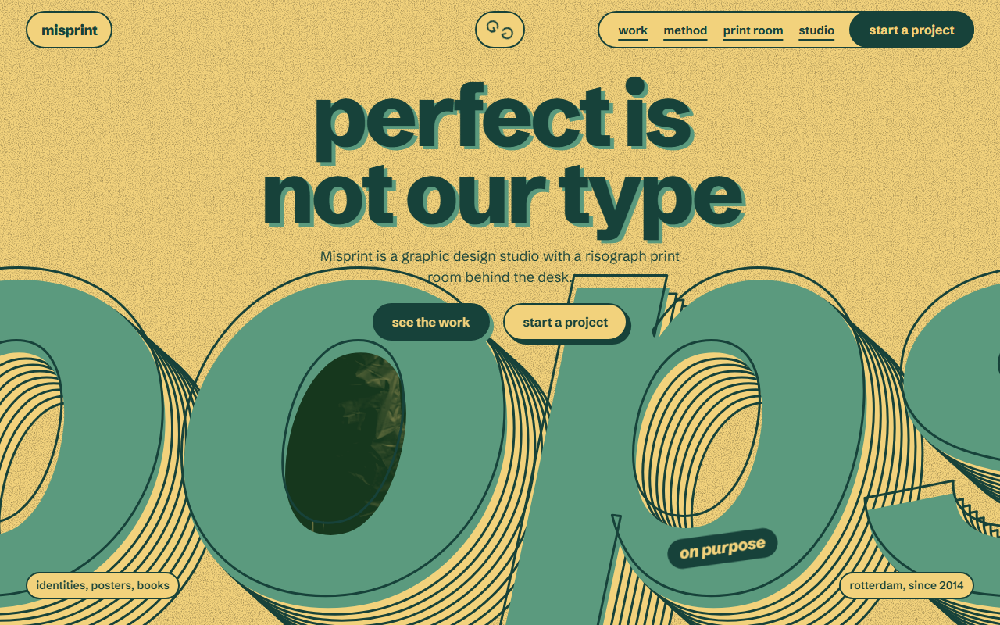
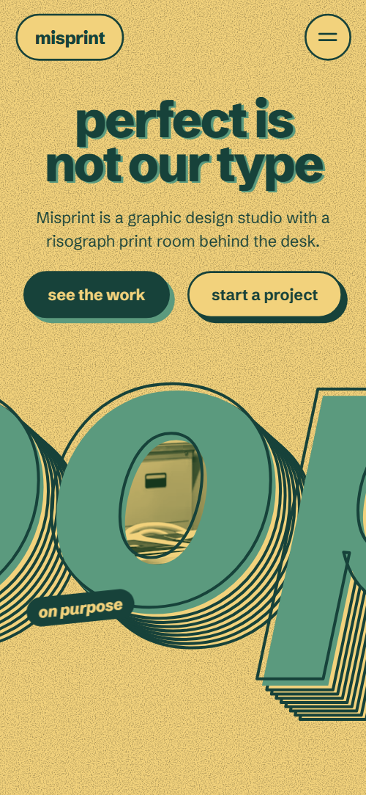
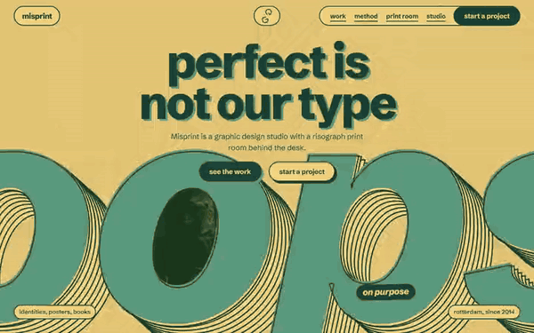

# Free HTML graphic design studio website template with scroll animations and no libraries

Graphic design studio website template: a free one-page site for a studio that also runs a risograph print room, with five jobs in a sideways row, a rates table, four team portraits and a contact form. The look is two inks on yellow paper under giant extruded words. Scroll motion is plain CSS, with no libraries, in one HTML file.

[](LICENSE)  

**[Live demo](https://8bsite.github.io/graphic-design-studio-website-template/)** · **[Use this template](https://github.com/new?template_name=graphic-design-studio-website-template&template_owner=8bsite)** · **[Download ZIP](https://github.com/8bsite/graphic-design-studio-website-template/archive/refs/heads/main.zip)** · **[Template page on 8b.com](https://8b.com/templates/misprint/)**

<a href="https://8bsite.github.io/graphic-design-studio-website-template/"></a> <a href="https://8bsite.github.io/graphic-design-studio-website-template/"></a>

<p align="center"><a href="https://8bsite.github.io/graphic-design-studio-website-template/"></a><br><sub>Scroll animation</sub></p>

## Use it with Claude Code, Cursor or Codex

Download the four files into your project folder (`curl.exe` in Windows PowerShell):

```bash
curl -LO https://raw.githubusercontent.com/8bsite/graphic-design-studio-website-template/main/index.html
curl -LO https://raw.githubusercontent.com/8bsite/graphic-design-studio-website-template/main/AGENTS.md
curl -LO https://raw.githubusercontent.com/8bsite/graphic-design-studio-website-template/main/LICENSE
curl -LO https://raw.githubusercontent.com/8bsite/graphic-design-studio-website-template/main/CREDITS.md
```

Then fill in the angle brackets and give your agent this prompt:

```text
Read AGENTS.md, then edit index.html. Make it the site for <my design studio: name and city, year founded, services, recent jobs with years, how a project runs, print room rates and hours, team, clients and quotes, contacts>. Replace the demo facts first, then the photos, and set each --len to the character count of its text. Keep the gate script, the inline motion kit and the data-8b-motion attributes; add no animation library. Ask me for missing facts and never invent jobs, prices, hours, clients, quotes or contacts.
```

In a vibe coding session, a graphic design studio website template for Claude Code, Cursor or Codex needs the facts only the studio has: jobs and years, how long an identity takes, print room rates, hours, team and clients. The demo invents all of them. The agent swaps the name in any letter case, retypes the giant words, which need a round letter at the data-focus position, and sets each --len to the new character count.

No agent? Click **[Use this template](https://github.com/new?template_name=graphic-design-studio-website-template&template_owner=8bsite)**, edit `index.html` on GitHub and turn on **Settings > Pages**.

## Sections and motion

- **Navigation**: fixed top bar: wordmark, a turning arrows mark, four section links and a Start a project button; hides on scroll down; phone menu overlay of seven links.
- **perfect is not our type**: two screens: a giant extruded word "oops" over a studio photo with the headline, intro and two buttons, then a statement sheet about the studio. On load the headline lines and buttons rise, the depth layers of the giant word pull into place and the studio photo opens inside its second o, then on scroll you dive through that counter while the word swells and the headline rises away.
- **fresh off the drum**: pinned horizontal row: a heading and five job cards with prints and a closing note with a button. Pinned: the row of five jobs slides sideways, and each photo's second-ink plate drops into register as the card crosses the middle.
- **two inks, no excuses**: heading, two ink discs, a photo and three printing rules. The heading's second ink slides into register, the photo is printed in from the top down, and the three rules feed in from the left 70 ms apart.
- **what leaves the room**: five discipline words in a justified column, each with a one-line note. Each of the five discipline words starts off to the left or right, alternating, and slides into a justified column as its row rises, with its second ink closing up.
- **how a job goes to print**: a held poster sheet that is printed in four passes beside four steps. A poster on a held sheet is drawn in four passes beside the four steps: sketch lines draw, the green plate drops in, the dark plate follows, crop marks are cut and the paper straightens.
- **the print room is open**: print room for hire: intro, a photo and a rates table. The heading registers, the photo is printed in, and the five rate rows feed in one after another.
- **seven people, one printer**: four portrait proofs dealt onto a table, with a hiring line. The four portrait proofs start piled in the middle of the table, each at its own angle, and spread to their places as the table rises.
- **said over the proofs**: three client quotes with name and business. Each of the three quotes registers its second ink, and the name and business pills feed in under it.
- **questions we get a lot**: a giant question mark beside five questions (native details). The giant question mark rises into place and its depth swings from down-right to down-left while the section passes; the questions stay put.
- **say something imperfect**: heading, email, phone, address and print room hours beside a three-field form. The heading registers, then the three contact lines and the form fields feed in one by one.
- **Footer**: footer: studio line, six links, copyright with the Design: 8B credit and a giant extruded wordmark. The full-width wordmark starts flat and low, and its depth pulls out to full as the page ends.

## Design

 the paper: page ground, nav pills, the secondary button, the sheet over the opening, text on the pine menu overlay  
 the first ink: all text, the 2px rules, outlines, primary buttons, the menu overlay and the dark second screen when scroll motion is off  
 the second ink: the giant word faces, plates behind photos, heading shadows, one ink disc, the hard shadow of primary buttons and the open question sign  
 deeper paper: alternate rate rows, the process sheet, portrait proofs and the contact form fill

**Schibsted Grotesk**: the only family, a variable 400 to 900 with italics: lowercase headings at 800, giant extruded words in 800 italic, statements at 700, body at 400, buttons at 700, small print and form labels at 600 (Google Fonts). Full-width sections on yellow paper, with lists ruled by 2px pine lines. A 12-column grid holds the method and print room, the work is one wide strip, and the questions sit beside a sticky giant question mark. The giant words are SVG text with eight stacked copies for the extruded depth. Corners are square except pill buttons and tags, and sheets, proofs and the form carry a hard offset shadow.

## Questions

**Can I get a design studio website like this without editing code?**  
Yes, with [8B's AI website builder](https://8b.com/). You describe the site in a sentence and it designs a new one, not this template. Designing and restyling are free; publishing with hosting and SSL, full HTML export and AI edits in chat are on Pro at $9 a month billed yearly. It also runs inside Claude and ChatGPT.

**Does the contact form send anything?**  
No. It checks the three required fields, shows the thank-you line and clears itself, but it sends nothing until you connect Formspree or Netlify Forms; AGENTS.md has both recipes. Without a service, delete the form with its script and keep the email link. Also reword the line that promises a reply within two working days.

**What happens in Firefox, with reduced motion or with scripts off?**  
Without scroll-driven animation support, as in Firefox today, or with reduced motion on, the page shows its static layout: the opening is two plain screens without the photo, the work row is a sideways-scrolling strip and scrolling is the browser's own. Firefox still plays the headline load-in. Without JavaScript the phone menu stays shut and the form sends nothing.

## Is it the right base?

Choose this base when the studio wants its portfolio to look hand printed and sells print on the side. A business that mostly takes quotes at a counter fits the [print and copy shop](https://8b.com/templates/shortrun/) template better, and a studio with many case studies needs more than one page. The weak spot is the portfolio itself: five cards in one pinned row, with no case-study pages and no filters.

## Before you publish

- Replace what is marked `data-8b-placeholder` (social preview image, favicon, email, phone, form) and the invented demo facts; [AGENTS.md](AGENTS.md) lists them.
- The form sends nothing yet: connect it to Formspree or Netlify Forms, or remove it.

## Tech

No JavaScript libraries: CSS scroll-driven animations and a small inline motion script with its own smooth wheel scrolling, 85 KB, no build step. Chrome and Edge 108+, Safari 16+, Firefox 110+ (it uses container query units, cascade layers, small/dynamic viewport units). Without scroll-driven animations (Firefox today) the scroll motion and the smooth wheel are off and each section shows its finished layout (a load-in or a loop may still play); with "reduce motion" on, the page is complete and nothing moves on its own (hover effects stay).

A GSAP build of the same page is [`index.gsap.html`](index.gsap.html): GSAP 3.13.0, ScrollTrigger, Lenis 1.3.27 from jsDelivr, 80 KB; its scroll motion also plays in Firefox. Use one of the two files.

## License

MIT, see [LICENSE](LICENSE). Photos, fonts and libraries keep their own licences: [CREDITS.md](CREDITS.md). More free templates: [8b.com/templates](https://8b.com/templates/) · [github.com/8bsite](https://github.com/8bsite).
