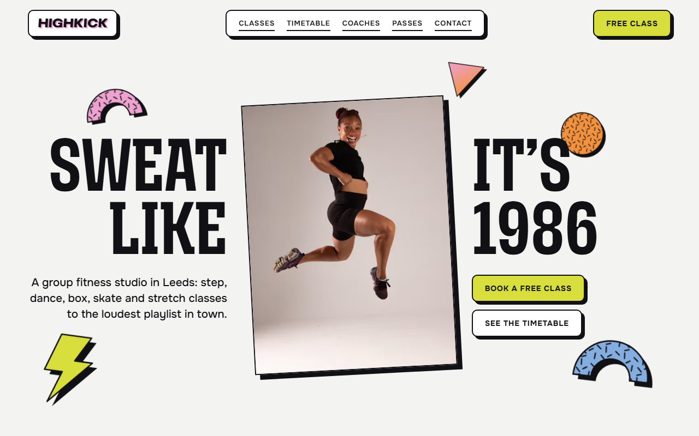
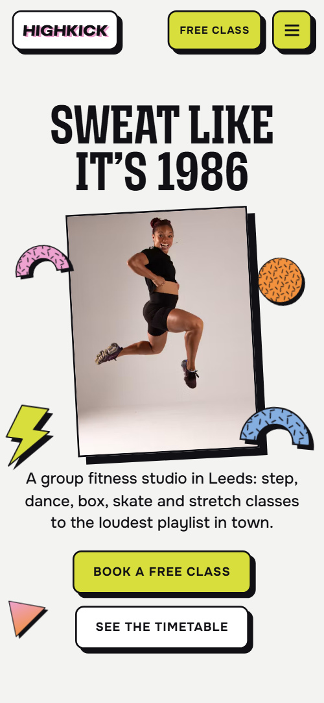
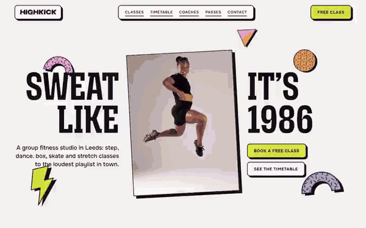

# Free HTML group fitness website template with GSAP scroll animations

Group fitness website template: one free HTML file for a studio that sells classes, a weekly timetable and passes, with a seven-class list, a fifty-minute class arc, four coach cards, a monthly roller night and a free-class form. The look is retro 80s, with pastel grounds, striped suns and spinning stickers. AGENTS.md lets Claude Code or Cursor adapt it.

[](LICENSE)  

**[Live demo](https://8bsite.github.io/group-fitness-website-template/)** · **[Use this template](https://github.com/new?template_name=group-fitness-website-template&template_owner=8bsite)** · **[Download ZIP](https://github.com/8bsite/group-fitness-website-template/archive/refs/heads/main.zip)** · **[Template page on 8b.com](https://8b.com/templates/highkick/)**

<a href="https://8bsite.github.io/group-fitness-website-template/"></a> <a href="https://8bsite.github.io/group-fitness-website-template/"></a>

<p align="center"><a href="https://8bsite.github.io/group-fitness-website-template/"></a><br><sub>Scroll animation</sub></p>

## Use it with Claude Code, Cursor or Codex

Download the four files into your project folder (`curl.exe` in Windows PowerShell):

```bash
curl -LO https://raw.githubusercontent.com/8bsite/group-fitness-website-template/main/index.html
curl -LO https://raw.githubusercontent.com/8bsite/group-fitness-website-template/main/AGENTS.md
curl -LO https://raw.githubusercontent.com/8bsite/group-fitness-website-template/main/LICENSE
curl -LO https://raw.githubusercontent.com/8bsite/group-fitness-website-template/main/CREDITS.md
```

Then fill in the angle brackets and give your agent this prompt:

```text
Read AGENTS.md, then edit index.html. Make this the site for <my studio: name, city, address, classes with lengths and levels, weekly timetable with coaches, pass prices and rules, a monthly event, desk hours, how members book>. Replace first the brand name, classes, timetable, passes, coaches and member quotes. Keep the section ids and the classes AGENTS.md lists, and set --len on the big event word and the footer wordmark to each new word's length. Ask me for missing facts and never invent prices, hours, addresses, coaches, reviews or contacts.
```

Vibe coding with Claude Code, Cursor or Codex goes faster when the agent has the facts first: class names and lengths, the weekly timetable, pass prices, coach names, desk hours, address and how members book. Replace those and the brand name, then set --len on the event word and the footer wordmark to the new word's length. The timetable line says twenty-four classes while the columns hold 22, so fix the line. Never invent prices or dates.

No agent? Click **[Use this template](https://github.com/new?template_name=group-fitness-website-template&template_owner=8bsite)**, edit `index.html` on GitHub and turn on **Settings > Pages**.

## Sections and motion

- **Navigation**: wordmark, five links in a pill, a free-class button; a round menu button and full-screen menu on small screens. The bar slides away on a downward scroll past 120px and returns on any upward scroll.
- **Sweat like it’s 1986**: two screens: a jumping photo between the halves of the h1 "Sweat like it's 1986" with stickers, then a sunset floor with a three-line promise and two snapshots. On load the headline halves slide in, the photo tilts into place and the stickers pop in and then bob; over about one screen of scrolling, without pinning, the halves part, the photo sinks and turns until it sets behind the sunset floor, the striped sun rises and the promise lines and snapshots slide in.
- **Seven classes. Pick your noise.**: seven classes as a list of big names where the row in the middle of the screen is lit with a lime band, a photo and details. The row nearest the middle of the screen lights up: a lime band wipes in behind its name, the photo pops up at a tilt and the details slide across.
- **The fifty-minute arc**: a held screen where an orange sun rides an intensity curve while four phases light up. Pinned for about one and a half screens: the lime curve draws itself, the orange dot rides along it and the four phase blocks light up in turn.
- **One big loud room**: facts about the studio room beside a pile of five tilted photos. The five photos fly in from alternating sides, tilted, and settle into a pile as it scrolls toward the middle.
- **Your coaches**: a held screen where four coach cards roll past sideways with striped suns. Pinned while the heading and four coach cards slide sideways; each striped sun rolls round and each portrait swings into place as its card arrives.
- **This week on the floor**: a seven-day timetable of class slots with times and coaches. Each day's slots stamp in one after another with a small overshoot and tilt as the column comes into view.
- **Rewind Fridays**: the monthly Rewind Friday night: a wordmark that glides in with colour ghosts and rewinds away, two photos and the event facts. The Rewind word glides in from the right with coloured ghosts trailing it, settles with a pink offset, then slides off to the left while the two photos drift in opposite directions.
- **Pay your way**: three passes drawn as tickets with a stub, a price, a description and a button, and a first-class-free note. The three tickets stamp in one after another, the heading rises and two stickers turn as they scroll past.
- **The regulars**: five member quotes on cards that stand up from a flat board. The quote board stands up from a steep backward tilt while the five cards pop up one after another.
- **Your first class is on us**: free-class form on the left, three info cards on the right. The three info cards stamp in once as they reach the lower part of the screen.
- **Footer**: a giant wordmark, three columns and a base line. One sticker turns and drifts while the footer scrolls past.

## Design

 page background, upper half of the opening, the gridded timetable ground and the contact section  
 text, every border and offset shadow, and the near-black ground of the arc and Rewind sections  
 lilac ground of the classes, coaches and passes sections, the quote board and the second opening screen's dusk  
 pink ground of the room, quotes and footer, the opening floor, the phone menu and the button hover stripes  
 orange in the striped suns, the dot that rides the arc, three disc and arc stickers, the triangle sticker's gradient and a ghost behind the Rewind word  
 lime: default button fill, class band, badges, highlighted cards, the curve and the headings on near-black grounds  
 blue cards, two arc stickers, the footer wordmark's second shadow and a ghost behind the Rewind word  
 green, the fill of the zigzag sticker in the passes section  
 nav pill, photo frames, form fields, white cards and text on the near-black sections

**Mozilla Headline**: weight 700 at 75% width, uppercase: the h1, section headings, class names, day names and menu links. **Pliant**: weight 900 italic at 125% width, uppercase: the nav wordmark, the Rewind word, pass prices and the footer wordmark. **Onest**: body text at 400, lead paragraphs at 500, and tracked uppercase labels and buttons at 600 and 700 (Google Fonts). A centred headline splits around a tilted portrait on the first screen. Grounds then alternate between lilac, pink and pale grey, with two near-black sections. Uppercase display type runs up to 170px. Content sits in rows and grids: seven class rows with the name in the middle, seven day columns on wide screens, three tilted pass tickets and a six-column quote board. Photos and cards tilt a few degrees, and inline SVG stickers repeat in the margins.

## Questions

**Does the class timetable take bookings?**  
No. The timetable is 22 slots in seven day columns, and the Book buttons jump to the free-class form, which shows a thank-you line and sends nothing. Connect Formspree or Netlify Forms, or point the buttons at your booking system such as Mindbody, Glofox or Momence.

**What happens on a phone, with reduced motion or without JavaScript?**  
Below 960px the nav links move into a round menu button. With reduced motion, smooth scrolling and the entrance and scroll animations are off and the lime class band is never drawn, but the page reads in full. Without JavaScript the menu cannot open and the form shows no thank-you line.

**Can I get a site like this without editing code?**  
Yes, with [8B's AI website builder](https://8b.com/templates/8b/): describe the studio in a sentence and its engine designs a new site, not this one. Designing and restyling are free; publishing with hosting and SSL, full HTML export and AI edits in chat are on Pro at $9 a month billed yearly. It also runs in Claude and ChatGPT.

## Is it the right base?

Choose it for a studio with a big personality and a short list of classes. A gym or coaching club that wants a calm, measured look is closer to the [training club](https://8b.com/templates/arcline/) template. A personal trainer website template wants one coach and no timetable, so this is heavier than needed. Every Book button jumps to the form, which sends nothing until you connect a service. Without code, 8B's builder makes a new site from a sentence.

## Before you publish

- Replace what is marked `data-8b-placeholder` (social preview image, favicon, form, phone, email, social) and the invented demo facts; [AGENTS.md](AGENTS.md) lists them.
- The form sends nothing yet: connect it to Formspree or Netlify Forms, or remove it.

## Tech

GSAP 3.13.0, ScrollTrigger, MotionPathPlugin, Lenis 1.3.27 from jsDelivr, 102 KB, no build step. Chrome and Edge 111+, Safari 16.2+, Firefox 113+ (it uses color-mix(), cascade layers, small/dynamic viewport units). With "reduce motion" on, the page is complete and still.

## License

MIT, see [LICENSE](LICENSE). Photos, fonts and libraries keep their own licences: [CREDITS.md](CREDITS.md). More free templates: [8b.com/templates](https://8b.com/templates/) · [github.com/8bsite](https://github.com/8bsite).
