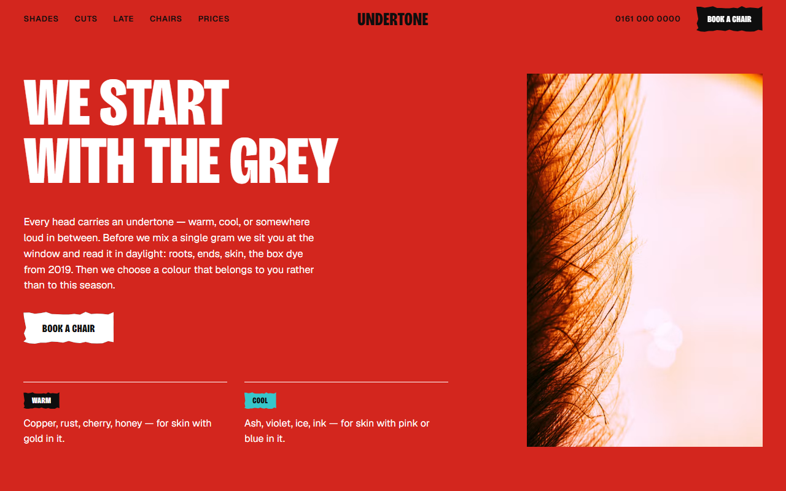
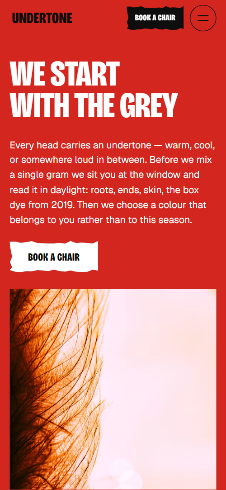

# Free HTML hair salon website template with GSAP scroll animations

Hair salon website template: one free HTML file for a cut and colour studio, with six signature shades, a four-stylist team, a full price list, aftercare rules and a booking form. The look is loud red, ink black and cyan, with torn-paper edges. AGENTS.md is included, so Claude Code, Cursor or Codex can adapt it.

[](LICENSE)  

**[Live demo](https://8bsite.github.io/hair-salon-website-template/)** · **[Use this template](https://github.com/new?template_name=hair-salon-website-template&template_owner=8bsite)** · **[Download ZIP](https://github.com/8bsite/hair-salon-website-template/archive/refs/heads/main.zip)** · **[Template page on 8b.com](https://8b.com/templates/undertone/)**

<a href="https://8bsite.github.io/hair-salon-website-template/"></a> <a href="https://8bsite.github.io/hair-salon-website-template/"></a>

<p align="center"><a href="https://8bsite.github.io/hair-salon-website-template/"></a><br><sub>Scroll animation</sub></p>

## Use it with Claude Code, Cursor or Codex

Download the four files into your project folder (`curl.exe` in Windows PowerShell):

```bash
curl -LO https://raw.githubusercontent.com/8bsite/hair-salon-website-template/main/index.html
curl -LO https://raw.githubusercontent.com/8bsite/hair-salon-website-template/main/AGENTS.md
curl -LO https://raw.githubusercontent.com/8bsite/hair-salon-website-template/main/LICENSE
curl -LO https://raw.githubusercontent.com/8bsite/hair-salon-website-template/main/CREDITS.md
```

Then fill in the angle brackets and give your agent this prompt:

```text
Read AGENTS.md, then edit index.html. Make this the site for <my salon: name, address, phone, email, services with prices, stylist names, roles and years, opening hours, consultation, patch test and deposit terms, how people book>. Replace first the studio name in every letter case, the shade names, prices, team and demo address. Keep the section ids, the classes AGENTS.md lists, six shades and five aftercare rules, and set --len on Late, Louder and the footer wordmark. Ask me for missing facts; never invent prices, hours or contacts.
```

Give Claude Code, Cursor or Codex the facts only the studio has: prices, opening hours, stylist names and years, address, and the consultation, patch test and deposit terms. The demo invents all of them, down to the formula card and the shade names. The agent should keep the section ids, the classes AGENTS.md lists and exactly six shades and five aftercare rules, and update --len when it changes Late, Louder or the footer wordmark. Vibe coding the rest is copy and photos.

No agent? Click **[Use this template](https://github.com/new?template_name=hair-salon-website-template&template_owner=8bsite)**, edit `index.html` on GitHub and turn on **Settings > Pages**.

## Sections and motion

- **Navigation**: top bar: five section links, the wordmark, phone number and a Book a chair button; hides on scroll down; phone menu overlay. The bar gets a solid ground after a short scroll, slides away while you scroll down and returns when you scroll up.
- **We start with the grey**: red first screen: statement "We start with the grey", paragraph, Book a chair button, a copper hair photo and two undertone badges. On load the heading, the paragraph and the two tone rows rise in one after another and the photo settles from a slight zoom; there is no scroll scene.
- **Six shades we're known for**: six signature shades as photo strips with warm or cool tags and from-prices (demo: Rust Riot, Cherry Bruise, Violet Hour, Deep End, Ash Static, Bone Bleach). Pinned: the six strips start as one grey stack in the middle of the row and fan out to their places one after another, each photo turning from grey to colour as you scroll.
- **Cut dry. Cut once.**: "Cut dry. Cut once." heading over one photo sliced by a red line, then four cuts with prices (demo: blunt bob, shag, crop, fringe). A red rule draws across the bob photo while the two halves of the photo and the two heading lines slide in from opposite sides and straighten, tied to scroll.
- **Fifteen minutes at the window**: free daylight consultation: photo, three numbered steps and an example formula card. The window photo is revealed by a torn edge and the formula card drops on, tilted, once each.
- **Late**: pinned night scene: a neon photo seen through the letters of the word "Late", then the Thursday late opening and a button. Pinned: the word Late starts so large that the neon photo fills the screen, then shrinks to its size while the photo settles, tied to scroll.
- **Four chairs**: four stylists as large name rows with role and years, a short bio, a booking link, a portrait and a specialism badge (demo: Ama, Jess, Theo, Dez). Each portrait is revealed by a torn edge and turns from grey to colour as it scrolls in, and each badge stamps on.
- **Transformation days**: transformation days: a spray-painted word "Louder" across the width above a portrait, a short pitch, a from-price with deposit and a button. The word Louder is split into letters that start bunched at the centre and spread across the width, while the portrait moves down from over the word and settles from a smaller, tilted state, tied to scroll.
- **Prices**: full price list in three groups with a note and a photo (demo: Cut, Colour, Lightening). The colourist photo turns from grey to colour as it scrolls in; the three price bands do not move.
- **Keep it loud**: pinned aftercare strip: a marker walks along a copper hair photo from day 0 to week 6 while the colour fades and a gloss brings it back. Pinned: a marker slides along the copper-curls strip, the colour drains and each week rule lights up as the marker reaches it; at week 6 the colour returns and the badge stamps on.
- **Book a chair**: booking: heading, lede, address, phone, email, opening hours, request form, three rule notes and a studio photo. The three rule notes stamp on and the studio photo is revealed by a torn edge, once each.
- **Footer**: ink footer: portrait, links to nine sections, address, phone, email, Instagram and TikTok, a huge wordmark, copyright with the Design: 8B credit. The portrait turns from grey to colour as it scrolls in.

## Design

 page ground, the solid nav bar after a short scroll, the shades, consultation, transformation and aftercare sections  
 text, rules, the dark late, prices and footer sections, the fill of the two ink buttons before the hover and of three badges  
 the opening screen and contact section ground, the colour price band, big numerals, the cut rule, red badges, the word Louder, the price in the transformation section and the hover fill of ink buttons  
 grey ground of the cuts and chairs sections and behind photos while they load  
 cyan accent: Cool badges, the lightening price band and the layer a white button's hover wipe reveals  
 paper notes, form fields, the fill of white buttons, labels on ink buttons, text on red and ink, the white cut price band  
 secondary text: intros, descriptions, roles, dashed formula lines  
 muted text on the dark late, prices and footer sections

**Bricolage Grotesque**: headings, logo, buttons, badges, shade names and the prices in the cut and price lists: extra-bold condensed capitals, loaded at one weight, 800. **Geist**: body text, labels, nav links, form fields and the from-prices under the shade strips: regular to bold, 400 to 700 (Google Fonts). Ten sections sit between bar and footer. A red opening screen puts the heading and a short paragraph on the left and a copper-hair photo on the right, with the warm and cool tones below. On wide screens the shades are six tall photo strips in one row; the stylists are large name rows with a portrait and a badge. Prices run in three columns, each under a coloured band. Torn-paper notes repeat in the consultation and contact sections.

## Questions

**Can I use it for a barber, a nail studio or another beauty salon?**  
Yes, after a text pass. The structure of price list, named specialists and booking form suits barbers, lash or nail studios. Rewrite the shade names, the cuts, the aftercare rules and the stylist bios, and swap the hair photos. A barber can drop the shades section with its own style and script, and the Shades links.

**Does the booking form send requests?**  
No. It checks the name and the phone or email field, shows a thank-you line and clears itself, but sends nothing. Connect Formspree or Netlify Forms with the steps in AGENTS.md, or point the Book buttons at your booking page. Then edit the thank-you line, which promises a call back within one working day.

**Can I get a site like this without editing code?**  
Yes, with [8B's AI website builder](https://8b.com/templates/8b/) instead of this file. You describe the salon in a sentence and its engine designs a new site, not this template. Designing and restyling are free; hosting with SSL, HTML export and AI edits in chat are on Pro at $9 a month billed yearly. It also runs inside Claude and ChatGPT.

## Is it the right base?

Choose this when the studio sells colour and wants a loud page. A local shop such as a [flower shop](https://8b.com/templates/moth-marigold/) will want a calmer layout. A barber with no colour menu can delete the shades section with its style, its script and the Shades links in the menus and footer. The weak spot is booking: every button jumps to a form that sends nothing until you connect a service, and there is no calendar. Owners who do not edit code can use the 8B builder.

## Before you publish

- Replace what is marked `data-8b-placeholder` (social preview image, favicon, phone, email, form, social) and the invented demo facts; [AGENTS.md](AGENTS.md) lists them.
- The form sends nothing yet: connect it to Formspree or Netlify Forms, or remove it.

## Tech

GSAP 3.13.0, ScrollTrigger, Lenis 1.3.27 from jsDelivr, 109 KB, no build step. Chrome and Edge 111+, Safari 16.2+, Firefox 113+ (it uses color-mix(), cascade layers, small/dynamic viewport units). With "reduce motion" on, the page is complete and still.

## License

MIT, see [LICENSE](LICENSE). Photos, fonts and libraries keep their own licences: [CREDITS.md](CREDITS.md). More free templates: [8b.com/templates](https://8b.com/templates/) · [github.com/8bsite](https://github.com/8bsite).
