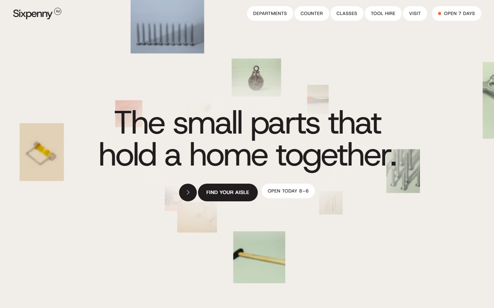
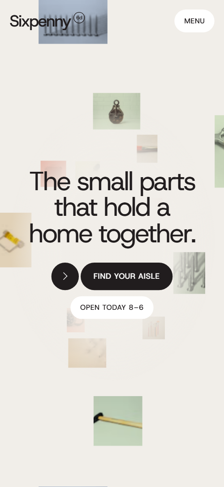
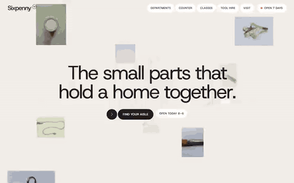

# Free HTML hardware store website template with GSAP scroll animations

Hardware store website template: a free one-page HTML site for an independent shop that sells by the single screw, cuts keys, mixes paint, runs Saturday workshops and hires out tools. A cloud of product tiles flies past the opening, then pale paper and dark department panels follow. One file with AGENTS.md, ready for an AI agent.

[](LICENSE)  

**[Live demo](https://8bsite.github.io/hardware-store-website-template/)** · **[Use this template](https://github.com/new?template_name=hardware-store-website-template&template_owner=8bsite)** · **[Download ZIP](https://github.com/8bsite/hardware-store-website-template/archive/refs/heads/main.zip)** · **[Template page on 8b.com](https://8b.com/templates/sixpenny/)**

<a href="https://8bsite.github.io/hardware-store-website-template/"></a> <a href="https://8bsite.github.io/hardware-store-website-template/"></a>

<p align="center"><a href="https://8bsite.github.io/hardware-store-website-template/"></a><br><sub>Scroll animation</sub></p>

## Use it with Claude Code, Cursor or Codex

Download the four files into your project folder (`curl.exe` in Windows PowerShell):

```bash
curl -LO https://raw.githubusercontent.com/8bsite/hardware-store-website-template/main/index.html
curl -LO https://raw.githubusercontent.com/8bsite/hardware-store-website-template/main/AGENTS.md
curl -LO https://raw.githubusercontent.com/8bsite/hardware-store-website-template/main/LICENSE
curl -LO https://raw.githubusercontent.com/8bsite/hardware-store-website-template/main/CREDITS.md
```

Then fill in the angle brackets and give your agent this prompt:

```text
Read AGENTS.md, then edit index.html. Make this the site for <my shop: name, address, year opened, owner and a quote, aisles with stock counts, counter jobs with prices, workshop dates and prices, hire tools with deposits, opening hours, delivery and returns rules, phone, email>. Replace first the name, hours, prices and dates. Keep the section ids, the classes AGENTS.md lists and both faces of every hire row; set the footer wordmark's len to the new name's length. Ask me for missing facts and never invent prices, hours or contacts.
```

A hardware store website template for Claude Code, Cursor or Codex needs you to hand the agent the facts only the shop has: hours, prices, deposits, workshop dates, delivery rules and stock counts. The demo invents all of them, including the owner's story. Ask the agent to replace the name everywhere, then set the footer wordmark's --len to its length. A hire or classes section you do not offer can go, along with its style block, animation script and the links to its id.

No agent? Click **[Use this template](https://github.com/new?template_name=hardware-store-website-template&template_owner=8bsite)**, edit `index.html` on GitHub and turn on **Settings > Pages**.

## Sections and motion

- **Navigation**: a logo mark, five section links and an Open 7 days link; a menu button opens a full-screen menu. The bar hides on a scroll down past 160 pixels and returns on a scroll up, and its logo turns white over the dark sections.
- **The small parts that hold a home together.**: a cloud of product tiles flying past under the heading, then a promise screen with a highlighted sentence. On load the heading and buttons slide in and the tile cloud flies toward you in a loop; on scroll the cloud rushes past, the heading shrinks away and the promise sentence fades in word by word.
- **Departments**: five departments held on one screen, each next panel wiping up over the last, with a guide link and a big letter. Pinned for about four screens of scroll: each next photo panel wipes up over the last while its text rises.
- **Done while you wait**: six jobs done while you wait, each with a price and a time, beside two photos. The heading and lead rise into view, each job row draws its rule and slides its cells in, and the two photos unveil.
- **Every aisle, front to back**: an index of six aisle names that grow to full size as each reaches the middle of the screen, each with a photo tile and a stock count. Each aisle name grows from 70 percent to full size as it nears the middle of the screen and shrinks away after, with its photo tile turning into place.
- **Bring the old one in**: three pairs: a part brought in and the match, sliding together as they rise. On scroll the brought-in part slides in from the left and its match from the right, both tilted, until they level out in place.
- **Len Hollis**: a portrait of the owner with a short history, a quote and a photo of the small-parts shelves, on a dark ground. The quote rises into view and the shelf photo unveils.
- **Fix-it Saturdays**: four Saturday workshop cards dealt out of a stack, each with date, price, places left and a phone link. On wide screens the four workshop cards start stacked at the centre and deal out to their places; on a phone each slides in from alternate sides.
- **Borrow it for the weekend**: six hire rows; each tag turns over from the buy-new price to the weekend price. As each hire row nears the middle, its tag flips from the buy-new price to the weekend price.
- **Come in, the kettle is on**: a shop-front photo that steps back into its half while hours, address, phone, email and a newsletter form come in. On wide screens the shop photo starts full width and steps back into the left half while the hours and newsletter box slide in; on a phone the photo zooms out.
- **Asked at the counter**: six questions as native &lt;details&gt; beside a photo of the parts cabinet. The heading rises, a rule draws above each question, and the photo unveils; opening a question turns its plus into a minus.
- **Footer**: a huge wordmark, the shop's address and hours, contact links, page links and small print. The big wordmark rises into view.

## Design

 page background and the soft fog behind the opening heading  
 text, rules, dark button fills, the departments ground and the menu overlay  
 button, guide card and class card faces, text on dark sections, the focus ring gap  
 footer ground, front of each hire tag, owner role and quote, button hover fill, a yellow tone  
 owner section ground  
 the dot beside Open 7 days and the orange tone behind some photos, badges and guide covers  
 sage tone behind some photos, badges and guide covers  
 sand tone behind some photos, badges and guide covers  
 blue tone behind some photos, badges and guide covers  
 stock counts, input placeholders and small grey text  
 ground of the hire and brought photo frames and the newsletter box, and the fallback tone

**Host Grotesk**: the only typeface: regular-weight headings with tight negative tracking, medium weight for labels, and uppercase medium buttons (Google Fonts). Pale paper ground with sentence-case type at regular weight and tight tracking. The opening centres a heading over a field of floating product tiles. Departments are full-screen photo panels with a rule, an aisle label, a heading and a small guide card with a big letter. Counter, hire and questions are rows between thin rules, beside photos. The owner section is dark green and the footer wordmark is huge.

## Questions

**Can customers buy things on this site?**  
No. There is no cart, checkout or product pages. The buttons jump to sections or open a phone call, which suits taking classes and hire bookings by phone. A shop with an online catalogue can point the department buttons at its category pages, as AGENTS.md describes.

**Does the newsletter form send anything?**  
No. The form checks that the email address is valid, then swaps itself for a thank-you line and sends nothing. AGENTS.md gives the steps for Formspree or Netlify Forms; a newsletter service such as Mailchimp or Buttondown needs its own form code. Or delete the form and its script. Also edit the line that promises a monthly email.

**Can I get a site like this without editing code?**  
Yes, with [8B's AI website builder](https://8b.com/): you describe the shop in a sentence and its engine designs a new site, not this template. Designing and restyling are free. Publishing with hosting and SSL, full HTML export and AI edits in chat are on Pro at $9 a month billed yearly. It also runs inside Claude and ChatGPT.

## Is it the right base?

As a hardware shop website template free of licence fees, it suits a neighbourhood shop that wants to sound friendly and practical, with a long catalogue shown as an index. If you sell mainly online, the page is too small: the buttons jump to anchors or a phone number, and there is no cart or product pages. Shops with a few lamps and repairs may prefer the [lamp shop](https://8b.com/templates/glim/) template. Owners who do not code can also try 8B's builder.

## Before you publish

- Replace what is marked `data-8b-placeholder` (social preview image, favicon, phone, email, form) and the invented demo facts; [AGENTS.md](AGENTS.md) lists them.
- The form sends nothing yet: connect it to Formspree or Netlify Forms, or remove it.

## Tech

GSAP 3.13.0, ScrollTrigger, SplitText, Lenis 1.3.4 from jsDelivr, 107 KB, no build step. Chrome and Edge 111+, Safari 16.2+, Firefox 113+ (it uses color-mix(), cascade layers, small/dynamic viewport units). With "reduce motion" on, the page is complete and still.

## License

MIT, see [LICENSE](LICENSE). Photos, fonts and libraries keep their own licences: [CREDITS.md](CREDITS.md). More free templates: [8b.com/templates](https://8b.com/templates/) · [github.com/8bsite](https://github.com/8bsite).
