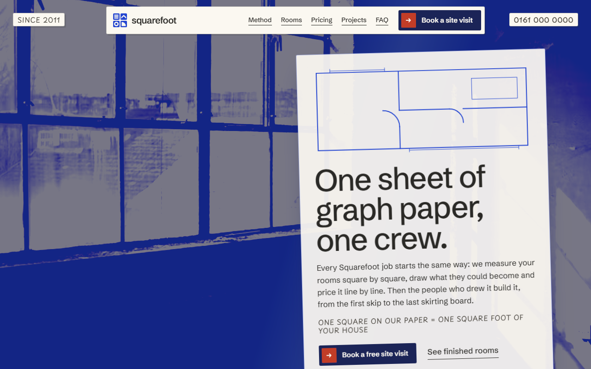
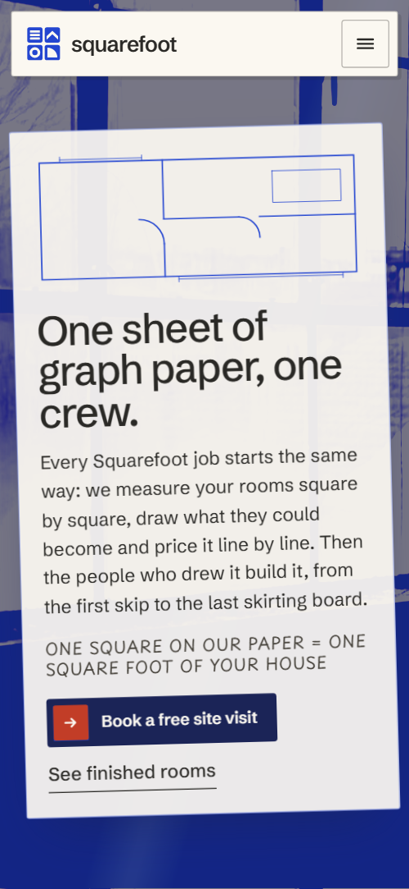
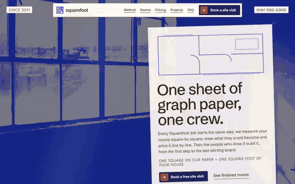

# Free HTML home renovation website template with GSAP scroll animations

Home renovation website template: one free HTML file for a design-and-build firm that does kitchens, extensions, lofts and bathrooms. A four-stage method, six services drawn as the rooms of a floor plan, square-foot prices, a site diary and a visit form sit on warm graph paper with pencil notes. AGENTS.md lets Claude Code, Cursor or Codex adapt it.

[](LICENSE)  

**[Live demo](https://8bsite.github.io/home-renovation-website-template/)** · **[Use this template](https://github.com/new?template_name=home-renovation-website-template&template_owner=8bsite)** · **[Download ZIP](https://github.com/8bsite/home-renovation-website-template/archive/refs/heads/main.zip)** · **[Template page on 8b.com](https://8b.com/templates/squarefoot/)**

<a href="https://8bsite.github.io/home-renovation-website-template/"></a> <a href="https://8bsite.github.io/home-renovation-website-template/"></a>

<p align="center"><a href="https://8bsite.github.io/home-renovation-website-template/"></a><br><sub>Scroll animation</sub></p>

## Use it with Claude Code, Cursor or Codex

Download the four files into your project folder (`curl.exe` in Windows PowerShell):

```bash
curl -LO https://raw.githubusercontent.com/8bsite/home-renovation-website-template/main/index.html
curl -LO https://raw.githubusercontent.com/8bsite/home-renovation-website-template/main/AGENTS.md
curl -LO https://raw.githubusercontent.com/8bsite/home-renovation-website-template/main/LICENSE
curl -LO https://raw.githubusercontent.com/8bsite/home-renovation-website-template/main/CREDITS.md
```

Then fill in the angle brackets and give your agent this prompt:

```text
Read AGENTS.md, then edit index.html. Make this the site for <my building firm: name, area, services, prices per square foot and what they include, how a job runs, projects, guarantee, insurance, how people book a visit>. Replace first the Manchester details, phone, email, prices, five projects, diary, neighbours' letter, snag list street and reviews. Keep the section ids, four method photos and steps, six plan rooms with their data-dx and data-dy, and the footer wordmark len. Ask me for missing facts and never invent prices, guarantees, reviews or contacts.
```

For vibe coding with Claude Code, Cursor or Codex, hand the agent the facts the demo invents: prices per square foot and what they include, guarantee terms, programme lengths, districts, insurance, certificates, real projects and permitted reviews. Replace the Manchester firm, phone, email and yard first, then the diary, the neighbours' letter and the snag list address. The plan is built for six rooms, the method for four photos and four steps.

No agent? Click **[Use this template](https://github.com/new?template_name=home-renovation-website-template&template_owner=8bsite)**, edit `index.html` on GitHub and turn on **Settings > Pages**.

## Sections and motion

- **Navigation**: fixed paper strip: four-tile logo, wordmark, five links, Book a site visit button; two pencil notes in the corners; phone menu overlay. The strip hides while you scroll down and returns on scroll up, and the phone menu opens as a full-screen overlay.
- **One sheet of graph paper, one crew.**: a full-screen sunlit-room photo in blue duotone with a paper sheet laid over it: heading, intro, pencil note, two actions and a small drawn plan. On load the photo fades in, the sheet drops in at a tilt and the plan's lines draw one after another, while a soft shaft of light loops across the photo.
- **From pencil to keys, with the same four people**: four stages (measure, draw, build, hand over) as a 2×2 contact sheet of photos that the camera zooms across, beside the four step texts. Pinned: the contact sheet stays in view and the camera zooms into each photo in turn as its step reaches the middle of the screen.
- **What we build, room by room**: six services as the rooms of one floor plan, with door arcs and pencil labels (demo: refurbishment, cellar, kitchens, extensions, lofts, bathrooms). The six rooms start apart and slide together into one floor plan as it scrolls into view, snapping to whole grid squares.
- **Priced by the square foot**: three sheets priced per square foot (demo: Refresh £65, Rebuild £140, Extend £210) with lists and buttons, and a footnote. Each price sheet drops a grid square and settles from a slight tilt as it arrives.
- **Finished rooms**: five finished rooms on a horizontal track that turn from blue duotone to full colour, with place, type and duration (demo: Chorlton, Didsbury, Levenshulme, Whalley Range, Burnage). On wide screens the section pins and a track of five cards runs sideways, each card developing from cobalt duotone to full colour at the centre.
- **The site diary**: a two-page notebook of six weekly entries from one extension, with two taped photos (demo: Chorlton, weeks 1 to 11). The two photos settle into place and a ruled line draws under four of the six entries on arrival.
- **Before we start, we write to your neighbours**: on a dark ground, a letter to the neighbours rises out of an envelope while four logo tiles float around it. The letter rises out of its envelope as it scrolls into view while four logo tiles drift in and grow.
- **The snag list ends empty**: a snag list of six items that are struck through and ticked in turn, then stamped Signed off, beside the guarantee text. The six items are struck through and ticked one by one as you scroll, then the stamp lands at a tilt.
- **Heard over the garden fence**: three short reviews on paper slips (demo: Chorlton, Didsbury, Levenshulme). Each review slip drops in and settles on arrival.
- **Asked at the kitchen table**: five questions in native disclosures inside a manila folder with a tab, beside a heading and a phone button. The folder slides up at a tilt and straightens before it settles, then stays still while the questions open.
- **Book a free site visit**: site-visit form with six fields, one of them a room select, beside a duotone street photo and a contact list (phone, email, yard, areas). A line draws above the send button when the form arrives.
- **Footer**: dark footer: four tiles that lock into the logo mark, a closing line, link columns, a large wordmark and the copyright with the Design: 8B credit. Four tiles fly in turned from four directions and lock into the logo mark as the footer comes into view.

## Design

 the paper ground under the graph grid, including the opening stage  
 body text, the faint graph lines and the borders of the method steps and diary pages  
 cobalt: the opening plan lines, room borders and titles, step numbers, the Extend sheet, the footer ground, button fill on hover and the duotone photos  
 deep navy: button bases, the letter section ground, the footer panel and the dim over the opening photo  
 vermilion: the Rebuild sheet, the icon tile in every button, diary margin lines and notes, snag ticks and strike lines, the Signed off stamp and the stamp box on the envelope  
 manila: the Refresh sheet, the questions folder and its tab, the envelope, the tape on diary photos and the footer column titles  
 warm white: the paper sheets and cards (nav strip, diary, letter, snag list, review slips, form), photo frames and captions, text on cobalt, vermilion and navy, and the stamp  
 the grey-brown of pencil notes and small captions

**Schibsted Grotesk**: headings, body text, labels and buttons, from regular to semibold. **Playpen Sans**: the handwritten pencil notes, set in capitals at small sizes (Google Fonts). Warm graph paper runs behind the page as a CSS background of squares. Sections are physical objects: a tracing-paper sheet over a photo, a contact sheet of four photos, a floor plan of six rooms, three tilted price sheets, a ruled two-page notebook, a letter with its envelope on navy, a snag list and a manila folder of questions. Handwritten pencil notes sit beside most headings.

## Questions

**Does it work as a construction company website, or only for renovations?**  
It works for any firm that quotes by area and wants to show its process, such as extension, loft or kitchen builders. Rename the six rooms, packages and projects. The copy talks about older houses and snag lists, so a firm doing commercial or large new builds should choose another template.

**Where does the site-visit form send enquiries?**  
Nowhere yet. It requires a name and phone, shows the thank-you line and resets, sending nothing. Connect Formspree or Netlify Forms using the steps in AGENTS.md, or delete the form and keep the phone and email links. Without JavaScript the form posts to #contact.

**Can I get a site like this without editing code?**  
Yes, with [8B's AI website builder](https://8b.com/templates/8b/). You describe the site in a sentence and its engine designs a new site of its own, not this template. Designing and restyling are free; publishing with hosting and SSL, HTML export and AI edits in chat are on Pro at $9 a month billed yearly. It also runs inside Claude and ChatGPT.

## Is it the right base?

Choose this for a house renovation website that sells design and build to homeowners, with a process, prices and a diary. A builder who wants stark black and white with one red, not graph paper, will find the [general contractor](https://8b.com/templates/ashlar/) template closer. The weak spot is the projects track: on wide screens the cards enter one pinned screen from the right, so at first you see mostly the heading. If nobody edits code, 8B's AI website builder is the no-code route.

## Before you publish

- Replace what is marked `data-8b-placeholder` (social preview image, favicon, phone, form, email, social) and the invented demo facts; [AGENTS.md](AGENTS.md) lists them.
- The form sends nothing yet: connect it to Formspree or Netlify Forms, or remove it.

## Tech

GSAP 3.13.0, ScrollTrigger, Lenis 1.3.27 from jsDelivr, 109 KB, no build step. Chrome and Edge 111+, Safari 16.2+, Firefox 121+ (it uses color-mix(), :has(), cascade layers, small/dynamic viewport units). With "reduce motion" on, the page is complete and still.

## License

MIT, see [LICENSE](LICENSE). Photos, fonts and libraries keep their own licences: [CREDITS.md](CREDITS.md). More free templates: [8b.com/templates](https://8b.com/templates/) · [github.com/8bsite](https://github.com/8bsite).
