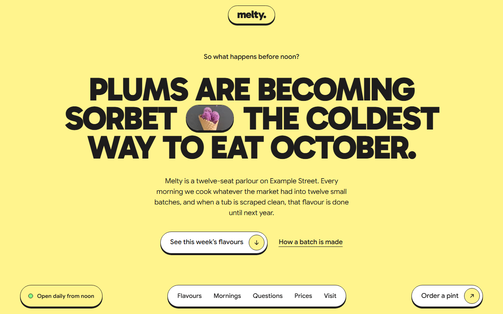
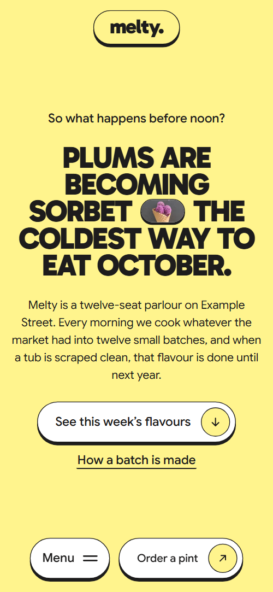
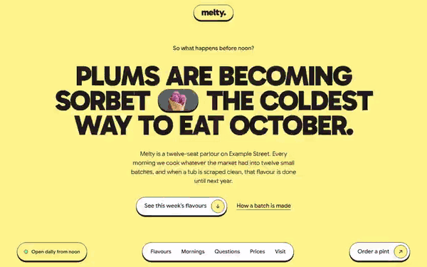

# Free HTML ice cream shop website template with scroll animations and no libraries

Ice cream shop website template: one free HTML file for a parlour, gelateria or dessert shop, with a flavour deck, price rows, a Saturday workshop, a monthly pint plan and a booking form. The look is sticker style: lemon ground, ink outlines, hard shadows. Its scroll motion is CSS with no JavaScript libraries, and AGENTS.md guides an AI agent.

[](LICENSE)  

**[Live demo](https://8bsite.github.io/ice-cream-shop-website-template/)** · **[Use this template](https://github.com/new?template_name=ice-cream-shop-website-template&template_owner=8bsite)** · **[Download ZIP](https://github.com/8bsite/ice-cream-shop-website-template/archive/refs/heads/main.zip)** · **[Template page on 8b.com](https://8b.com/templates/melty/)**

<a href="https://8bsite.github.io/ice-cream-shop-website-template/"></a> <a href="https://8bsite.github.io/ice-cream-shop-website-template/"></a>

<p align="center"><a href="https://8bsite.github.io/ice-cream-shop-website-template/"></a><br><sub>Scroll animation</sub></p>

## Use it with Claude Code, Cursor or Codex

Download the four files into your project folder (`curl.exe` in Windows PowerShell):

```bash
curl -LO https://raw.githubusercontent.com/8bsite/ice-cream-shop-website-template/main/index.html
curl -LO https://raw.githubusercontent.com/8bsite/ice-cream-shop-website-template/main/AGENTS.md
curl -LO https://raw.githubusercontent.com/8bsite/ice-cream-shop-website-template/main/LICENSE
curl -LO https://raw.githubusercontent.com/8bsite/ice-cream-shop-website-template/main/CREDITS.md
```

Then fill in the angle brackets and give your agent this prompt:

```text
Read AGENTS.md, then edit index.html. Make this the site for <my shop: name, address, opening hours, this week's flavours with diet tags, prices, workshop day and price, monthly plans with prices and collection or delivery, suppliers, how people book>. Replace first the shop name, including the footer wordmark's len, then flavours, prices, plans, suppliers, reviews and hours. Motion is CSS scroll-driven animation plus the inline motion kit: keep the gate script, ids, data-8b attributes and listed classes; add no library. Never invent allergen claims, prices, hours, reviews or contacts.
```

If you vibe code the shop in Claude Code or Cursor, hand the agent the facts only the shop has: flavours and their diet tags, prices, hours, address, suppliers, workshop terms and plan prices. The demo invents all of them, plus the reviews. The agent should rename the shop everywhere and set the footer wordmark's --len to the new name's character count. Prices, steps and neighbours can change in number; the deck holds five flavours, the questions three, each ribbon four reviews and the Pint Club three plans.

No agent? Click **[Use this template](https://github.com/new?template_name=ice-cream-shop-website-template&template_owner=8bsite)**, edit `index.html` on GitHub and turn on **Settings > Pages**.

## Sections and motion

- **Navigation**: fixed melty. logo pill at the top; fixed bottom bar with opening hours line, five links and Order a pint button (Menu button on phones); bottom bar hides on scroll down; phone overlay. The bottom bar slides away when you scroll down and returns on a scroll up, and the logo shrinks a little after 60 pixels.
- **Plums are becoming sorbet the coldest way to eat October.**: lemon screen: a small question, a big headline with a photo chip, a paragraph and two buttons. On load the lead line, headline, paragraph and buttons settle into place one after another, and the photo chip in the headline pops; there is no scroll animation here, and this load-in also plays in Firefox.
- **This week in the freezer**: "This week in the freezer": five flavour cards dealt onto one pile, each with photo, description and tags. The five flavour cards hold in one pile for about three screens of scrolling, with the heading beside them on wide screens, and each next card slides up from below with a tilt.
- **At six we buy what the market has, cook it into a base, churn it cold and scoop it by noon.**: "Before you’re up, we’re at it.": one big sentence with three photo chips, then four numbered sticker steps. The three photo chips in the big sentence pop in and the four numbered steps stick on, once, as they reach the screen.
- **Will it survive the walk home?**: three big questions from the counter, each with a highlighted phrase that grows into a colour card holding the answer and a photo. As you scroll, each highlighted phrase grows into the full coloured card and the answer rises into view.
- **Cup, cone or a whole pint**: "Cup, cone or a whole pint": a photo of five cones and five priced sticker rows, with toppings. The cone photo and the five price pills stick on as they reach the screen, once.
- **From their field to your cone**: "From their field to your cone": two photo stickers that fly in and bump, and a list of eight local suppliers. Two photos fly in from the sides on scroll, bump and settle.
- **Saturday churn school**: "Saturday churn school": a kitchen photo, a paragraph, when, who and price, and a booking button. The title fills in word by word as you scroll, and the photo and the ticket stick on once.
- **The Pint Club**: "The Pint Club": a paragraph with a tub photo and three plan cards (Solo, Duo, Freezer full) that spread from a stack. The three plan cards start stacked on the middle one and fan out to their places as you scroll.
- **Overheard at the counter**: "Overheard at the counter": eight short reviews on two ribbons that start crossed like an X, settle to a slight tilt and run in opposite directions. Two ribbons start crossed like an X and settle to a slight tilt as you scroll, while each runs its reviews sideways in opposite directions, pausing only when off screen.
- **1 Example Street**: visit: the street address as heading, opening hours, phone and email, a cone photo and a booking form. The hours card, the cone photo and the form stick on once.
- **Footer**: footer: two big tile links, three round icon links, a giant melty. wordmark and a copyright line with the Design: 8B credit. The letters of the big wordmark stretch up from a squashed shape one after another as you scroll.

## Design

 lemon page ground, the first screen, the logo pill, plan price pills, the end of the visit gradient  
 text, every 1.5px outline, the hard shadows (except under the dark button) and the dark button  
 white cards, nav bar, buttons, form fields, badges and the first review ribbon  
 pink: button hover wipe, second highlight style, second question card, second review ribbon, shadow of the dark button  
 green: first highlight style, first question card, odd price pills, nav link hover, ribbon dots, gradient  
 cyan: third highlight style, third question card, even price pills, gradient  
 coral: start of the menu overlay and visit section gradients  
 peach: middle of those gradients and start of the flavour card gradient  
 violet: end of the Pint Club sheet gradient and of the green card gradient

**Gabarito**: weight 900 only: uppercase headings and flavour names, prices, step numbers, opening times, the lowercase logo and the footer wordmark. **Google Sans**: body text at weight 400, buttons and links at 500, badges and small labels at 600 (Google Fonts). Every surface is a white, gradient or colour-filled box with a 1.5px ink outline and rounded corners, most with a hard shadow. Headings are huge, uppercase and tight; two hold small photo chips. Sections alternate a sticky heading beside a card pile, centred statements, one priced sheet, a row of three plan cards and a two-column visit block with the form. A pill bar with the links and the order button is fixed to the bottom of the screen.

## Questions

**Does the booking form send me an email?**  
No. It checks the name and email, shows a thank-you line and clears itself, but nothing leaves the page. Connect Formspree or Netlify Forms, or delete the form and its script. Edit the thank-you line, which promises a reply within a day.

**Can I have more or fewer than five flavours?**  
Not without CSS work. The deck's length and each card's timing are written for five cards, so a sixth card gets no flight of its own and fewer cards leave an empty stretch of scrolling. Swap the five flavours each week, or ask your agent to add matching rules. Without the [scroll animation](https://8b.com/templates/animated/) the cards form a tilted column.

**Can customers order pints or join the club online?**  
Not as shipped. There is no cart or checkout. The Order a pint button jumps to the club section, and the plan and workshop buttons jump to the form. Point each button at your own ordering or booking page, or keep them as links to the form.

## Is it the right base?

Choose this ice cream store template when the menu changes weekly and you want workshops or a subscription on the same page. A [neighbourhood bakery](https://8b.com/templates/okapi/) selling cakes and pre-order boxes fits another page better. The motion needs no animation library: about 28 KB of code gzipped against 75 KB and four requests for the GSAP version. The weak spot is ordering: there is no cart or checkout, Order a pint only jumps down the page, and the form sends nothing until connected.

## Before you publish

- Replace what is marked `data-8b-placeholder` (social preview image, favicon, phone, email, form, social) and the invented demo facts; [AGENTS.md](AGENTS.md) lists them.
- The form sends nothing yet: connect it to Formspree or Netlify Forms, or remove it.

## Tech

No JavaScript libraries: CSS scroll-driven animations and a small inline motion script with its own smooth wheel scrolling, 109 KB, no build step. Chrome and Edge 108+, Safari 16+, Firefox 110+ (it uses container query units, cascade layers, small/dynamic viewport units). Without scroll-driven animations (Firefox today) the scroll motion and the smooth wheel are off and each section shows its finished layout (a load-in or a loop may still play); with "reduce motion" on, the page is complete and nothing moves on its own (hover effects stay).

A GSAP build of the same page is [`index.gsap.html`](index.gsap.html): GSAP 3.13.0, ScrollTrigger, SplitText, Lenis 1.3.4 from jsDelivr, 97 KB; its scroll motion also plays in Firefox. Use one of the two files.

## License

MIT, see [LICENSE](LICENSE). Photos, fonts and libraries keep their own licences: [CREDITS.md](CREDITS.md). More free templates: [8b.com/templates](https://8b.com/templates/) · [github.com/8bsite](https://github.com/8bsite).
