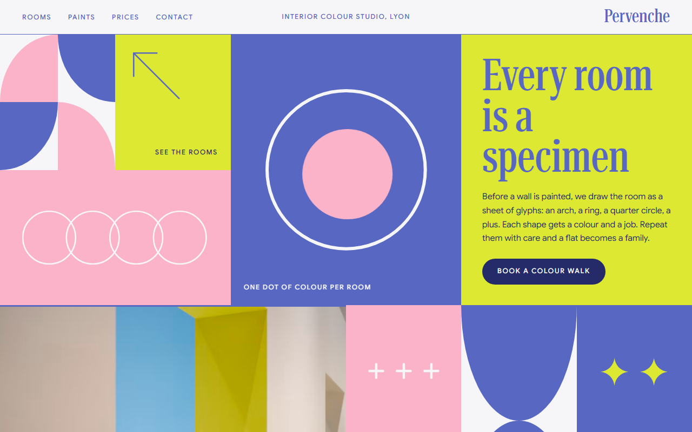
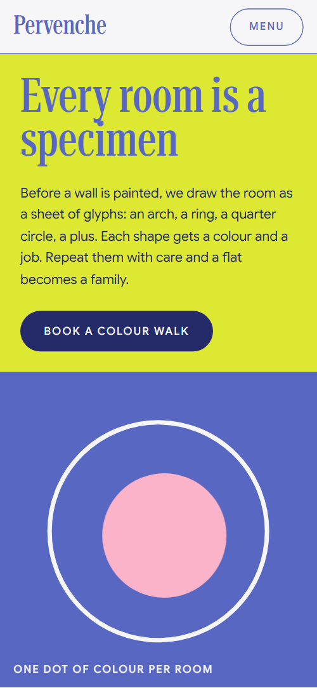
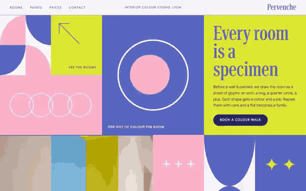

# Free HTML interior design website template with GSAP scroll animations

Interior design website template: one free HTML page for a small colour studio or decorator, with a tile mosaic opening, an A to Z glossary, six projects, four priced commissions, six house paints and a contact form. Flat periwinkle, pink and lime sit on near-white. An AI agent can adapt the single file.

[](LICENSE)  

**[Live demo](https://8bsite.github.io/interior-design-website-template/)** · **[Use this template](https://github.com/new?template_name=interior-design-website-template&template_owner=8bsite)** · **[Download ZIP](https://github.com/8bsite/interior-design-website-template/archive/refs/heads/main.zip)** · **[Template page on 8b.com](https://8b.com/templates/pervenche/)**

<a href="https://8bsite.github.io/interior-design-website-template/"></a> <a href="https://8bsite.github.io/interior-design-website-template/"></a>

<p align="center"><a href="https://8bsite.github.io/interior-design-website-template/"></a><br><sub>Scroll animation</sub></p>

## Use it with Claude Code, Cursor or Codex

Download the four files into your project folder (`curl.exe` in Windows PowerShell):

```bash
curl -LO https://raw.githubusercontent.com/8bsite/interior-design-website-template/main/index.html
curl -LO https://raw.githubusercontent.com/8bsite/interior-design-website-template/main/AGENTS.md
curl -LO https://raw.githubusercontent.com/8bsite/interior-design-website-template/main/LICENSE
curl -LO https://raw.githubusercontent.com/8bsite/interior-design-website-template/main/CREDITS.md
```

Then fill in the angle brackets and give your agent this prompt:

```text
Read AGENTS.md, then edit index.html. Make this the site for <my interior studio: city, what I design, projects with town and year, packages with fixed prices, paints or palette, how a job runs in steps, opening hours, address, how clients reach me>. Replace first the studio name everywhere, the four prices, the six project names, the client quotes and the contact details. Keep the section ids, the data-8b attributes AGENTS.md lists and four sittings. Ask me for any missing fact and never invent prices, hours, addresses, reviews or contacts.
```

Hand index.html and AGENTS.md to Claude Code, Cursor or Codex and start vibe coding with the studio's own facts: city, projects, the four prices, paints, hours, address and contacts. The demo's euro prices, client quotes and project names are invented, so every one must be replaced. Keep the section ids and the classes AGENTS.md lists, and change the giant contact word and its --len value together. The agent must ask for missing prices and reviews, not make them up.

No agent? Click **[Use this template](https://github.com/new?template_name=interior-design-website-template&template_owner=8bsite)**, edit `index.html` on GitHub and turn on **Settings > Pages**.

## Sections and motion

- **Navigation**: top bar: four section links, a studio tagline, the Pervenche wordmark and a Menu button that opens a full-screen overlay. The bar hides when you scroll down and returns on scroll up, and below 820 px wide the Menu button opens a full-screen overlay.
- **Every room is a specimen**: first screen: a mosaic of colour tiles around the h1 "Every room is a specimen", a paragraph, a button, a photo and a See the rooms tile. On load the tiles fade in, the text tile fills with colour, its text rises and the sparkles pop, and the photo eases out of a slight zoom as you scroll; tiles that start below the first screen, mostly on phones, animate again as they scroll in, the photo opening from a small circle.
- **A room alphabet**: a sticky A to Z wall of letters beside a glossary of ten entries (demo: room terms such as Arch, Colour drench, Limewash). While the glossary scrolls past the sticky wall, a wave of width runs along the wall and each letter stretches and relaxes.
- **Rooms we have drawn**: six projects as photos with a name and a type, place and year (demo: a hair salon, an attic bedroom, a pâtisserie counter, a café front). The six photos float around the heading like loose prints, then fly into their hairline frames as you scroll.
- **Said in our rooms**: a periwinkle band with three client quotes on cards, a badge and a giant COLOUR FIRST word pair. The band's shapes turn into place as it rises, and on exit the two giant words part like a curtain.
- **Commissions**: a price sheet of four rows with a name, a line, Fixed or From and a price in a lime pill (demo: colour walk to whole-home). The head and rows rise into place, each rail draws from the left and each lime pill slides in from the right.
- **Six house paints**: six tall paint cards in a sticky deck, each leaving its rotated name as a spine (demo: Pervenche, Bonbon, Citron, Lilas, Craie, Encre). The section sticks and each paint card slides in over the previous one, leaving its rotated name as a spine.
- **We paint for the light you have**: a text column with four hours of the day beside a painted wall where a patch of sunlight crosses and night falls (demo: Morning, Noon, Evening, Night). A patch of sunlight crosses the wall as you scroll, the wall warms in the evening and goes dark at night when the lamp comes on.
- **Four sittings**: four rings that roll into one chain above four numbered meeting steps (demo: Walk, Draw, Sample, Paint). Four rings start stacked at the left and roll out to the right until they lock into one chain.
- **Questions people ask**: five questions and answers as native &lt;details&gt; items with a plus that turns into a cross. Each rule draws itself and the sparkle twinkles; the questions open without script.
- **B o n j o u r**: a closing frame with a giant "Bonjour" word, caption strip, a form and the studio details. The letters of the giant contact word rise out of their baselines in a scattered order, and a pink dot hops along them to land as the dot of the j.
- **Footer**: footer: brand and address, a Studio column of five links, an Elsewhere column with Instagram, Pinterest and email, a caption strip with the copyright and Design: 8B.

## Design

 page ground, navigation bar, and text on the periwinkle bands and the menu overlay  
 body text and headings, hairline rules, the quote, price and sittings bands, the menu overlay and the daylight wall  
 glossary letter discs, the plus and ring tiles, the hover dot on buttons, one paint card, the open question icon  
 the Commissions and form buttons, price pills, the opening text tile's fill, one paint card and the daylight lamp  
 text on lime and pink surfaces, form text, the opening button, focus outlines and the darkest paint card

**Google Sans**: body text at weight 400, and uppercase spaced captions, buttons and form labels at weight 500. **Roboto Serif**: headings, wordmark, menu links and the giant words, at weight 500 in its narrowest width with the largest optical size; the A to Z wave stretches the letters (Google Fonts). Nine tiles of different sizes in a six-column mosaic open the page around the heading. Below, near-white sections alternate with full periwinkle bands for the client quotes with the price list, and for the four sittings. Headings are tall condensed serif; small uppercase sans captions sit under hairline rules. Several sections pair content with a sticky element: the glossary beside the sticky A to Z wall, and the paint cards stacked as a deck.

## Questions

**Where can I find free interior design website templates like this one?**  
This one is free: a single index.html under the MIT licence, with AGENTS.md. It loads GSAP and Lenis from jsDelivr and fonts from Google Fonts. The seven photos come from Unsplash and are credited in CREDITS.md. Replace them with your own work before you publish.

**Does the contact form send anything?**  
No. As shipped it checks the required fields and shows a thank-you line, but nothing leaves the page. Connect a service such as Formspree or Netlify Forms, or your own endpoint, and replace the demo email and phone, which are placeholders.

**Can I get a site like this without editing code?**  
Yes, in a different way. [8B's AI website builder](https://8b.com/templates/8b/) designs a new site from a sentence, and designing and restyling are free. Publishing with hosting and SSL, full HTML export and AI edits in chat are on Pro at $9 a month billed yearly. It also runs inside Claude and ChatGPT. It does not produce this template.

## Is it the right base?

Choose this as an interior design web template when you sell a method and fixed prices to private clients and want colour and type to carry the page. If you present whole buildings instead of rooms, the [architecture](https://8b.com/templates/midblock/) template fits better. The weak spot is the six paint cards: they assume you mix your own paints, so cut them if you do not. For a site without touching code, the 8B builder is the other route.

## Before you publish

- Replace what is marked `data-8b-placeholder` (social preview image, favicon, form, email, phone, social) and the invented demo facts; [AGENTS.md](AGENTS.md) lists them.
- The form sends nothing yet: connect it to Formspree or Netlify Forms, or remove it.

## Tech

GSAP 3.13.0, ScrollTrigger, SplitText, Lenis 1.3.4 from jsDelivr, 125 KB, no build step. Chrome and Edge 111+, Safari 16.2+, Firefox 113+ (it uses color-mix(), container query units, cascade layers, small/dynamic viewport units). With "reduce motion" on, the page is complete and still.

## License

MIT, see [LICENSE](LICENSE). Photos, fonts and libraries keep their own licences: [CREDITS.md](CREDITS.md). More free templates: [8b.com/templates](https://8b.com/templates/) · [github.com/8bsite](https://github.com/8bsite).
