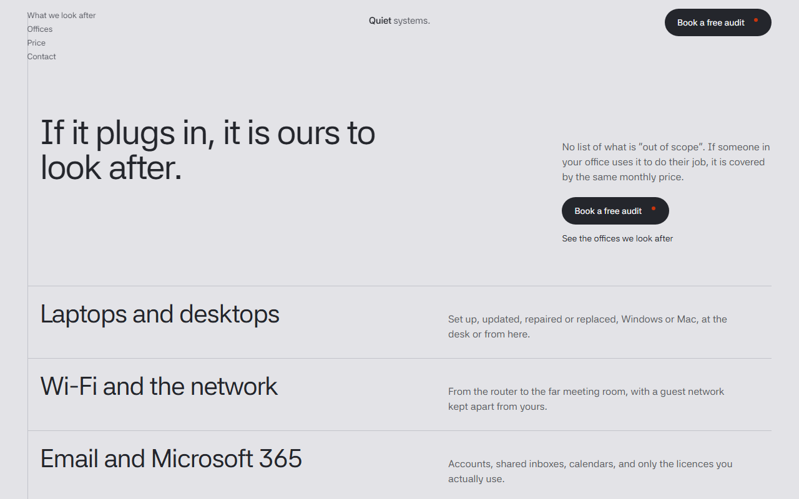
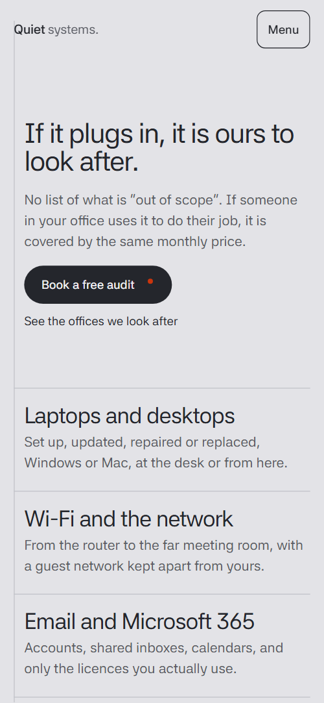
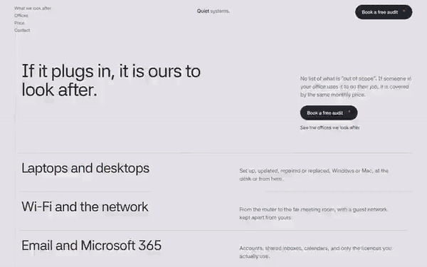

# Free HTML it support website template with scroll animations and no libraries

IT support website template: one free HTML file for a managed IT provider that looks after the computers, Wi-Fi, email and backups of small offices. It has a phone line, a headcount price calculator, five security layers and an audit form in cool grey and orange. Scroll motion is CSS with no libraries; AGENTS.md lets Claude Code adapt it.

[](LICENSE)  

**[Live demo](https://8bsite.github.io/it-support-website-template/)** · **[Use this template](https://github.com/new?template_name=it-support-website-template&template_owner=8bsite)** · **[Download ZIP](https://github.com/8bsite/it-support-website-template/archive/refs/heads/main.zip)** · **[Template page on 8b.com](https://8b.com/templates/quiet-systems/)**

<a href="https://8bsite.github.io/it-support-website-template/"></a> <a href="https://8bsite.github.io/it-support-website-template/"></a>

<p align="center"><a href="https://8bsite.github.io/it-support-website-template/"></a><br><sub>Scroll animation</sub></p>

## Use it with Claude Code, Cursor or Codex

Download the four files into your project folder (`curl.exe` in Windows PowerShell):

```bash
curl -LO https://raw.githubusercontent.com/8bsite/it-support-website-template/main/index.html
curl -LO https://raw.githubusercontent.com/8bsite/it-support-website-template/main/AGENTS.md
curl -LO https://raw.githubusercontent.com/8bsite/it-support-website-template/main/LICENSE
curl -LO https://raw.githubusercontent.com/8bsite/it-support-website-template/main/CREDITS.md
```

Then fill in the angle brackets and give your agent this prompt:

```text
Read AGENTS.md, then edit index.html. Make this the site for <my support firm: name, area, services, price per person and headcount range, hours, clients, team, how people book, legal name>. Replace the firm name, services, client offices, notes and team first. Change data-rate with the visible price and set the phone number's --len to its character count. Keep the ids, the listed classes, the gate script in the head, the data-8b-motion attributes and five team members; add no animation library. Never invent prices, clients or contacts; ask me.
```

Using this IT support website template for Claude Code or Cursor goes fastest when the agent has the facts only the firm knows: services, area, hours, price per person and slider range, client names, team and legal name. The demo invents all of them, including the five offices, the three notes and the portraits. If you [vibe code the site](https://8b.com/templates/vibe-coding/), the agent should change data-rate with the visible price, keep the ids and the classes AGENTS.md lists, and ask before naming any client.

No agent? Click **[Use this template](https://github.com/new?template_name=it-support-website-template&template_owner=8bsite)**, edit `index.html` on GitHub and turn on **Settings > Pages**.

## Sections and motion

- **Navigation**: four links, a wordmark, a Book a free audit button and a Menu button that opens a full-screen overlay. The bar slides away after 24 px of scrolling down past 80 px and returns in a compact form after 40 px of scrolling up; on phones Menu opens a full-screen overlay.
- **If it plugs in, it is ours to look after.**: first screen: the h1 If it plugs in, it is ours to look after. with a lead and two actions, then a ruled list of eight things looked after. On load the heading block slides in from the right while opening from the left, and on scroll the rows below the first screen settle onto their lines as their hairlines draw.
- **Call one number. Someone who knows your office answers.**: a large phone number with three facts: hours, who answers and out of hours. The heading and the large phone number slide in while opening, and the three hairlines draw.
- **Sixty offices call us. Here are five of them.**: a grid of five client offices that starts zoomed in on one photo and zooms out to all five with captions. On wide screens the section is held while the grid zooms out from one photo to all five; on phones it zooms out from 1.7 times as it scrolls in.
- **Locked, without the lecture.**: a dark cut-corner panel with five security layers that slide out from under each other. Scrubbed with the scroll, the lower four rows start stacked on the first and slide down into place while the panel's clipped corner closes.
- **One price per person. Everything in it.**: one price per person: a checklist beside a card with a headcount slider and a live monthly total. The heading settles, the hairlines draw and the card arrives with a deep clipped corner that closes; the slider updates the total as you drag.
- **What changed after the first month.**: three before and after notes where the old complaint shrinks and what changed rises in. As each note crosses the screen, the Before line shrinks from 1.75 times its size and turns grey while the change line rises and fades in.
- **Five people. You will know them by name.**: five engineers as portraits; on wide screens an index of names drives one held portrait that opens from a cut corner. On wide screens the name at the middle of the screen darkens and its portrait opens over the last one from the frame's corner; on narrower screens each portrait opens as it scrolls in.
- **Questions offices ask before they call.**: five questions and answers (native details). The heading and note settle in and a hairline draws above each question; the answers open natively.
- **Book a free audit.**: a drawn ring and rotating radius behind the heading, contact details and an audit request form. A thin ring and a radius line behind the heading turn by 130 degrees as the section scrolls in, drawing an orange arc along the ring.
- **Footer**: wordmark with a sentence, four columns of links and details, and a base line. A hairline draws across above the four columns.

## Design

 page background, the form fields and the compact nav bar  
 body text, filled buttons, and the dark phone-line section, security panel, menu overlay and footer  
 the price card and audit form, the before and after notes section, the light buttons on dark blocks, and text on the dark blocks  
 leads, captions, nav links, FAQ answers, the regular half of the wordmark and the grey the Before lines fade to  
 the only accent: focus outlines, the dot in buttons, plus marks, the slider and the arc on the contact ring  
 hairlines, field borders, empty photo frames and the contact ring outline  
 small labels and descriptions on the dark blocks, and the regular half of the footer wordmark  
 declared with a large muted text style that no element in the shipped markup uses

**Asta Sans**: the only typeface, loaded from Google Fonts: regular weight for headings and body text, medium on buttons, semibold on the bold half of the wordmark and the Before label (Google Fonts). Full-width sections on a pale grey ground, with one vertical hairline down the left edge of the first section. The first screen is a heading block with two actions, then a ruled list of eight services. Later sections repeat the same pieces: a hairline, a large heading, a short lead, then rows or cards. Cards, the five client photos and the team portraits share the clipped upper-left corner.

## Questions

**Does this IT company website design template include a price calculator?**  
Yes. The price section has a slider for people in the office, from 3 to 60 and starting at 12, and a script multiplies it by the rate in data-rate to write the monthly total. Change data-rate together with the visible £42, and the slider's min and max if your range differs.

**Does the free audit form send anything?**  
No. The form has name, company, contact, office size and message fields; as shipped the script checks them and shows a thank-you line, and nothing leaves the page. Connect Formspree or Netlify Forms for real requests, or point the booking buttons at your Calendly or Cal.com page instead.

**What happens in Firefox, with reduced motion or without JavaScript?**  
Without CSS scroll-driven animations, Firefox today, or with reduced motion, the page shows its finished layout with ordinary scrolling and the team as a plain grid; the nav still hides on scroll, and Firefox still plays the heading's load-in. Without JavaScript the Menu, the slider total and the form stop; the [one-scroll page](https://8b.com/templates/one-page/) still reads.

## Is it the right base?

As an it company web template it suits a firm selling a calm, fixed monthly service to small offices. This build has no JavaScript libraries and no script from a CDN: the same look and scroll behaviour in about 35 KB of gzipped code, against about 81 KB and three more requests for the GSAP version. Many service pages, a client portal or a ticket form need more, and a shop that [fixes phones and laptops](https://8b.com/templates/reflow/) over the counter fits a different layout.

## Before you publish

- Replace what is marked `data-8b-placeholder` (social preview image, favicon, phone, email, form) and the invented demo facts; [AGENTS.md](AGENTS.md) lists them.
- The form sends nothing yet: connect it to Formspree or Netlify Forms, or remove it.

## Tech

No JavaScript libraries: CSS scroll-driven animations and a small inline motion script with its own smooth wheel scrolling, 136 KB, no build step. Chrome and Edge 111+, Safari 16.2+, Firefox 113+ (it uses color-mix(), cascade layers, small/dynamic viewport units). Without scroll-driven animations (Firefox today) the scroll motion and the smooth wheel are off and each section shows its finished layout (a load-in or a loop may still play); with "reduce motion" on, the page is complete and nothing moves on its own (hover effects stay).

A GSAP build of the same page is [`index.gsap.html`](index.gsap.html): GSAP 3.13.0, ScrollTrigger, Lenis 1.3.4 from jsDelivr, 131 KB; its scroll motion also plays in Firefox. Use one of the two files.

## License

MIT, see [LICENSE](LICENSE). Photos, fonts and libraries keep their own licences: [CREDITS.md](CREDITS.md). More free templates: [8b.com/templates](https://8b.com/templates/) · [github.com/8bsite](https://github.com/8bsite).
