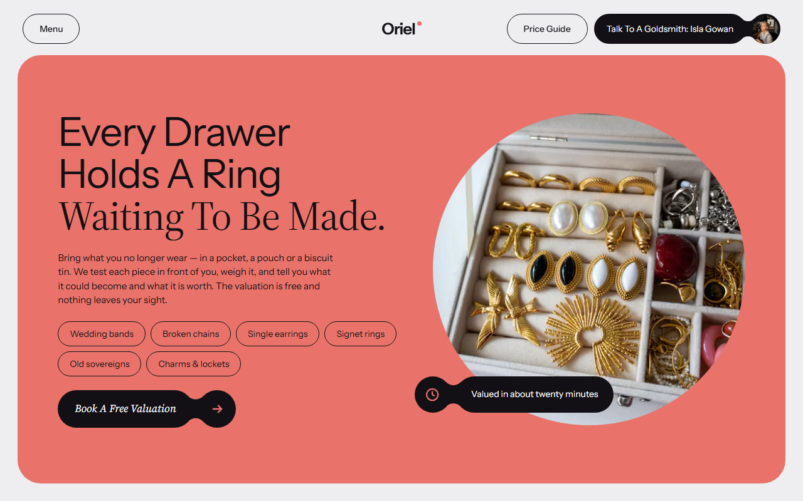
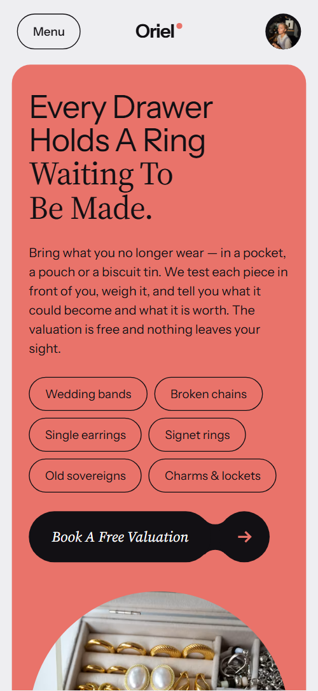
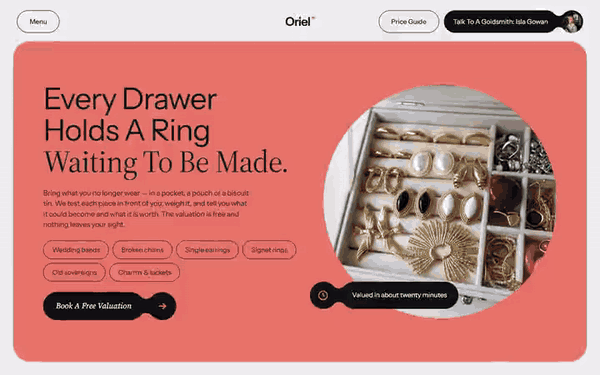

# Free HTML jewelry website template with GSAP scroll animations

Jewelry website template: one free HTML page for an independent goldsmith, with prices by piece, a five-sitting process, a stand-in ring offer for proposals, three remade-piece stories, a care price list and an appointment form. Coral, lilac and near-black panels sit on a pale grey page. An AI agent can adapt the single file.

[](LICENSE)  

**[Live demo](https://8bsite.github.io/jewelry-website-template/)** · **[Use this template](https://github.com/new?template_name=jewelry-website-template&template_owner=8bsite)** · **[Download ZIP](https://github.com/8bsite/jewelry-website-template/archive/refs/heads/main.zip)** · **[Template page on 8b.com](https://8b.com/templates/oriel/)**

<a href="https://8bsite.github.io/jewelry-website-template/"></a> <a href="https://8bsite.github.io/jewelry-website-template/"></a>

<p align="center"><a href="https://8bsite.github.io/jewelry-website-template/"></a><br><sub>Scroll animation</sub></p>

## Use it with Claude Code, Cursor or Codex

Download the four files into your project folder (`curl.exe` in Windows PowerShell):

```bash
curl -LO https://raw.githubusercontent.com/8bsite/jewelry-website-template/main/index.html
curl -LO https://raw.githubusercontent.com/8bsite/jewelry-website-template/main/AGENTS.md
curl -LO https://raw.githubusercontent.com/8bsite/jewelry-website-template/main/LICENSE
curl -LO https://raw.githubusercontent.com/8bsite/jewelry-website-template/main/CREDITS.md
```

Then fill in the angle brackets and give your agent this prompt:

```text
Read AGENTS.md, then edit index.html. Make it the site for <my studio: name, city, what we make and repair, starting prices, service prices, lead times, hallmarking office, makers and roles, hours, booking, legal name and company number>. Replace first the studio name, the five pieces, the five process steps, the three stories, the makers and the care prices. Keep the section ids, the classes AGENTS.md lists and each --len set to its name's character count. Ask me for missing facts; never invent hallmarks, carats, reviews, quotes or contacts.
```

Vibe coding with Claude Code, Cursor or Codex goes fastest when you give the agent the facts only the workshop has: starting prices per piece, service prices, lead times, the assay office, makers and roles, hours and address. The agent should replace the prices, the five sittings, the stories and the makers first. The footer wordmark and each sitting name carry an inline --len; set it to the character count of every new name.

No agent? Click **[Use this template](https://github.com/new?template_name=jewelry-website-template&template_owner=8bsite)**, edit `index.html` on GitHub and turn on **Settings > Pages**.

## Sections and motion

- **Navigation**: a Menu button, the wordmark with a dot, a Price Guide button and a call button with the founder's round photo; a full-screen menu with nine links. The bar turns into a floating pill after 40 px of scroll, slides away when you scroll down and returns on scroll up; the Menu button opens a full-screen overlay and pauses smooth scrolling.
- **Every Drawer Holds A Ring Waiting To Be Made.**: one big rounded coral panel: a heading in two voices, a paragraph, six badges, a valuation button and a photo of an old jewellery box with a caption pill. On load the coral panel grows from slightly smaller and its heading, paragraph, badges and button rise in turn; nothing moves on scroll.
- **What Leaves Our Bench Most Weeks**: a held screen where five tall piece frames travel sideways as one strand, curving up in the middle. Pinned: the five frames travel sideways as one strand, each riding a curve, upright and highest in the middle and lower and tilted at the edges, while its photo slides inside the frame.
- **Where Our Metal Comes From**: where the metal comes from: an intro and three rows, each a round photo fused to a pill. The two heading halves slide in from opposite sides as you scroll, and each row's round photo starts smaller and tucked into its pill, then slides out to full size.
- **Five Sittings From Drawer To Hand**: five numbered sittings from sketch to hand-over; each name swells wide and bold as it crosses the reading line and its photo circle grows. As each sitting crosses the reading line its name widens from narrow and light to wide and bold and its photo circle grows from about half size, then both fall back.
- **Proposing? Use A Stand-In.**: a tall photo beside a pitch for a silver stand-in ring, three points and a button. The photo opens from a rounded inset to the full frame while the picture settles, the heading halves slide together and the three points settle into place.
- **Three Pieces That Came Back Different**: three remade pieces as stacking cards, each with the story, a quote and a came-in and came-out photo pair. The cards are held with staggered offsets, so each new card slides over the one before, which shrinks to 92 percent.
- **Four At The Bench And A Seat For You**: four makers and an empty seat for the visitor: round portraits start as a small cluster and spread into a row. Pinned for about 1.4 screens: the circles begin as a small overlapping cluster and spread into a row, then names and roles fade in.
- **Asked At The Counter**: five questions and answers (native details) with a phone line. The heading halves slide in from opposite sides; the questions open with a plain click.
- **Looked After For As Long As You Wear It**: a care promise and eight price pills that settle from a scatter into one block. The eight pills start scattered and tilted and settle into one block as it scrolls up, the free pill first.
- **Come Round To Tanner's Wynd**: address, hours, phone and email as fused pills, a shop photo and a booking form. The heading halves slide together, the three fused facts settle and the shop photo opens from a rounded inset.
- **Footer**: address, hours, contacts and five links above a huge wordmark that widens as you scroll, then the legal line. The wordmark's font width runs from 75 to 100 as the footer comes up, which stretches it across the page.

## Design

 page background and the nav bar once it floats  
 text, the pieces, makers, menu and footer grounds, the middle story card, the booking form, the small fused pills of the contact facts and the photo caption, rules in the sittings list  
 the opening panel, buttons, the free-cleaning pill, piece prices, the logo dot, the 'You' circle, the open question's plus  
 the sittings ground, the first story card, the empty backing of photos  
 the stand-in and care grounds, the third story card  
 text on dark grounds, the fused photo pills, price pills, an opened question  
 small text in the metal rows, care prices, the empty frames of the pieces strip  
 secondary text on near-black: piece lines, makers' roles, footer labels, the form status line

**Instrument Sans**: headings in regular weight, body text, labels, buttons and form fields; a variable font whose width axis widens the sitting names and the footer wordmark, at weight 650 for those display lines. **Source Serif 4**: the second line of each heading, in upright regular weight, and the italic label of the valuation button on the first screen (Google Fonts). A pale grey page cut into full-width bands of different grounds. Every section heading has two voices, a sans line and a serif line, stacked. Photos are tall frames, circles or pills. In the metal section round photos fuse to white pills through a curved neck; the stand-in points use the same pill with an icon, the contact facts a smaller near-black one. Sittings are a numbered list with a round photo on the right. Stories are three stacked cards.

## Questions

**Can I take online orders with it?**  
No. There is no cart, checkout or stock list. Pieces show a from price as plain text, and the buttons lead to the questions, the care prices, the phone link or the booking form. To sell online, point the buttons at your shop platform or choose a template built for it.

**Does the booking form send anything?**  
No, not as shipped. A script checks the name and email, shows a thank-you line that promises a reply within a working day, and clears the form. Without JavaScript the form posts to #. Connect Formspree or Netlify Forms, and rewrite the promise to match how you reply.

**What happens on a phone, with reduced motion or without JavaScript?**  
On a phone the pieces strip still runs sideways, the makers and prices reflow and story cards compress. With reduced motion, entrance and scroll animations and smooth scrolling are off, while the nav bar still hides on scroll and buttons react to hover. Without JavaScript the Menu button cannot open its overlay; the questions and footer links still work.

## Is it the right base?

Pick it for a studio with a process to show and visits to book. A business that sells stock and ships it needs a shop, and the [flower shop](https://8b.com/templates/moth-marigold/) template at least shows delivery and standing orders. The weak spot is length: the pieces strip holds the screen for about four item widths of scroll, and the makers section for about 1.4 screens. Owners who do not code can use 8B's no-code builder instead.

## Before you publish

- Replace what is marked `data-8b-placeholder` (social preview image, favicon, phone, email, form) and the invented demo facts; [AGENTS.md](AGENTS.md) lists them.
- The form sends nothing yet: connect it to Formspree or Netlify Forms, or remove it.

## Tech

GSAP 3.13.0, ScrollTrigger, Lenis 1.3.27 from jsDelivr, 107 KB, no build step. Chrome and Edge 111+, Safari 16.2+, Firefox 113+ (it uses color-mix(), cascade layers, small/dynamic viewport units). With "reduce motion" on, the page is complete and still.

## License

MIT, see [LICENSE](LICENSE). Photos, fonts and libraries keep their own licences: [CREDITS.md](CREDITS.md). More free templates: [8b.com/templates](https://8b.com/templates/) · [github.com/8bsite](https://github.com/8bsite).
