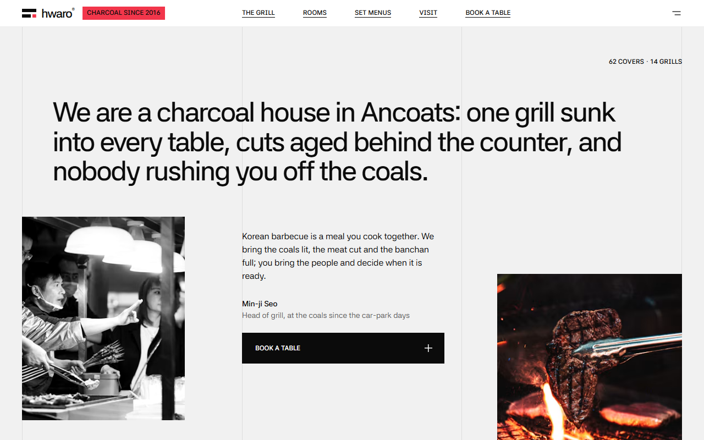
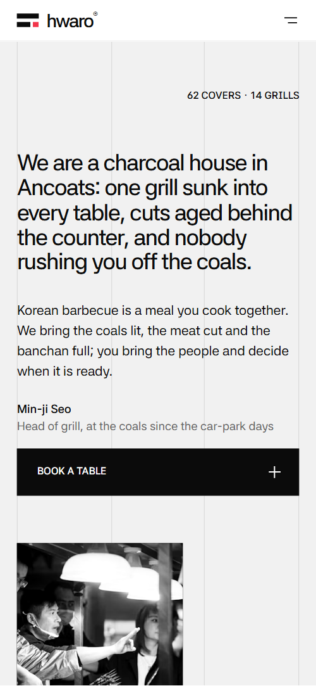
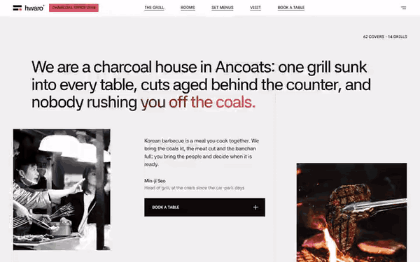

# Free HTML korean restaurant website template with GSAP scroll animations

Korean restaurant website template: a free page for a table-grill barbecue with a menu in four grill groups, four rooms, one night in nine photos, a grilling guide, eight banchan, three set menus and a table request form. Column rules cross white, grey and black grounds with one red accent. An AI agent adapts the single HTML file through AGENTS.md.

[](LICENSE)  

**[Live demo](https://8bsite.github.io/korean-restaurant-website-template/)** · **[Use this template](https://github.com/new?template_name=korean-restaurant-website-template&template_owner=8bsite)** · **[Download ZIP](https://github.com/8bsite/korean-restaurant-website-template/archive/refs/heads/main.zip)** · **[Template page on 8b.com](https://8b.com/templates/hwaro/)**

<a href="https://8bsite.github.io/korean-restaurant-website-template/"></a> <a href="https://8bsite.github.io/korean-restaurant-website-template/"></a>

<p align="center"><a href="https://8bsite.github.io/korean-restaurant-website-template/"></a><br><sub>Scroll animation</sub></p>

## Use it with Claude Code, Cursor or Codex

Download the four files into your project folder (`curl.exe` in Windows PowerShell):

```bash
curl -LO https://raw.githubusercontent.com/8bsite/korean-restaurant-website-template/main/index.html
curl -LO https://raw.githubusercontent.com/8bsite/korean-restaurant-website-template/main/AGENTS.md
curl -LO https://raw.githubusercontent.com/8bsite/korean-restaurant-website-template/main/LICENSE
curl -LO https://raw.githubusercontent.com/8bsite/korean-restaurant-website-template/main/CREDITS.md
```

Then fill in the angle brackets and give your agent this prompt:

```text
Read AGENTS.md, then edit index.html. Adapt it to <my Korean barbecue: name, address, hours, cuts and prices, set menus, rooms and seats, allergens, booking rules, contacts, staff, reviews>. First replace the name in every letter case, the Manchester address, pound prices and clashing demo hours. Keep nine night cells, .nt-cell--main in the middle, four grilling steps, three set cards with one red, --len numbers matching their text and the classes AGENTS.md lists. Ask me for any missing fact; never invent prices, hours, addresses, licences, allergens, reviews or contacts.
```

A vibe coding pass in Claude Code or Cursor first replaces the Manchester address, pound prices, the 10% service line, the back room deposit and hours that differ between the menu overlay and the contact block. The owner supplies cuts, prices, allergens, booking rules and one set of hours; the demo allergen answer must go. Change both copies of each room photo, sharp and blurred. Keep nine night frames with .nt-cell--main in the middle, the grill index in row order, and each --len number matched to its line.

No agent? Click **[Use this template](https://github.com/new?template_name=korean-restaurant-website-template&template_owner=8bsite)**, edit `index.html` on GitHub and turn on **Settings > Pages**.

## Sections and motion

- **Navigation**: white top bar: logo mark and wordmark, a red badge, five links and a menu button; full-screen black menu with Hangul names, phone, address and hours. The white bar slides out of sight once you scroll down past 160 px and returns on the first scroll up; the menu button opens a full-screen black overlay.
- **We are a charcoal house in Ancoats: one grill sunk into every table, cuts aged behind the counter, and nobody rushing you off the coals.**: the opening statement as the h1 on the light grid, with a covers label, a black-and-white photo, the head of grill's note with a booking button, and a second photo. On load the covers label, statement and text column lift and fade in and the statement's words burn once from ash grey through red to ink; Lenis smooths the scroll page-wide, and each photo opens upward from its foot as it arrives, settling from a zoom.
- **What we fire 불판**: the menu as four fires: a sticky side column with an index, and four rows each with a Hangul label, two photos, a text, a starting price and cut tags. As each row scrolls up, its right photo slides out from over the left one into its own column while the left picture settles from a zoom, and a red marker in the sticky index moves to the group in view.
- **The rooms.**: four rooms as wide photos over a blurred glow of the same photo, with seats, opening time, a caption and two notes; a title filling the width. The title drifts sideways into place as it rises, and each room photo opens from a slot the width of the middle column to the full grid by mid-screen, settling from a zoom while the glow behind brightens.
- **One night 하룻밤**: one service in nine photos with their times, a 3×3 grid on a black ground. Pinned: the 21:00 photo starts out filling the screen and shrinks into the middle cell while the other eight, pushed mostly past the screen edges, close in; the grid then holds still for the last stretch of scroll.
- **Raw to ready 굽는 법**: four grilling steps in a 2×2 grid read clockwise, a dark card moving from step to step, beside a quote from the head butcher. Pinned: a dark card travels clockwise from step one to step four as you scroll, and the step under it turns light on dark with a red number.
- **Table talk 손님 이야기**: three guest quotes beside a sticky portrait frame that changes to the guest being read, with a rating line. Each quote's words burn from ash grey through red to ink with the scroll, and as the next quote rises its guest's portrait wipes up over the last one in the sticky frame.
- **Eight small plates 반찬**: the eight side dishes of the week with Hangul names, a statement and two photos. The heading drifts in from the right, the statement burns from ash to ink word by word, and both photos open upward once as they arrive.
- **Where the fire came from 걸어온 길**: the history as four years on a horizontal track over a red rule. Pinned: the four years slide left with your scroll while the red rule fills from a tenth to full width, and the photos of years two to four open from left to right.
- **Set menus 세트**: three set menus as cards with a price, what goes on the grill and to finish; the most booked card turns red. The heading glides left into place, and in the most booked card a red field rises from its foot while its check boxes fill one by one with the scroll; the other two cards stay still.
- **Good to know 안내**: six questions and answers (native &lt;details&gt;) beside a heading with a phone link. The heading eases in sideways as it rises; opening a question turns its red plus into a cross.
- **Book a grill.**: booking: the title filling the width, a next free table note, contacts and hours, and a table request form (placeholders). The title is cut into three column slices that start at different heights and slide together into one line by the time it has risen to 42% of the screen.
- **Footer**: black footer: links, the wordmark across two columns with a handwritten red line, phone, email, copyright with the Design: 8B credit.

## Design

 white bar, grill, guest and question grounds, set cards, text on dark grounds, the form's submit button  
 text on light grounds, night and footer grounds, menu overlay, black buttons, the dark card of the grilling guide, the Most booked badge, the ink end of the burning words  
 page ground: opening, grilling guide, banchan and set menu sections; the thin gaps between set cards  
 charcoal ground of the rooms, history and booking sections; the frames behind most photos; form dropdown options  
 the only accent: badge, logo bar, grill index marker, night times, lit step numbers, burning words, the most booked set card, history rule and squares, form field corners, button and link hovers, question plus, footer handwriting  
 secondary text on light grounds: signature roles, grill note, index links out of view, unlit step texts, guest visits, banchan lines, set labels and times  
 secondary text on dark grounds: room intro, captions and seat labels, night and history lines, booking line, form labels and placeholders, footer headings and legal line, menu overlay details

**Asta Sans**: every text but one line: tight semibold headings and the grid-wide titles, medium weight for the opening statement, guest quotes, banchan line and Hangul subtitles, semibold uppercase labels and buttons, regular body text; Latin and Korean slices. **Playwrite US Trad**: handwriting, regular weight, only for the tilted red line across the foot of the footer wordmark (Google Fonts). This restaurant website design rests on a three-column grid with hairline rules drawn on every section, light or dark. In the grill and guest sections the first third sticks while rows or quotes run past in the other two. Most section headings carry a Hangul subtitle. Two section titles fill the grid on one line, and the footer wordmark fills two columns. Room photos span the grid at 2:1 over a blurred copy glowing past their edges.

## Questions

**Does the table request form send bookings?**  
Not as shipped. A script checks the required name, phone and date, shows a thank-you line and sends nothing; without JavaScript the form posts back to the page. Connect Formspree or Netlify Forms, or point the Book a table links at OpenTable. The Next free table line is fixed and the confirmation promises a text within the hour: rewrite both.

**Can it work as a restaurant website template with online ordering?**  
No. Nothing here takes an order or a payment: the grill rows and set cards show prices only, and every booking button jumps to the form. For takeaway, add a link from the menu overlay to the ordering service you already use, and keep this page for the dining room.

**What has to stay the same when the agent edits it?**  
Every id, plus the attributes and classes AGENTS.md lists. Nine night frames with the 21:00 cell in the middle, four grilling steps, three set cards with one red, and one portrait per quote. Keep the header comment and the 8B meta tag in the head. Keep the Design: 8B footer link unless the site owner asks to remove it.

## Is it the right base?

Choose this restaurant site template when the grill is the point: a menu split by what goes on the fire, a guide for first-time grillers and rooms with different seating. A kitchen without table grills, serving courses from lunch until late, fits the [brasserie](https://8b.com/templates/ombrelle/) template better. The weak spot is legibility: guest quotes and the banchan line stay faint ash grey low on the screen until they burn to ink. Short windows and landscape phones crop the pinned night grid and history track.

## Before you publish

- Replace what is marked `data-8b-placeholder` (social preview image, favicon, phone, email, form) and the invented demo facts; [AGENTS.md](AGENTS.md) lists them.
- The form sends nothing yet: connect it to Formspree or Netlify Forms, or remove it.

## Tech

GSAP 3.13.0, ScrollTrigger, Lenis 1.3.4 from jsDelivr, 172 KB, no build step. Chrome and Edge 111+, Safari 16.2+, Firefox 113+ (it uses color-mix(), container query units, cascade layers, small/dynamic viewport units). With "reduce motion" on, the page is complete and still.

## License

MIT, see [LICENSE](LICENSE). Photos, fonts and libraries keep their own licences: [CREDITS.md](CREDITS.md). More free templates: [8b.com/templates](https://8b.com/templates/) · [github.com/8bsite](https://github.com/8bsite).
