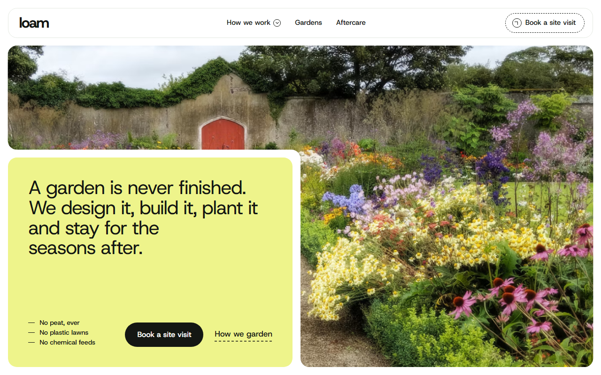
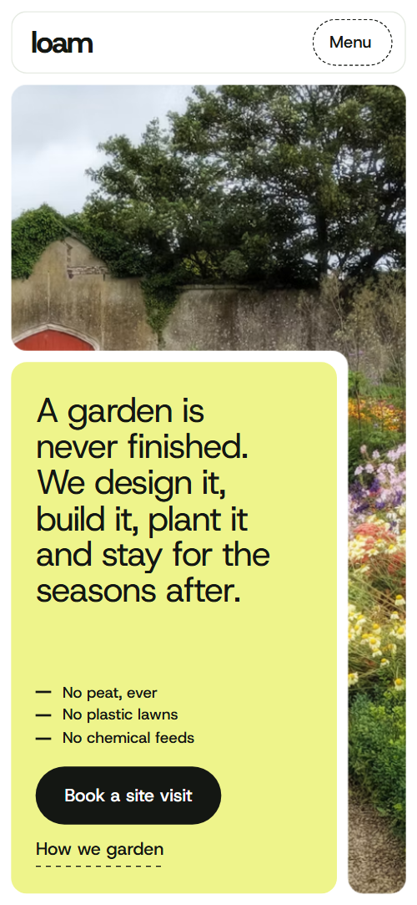
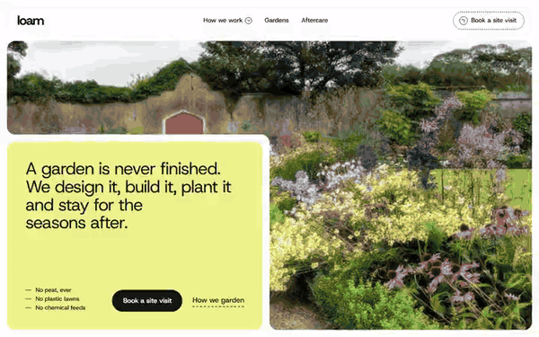

# Free HTML landscaping website template with GSAP scroll animations

Landscaping website template: one free HTML file for a firm that designs, builds, plants and looks after gardens, with lime, forest-green and sage panels, a screen-high garden photo, a four-step process, three finished gardens, aftercare by season and a site-visit form. AGENTS.md is included, so Claude Code, Cursor or Codex can adapt it.

[](LICENSE)  

**[Live demo](https://8bsite.github.io/landscaping-website-template/)** · **[Use this template](https://github.com/new?template_name=landscaping-website-template&template_owner=8bsite)** · **[Download ZIP](https://github.com/8bsite/landscaping-website-template/archive/refs/heads/main.zip)** · **[Template page on 8b.com](https://8b.com/templates/loam/)**

<a href="https://8bsite.github.io/landscaping-website-template/"></a> <a href="https://8bsite.github.io/landscaping-website-template/"></a>

<p align="center"><a href="https://8bsite.github.io/landscaping-website-template/"></a><br><sub>Scroll animation</sub></p>

## Use it with Claude Code, Cursor or Codex

Download the four files into your project folder (`curl.exe` in Windows PowerShell):

```bash
curl -LO https://raw.githubusercontent.com/8bsite/landscaping-website-template/main/index.html
curl -LO https://raw.githubusercontent.com/8bsite/landscaping-website-template/main/AGENTS.md
curl -LO https://raw.githubusercontent.com/8bsite/landscaping-website-template/main/LICENSE
curl -LO https://raw.githubusercontent.com/8bsite/landscaping-website-template/main/CREDITS.md
```

Then fill in the angle brackets and give your agent this prompt:

```text
Read AGENTS.md, then edit index.html. Make this the site for <my landscaping firm: name, town and service area, year founded, services, price ranges, gardens built with sizes and weeks, aftercare visits per season, materials and distances, hours, phone, email, company number>. Replace first the name, the three gardens, the client quotes and the numbers in the copy. Keep the section ids, the classes AGENTS.md lists, four service beds and the footer wordmark len. Ask me for missing facts and never invent prices, certifications, reviews, distances or contacts.
```

Vibe coding with Claude Code, Cursor or Codex goes fastest when you give the agent the facts only the firm has: founding year, service area, price ranges, garden count, sizes and weeks of finished gardens, visits per season, hours and company number. The demo invents all of them, along with the three client quotes. The agent should keep the policy lines, such as no peat and no plastic lawns, only if they are true for you.

No agent? Click **[Use this template](https://github.com/new?template_name=landscaping-website-template&template_owner=8bsite)**, edit `index.html` on GitHub and turn on **Settings > Pages**.

## Sections and motion

- **Navigation**: wordmark, three links and a Book a site visit button; a Menu button and full-screen overlay on phones. The white bar hides after 24 px of scrolling down, once past the top of the page, and comes back on scrolling up; this runs with reduced motion too.
- **A garden is never finished. We design it, build it, plant it and stay for the seasons after.**: one screen: a garden photo with a lime panel holding the promise, three never-use lines and the buttons. On load the block lifts in and the three headline lines rise into place, and the photo drifts slowly sideways and back, nine seconds each way, pausing when the section is off screen.
- **Soil first. Everything else follows.**: four rule bands (Compost, Rainwater, Habitat, Local), each a panel with a heading, a paragraph and a corner tab. From the second band on, each band starts pulled up over the one before and tilted 1.6 degrees, then settles into the stack as you scroll.
- **How a garden gets made**: a board of four photo beds (Design, Build, Plant, Tend) whose seams slide so each takes the board in turn. Held in place: the board of four photo beds moves its seams through five states as you scroll, so each bed takes the largest share in turn, ending in an even two by two plot (an even stack of four on phones).
- **Room for wildlife**: one large sentence with four inline photo pills, lit word by word as you read. The long sentence is split into words that go from faint to full as you scroll, and each photo pill opens from its centre.
- **Gardens we have made**: three finished gardens as large photo panels with a name tab and a facts tab, stacking over one another. Each of the first two garden panels is held near the top while the next slides over it, shrinking to 93% and darkening, and the photos drift inside their frames.
- **What we build with**: five rows of local materials with a small photo, a line and how far it comes from. Each thumbnail opens from its upper-left corner once, as it comes into view.
- **Aftercare, all year round**: four season panels (Spring, Summer, Autumn, Winter) that travel sideways while the background colour turns with the year. Pinned: the four season panels travel sideways while the background colour turns from lime to forest, terracotta and pale blue-grey.
- **What it is like to have us around**: three client quotes on panels with a small photo, dealt out from one pile. The three quote panels start as one tilted pile and are dealt into a row, or a column on narrow screens, as the section scrolls up.
- **Questions we are asked**: five questions and answers in native details elements. Only the heading rises into place; the questions open and close with native details elements.
- **Let’s walk your garden**: a site-visit form on a panel with a notched tab holding phone, email, yard address and hours. On wide screens the notch for the contact tab opens in the panel corner and the tab slides in while the title thins from bold to regular weight.
- **Footer**: a near-black panel with the about line, a button, five links, the address and the large wordmark.

## Design

 page background, the navigation bar, form fields, text on forest and near-black panels  
 body text, filled buttons, the fourth principle band, the footer panel, dashed field borders  
 lime panels (opening statement, first principle band, contact, first quote, spring), button hover fill, mobile menu overlay, footer wordmark  
 captions, fact labels, place names, lead text and answers in the questions section  
 forest panels (second principle band, wildlife sentence, summer, third quote) and the ground behind photos  
 sage panels (third principle band, second quote), the navigation outline and photo thumbnail ground  
 terracotta, used only for the autumn panel  
 pale blue-grey, used only for the winter panel

**Host Grotesk**: the only typeface: regular-weight headings with tight tracking, medium-weight labels, buttons and card titles, regular body text, and a heavy 750 weight for the nav logo and the footer wordmark (Google Fonts). Rounded panels with notched corners: the section name, the facts of a garden or the contact details sit on tabs cut out of a panel corner with CSS clip-path. Most sections open with a heading and a lead in a seven to five column split. Lime, forest, sage and near-black panels alternate, and photos fill their panels edge to edge. Links draw a dashed underline that fills on hover, and filled buttons fill with lime from a corner.

## Questions

**Can it work as a lawn care website template?**  
Yes, with edits. The aftercare section already shows four seasons with a visit count and three tasks each, which suits mowing, feeding and hedge work. The services board has four fixed beds, so rename them to your jobs, and replace the three finished gardens with your own work.

**Where does the site-visit form send its messages?**  
Nowhere yet. The form needs a name, an email and a postcode, then prints a thank-you line and clears the fields without sending anything. Connect Formspree or Netlify Forms using the steps in AGENTS.md, or point the Book a site visit buttons at your calendar. Edit the line that promises a call within two working days.

**Can I get a site like this without editing code?**  
Yes, through [8B's AI website builder](https://8b.com/templates/8b/): you describe the site in a sentence and it designs a new one, its own design rather than this template. Designing and restyling are free. Publishing with hosting and SSL, HTML export and AI edits in chat are on Pro at $9 a month billed yearly. It also runs inside Claude and ChatGPT.

## Is it the right base?

As one of the landscape website templates for a firm that sells a garden as design, build and years of visits, it suits calm, large type and lots of photography. A trade that quotes single jobs, like the [renovation](https://8b.com/templates/squarefoot/) template's kind of business, fits a different story. The weak spot is length: one page, long scrolling, no blog. For a no-code route, 8B can design a site from a sentence.

## Before you publish

- Replace what is marked `data-8b-placeholder` (social preview image, favicon, form, phone, email) and the invented demo facts; [AGENTS.md](AGENTS.md) lists them.
- The form sends nothing yet: connect it to Formspree or Netlify Forms, or remove it.

## Tech

GSAP 3.13.0, ScrollTrigger, SplitText, Lenis 1.3.27 from jsDelivr, 93 KB, no build step. Chrome and Edge 108+, Safari 16+, Firefox 110+ (it uses container query units, cascade layers, small/dynamic viewport units). With "reduce motion" on, the page is complete and still.

## License

MIT, see [LICENSE](LICENSE). Photos, fonts and libraries keep their own licences: [CREDITS.md](CREDITS.md). More free templates: [8b.com/templates](https://8b.com/templates/) · [github.com/8bsite](https://github.com/8bsite).
