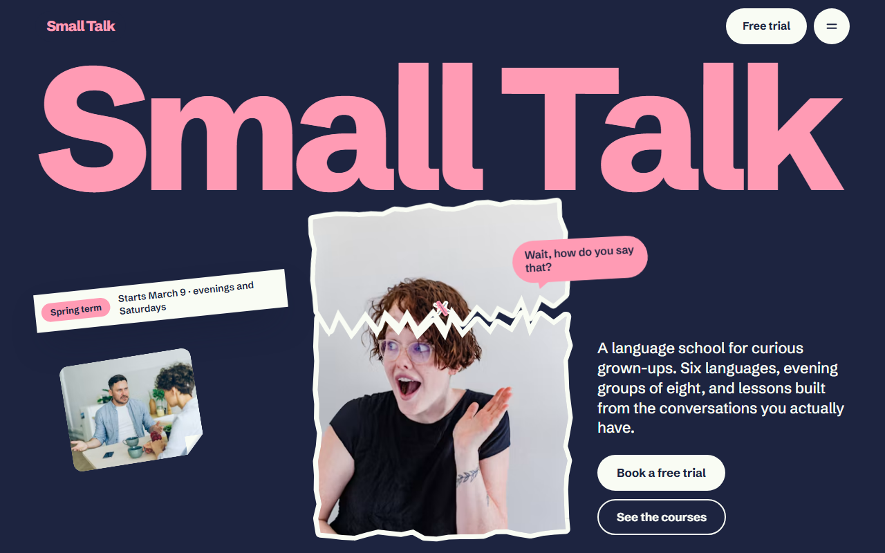
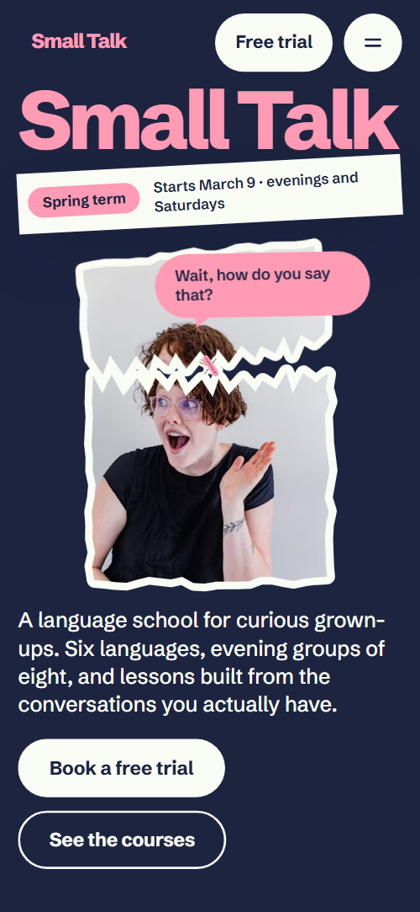
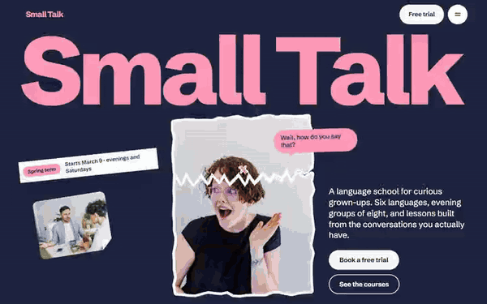

# Free HTML language course website template with GSAP scroll animations

This language course website template is a free one-page HTML site for a school that teaches adults in small evening groups. It has six syllabus cards, six languages with times, four teachers, a level finder, three fees and a trial form, in navy and pink with torn-paper photo stickers. One index.html and AGENTS.md let an AI agent adapt it.

[](LICENSE)  

**[Live demo](https://8bsite.github.io/language-course-website-template/)** · **[Use this template](https://github.com/new?template_name=language-course-website-template&template_owner=8bsite)** · **[Download ZIP](https://github.com/8bsite/language-course-website-template/archive/refs/heads/main.zip)** · **[Template page on 8b.com](https://8b.com/templates/small-talk/)**

<a href="https://8bsite.github.io/language-course-website-template/"></a> <a href="https://8bsite.github.io/language-course-website-template/"></a>

<p align="center"><a href="https://8bsite.github.io/language-course-website-template/"></a><br><sub>Scroll animation</sub></p>

## Use it with Claude Code, Cursor or Codex

Download the four files into your project folder (`curl.exe` in Windows PowerShell):

```bash
curl -LO https://raw.githubusercontent.com/8bsite/language-course-website-template/main/index.html
curl -LO https://raw.githubusercontent.com/8bsite/language-course-website-template/main/AGENTS.md
curl -LO https://raw.githubusercontent.com/8bsite/language-course-website-template/main/LICENSE
curl -LO https://raw.githubusercontent.com/8bsite/language-course-website-template/main/CREDITS.md
```

Then fill in the angle brackets and give your agent this prompt:

```text
Read AGENTS.md, then edit index.html. Turn it into the site for <my school: name, city and address, languages or subjects, levels, lesson days and times, term dates, teachers, clubs or trips, fees and refund terms, how people book a trial>. Replace first the brand name with its --len, the languages, times, fees and teachers. Keep the section ids, the classes AGENTS.md lists and exactly three level questions, or change the result ranges. Ask me for missing facts; never invent prices, dates, teacher bios, refunds or contacts.
```

Start with the six languages and their times, the three fees, the four teachers, the clubs, the trips and the contact block. Rename the brand and update the wordmark's --len, which sizes the first-screen wordmark. In Claude Code, Cursor or Codex, vibe coding goes fastest when you supply refund terms, hours and teacher bios yourself. Teacher photos are stock portraits of real people: replace them with your own staff.

No agent? Click **[Use this template](https://github.com/new?template_name=language-course-website-template&template_owner=8bsite)**, edit `index.html` on GitHub and turn on **Settings > Pages**.

## Sections and motion

- **Navigation**: fixed bar: pink wordmark, Free trial button and a menu button; full-screen menu with seven links, address and phone; hides on scroll down. The bar slides up out of view while you scroll down and returns on the way up, and the full-screen menu opens from a button and closes on Escape while Lenis smooth scrolling pauses.
- **Small Talk**: two screens: giant wordmark, a torn portrait sticker with a bubble, a term tape and intro with two buttons; then a statement surrounded by eight greeting bubbles. On load the wordmark rises, the portrait lands and the tape and intro slide in, then scrolling lifts the torn cap off the portrait, tilts the portrait and bursts eight bubbles around the statement, whose words light up one by one.
- **The syllabus is your Tuesday**: six week cards with a photo, week badge, situation and a phrase in the language, on a 3 by 2 plan. As the plan scrolls in, six photos fly from scattered sizes and turns onto their slots with corners pressed flat, and the heading lines rise.
- **Six languages around one table**: six large language names, each with a greeting bubble, levels and lesson times. A divider is drawn across each row and each greeting bubble is slapped on with a turn when it arrives.
- **Who’s talking? Our teachers**: four teacher stickers behind name bars, each with a hello bubble and a short bio. Each teacher pops up out of the name bar turning upright, one after another, and the hello bubble pops in after them.
- **After class Where’s everyone?**: four dated event rows: supper club, film night, market walk, pub quiz. The heading lines rise and a hairline is drawn across each of the four event rows.
- **Overheard in class**: four student quotes on torn notes, ripped off a pad one after another (pinned screen). The screen pins for about two and a half screens of scroll while four notes are ripped off a pink pad, lifted with a turn and set in their places.
- **Weekends abroad Say it where they say it**: four postcards (Lisbon, Lyon, Osaka, Oaxaca) that travel sideways on a pinned pink screen, each stamped with a greeting. The screen pins while the four postcards travel sideways for as far as the track overflows, and each postmark is stamped on as its card comes into view.
- **Not sure where to start?**: a three-question chat with reply buttons that suggests a group. Each reply you click sets a score, and the sum of three answers decides which group bubble shows; the question bubbles are slapped on as they arrive.
- **Fees with no small print**: three plans and a note called The small print, at full size. The small print starts as a tiny turned scrap and grows to a readable note as it scrolls in, and each price is slapped on with a turn.
- **Say hello in any language**: address, hours, phone, email, a room photo and a free-trial booking form. The heading lines rise and the room photo is slapped on with a turn.
- **Footer**: a grinning face peeking in with a bubble, six links, copyright with the Design: 8B credit, phone, email, Privacy. The face rises into the footer turning, then its bubble pops in.

## Design

 navy ground of the opening, syllabus, languages, voices, level and contact sections, and the dark text on pink and cream  
 body text on navy, the fees ground, sticker rims, quote notes, cream buttons and the second kind of bubble  
 the accent: wordmark, heading accent words, bubbles, badge, trips ground, teacher name bars, club dates, the small-print note, button sweep and focus ring  
 charcoal ground of the teachers and after-class sections  
 lead paragraphs, captions, teacher bios and club texts on navy or charcoal  
 hairlines between rows, form field borders, menu and footer link dividers, the peeled corner's shade  
 deep navy of the full-screen menu, the contact form panel, field fills and the footer

**Schibsted Grotesk**: the only typeface, as a variable font from 400 to 800: weight 800 with tight tracking for the wordmark, headings and prices, 700 for statements and titles, 500 to 600 for leads and bubbles, 400 for body text (Google Fonts). A giant wordmark fills the width of the first screen, with a tilted tape, a torn portrait sticker and the intro around it. Several sections pair a heavy heading on the left with a short lead on the right, then a list: cards, rows with hairline rules, name bars or plans. Photos get torn edges or a peeled corner, bubbles carry greetings in six languages, and the ground shifts from navy to charcoal, pink and cream.

## Questions

**Is this a language school website template free for commercial use?**  
Yes. It is a single index.html under the MIT license, so a school, a freelancer or an agency can use it for a client at no cost. GSAP, ScrollTrigger, SplitText and Lenis load from jsDelivr, and there is no build step. The photos come from Unsplash and the typeface, Schibsted Grotesk, is under the Open Font License.

**Can students book a trial lesson on the page?**  
Not yet. Every trial button jumps to the contact form, which requires a name and an email, shows a thank-you line and clears itself without sending anything. Connect Formspree or Netlify Forms with the steps in AGENTS.md, or point the buttons at your booking system, and rewrite the thank-you line, which promises a call within a day.

**Can I get a language school site like this without editing code?**  
Yes, with [8B's AI website builder](https://8b.com/templates/8b/): describe your school in a sentence and its engine designs a new site, not this template. Designing and restyling are free. Publishing with hosting and SSL, full HTML export and AI edits in chat are on Pro, $9 a month billed yearly. It also runs inside Claude and ChatGPT through the 8B connector.

## Is it the right base?

Choose it for a school with groups, terms and a talkative brand. A plainer, flat-colour site is closer in the [white template with coloured panels](https://8b.com/templates/saylo/). As a language school template it has weak spots: one page, no course catalogue or student login, a form that sends nothing yet, and a twelve-week syllabus beside ten-week courses. Owners who would rather not edit code can use the 8B builder.

## Before you publish

- Replace what is marked `data-8b-placeholder` (social preview image, favicon, phone, form, email) and the invented demo facts; [AGENTS.md](AGENTS.md) lists them.
- The form sends nothing yet: connect it to Formspree or Netlify Forms, or remove it.

## Tech

GSAP 3.13.0, ScrollTrigger, SplitText, Lenis 1.3.4 from jsDelivr, 98 KB, no build step. Chrome and Edge 111+, Safari 16.2+, Firefox 113+ (it uses color-mix(), container query units, cascade layers, small/dynamic viewport units). With "reduce motion" on, the page is complete and still.

## License

MIT, see [LICENSE](LICENSE). Photos, fonts and libraries keep their own licences: [CREDITS.md](CREDITS.md). More free templates: [8b.com/templates](https://8b.com/templates/) · [github.com/8bsite](https://github.com/8bsite).
