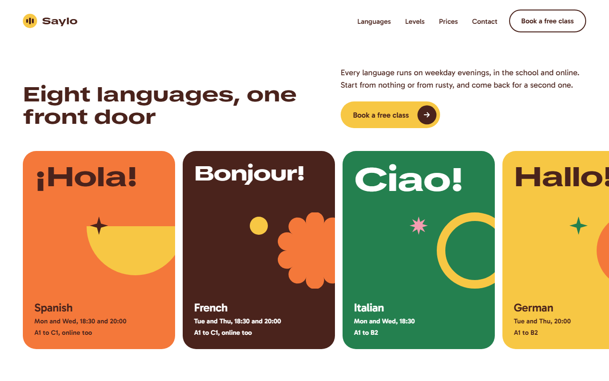
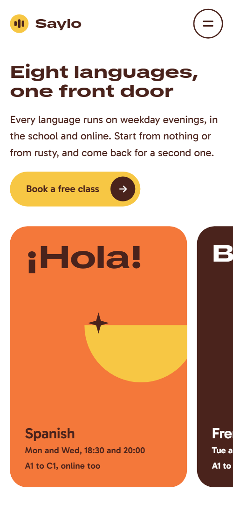
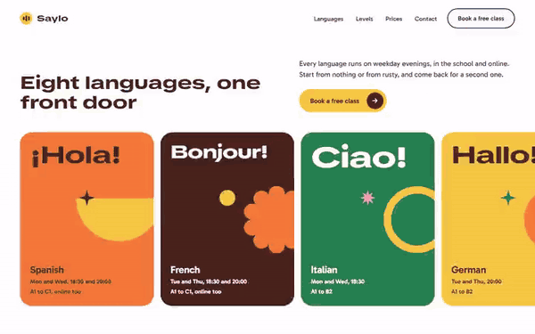

# Free HTML language school website template with GSAP scroll animations

This language school website template is one free HTML file for a school or evening class provider teaching adults. It has eight languages on a sideways track, five level bars, a week of classes, three prices and a free-class offer, in wide heavy headings and flat colour shapes. AGENTS.md is included, so an AI agent can adapt it.

[](LICENSE)  

**[Live demo](https://8bsite.github.io/language-school-website-template/)** · **[Use this template](https://github.com/new?template_name=language-school-website-template&template_owner=8bsite)** · **[Download ZIP](https://github.com/8bsite/language-school-website-template/archive/refs/heads/main.zip)** · **[Template page on 8b.com](https://8b.com/templates/saylo/)**

<a href="https://8bsite.github.io/language-school-website-template/"></a> <a href="https://8bsite.github.io/language-school-website-template/"></a>

<p align="center"><a href="https://8bsite.github.io/language-school-website-template/"></a><br><sub>Scroll animation</sub></p>

## Use it with Claude Code, Cursor or Codex

Download the four files into your project folder (`curl.exe` in Windows PowerShell):

```bash
curl -LO https://raw.githubusercontent.com/8bsite/language-school-website-template/main/index.html
curl -LO https://raw.githubusercontent.com/8bsite/language-school-website-template/main/AGENTS.md
curl -LO https://raw.githubusercontent.com/8bsite/language-school-website-template/main/LICENSE
curl -LO https://raw.githubusercontent.com/8bsite/language-school-website-template/main/CREDITS.md
```

Then fill in the angle brackets and give your agent this prompt:

```text
Read AGENTS.md, then edit index.html. Make this the site for <my school: name, city, address, languages with days, times and level ranges, weekly clubs and walks, the free class offer, prices, student quotes with permission, opening hours, how people book>. Replace first the school name, greetings and Leeds details, then prices, quotes and portraits. Keep the section ids, the classes AGENTS.md lists and each --lv-step; set each greeting's --len to its character count. Ask me for missing facts and never invent timetables, prices, teachers, quotes or contacts.
```

Vibe coding with Claude Code, Cursor or Codex starts with facts only the school has: languages, days and times, level ranges, prices, the free class offer, hours and address. The demo invents all of them, plus the five student quotes, shown with stock portraits. Ask the agent to change each greeting and its --len value, keep every --lv-step on the level bars, leave the section ids and the animation classes from AGENTS.md alone, and never invent teachers, prices or results.

No agent? Click **[Use this template](https://github.com/new?template_name=language-school-website-template&template_owner=8bsite)**, edit `index.html` on GitHub and turn on **Settings > Pages**.

## Sections and motion

- **Navigation**: top bar: three-bar mark and wordmark, four links, a Book a free class button and a menu button on phones; a full-screen overlay. The bar hides on scroll down once past 120px and returns on scroll up, and a white pill fades in behind it after 40px.
- **Eight languages, one front door**: first screen: h1 "Eight languages, one front door", a short paragraph with a button, and a pinned sideways track of eight language panels with a greeting, a name, days and levels. Pinned: the eight panels slide sideways as you scroll, and the shapes on panels that start off screen swing upright as they arrive.
- **From hello to holding your own**: five level bars rising like a voice meter, each with a code and a short text (demo: A1 First words to C1 Thinking in it). As the list crosses the screen the five bars grow one after another, upward on desktop with each code riding the top and sideways under 900px.
- **A week at Saylo**: four rows for the week with a pill and text, two of them with photos (demo: evening classes, Friday conversation clubs, Saturday market walk, online). The heading block lifts and fades in once, and each day pill springs in small and turned.
- **Sit in on a real class before you pay a penny**: a panel with a heap of coloured shapes, a heading, a sentence and a Book a free class button (demo: sit in on a real class before you pay). As the panel scrolls in, six shapes drop and bounce onto a half-disc that rocks and settles.
- **Three ways in**: three price rows, each with a shape, a name, a line, a price and a button (demo: Group course £260, Private lessons £38 an hour, Club pass £45 a term). The heading block and each row lift and fade in once, and the shape inside each white circle springs in.
- **Overheard at Saylo**: a pinned chat thread of five student sayings, each a face, a line in the language and its English meaning (demo: Spanish, Italian, French, Portuguese, German). Pinned for half a screen per bubble: each face and bubble pops in from its side in turn while the thread climbs to keep the newest line in view.
- **Questions people ask before the first class**: five questions and answers as native &lt;details&gt; rows beside a heading with three popping shapes. The heading block lifts in once, three shapes spring in, and an opened question turns its plus into a cross.
- **Say your first sentence in a new language this week, in a room of six people who are trying too.**: a speech bubble with a closing statement and a Book a free class button, then four details (visit, call, write, front desk hours). The cream ground opens from a narrow pill into the full speech bubble, its tail grows in, the second half of the statement turns from grey to full colour word by word and three sparkles spring in.
- **Footer**: a row with two links, the three-bar mark and wordmark, two links, then the school's address and three social buttons. The three-bar logo mark springs in.

## Design

 page background, the pill behind the nav bar once scrolled, level code tags, the circles holding the price shapes, text on dark panels  
 all main text, the menu overlay, the trial panel, the dark language panels, the Private lessons row, the C1 level bar, the button hover fill  
 the cream ground and tail of the closing speech bubble  
 orange panels, price row, level 3 bar, day pill and chat bubble  
 the main button fill, the logo mark, the FAQ plus circle, yellow panels, pills and bubbles  
 green panel, level 4 bar, day pill and chat bubble  
 pink panel, level 1 bar and chat bubble  
 blue panel, price circle shape, day pill and chat bubble  
 small captions, level descriptions, the thread and FAQ leads, contact labels  
 the second half of the closing statement before it inks in  
 hairlines between rows and questions, placeholder behind photos, the trial panel's paragraph

**TikTok Sans**: extra-wide (150% width) weight 800 for headings, the wordmark, language greetings, price amounts, day pills and the menu overlay links. **Gabarito**: body text at 17px weight 400, semibold buttons, tags and small labels (weights 400 to 700 load) (Google Fonts). A 1240px column on a white page. Most sections open with a heading and a short paragraph side by side. Below come eight coloured language panels, five level bars in a row, a sticky heading beside four timetable rows, a dark panel with a pile of shapes, three pill-shaped price rows, a chat thread and the questions in two columns, and a cream speech bubble above four contact details. Corners are pills or 28px, 48px on the closing bubble.

## Questions

**Does the booking button send anything?**  
No. There is no form. The three Book a free class buttons in the nav, menu and first screen jump to the trial section, and the other five buttons open the visitor's email app on a placeholder address. Point them at your booking or checkout pages, or add a form service such as Formspree or Netlify Forms.

**Can I get a site like this without editing code?**  
Yes, with [8B's AI website builder](https://8b.com/templates/8b/). You describe the school in a sentence and it designs a new site, in its own design rather than this template. Designing and restyling are free. Publishing with hosting and SSL, HTML export and AI edits in chat are on Pro at $9 a month billed yearly. It also runs in Claude and ChatGPT.

**What happens with reduced motion or without JavaScript?**  
With reduced motion the pinned scenes and smooth scrolling switch off, so the language panels become a plain grid and the thread a list. The hiding nav bar and hover fills keep running. Without JavaScript the FAQ still opens, but the phone menu does nothing and the sideways track stays one clipped row, so later panels cannot be reached.

## Is it the right base?

This is the right base for an adult school with several languages, fixed evening groups and a free first class. Parents choosing a place for small children are better served by a [day nursery](https://8b.com/templates/mallow-house/) page with rooms by age. The weak spot is booking: there is no calendar and no form, only mailto buttons, so a school with live timetables needs a booking tool. For no code at all, 8B builds sites from a sentence.

## Before you publish

- Replace what is marked `data-8b-placeholder` (social preview image, favicon, email, phone, social) and the invented demo facts; [AGENTS.md](AGENTS.md) lists them.

## Tech

GSAP 3.13.0, ScrollTrigger, SplitText, Lenis 1.3.27 from jsDelivr, 79 KB, no build step. Chrome and Edge 108+, Safari 16+, Firefox 110+ (it uses container query units, cascade layers, small/dynamic viewport units). With "reduce motion" on, the page is complete and still.

## License

MIT, see [LICENSE](LICENSE). Photos, fonts and libraries keep their own licences: [CREDITS.md](CREDITS.md). More free templates: [8b.com/templates](https://8b.com/templates/) · [github.com/8bsite](https://github.com/8bsite).
