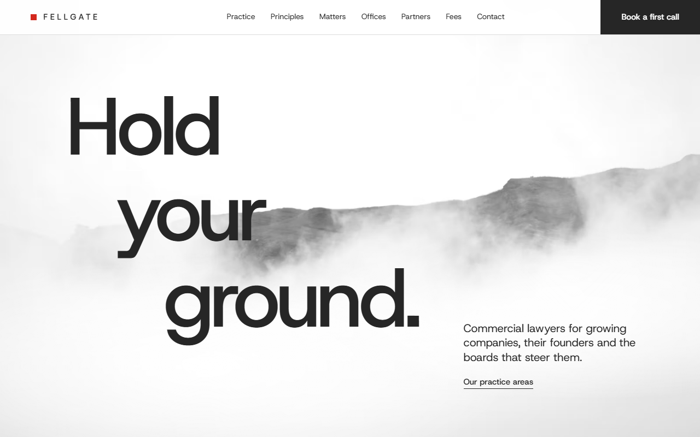
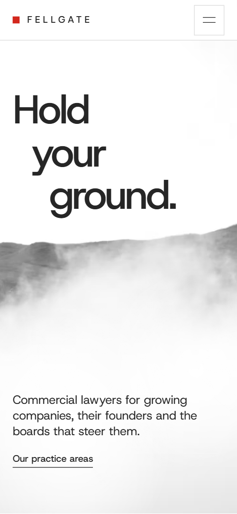
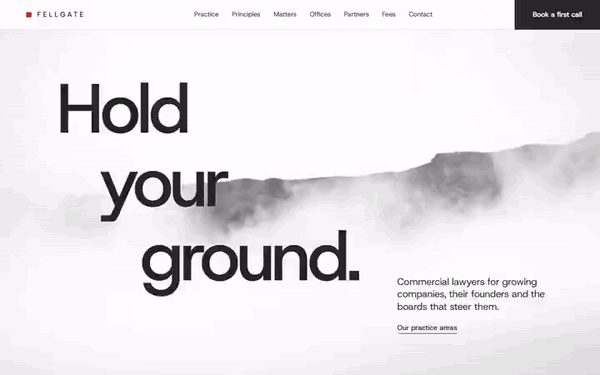

# Free HTML law firm website template with scroll animations and no libraries

Law firm website template: one free index.html for a commercial practice advising companies and boards, with four full-screen practice panels, matters, three offices, six partners, a fee scale and a contact form. Most photos are greyscale; one red marks the practice shapes and fee bars. Its scroll motion is CSS, no libraries; AGENTS.md guides Claude Code or Cursor.

[](LICENSE)  

**[Live demo](https://8bsite.github.io/law-firm-website-template/)** · **[Use this template](https://github.com/new?template_name=law-firm-website-template&template_owner=8bsite)** · **[Download ZIP](https://github.com/8bsite/law-firm-website-template/archive/refs/heads/main.zip)** · **[Template page on 8b.com](https://8b.com/templates/fellgate/)**

<a href="https://8bsite.github.io/law-firm-website-template/"></a> <a href="https://8bsite.github.io/law-firm-website-template/"></a>

<p align="center"><a href="https://8bsite.github.io/law-firm-website-template/"></a><br><sub>Scroll animation</sub></p>

## Use it with Claude Code, Cursor or Codex

Download the four files into your project folder (`curl.exe` in Windows PowerShell):

```bash
curl -LO https://raw.githubusercontent.com/8bsite/law-firm-website-template/main/index.html
curl -LO https://raw.githubusercontent.com/8bsite/law-firm-website-template/main/AGENTS.md
curl -LO https://raw.githubusercontent.com/8bsite/law-firm-website-template/main/LICENSE
curl -LO https://raw.githubusercontent.com/8bsite/law-firm-website-template/main/CREDITS.md
```

Then fill in the angle brackets and give your agent this prompt:

```text
Read AGENTS.md, then edit index.html. The site presents <our firm: name and legal form, practice areas, partners and direct lines, office addresses and phones, publishable matters, how we charge, regulator and registration number>. Replace first the firm name, legal line, matters, partners and cities.Keep the ids and classes AGENTS.md lists, each practice panel's data-figure and red pieces, the h1's three short lines, --city-i centred on zero, the gate script and the data-8b attributes; add no animation library. Never invent fees, results, client names, regulators, addresses or contacts; ask me.
```

Used as a law firm website template for Claude Code, Cursor or Codex, a vibe coding pass starts with the legal facts: the footer's legal form, registration and regulators, then the six matters, published only with clients' consent. The partners' stock portraits show real people: replace them along with names and direct lines. The fee cap's stop line sits where its bar ends, now 52%. The head count, founding year, team sizes, deal ranges, response times and pro bono figures are invented; the agent asks for each.

No agent? Click **[Use this template](https://github.com/new?template_name=law-firm-website-template&template_owner=8bsite)**, edit `index.html` on GitHub and turn on **Settings > Pages**.

## Sections and motion

- **Navigation**: fixed bar: logo, seven section links and a Book a first call button; hides on scroll down; full-screen menu below 1000 px. While you scroll down the bar slides up out of view, and it slides back as soon as you scroll up.
- **Hold your ground.**: two screens: a monochrome mountain photo in fog with the stepped h1 and a lead, then a statement and a paragraph about the firm inked out of the white. On load the photo settles from a zoom, the three heading words rise in turn and two fog bands drift sideways; scrolling then grows, brightens and (on wide screens with a mouse) blurs the photo, pushes the lines apart until they fade, lifts the mist and inks the statement word by word.
- **Four practices, one standard: advice you can act on the same day.**: intro and four full-screen practice panels that stack, each with a photo over red shapes, a two-line title, text and key terms. Held on screen while you scroll, each full-screen panel slides up over the one before, which darkens, as its red pieces open out of one small block into the panel's own figure and the title slides in from the left; the index of the four practices stays in view, underlines the current one and fades after the last panel.
- **Five promises, written into every engagement letter.**: five promises in red serif in a two-column staircase of hairline cells, beside an intro and a link to fees. On wide screens the staircase assembles with the scroll, right-hand cells stepping down from half a cell higher while left-hand cells rise 60 px; on phones every second cell slides in from the left edge to its place on the right.
- **Recent matters, told plainly.**: table of six recent matters: year, client, matter, outcome. Once, as each of the six rows comes into view, its hairline draws from the left and the year, client, matter and outcome rise into place.
- **Three offices, and partner firms in twelve more countries.**: an arc of ten city photos turning around a paragraph, then three office addresses and phones. Scrolling turns the ring of ten city photos 40 degrees into place as it rises, each photo settling from a closer crop; below it, a hairline draws over each office and its lines rise once.
- **Seventy lawyers. Six partners sign the letters.**: six partner portraits with practice, city and direct line, carried sideways by the scroll. Held on screen while you scroll, the row of six portraits travels sideways from the first to the last, each photo shifting a little inside its frame; tabbing to an off-screen card scrolls the page to it.
- **One working day in ten belongs to people who could never pay for it.**: a photo beside a large statement and three items of pro bono work. The statement darkens word by word from pale grey as you scroll it up, and the mountain photo drifts slowly inside its frame.
- **Fees agreed before the work, in writing.**: three fee types on one scale: red bars for fixed, capped and hourly, with their terms. Row by row with the scroll, each red bar grows from a small square to its reach, the cap's dark stop line grows upward, and the fee name and terms fade in from 25% opacity.
- **Questions clients ask before the first call.**: six questions and answers (native &lt;details&gt;) beside a heading and a Book a first call button. Once, as each question arrives, its hairline draws across and the question rises into place; opening an answer turns its plus into a minus.
- **Tell us where you need to stand. A partner will call you back within one working day.**: closing statement, four office photos dealt into a row, a contact form (no back end yet) and phone, email and out-of-hours line. The four office photos start as one tilted pile in the middle of the strip and deal out into their row as you scroll (two by two on phones), while the statement above darkens word by word.
- **Footer**: logo, five policy links, the regulation line and the copyright with the Design: 8B credit.

## Design

 page ground, promise cells, the full-screen menu, the fog and mist over the opening photo, button text  
 text, logo, dark buttons, the cap's stop line on the fee scale, the shade that darkens a covered practice panel  
 ground of the practice section and its four panels  
 the one accent: logo square, practice shapes, serif promises and fee names, fee bars, the hover fill of buttons and icons  
 small grey text (notes, addresses, promise and fee lines, the legal line), form labels and underlines, table heads and years, the rules between questions  
 hairlines (nav edge, table rows, promise cells, fee tracks, footer edge), empty photo frames, the pale start of the ink effect  
 ground of the partners, questions and footer

**Host Grotesk**: everything except the promises and fee names: body text at 400; headings, the huge h1 and practice titles, uppercase labels, buttons and the letter-spaced logo at 500. **Source Serif 4**: light 300 weight in red, only for the five promises and the three fee names (Google Fonts). Four sections open alike: a large heading at the left, a short note at the right aligned to its foot. The opening is two full screens over one fog photo. Each practice panel is a three-column grid: a tall photo in the middle over red blocks, a two-line title across the grid at mid-height, text lower left, terms lower right. Hairlines divide table rows, offices, fee rows and questions; the promises stand in a staircase of bordered cells.

## Questions

**Can a US attorney use it?**  
Yes, after a pass over the legal terms. The demo names Scots, English and Irish law, the Court of Session, three UK and Irish regulators, an LLP registered in Scotland, sums in pounds and a Modern slavery statement link. Swap in your state bar, courts and currency and it works as an attorney website template.

**Where does the new-matter form send its messages?**  
Nowhere until you connect it. The browser requires a name and an email; with JavaScript the form shows the thank-you text in data-sent and clears the fields, and without JavaScript it posts to #contact. AGENTS.md gives the Formspree and Netlify Forms steps. The Matter menu lists the four demo practices plus Not sure yet: match it to yours.

**Can a law firm get a site like this without editing code?**  
Yes. [8B's AI website builder](https://8b.com/) designs a new site from one sentence about your firm, in its own design, not this template. Designing and restyling are free; publishing with hosting and SSL, full HTML export and AI edits in chat are on Pro at $9 a month billed yearly. It also runs inside Claude and ChatGPT through the 8B connector.

## Is it the right base?

Among law firm websites, pick it for a firm that wants to look composed and will explain its fees up front; bookkeeping practices will find more in the [template built for accountants](https://8b.com/templates/evenkeel/). This is the light build: the same look and scroll behaviour with no animation library and no script from a CDN, about 27 KB of code gzipped against 75 KB and four extra requests for the GSAP version. The gap is depth: one page, no page per practice or partner.

## Before you publish

- Replace what is marked `data-8b-placeholder` (social preview image, favicon, phone, form, email, social) and the invented demo facts; [AGENTS.md](AGENTS.md) lists them.
- The form sends nothing yet: connect it to Formspree or Netlify Forms, or remove it.

## Tech

No JavaScript libraries: CSS scroll-driven animations and a small inline motion script with its own smooth wheel scrolling, 106 KB, no build step. Chrome and Edge 111+, Safari 16.2+, Firefox 113+ (it uses color-mix(), cascade layers, small/dynamic viewport units). Without scroll-driven animations (Firefox today) the scroll motion and the smooth wheel are off and each section shows its finished layout (a load-in or a loop may still play); with "reduce motion" on, the page is complete and nothing moves on its own (hover effects stay).

A GSAP build of the same page is [`index.gsap.html`](index.gsap.html): GSAP 3.13.0, ScrollTrigger, SplitText, Lenis 1.3.4 from jsDelivr, 94 KB; its scroll motion also plays in Firefox. Use one of the two files.

## License

MIT, see [LICENSE](LICENSE). Photos, fonts and libraries keep their own licences: [CREDITS.md](CREDITS.md). More free templates: [8b.com/templates](https://8b.com/templates/) · [github.com/8bsite](https://github.com/8bsite).
