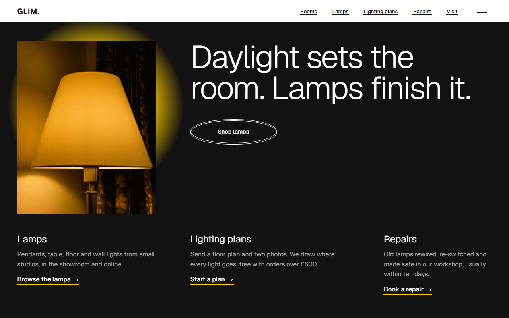
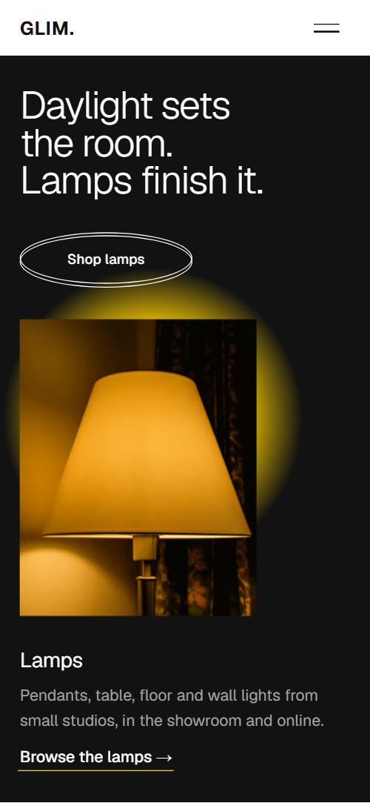
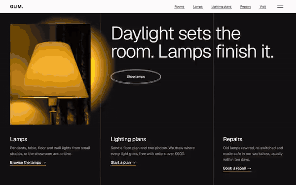

# Free HTML lighting store website template with GSAP scroll animations

Lighting store website template: a free one-page HTML site for a lamp shop or showroom that also draws lighting plans and repairs old lamps. It has six rooms, a priced lamp list, a weekend loan and a late-opening night, in light grey and ink with one yellow for the light. One file with AGENTS.md, ready for an AI agent.

[](LICENSE)  

**[Live demo](https://8bsite.github.io/lighting-store-website-template/)** · **[Use this template](https://github.com/new?template_name=lighting-store-website-template&template_owner=8bsite)** · **[Download ZIP](https://github.com/8bsite/lighting-store-website-template/archive/refs/heads/main.zip)** · **[Template page on 8b.com](https://8b.com/templates/glim/)**

<a href="https://8bsite.github.io/lighting-store-website-template/"></a> <a href="https://8bsite.github.io/lighting-store-website-template/"></a>

<p align="center"><a href="https://8bsite.github.io/lighting-store-website-template/"></a><br><sub>Scroll animation</sub></p>

## Use it with Claude Code, Cursor or Codex

Download the four files into your project folder (`curl.exe` in Windows PowerShell):

```bash
curl -LO https://raw.githubusercontent.com/8bsite/lighting-store-website-template/main/index.html
curl -LO https://raw.githubusercontent.com/8bsite/lighting-store-website-template/main/AGENTS.md
curl -LO https://raw.githubusercontent.com/8bsite/lighting-store-website-template/main/LICENSE
curl -LO https://raw.githubusercontent.com/8bsite/lighting-store-website-template/main/CREDITS.md
```

Then fill in the angle brackets and give your agent this prompt:

```text
Read AGENTS.md, then edit index.html. Make this the site for <my shop: name, city and address, opening hours, lamp types with real prices, the makers I stock, delivery and return terms, lighting plan and repair prices, loan rules, contacts>. Replace first the shop name, the six lamp prices, ten workshops and Glasgow details. Keep the section ids and the selectors AGENTS.md lists, and set the footer wordmark's --len to the new name's character count. Ask me for missing facts and never invent prices, stock, makers, hours, reviews or contacts.
```

Vibe coding with Claude Code, Cursor or Codex goes fastest when the agent has the shop's facts: six lamp prices, ten workshops, hours, address, delivery and returns, plan and loan terms, repair promises. The demo invents all of them, including the Glasgow address and the company name. Replace the name wherever it appears and set the footer wordmark's --len to its length. Room columns and lamp rows can be added or removed; the three service columns and three loan days are fixed by their grids.

No agent? Click **[Use this template](https://github.com/new?template_name=lighting-store-website-template&template_owner=8bsite)**, edit `index.html` on GitHub and turn on **Settings > Pages**.

## Sections and motion

- **Navigation**: white top bar: wordmark, five section links and a menu button that opens a full-screen overlay with seven links; hides on scroll down. The white bar slides away when you scroll down past 140 px and returns on scroll up; Lenis smooth scrolling runs page-wide.
- **Daylight sets the room. Lamps finish it.**: first screen: dark ground with two hairline rules, the headline, a Shop lamps button, a photo of a glowing lamp and three service columns. On load the two rules draw down, the heading lifts, the button opens, the photo opens from below and the three services lift in turn, while a yellow pool behind the photo drifts in a loop.
- **Light, room by room**: pinned sideways track: an intro column, six room columns (kitchen, bath, bedroom, living, study, hall) and a closing column with a button. Pinned: six room columns slide sideways, and as each reaches the middle its yellow strip rises, its photo goes from dim grey to colour and its squiggle draws.
- **Six ways to light a room**: list of six lamp types with a price, a link and one photo frame beside the list that changes as each type is read. On desktop one photo frame stays on the right and each next lamp photo rises into it as its row is read, while a yellow bar along the list's left edge rises and drops with each row.
- **A plan before a single hole is drilled**: split section: heading, paragraph and a photo on the left, three numbered steps and a button on the right. The heading block rises in, the photo goes from dim grey to full light as it crosses the screen and a hairline draws above each step.
- **Made by hands, not lines**: left heading and paragraph, right a list of ten workshops with city and what they make. Each workshop name thickens from light to bold as its row nears the middle of the screen, and its rule turns yellow and heavier.
- **Borrow a lamp for the weekend**: loan offer: heading, paragraph, button and note beside a large photo, then three day columns (Friday, The weekend, Monday). The heading block rises in, the photo switches on from grey and a yellow bar draws over each of the three days.
- **Bring us the lamp you cannot throw away**: repair offer with a before and after photo of an old lamp and four numbered steps. A yellow line sweeps down the framed photo and leaves the colour copy behind it, while the four steps light in turn.
- **Before the lamps arrive**: heading with a link to the contact form beside five questions as native details elements. The heading rises in and a hairline draws above each of the five questions as it arrives.
- **Open till nine on Thursdays**: dark section about late opening: a two-part heading, a round photo, hours and a link. The round photo opens from a thin slit to a full circle while it zooms out, its rings stretch and the two heading lines slide in from opposite sides.
- **Come and see them lit**: address, opening hours, phone and email on the left, a contact form on the right. A yellow glow behind the address grows and brightens as it scrolls into view, and the heading block rises in.
- **Footer**: dark footer: shop links, showroom address, phone and email, a large wordmark and the copyright line. The large wordmark thickens and turns from grey to yellow as it scrolls into view.

## Design

 page background and the text colour of links on their hover fill  
 text, hairline rules, outlines, the dark first screen, the late-opening section, the footer and the menu overlay  
 top bar, makers section background and text on the dark sections  
 the light: glows, photo strips, lit lamp-list lines, makers row rules, repair line and step bars, loan day bars, button hover fill, footer wordmark  
 notes, price lines, the product line under each workshop's city, unlit repair steps and photo placeholders  
 body text on the dark sections, the first screen rules, the late-opening rings and the footer's resting wordmark

**Geist**: the only typeface, one variable file for weights 200 to 800: light headings, regular body, medium buttons and links, bold wordmarks, with workshop names and the footer mark changing weight on scroll (Google Fonts). A three column grid (about 34, 38 and 28 percent) returns in the first screen, loan, repairs and footer, divided by hairline rules. The first screen is dark, with two rules, a photo in the first column and three service columns along the bottom. Light sections alternate with a white makers list and a dark late-opening section with a round photo. Six room columns run sideways in one pinned track, and the lamp list keeps one photo frame beside it.

## Questions

**Can I get a site like this without editing code?**  
Not this file; it needs a coding agent or a developer. [8B's AI website builder](https://8b.com/templates/8b/) designs a new site, with its own look, from a sentence. Designing and restyling are free. Publishing with hosting and SSL, full HTML export and AI edits in chat are on Pro at $9 a month billed yearly. It also runs inside Claude and ChatGPT.

**Can it be a home decor ecommerce website template with a basket?**  
No. There is no basket, checkout or product database. Every button jumps to an anchor on the page. Point the shop buttons and the six room links at your online shop or category pages, or keep the enquiry form for a showroom that sells in person.

**Does the contact form send messages?**  
No. As shipped, the script checks the name, email and message, shows a thank-you line and sends nothing. Connect it to Formspree or Netlify Forms, or delete the form and keep the phone and email. Without JavaScript it shows no thank-you line at all.

## Is it the right base?

This is a good base for a shop that sells by showing lamps lit, drawing plans and mending old ones. It has no basket, so a shop with checkout needs its own links on the buttons. A designer who sells a method rather than products may prefer the [interior colour studio](https://8b.com/templates/pervenche/) template. Not a coder? 8B can build a different site from a sentence.

## Before you publish

- Replace what is marked `data-8b-placeholder` (social preview image, favicon, phone, email, form) and the invented demo facts; [AGENTS.md](AGENTS.md) lists them.
- The form sends nothing yet: connect it to Formspree or Netlify Forms, or remove it.

## Tech

GSAP 3.13.0, ScrollTrigger, Lenis 1.3.4 from jsDelivr, 91 KB, no build step. Chrome and Edge 111+, Safari 16.2+, Firefox 113+ (it uses color-mix(), cascade layers, small/dynamic viewport units). With "reduce motion" on, the page is complete and still.

## License

MIT, see [LICENSE](LICENSE). Photos, fonts and libraries keep their own licences: [CREDITS.md](CREDITS.md). More free templates: [8b.com/templates](https://8b.com/templates/) · [github.com/8bsite](https://github.com/8bsite).
