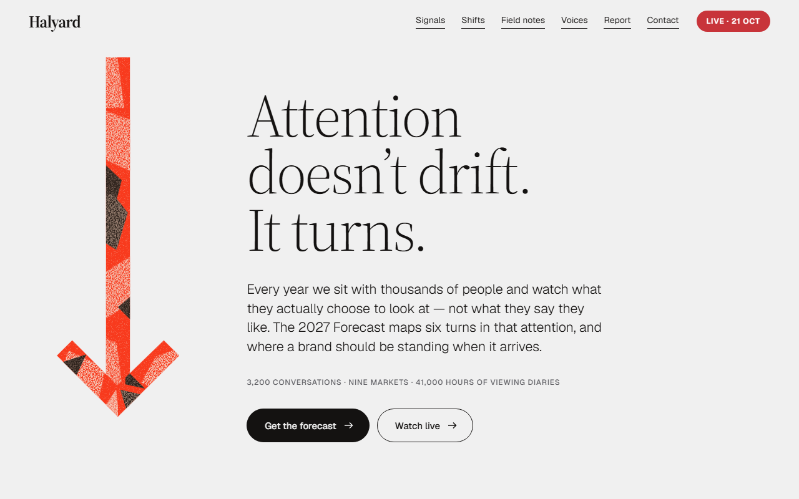
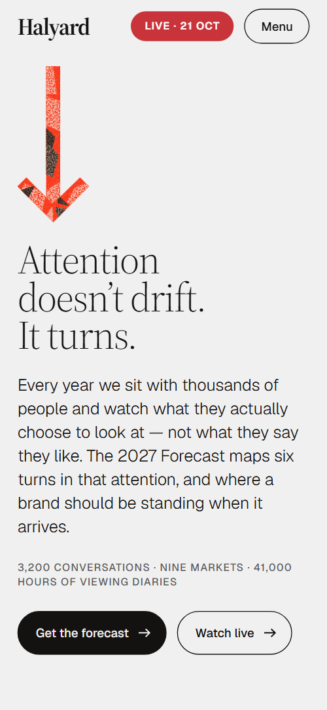
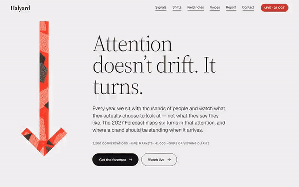

# Free HTML marketing agency website template with scroll animations and no libraries

Marketing agency website template: one free HTML file for a communications studio that publishes a yearly research report and runs a live series. It holds six research signals, a ledger of old and new measures, four dated sessions and two forms, in grey, black and vermilion paper cut. Its scroll motion runs on CSS with no libraries.

[](LICENSE)  

**[Live demo](https://8bsite.github.io/marketing-agency-website-template/)** · **[Use this template](https://github.com/new?template_name=marketing-agency-website-template&template_owner=8bsite)** · **[Download ZIP](https://github.com/8bsite/marketing-agency-website-template/archive/refs/heads/main.zip)** · **[Template page on 8b.com](https://8b.com/templates/halyard/)**

<a href="https://8bsite.github.io/marketing-agency-website-template/"></a> <a href="https://8bsite.github.io/marketing-agency-website-template/"></a>

<p align="center"><a href="https://8bsite.github.io/marketing-agency-website-template/"></a><br><sub>Scroll animation</sub></p>

## Use it with Claude Code, Cursor or Codex

Download the four files into your project folder (`curl.exe` in Windows PowerShell):

```bash
curl -LO https://raw.githubusercontent.com/8bsite/marketing-agency-website-template/main/index.html
curl -LO https://raw.githubusercontent.com/8bsite/marketing-agency-website-template/main/AGENTS.md
curl -LO https://raw.githubusercontent.com/8bsite/marketing-agency-website-template/main/LICENSE
curl -LO https://raw.githubusercontent.com/8bsite/marketing-agency-website-template/main/CREDITS.md
```

Then fill in the angle brackets and give your agent this prompt:

```text
Read AGENTS.md, then edit index.html. Make this the site for <my agency: name, city, yearly publication, findings and chapters, live event dates, titles and guests, team names and roles, hours, address, contacts>. Replace the figures, signals, shifts, session dates and nav live link first, then the team. Keep the gate script in the head, every id, the data-8b-section and data-8b-motion attributes and the classes AGENTS.md lists; add no animation library. Keep six signals, five field photos and the footer --len. Never invent figures, dates, names or contacts; ask me.
```

A marketing agency website template for Claude Code goes fastest when the agent gets the studio's facts first: research figures, each signal and its market count, session dates and guests, team names, address. The demo invents all of it. If you vibe code in Cursor or Codex, the agent should rename the studio in any letter case across [the single agency page](https://8b.com/templates/one-page/), set the footer wordmark's --len, update the dates by hand and replace the four portraits and their alt texts.

No agent? Click **[Use this template](https://github.com/new?template_name=marketing-agency-website-template&template_owner=8bsite)**, edit `index.html` on GitHub and turn on **Settings > Pages**.

## Sections and motion

- **Navigation**: fixed top bar: logo, six section links, a red live link; hides on scroll down; phone menu overlay. The bar hides while you scroll down and returns on scroll up; the Menu button opens a full-screen overlay below 960 px.
- **Attention doesn’t drift. It turns.**: first screen: a tall collage arrow on the left, the h1 "Attention doesn't drift. It turns.", a lead, a facts line and two buttons. Smooth wheel scrolling throughout; on load the arrow drops in and the heading, lead, facts line and buttons slide in one after another, while paper pieces flow along the arrow's shaft in a loop.
- **Six signals for 2027**: six numbered trends as a list beside a sticky dial with one big arrow that swings to each trend's bearing. The big arrow swings to each signal's bearing as that item crosses the screen centre, one dial tick per item lights red, and the other signal names grey out.
- **What brands count, and what people act on**: ledger of six old measures struck out and replaced by new ones, each with a one-line note. Row by row, red tape covers the old measure, a small arrow grows out and the new measure slides in.
- **Field notes**: a quote over five torn photos that start piled on top of it and part toward the edges, each with a city caption. Five photos start piled over the quote and part toward the edges at different angles while the stage stays pinned on wide screens, then lift away as the sessions sheet arrives.
- **Halyard Ahead: four evenings, argued live**: red paper sheet with four live session strips: date, title, guest and a Save a seat button. The red sheet arrives tilted and settles flat, and each strip swings into place from a tilt to one side as it rises into the lower part of the screen.
- **The people reading the wind**: four torn portraits on a sideways track threaded on a collage shaft: name, role and a line each. The section pins while the track of four portraits runs sideways, and each portrait's red tint slides into register as its card arrives.
- **The full forecast, free**: report cover made of an arrow and loose paper bits beside a summary of the 64-page report, seven chapters and an email form. The cover's arrow parts and three loose bits fly in from scattered positions and lock together as the cover scrolls into view.
- **Before you ask**: five questions and answers (native &lt;details&gt;) with a thin stack and two loose paper bits. Rules draw across above each question, and two loose bits drift at different speeds with the scroll.
- **Point us somewhere**: contact form and address block under a long arrow that extends across the section. The long arrow's shaft grows from the left and its head slides across to the right.
- **Footer**: large wordmark, four links, a note about the studio, copyright with the Design: 8B credit and a back-to-top button. The wordmark wipes in from the left as it scrolls into view.

## Design

 cool grey page ground, the nav bar after the first scroll, the phone menu overlay  
 text, outlines and rules, the filled button and the inactive dial ticks  
 vermilion: the arrow, the sessions sheet, the tape over old measures, the button sweep on hover, the active dial tick, photo tints  
 pink paper: loose bits and the grain over the sessions sheet and the arrow  
 dark brown paper bits and the ground behind photos  
 taupe pieces inside the arrow and the dark bits  
 the Next live and Free pills and the red live link in the nav  
 text on the red pills and the live link  
 secondary text: facts line, the signals intro, notes, captions, roles, old measures, signal names away from the centre  
 photo caption plates, session strips, the report cover and form fields

**Source Serif 4**: display headings in a light weight, the quote, signal and team names, the logo and the footer wordmark. **Geist**: body text, buttons, small uppercase labels and the thin uppercase stacks beside the section headings (Google Fonts). The first screen is two columns: a tall paper-cut arrow on the left, heading, lead and two buttons on the right. Sections then alternate a heading with a short intro and a list: signals beside a sticky dial, six ledger rows from old measure to new, four session strips, four portraits in a row, a report cover beside its form. Thin rules divide list items. The arrow returns in five sections, from a small glyph to a full-width line.

## Questions

**Can I use it as a webinar landing page?**  
Partly. The sessions section lists four dated evenings, but each Save a seat button only jumps to the contact form: there is no registration step, countdown or stream embed, so it is not a webinar registration landing page on its own. Point the buttons at your event or ticket page.

**Do the forms send anything?**  
No. The report form checks the email and the contact form checks name, email and message, then each shows a thank-you line and clears its fields. Nothing is sent or stored. Connect Formspree or Netlify Forms with the steps in AGENTS.md, or delete a form and its script.

**Can I get a site like this without editing code?**  
Yes, in another way. [8B's AI website builder](https://8b.com/) designs a new site from a sentence, with its own design rather than this template. Designing and restyling are free; publishing with hosting and SSL, full HTML export and AI edits in chat are on Pro at $9 a month billed yearly. It also runs inside Claude and ChatGPT.

## Is it the right base?

Pick it when the studio's argument is its research and the goal is report sign-ups and seats. A studio that shows its work first suits the [agency](https://8b.com/templates/sillage/) template. This light build keeps the look and scroll behaviour with no animation library and no script from a CDN: about 29 KB of code gzipped in one file, against 75 KB and four extra requests for the GSAP version. Both forms send nothing until connected.

## Before you publish

- Replace what is marked `data-8b-placeholder` (social preview image, favicon, form, email, phone) and the invented demo facts; [AGENTS.md](AGENTS.md) lists them.
- The form sends nothing yet: connect it to Formspree or Netlify Forms, or remove it.

## Tech

No JavaScript libraries: CSS scroll-driven animations and a small inline motion script with its own smooth wheel scrolling, 122 KB, no build step. Chrome and Edge 111+, Safari 16.2+, Firefox 113+ (it uses color-mix(), container query units, cascade layers, small/dynamic viewport units). Without scroll-driven animations (Firefox today) the scroll motion and the smooth wheel are off and each section shows its finished layout (a load-in or a loop may still play); with "reduce motion" on, the page is complete and nothing moves on its own (hover effects stay).

A GSAP build of the same page is [`index.gsap.html`](index.gsap.html): GSAP 3.13.0, ScrollTrigger, SplitText, Lenis 1.3.27 from jsDelivr, 113 KB; its scroll motion also plays in Firefox. Use one of the two files.

## License

MIT, see [LICENSE](LICENSE). Photos, fonts and libraries keep their own licences: [CREDITS.md](CREDITS.md). More free templates: [8b.com/templates](https://8b.com/templates/) · [github.com/8bsite](https://github.com/8bsite).
